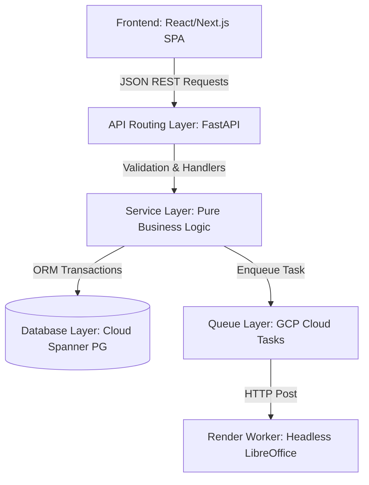

# GEMINI.md — WINDTRE Sintesi & Trasparenze Automation

Welcome! This document serves as the **Context & Engineering Playbook** for Gemini or any agentic AI coding assistant working on this repository. It defines our system architecture, directory layouts, database conventions, critical AGCOM regulatory rules, and coding standards.

Always consult this document before proposing or executing changes in the codebase.

---

## 1. Project Context & Objectives

The **WINDTRE Sintesi & Trasparenze Automation** system is an enterprise-grade, serverless platform on GCP. It automates the generation, compliance verification, lifecycle management, and publishing of:
*   **Sintesi Contrattuali (Contractual Syntheses)** in accessible **PDF/UA** formats (generated via Word `.docx` templates + LibreOffice).
*   **Trasparenze Tariffarie (Tariff Transparency Sheets)** in standard **Excel `.xlsx`** and accessible **PDF/UA** formats (generated via Excel templates + LibreOffice).

These documents must strictly adhere to the Italian communications authority (**AGCOM**) regulations and accessibility requirements, while serving **9 distinct corporate segments** across WINDTRE and Very Mobile.

---

## 2. Decoupled Architecture & Separation of Concerns

To guarantee enterprise scalability, modular testability, and fast response times, the codebase strictly enforces a **Separation of Concerns (SoC)** model, dividing the frontend, API gateways, business logic, and heavy rendering workers.



### Architectural Divisions

1.  **Frontend Layer (Client)**:
    *   An isolated single-page application (Next.js/React) deployed to Google Cloud Storage (GCS) and accelerated by Cloud CDN.
    *   Communicates with the backend exclusively via standard JSON endpoints.
    *   No direct database connections or document synthesis logic is permitted in this layer.

2.  **API Routing Layer (`app/api_routes.py`)**:
    *   FastAPI routers that act as exceptionally **thin controllers**.
    *   Responsible strictly for route definition, endpoint HTTP responses, schemas parsing (Pydantic validation), and dependency injection (User Authentication and DB sessions).
    *   **Prohibited**: Direct DB querying, business validations, and file operations. These must be delegated to the Service Layer.

3.  **Service & Domain Layer (`app/services/`)**:
    *   Contains the core business logic and state transition rules.
    *   `OfferService`: Manages offer bootstrapping, state transitions (the "4-File Co-existence" state-machine), and segment-specific dynamic layouts row checks.
    *   `DocumentService`: Houses document synthesis preparation, historical record auditing, and mappings sheet metadata packaging.

4.  **Database Layer (`app/database_models.py` / `spanner_schema.sql`)**:
    *   SQLAlchemy Declarative Base schemas mapped specifically to GCP Cloud Spanner.
    *   Strictly isolates relational transactions, indexing, and Spanner JSON column schemas from routes and rendering.

5.  **Rendering & Worker Layer (`app/document_generator.py`)**:
    *   Executes CPU-intensive document processing: XML-level `.docx` node deletions (`docxtpl`), Excel cell shifts (`openpyxl`), and tagged PDF/UA compilation (headless LibreOffice).
    *   Runs asynchronously and isolated from web server request-response threads, ensuring the API is never blocked by high-throughput rendering.

---

## 3. Core Database & Model Guidelines

We interact with Cloud Spanner using the **SQLAlchemy 2.0 Declarative ORM** and **Pydantic v2** for schemas.

### Primary Database Conventions
1.  **UUID Keys**: Primary keys are cryptographic `UUIDv4` strings. To prevent Spanner database hotspots, **generate UUIDs on the application layer** using `uuid.uuid4()`. Never rely on auto-incrementing integers or sequential IDs.
2.  **No PostgreSQL-Specific Extensions**: Since Cloud Spanner PostgreSQL Dialect supports standard relational types, do not use complex PostgreSQL-only extension functions like `gen_random_uuid()` at the schema level inside Python models. Keep `uuid4` generation on the Python application side.
3.  **Dynamic Schemas inside JSON**: Dynamic table structures (such as `structural_content` and `note_structure`) are stored in Spanner's native `JSON` column types.

### Code Map
*   [app/api_routes.py](file:///home/user/projects/pre_contratti/app/api_routes.py): Thin FastAPI router managing request-response cycles.
*   [app/services/offer_service.py](file:///home/user/projects/pre_contratti/app/services/offer_service.py): Service layer managing offer states, dynamic layouts, and validation.
*   [app/services/document_service.py](file:///home/user/projects/pre_contratti/app/services/document_service.py): Service layer managing document generation preparation, history recording, and CSV sheet compilation.
*   [app/database_models.py](file:///home/user/projects/pre_contratti/app/database_models.py): Contains the SQLAlchemy 2.0 Models (`Segment`, `User`, `Offer`, `OfferStateHistory`, `DynamicTable`) and corresponding Pydantic schemas.
*   [app/document_generator.py](file:///home/user/projects/pre_contratti/app/document_generator.py): Dedicated template rendering engine.
*   [app/database/spanner_schema.sql](file:///home/user/projects/pre_contratti/app/database/spanner_schema.sql): PostgreSQL-dialect SQL DDL schema.

---

## 4. Crucial Business Logic & Regulatory Rules

These rules are non-negotiable. Any modification to generation engines or APIs must preserve them:

### A. AGCOM Document Standards (Accessibility & Format)
*   **Standard 228 (ND to Non applicabile)**: If a dynamic cell or row value is explicitly `"ND"`, the parser must render `"Non applicabile"` in the final output.
*   **Standard 229 (Suppressing Blank Structural Gaps)**: No empty rows or placeholder borders are allowed in tables. If a row in the database has a `null` or empty value, **it must be programmatically deleted from the document XML structure** (e.g., using `remove_table_row`).
*   **Standard 230 (Footnote Placement)**: Regulatory notes, links, and variables must be anchored directly underneath the active table border, rather than floating in the page footer or in unrelated regions.
*   **Technology Badge (Bollino) Injection**:
    *   For fixed-line and FWA segments, the correct AGCOM Technology Badge (`Verde - FTTH`, `Giallo - FTTC/FWA`) must be injected into the document adjacent to the technology name in **Tabella 1**.
    *   **Alt Text**: The image element must contain descriptive alt text (e.g. *"Bollino Verde - Tecnologia Fibra Ottica FTTH"*) embedded directly inside the XML draw descriptions to support PDF/UA screen readers.

### B. Segment Segregation Matrix & RBAC
Access must be strictly restricted based on the user's active commercial segment. Do not allow users to read/edit offers belonging to segments outside their assigned group:
*   `W3_MOB_GA_CNS` (WINDTRE Mobile GA Consumer)
*   `W3_MOB_CB_CNS` (WINDTRE Mobile CB Consumer)
*   `W3_MOB_GA_MB` (WINDTRE Mobile GA Microbusiness)
*   `W3_FIX_GA_CNS` (WINDTRE Fisso GA / Cross Selling Consumer)
*   `W3_FIX_CB_CNS` (WINDTRE Fisso CB Consumer)
*   `W3_FIX_GA_MB` (WINDTRE Fisso GA / Cross Selling MB)
*   `W3_FIX_CB_MB` (WINDTRE Fisso CB Microbusiness)
*   `W3_ETN_CNS` (WINDTRE Etnico Consumer GA/CB)
*   `VERY_MOBILE` (Very Mobile Segment)

### C. Naming Autonomy & Suffix Policies
*   **Very Mobile**: The generated filenames must compile **exactly** as typed by the user in `custom_filename_sintesi` and `custom_filename_trasparenza`. **Never append automatic date/time suffixes** (e.g. `_YYYYMMDD_HHMM`) to Very Mobile files, as these violate naming autonomy.
*   **WINDTRE**: Suffixes indicating lifecycle states (e.g., `_NUOVA` or `_COD_[AGCOM_CODE]`) are appended to ensure unique identification and facilitate the 4-file co-existence rule.

### D. The "4-File Co-existence" Rule
For each active offer, the system must retain and allow simultaneous access to **4 distinct output files**:
1.  **Pair 1 (NUOVA State)**: Sintesi PDF/Word + Trasparenza Excel/PDF generated *before* an AGCOM code is assigned (indicated by `_SOCI` or `_NUOVA`).
2.  **Pair 2 (APERTA State)**: Sintesi PDF/Word + Trasparenza Excel/PDF generated *after* the AGCOM code is assigned and the offer goes active (indicated by `_COD_[AGCOM_CODE]`).

During lifecycle transitions from `NUOVA` to `APERTA`, do **not** delete or overwrite the pre-code files.

### E. Note Subdivision (Fixed vs. Variable)
*   To simplify editing, the user notes are divided.
*   **Fixed Part**: Read-only, boilerplate regulatory text.
*   **Variable Part**: Rich-text editable area for marketing customization.
*   **Compilation**: On save or during document generation, these must be concatenated with proper spacing to maintain a unified database text block.

### F. Global Update Calculations
*   **EU Giga RDA Coefficient**: Updated globally before December 31st each year. The system must recalculate the EU Gigabytes allowance dynamically based on the monthly fee (excluding VAT) and the global constant:
    $$\text{EU Gigabytes} = \left( \frac{\text{Monthly Fee (excl. VAT)}}{\text{RDA Constant}} \right) \times 2$$

---

## 5. Developer Operational Workflows

### Setup & Dependencies
To set up the development environment, install the backend dependencies:
```bash
pip install -r requirements.txt
```

### Running the API locally
Run the FastAPI development server with reload enabled:
```bash
uvicorn app.main:app --reload --port 8000
```

### Running Tests
All logic must be fully tested. Run the test suite:
```bash
pytest tests/
```

---

## 6. How Gemini / AI Assistant Should Behave

When you receive a code modification request:
1.  **Enforce the Service/Router Pattern**: Always write thin controllers inside `app/api_routes.py`. Business rules, calculations, segment checks, and DB manipulations must live inside the `app/services/` layer.
2.  **Preserve Comments & Docstrings**: Never strip existing comments or descriptive docstrings unless explicitly instructed.
3.  **Verify Spanner Compatibility**: Ensure any SQLAlchemy models are compatible with Cloud Spanner’s PostgreSQL dialect (avoid PG extensions, use app-side UUID generation).
4.  **Check AGCOM Compliance**: Always verify that any changes to document rendering do not violate Standard 228 (translating "ND"), Standard 229 (omitting unpopulated rows entirely), or Standard 230 (anchoring notes to borders).
5.  **Enforce RBAC Checking**: When modifying routers in `app/api_routes.py`, ensure segment isolation checks are properly executed on the request's current user context.
6.  **Run Tests**: If modifying core utilities, run `pytest` to make sure you didn't break template compilation or route operations.
