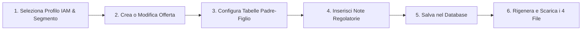
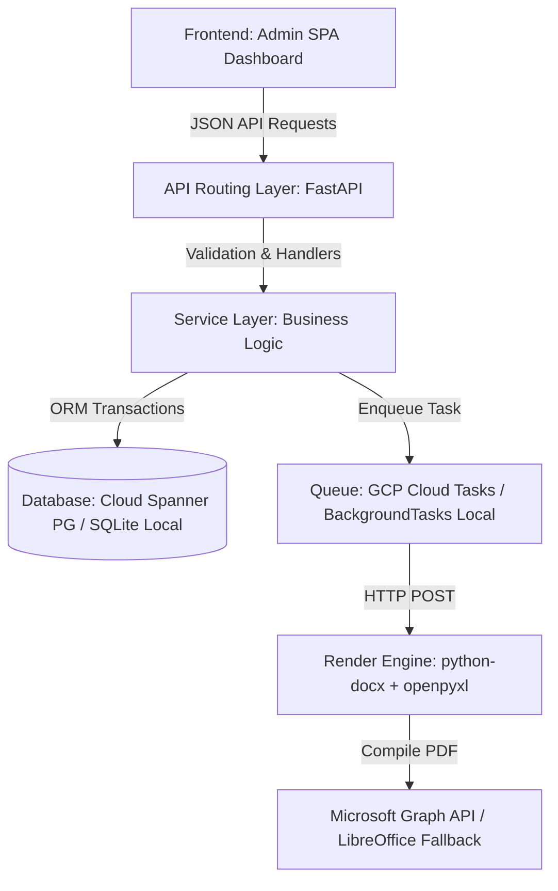

# WINDTRE Sintesi & Trasparenze Automation

[](https://www.python.org/downloads/release/python-3110/)
[](https://fastapi.tiangolo.com)
[](https://www.sqlalchemy.org/)
[](#-agcom-regulatory-compliance-standards)

An enterprise-grade document synthesis, lifecycle management, and regulatory compliance platform deployed on Google Cloud Platform. This platform automates the high-fidelity generation, AGCOM verification, and publishing of:
* **Sintesi Contrattuali (Contractual Syntheses)** in accessible **PDF/UA** formats (generated via Word `.docx` templates + Microsoft Graph API).
* **Trasparenze Tariffarie (Tariff Transparency Sheets)** in structured **Excel `.xlsx`** and accessible **PDF/UA** formats (generated via Excel templates + Spire.XLS / LibreOffice fallback).

The platform serves **9 commercial corporate segments** across WINDTRE and Very Mobile, guaranteeing strict segment data-level segregation, naming autonomy, and regulatory auditability.

---

## 👥 Accesso Rapido all'Applicazione (End-User & API Portal)

Quando il backend è in esecuzione, l'intera applicazione è accessibile direttamente via browser:

* 🖥️ **Portale Web Amministrativo (Dashboard):** [http://localhost:8000/](http://localhost:8000/)  
  *Interfaccia grafica Single-Page per la gestione delle offerte, composizione delle tabelle e rigenerazione documentale.*
* 📚 **Documentazione API Interattiva (Swagger UI):** [http://localhost:8000/docs](http://localhost:8000/docs)  
  *Esploratore interattivo per testare direttamente gli endpoint REST Pydantic.*
* 📖 **ReDoc Alternative API Explorer:** [http://localhost:8000/redoc](http://localhost:8000/redoc)
* 🩺 **Healthcheck Endpoint:** [http://localhost:8000/health](http://localhost:8000/health)

### Simulatore IAM & Ruoli Operatore
Nella barra superiore della Dashboard è integrato un **Simulatore IAM** per testare i permessi e la segregazione dei 9 segmenti:
* **Silvia Miletto:** Profilo Mobile CB Consumer (`W3_MOB_CB_CNS`)
* **Beatrice Vaccari:** Profilo Mobile GA Consumer (`W3_MOB_GA_CNS`)
* **Germana Serafini:** Profilo Very Mobile (`VERY_MOBILE`)
* **Amministratore di Sistema:** Accesso sbloccato a tutti i 9 segmenti aziendali

*Nota di sicurezza:* I pulsanti dei segmenti per i quali l'utente corrente non possiede l'autorizzazione risultano disabilitati (grigi) con badge "No Access", garantendo la segregazione dei dati regolatoria.

---

## 🔄 Flusso di Lavoro Operativo (Step-by-Step)



1. **Selezione Segmento Commerciale:** Scegli il segmento attivo nella barra laterale sinistra.
2. **Creazione / Modifica Offerta:** Clicca su **✏️ Modifica** su un'offerta esistente o seleziona **+ Nuova Offerta**.
3. **Parametri Commerciali:** Inserisci Nome Commerciale, Prezzo Base Mensile, Modalità di Pagamento e Date di Validità.
4. **Visual Table Builder (Tabelle Padre-Figlio):**
   * Configura le voci nelle 4 tabelle AGCOM (`PREZZO`, `SERVIZI`, `COSTI`, `DURATA`).
   * Aggiungi elementi primari (Padre) e dettagli secondari (Figli).
   * Se un valore non è applicabile, inserisci `"ND"`: il parser lo convertirà automaticamente in `"Non applicabile"`.
5. **Note Regolatorie & Richiami (Footnotes):**
   * Utilizza la barra strumenti Markdown (`B`, `I`, `^1^`, Link) per comporre le note.
   * Inserisci l'apice numerico nel rigo di tabella (es. `¹`) e avvia la nota corrispondente con `¹ ...`. Le note vengono ancorate automaticamente al bordo inferiore della tabella (Standard 230).
6. **Compilazione & Download:** Clicca su **Salva Modifiche** e poi su **🔄 Rigenera**: il motore compilerà all'istante i documenti scaricabili in PDF/UA, DOCX e XLSX.

---

## 📑 La Regola dei "4 File Coesistenti" (Ciclo di Vita)

Per ogni offerta commerciale, il sistema garantisce la conservazione permanente e l'accesso simultaneo a **4 file di output**:

| Fase del Ciclo di Vita | Stato Portale | Codice AGCOM | File Generati & Suffissi | Scopo Operativo |
| :--- | :--- | :--- | :--- | :--- |
| **1. Bozza / Pre-Lancio** | `NUOVA` | Assente (`None`) | `NomeOfferta_NUOVA.pdf`<br>`NomeOfferta_NUOVA.xlsx`<br>`(e relativi .docx / .xlsx)` | Validazione interna, approvazione legale, informativa sindacale (SOCI) |
| **2. Lancio Commerciale** | `APERTA` | Inserito (es. `COD1234567`) | `NomeOfferta_COD_1234567.pdf`<br>`NomeOfferta_COD_1234567.xlsx`<br>`(e relativi .docx / .xlsx)` | Pubblicazione ufficiale sul portale web e invio telematico agli archivi AGCOM |

*Regola di Conservazione:* Il passaggio di stato da `NUOVA` ad `APERTA` **non cancella né sovrascrive** i file generati in precedenza. Entrambe le coppie rimangono storicizzate nel database per finalità di audit e conformità retroattiva.

---

## ⚡ Aggiornamenti Massivi (Bulk Updates)

Gli amministratori di segmento possono aggiornare contemporaneamente più offerte commerciali:
1. Seleziona le caselle di spunta (checkbox) accanto alle offerte desiderate nella tabella.
2. Clicca sul pulsante **Modifica Massiva (N)** nella barra superiore.
3. Seleziona i campi da aggiornare (es. proroga data fine validità, cambio metodo di pagamento, avanzamento stato).
4. Conferma: l'aggiornamento viene eseguito in una **singola transazione atomica protetta**.
5. Clicca su **Rigenera Selezionati** per avviare la ricompilazione in background di tutti i documenti aggiornati.

---

## 📋 Regole di Conformità AGCOM

Queste regole sono tassative e implementate a livello di motore di sintesi:
* **Standard 228 (Mappatura ND):** Converte automaticamente qualsiasi valore `"ND"` o `"N/A"` in `"Non applicabile"` nel documento visibile.
* **Standard 229 (Zero Spazi Vuoti):** Rimuove programmaticamente i nodi riga vuoti (`<w:tr>`) dal DOM OpenXML di Word e pulisce le righe non popolate da Excel per evitare trappole di navigazione con gli screen reader (NVDA/JAWS).
* **Standard 230 (Ancoraggio Note):** Le note e i richiami a piè di tabella sono ancorati direttamente al bordo inferiore della tabella attiva (`{{PREZZO_notes}}`, etc.), non in piè di pagina orfani.
* **Iniezione Bollini Tecnologici:** Associa automaticamente il badge AGCOM ufficiale alla tecnologia selezionata:
  * `FTTH` → **Bollino Verde** (`bollino_verde_fibra.png`, *"Bollino Verde - Tecnologia Fibra Ottica FTTH"*)
  * `FTTC` → **Bollino Giallo** (`bollino_giallo_rame.png`, *"Bollino Giallo - Misto Fibra Rame FTTC"*)
  * `FWA` → **Bollino Giallo** (`bollino_giallo_radio.png`, *"Bollino Giallo - Misto Fibra Radio FWA"*)
  * `5G` → **Bollino Grafico** (`bollino_5g_grafico.png`, *"Bollino Grafico - Tecnologia Mobile 5G"*)
  * `Rame` → **Bollino Rosso** (`Bollino_RAME_ROSSO_CMYK.png`)  
  *Ogni badge include il testo alternativo (ALT text) embedded nel descrittore di disegno XML per l'accessibilità PDF/UA. È inoltre supportato il token inline `$Bollino$` nei campi descrittivi.*

---

## 🛠️ Architettura del Sistema: Cloud Target vs. Runtime Locale



> [!NOTE]
> **Differenza tra Produzione Cloud ed Emulazione Locale:**
> * **Architettura di Produzione Target (GCP Serverless):** Progettata per Cloud Run, database relazionale Cloud Spanner con dialetto PostgreSQL (chiavi `UUIDv4` generate lato applicazione per prevenire hot-spotting), code asincrone Cloud Tasks, bucket Cloud Storage (GCS) privati protetti da VPC Service Controls e autenticazione Zero-Trust tramite Google Cloud IAP.
> * **Ambiente di Sviluppo Locale / Container:** Funziona immediatamente senza dipendenze cloud esterne: utilizza SQLite locale (`pre_contratti.db`), `BackgroundTasks` in-process di FastAPI, storage su filesystem (`/tmp/compilation_workspace`) e serve direttamente la dashboard SPA su `GET /`.

---

## 📦 Tech Stack & Motori di Rendering

* **API & Business Logic:** FastAPI, Pydantic v2, SQLAlchemy 2.0 Declarative ORM.
* **Sintesi Word (`app/document_generator.py`):** Utilizza nativamente **`python-docx`** (`docx.Document` e manipolazione diretta del DOM OpenXML via `docx.oxml`).  
  *(Nota per i contributori: il progetto non utilizza `docxtpl` né sintassi Jinja2; i template adottano segnaposto strutturati es. `{{parent_0_label}}`).*
* **Sintesi Excel (`app/document_generator.py`):** Utilizza **`openpyxl`** per lo scorrimento delle coordinate, inserimento di sotto-righe Padre-Figlio e riscrittura coerente delle formule di calcolo AGCOM.
* **Compilatore PDF Sintesi Contrattuale:** Richiede le API **Microsoft Graph (OneDrive)** per la conversione DOCX → PDF, garantendo file Tagged PDF/UA conformi al 100%. Nessun fallback locale è ammesso per la Sintesi per prevenire derive di non conformità.
* **Compilatore PDF Trasparenza Tariffaria:** Pipeline a 3 livelli di resilienza:
  1. *Livello 1:* Microsoft Graph API (conversione cloud ad alta fedeltà).
  2. *Livello 2 (Fallback):* `Spire.XLS` con rimozione automatica dei banner di valutazione tramite `pypdf`.
  3. *Livello 3 (Fallback):* Headless LibreOffice CLI (`libreoffice --headless --convert-to pdf:calc_pdf_Export`).

---

## 📂 Struttura della Repository

```
├── admin_dashboard.html        # Single-Page Application (servita su http://localhost:8000/)
├── Dockerfile                  # Container di produzione Cloud Run (Python 3.11 + LibreOffice + Font)
├── GEMINI.md                   # Engineering playbook & linee guida per AI e contributori
├── README.MD                   # Manuale principale dell'applicazione (questo file)
├── requirements.txt            # Dipendenze Python di produzione
├── .env.example                # Template per le variabili d'ambiente (Microsoft Graph)
├── app/                        # Pacchetto applicativo backend FastAPI
│   ├── main.py                 # Entrypoint ASGI, startup/seeding DB, route frontend e download
│   ├── api_routes.py           # Controller REST e validazione schemi Pydantic
│   ├── database_models.py      # Modelli SQLAlchemy 2.0 & schemi Pydantic v2
│   ├── document_generator.py   # Motore di sintesi documentale python-docx & openpyxl
│   ├── database/
│   │   └── spanner_schema.sql  # Schema DDL per Cloud Spanner (PostgreSQL dialect)
│   └── services/
│       ├── document_service.py # Preparazione payload sintesi e storico audit
│       ├── graph.py            # Client API Microsoft Graph / OneDrive
│       └── offer_service.py    # Macchina a stati, aggiornamenti massivi e limiti riga
├── docs/                       # Manuali tecnici, guide e specifiche di progetto
│   ├── architecture_blueprint.md # Architettura di sicurezza Zero-Trust GCP
│   ├── database_design.md      # Schema Spanner, indici e strutture JSON native
│   ├── DOCKER_GUIDE.md         # Guida dettagliata ai container e deployment
│   ├── hld_presentation.md     # Presentazione High-Level serverless
│   ├── low_level_design.md     # Specifiche dettagliate e diagrammi di sequenza
│   ├── SINTESI_TEMPLATE_MANUAL.md # Specifiche segnaposto template Word
│   ├── SINTESI_TEMPLATE_MANUAL_ITA.md # Manuale segnaposto in italiano
│   └── task_vs_jobs.md         # Confronto architetturale Cloud Tasks vs Jobs
├── templates/                  # Template master e asset normativi
│   ├── w3_meta_template.docx   # Master Sintesi OpenXML
│   ├── template_trasaparenza.xlsx # Master Trasparenza Tariffaria
│   └── bollini/                # Asset grafici ufficiali dei Bollini Tecnologici AGCOM
└── tests/                      # Suite di test pytest
    └── test_suite.py           # Test normalizzatori Adobe, date, bulk update e tabelle
```

---

## 🚀 Guida all'Installazione & Avvio Locale

### Prerequisiti di Sistema
* **Python 3.11** (consigliato per compatibilità con le librerie binarie).
* **LibreOffice & Font di Accessibilità** (necessari per il fallback locale della Trasparenza):
  * *Ubuntu / Debian:* `sudo apt-get install -y libreoffice-writer libreoffice-calc fonts-liberation fonts-dejavu fontconfig`
  * *macOS:* `brew install --cask libreoffice`

### Opzione A: Avvio Locale con Virtual Environment
```bash
# 1. Clona il repository ed entra nella cartella
git clone <repo-url> && cd pre_contratti

# 2. Crea e attiva il virtual environment con Python 3.11
python3.11 -m venv .venv
source .venv/bin/activate

# 3. Installa le dipendenze Python
pip install -r requirements.txt

# 4. Configura le credenziali Microsoft Graph
cp .env.example .env
# Modifica .env con le tue credenziali Azure AD (necessarie per la compilazione PDF/UA Sintesi)

# 5. Avvia il server di sviluppo FastAPI
uvicorn app.main:app --reload --port 8000
```
All'avvio, il database locale `pre_contratti.db` viene creato e popolato automaticamente con i 9 segmenti e le offerte dimostrative.  
Apri il browser su: **[http://localhost:8000/](http://localhost:8000/)**

### Opzione B: Avvio con Docker (Metodo Consigliato)
Docker esegue l'intera applicazione in un ambiente isolato con LibreOffice e tutti i font di conformità preinstallati:
```bash
docker build -t pre-contratti-app .
docker run -p 8080:8080 --env-file .env pre-contratti-app
```
Apri il browser su: **[http://localhost:8080/](http://localhost:8080/)**. Consulta [docs/DOCKER_GUIDE.md](docs/DOCKER_GUIDE.md) per ulteriori opzioni.

---

## 🧪 Esecuzione della Suite di Test

Tutti i test sono strutturati con `pytest`:
```bash
# Esegui l'intera suite di test
pytest tests/

# Esegui un test specifico con output dettagliato
pytest tests/test_suite.py -k test_adobe_filename_normalizer_pipeline -v

# Genera il report di copertura del codice
pytest --cov=app tests/
```

---

## 🤝 Linee Guida per i Contributori

1. **Strategia dei Branch:** Crea feature branch da `main`: `feature/W3-XXXX-descrizione` o `fix/descrizione`. Usa Conventional Commits (`feat:`, `fix:`, `docs:`, `test:`).
2. **Standard Architetturali (Separation of Concerns):**
   * Mantieni [app/api_routes.py](app/api_routes.py) come controller snello: nessuna query al database diretta o operazione su file nelle rotte.
   * La logica di business e le transazioni risiedono in [app/services/](app/services/).
3. **Compatibilità Cloud Spanner:**
   * Usa esclusivamente la sintassi dichiarativa **SQLAlchemy 2.0** (`Mapped[...]`, `mapped_column`, `select(...)`).
   * Genera sempre chiavi primarie `UUIDv4` lato applicazione con `uuid.uuid4()` per prevenire hot-spotting su Spanner. Non usare funzioni proprietarie PostgreSQL come `gen_random_uuid()` a livello di schema.
4. **Verifica Normativa AGCOM:**
   * Qualsiasi modifica ai motori di rendering non deve compromettere lo Standard 228 (mappatura ND), lo Standard 229 (eliminazione righe vuote) o l'ancoraggio note Standard 230.
5. **Linting & Formattazione:**
   Prima di aprire una Pull Request, verifica la formattazione:
   ```bash
   ruff check app/ tests/
   ruff format app/ tests/
   ```

---

## ❓ FAQ & Risoluzione Problemi per Utenti Business

* **D: Perché non riesco a cliccare su alcuni segmenti a sinistra?**  
  *R:* Il tuo utente IAM attuale non possiede i permessi per quel segmento. Nel simulatore in alto a destra, seleziona il profilo corrispondente (es. *Silvia Miletto* per Consumer CB) o contatta l'amministratore.
* **D: Perché per le offerte Very Mobile non vedo i file della Trasparenza Tariffaria?**  
  *R:* Per i servizi Very Mobile, la normativa prevede esclusivamente la Sintesi Contrattuale; la Trasparenza Tariffaria è contrassegnata come esente (`requires_trasparenza = False`).
* **D: Perché il salvataggio dell'offerta genera un errore di validazione date?**  
  *R:* Il sistema rifiuta logicamente le offerte in cui la Data Fine Sottoscrivibilità è antecedente alla Data Inizio.
* **D: Perché il download del PDF genera un file mock?**  
  *R:* In ambiente locale senza credenziali Microsoft Graph API configurate nel file `.env`, il sistema crea un file segnaposto per consentire il test dell'interfaccia. Per compilare PDF reali, configura `.env`.
* **D: Come richiedere assistenza tecnica o normativa?**  
  * Canale Teams/Slack: `#w3-sintesi-automation-support`  
  * Email di supporto: `commercial-compliance-support@windtre.it`
