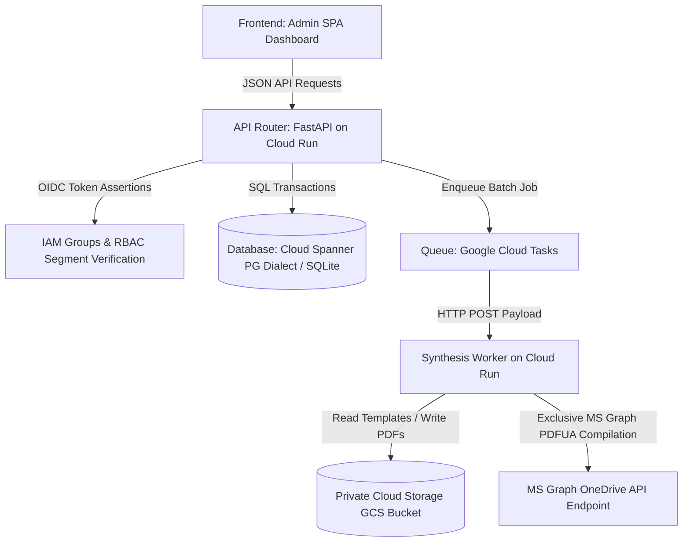

# WINDTRE Sintesi & Trasparenze Automation

An enterprise-grade, accessible, and serverless document synthesis and lifecycle management platform deployed on Google Cloud Platform. This system automates the high-fidelity generation, AGCOM compliance verification, and publishing of:
*   **Sintesi Contrattuali (Contractual Syntheses)** in accessible **PDF/UA** formats.
*   **Trasparenze Tariffarie (Tariff Transparency Sheets)** in structured **Excel `.xlsx`** and accessible **PDF/UA** formats.

The system serves **9 commercial corporate segments** across WINDTRE and Very Mobile, guaranteeing strict segment data-level segregation and compliance.

---

## 🛠️ Architectural Design & Tech Stack

Following a robust **Separation of Concerns (SoC)** model, the platform decouples routing, business operations, and heavy rendering workloads:



### 1. Unified Backend Layer (`FastAPI`)
*   **API Routers (`app/api_routes.py`):** Acts as exceptionally thin controllers. They manage Pydantic request-response validation, session dependency injections, and SSO segment permissions, delegating all domain logic.
*   **Service Layer (`app/services/`):** House pure business transactions. `OfferService` coordinates state machines, bulk updates, and segment validations. `DocumentService` handles preparation and audit histories.
*   **Spanner ORM (`app/database_models.py`):** Structured via SQLAlchemy 2.0. Generates app-side UUIDv4 keys to prevent Spanner hot-spotting, storing dynamic Padre-Figlio layouts in native, optimized JSON columns.

### 2. High-Fidelity Rendering & Compliance Engine (`app/document_generator.py`)
*   **Meta-Template OpenXML Loops (`docxtpl`):** Generates Word documents by dynamically looping and rendering complex nested table cells without hardcoded templates.
*   **Excel Coordinate Shifting (`openpyxl`):** Inserts children sub-rows dynamically while shifting cells and updating complex AGCOM calculation formulas safely down the spreadsheet.
*   **Clean Markup Filter:** Sanitizes formatting markups (e.g. `<b>`, markdown asterisks, carets) so they do not leak as raw plain text inside spreadsheet exports.
*   **Exclusive Microsoft Graph PDF/UA Compiler:** Converts DOCX files strictly via the high-fidelity Microsoft Graph/OneDrive API, ensuring 100% compliant Tagged PDF/UA outputs. All local fallback and backup compilers (headless LibreOffice/ReportLab) are bypassed for Sintesi generation to prevent compliance drift.

---

## 📋 AGCOM Compliance Rules (Italian Communications Authority)

These non-negotiable rules are hardcoded and verified in the rendering worker:
*   **Standard 228 (ND mapping):** Automatically maps and renders raw input values of `"ND"` or `"N/A"` as `"Non applicabile"` in final PDF/UA outputs.
*   **Standard 229 (Zero blank gaps):** Programmatically purges empty rows from tables to eliminate visual gaps and NVDA screen reader traps.
*   **Standard 230 (Footnote Placement):** Footnotes, variables, and regulatory notes are anchored directly next to the bottom border of active tables.
*   **Technology Badge (Bollino) Injection:** Programmatically injects the correct AGCOM Technology Badge (`FTTH Verde`, `FTTC/FWA Giallo`) into Tabella 1, complete with descriptive ALT text embedded in the XML drawing node.

---

## 🌟 Advanced Features

*   **Atomic Bulk/Massive Updates:** Allows administrators to select multiple offers in their commercial segment and apply common metadata edits (prices, valid dates, payment types, status) simultaneously under a single database transaction.
*   **The "4-File Co-existence" Rule:** Simultaneous, independent access for each active offer to 4 distinct output files (NUOVA state before code assignment, and APERTA state after AGCOM code assignment).
*   **Very Mobile Filename Autonomy:** Guarantees exact compiling of custom filenames with no automatic suffixes or timestamps for Very Mobile, while normal Windtre files receive status-related suffixes.

---

## 📂 Project Directory Structure

All technical manuals, guides, and design specifications have been organized inside the `docs/` folder:

```
├── app/                        # Main FastAPI backend package
│   ├── api_routes.py           # Thin routes and schemas validation
│   ├── database_models.py      # SQLAlchemy 2.0 / Pydantic models
│   ├── document_generator.py   # docxtpl / openpyxl rendering engine
│   └── services/               # Pure business domain layer
│       ├── document_service.py # Synthesis setup & audits
│       ├── graph.py            # MS Graph / OneDrive API integration
│       └── offer_service.py    # State transitions & bulk updates
├── docs/                       # Project documentation, guides and designs
│   ├── DOCKER_GUIDE.md         # Deployment and container guide
│   ├── GEMINI.md               # Main repository engineering rules
│   ├── hld_presentation.md     # High-Level serverless architecture slides
│   ├── low_level_design.md     # In-depth synthesis mechanics & sequences
│   └── SINTESI_TEMPLATE_MANUAL.md # Template OpenXML loop definitions
├── templates/                  # Seeded docx & xlsx master templates
├── tests/                      # Pytest validation test suite
├── .gitignore                  # Production Git exclude list
├── CONTRIBUTING.md             # Developer guide (setup, git, quality)
├── pyproject.toml              # Dependencies and tool configuration
├── uv.lock                     # Locked dependency versions
└── README.MD                   # Project main manual (This file)
```

---

## 🚀 Setting Up & Running Locally

Setup, comandi quotidiani e convenzioni Git sono documentati nella guida per
gli sviluppatori: **[CONTRIBUTING.md](CONTRIBUTING.md)**. In breve:

```bash
uv sync                                   # crea .venv e installa le dipendenze
cp .env.example .env                      # configura le variabili d'ambiente
uv run pre-commit install                 # installa gli hook di qualità
uv run uvicorn app.main:app --reload --port 8000   # avvia l'app
uv run pytest                             # esegue la suite di test
```

On startup, a local SQL database `pre_contratti.db` is automatically created,
tables are generated, and segment metadata is seeded.

> Non usare `pip`/`requirements.txt`: la fonte di verità delle dipendenze è
> `pyproject.toml` + `uv.lock`. Per il dettaglio tecnico vedi
> [`docs/best-practices/`](docs/best-practices/README.md).
