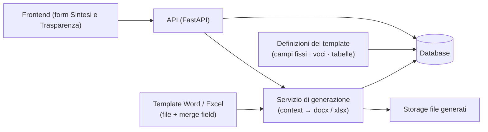
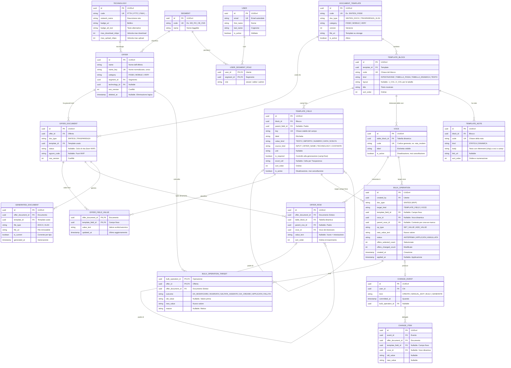

# Sintesi & Trasparenze — Documento tecnico di riferimento per l'MVP

**Versione:** 0.2 (bozza per revisione) · **Data:** 10 ottobre 2026
**Destinatari:** sviluppatori che implementano l'MVP.
**Novità della v0.2:** nelle tabelle dinamiche **nessuna voce è obbligatoria**; l'utente compone padri e figli liberamente e le etichette passano da un **dizionario delle voci** (tendina + "Nuova voce"). Vedi §6.4–6.5.
**Sostituisce, per le parti in contrasto:** il *Documento di inquadramento per la progettazione del modello dati* (`Progetto_Sintesi_Trasparenze_Documento_Progettuale_Modello_Dati NEW.md`) e le bozze `docs/new/`. In particolare è **superato** il principio della "fonte unica di verità" tra Sintesi e Trasparenza (vedi §2, D1–D2).

**Fonti usate**

| Sigla | Documento |
|---|---|
| INQUADRAMENTO | *Documento di inquadramento per la progettazione del modello dati* (NEW), 5 ottobre 2026 |
| DESCRITTIVO | *Documento descrittivo v0.2* (NEW), 2 ottobre 2026 |
| BOZZE | `docs/new/` — *Modello dati v0.1/v0.2*, *Esempio illustrato*, *Inquadramento v1.1* |
| CODICE | Prototipo esistente (`app/`, `admin_dashboard.html`, template in `templates/`) |
| CAMPIONI | I due screenshot della Sintesi Fisse allegati alla richiesta (offerta "SUPER Internet Casa 5G", FWA) |

**Legenda delle etichette**

| Etichetta | Significato |
|---|---|
| **[DECISO]** | Decisione dello sviluppatore/committente riportata in questo documento; non si discute in questa fase |
| **[EREDITATO]** | Requisito o vincolo dei documenti precedenti ancora valido |
| **[IPOTESI]** | Scelta di progetto proposta da questo documento: da confermare in revisione |
| **[APERTO]** | Non deciso; domanda raccolta in §11 |
| **[FUORI MVP]** | Non implementato ora; il modello non deve precluderlo |

---

## 0. Scopo del documento

Questo documento è **la guida tecnica per l'MVP** dell'applicazione Sintesi & Trasparenze. Contiene:

1. le **decisioni recenti** che ridefiniscono il modello (§2);
2. il **perimetro** dell'MVP, con i punti di estensione già previsti (§3, §10);
3. la **soluzione al nodo centrale** — tabelle a righe variabili e azioni massive (§6);
4. il **modello dati** da implementare (§7);
5. i **flussi applicativi** e le regole di generazione (§8);
6. i **casi d'uso** con cui validare l'MVP (§9);
7. i **punti aperti** da chiarire prima di dichiarare il documento definitivo (§11).

Il documento è volutamente focalizzato: parte dal semplice e lascia fuori tutto ciò che non serve al primo rilascio, purché il modello non lo precluda.

---

## 1. Il progetto in una pagina

WINDTRE (con il marchio Very Mobile) deve produrre, per ogni offerta commerciale, due documenti regolamentari:

- la **Sintesi Contrattuale**: documento per il cliente, oggi in Word e poi PDF, organizzato in sezioni, **tabelle padre/figlio** e note; contiene i bollini di tecnologia;
- la **Trasparenza Tariffaria**: scheda **Excel a griglia fissa imposta da AGCOM** (Vademecum, delibera 252/16/CONS), più un PDF per i siti.

Oggi i documenti sono file sparsi sui PC del marketing: ogni modifica comune a più offerte va rifatta a mano, con errori e disallineamenti.

L'obiettivo dell'applicazione è una **web app** in cui il marketing (circa 20 persone, non tecniche) inserisce i dati delle offerte in un database centrale e da lì **genera** Sintesi e Trasparenze. Il requisito storico più enfatizzato è la **modifica massiva**: cambiare un valore una volta e propagarlo a un gruppo di offerte.

**Novità rispetto all'impostazione precedente.** Non c'è più un'unica fonte di verità tra i due documenti: si è deciso di avere **due form separati** e **due ground truth indipendenti** per ogni offerta, una per la Sintesi e una per la Trasparenza (§2). Le azioni massive esistono **solo per la Sintesi**. Di conseguenza Sintesi e Trasparenza della stessa offerta possono non essere allineate: è una conseguenza accettata.

### 1.1 Mercati e gruppi di riferimento

Gli utenti sono divisi in **nove gruppi** (segmenti) [EREDITATO]:

| # | Segmento | Categoria | Nell'MVP |
|---|---|---|---|
| 1 | Mobile GA Consumer | Mobile | — |
| 2 | Mobile CB Consumer | Mobile | — |
| 3 | Mobile GA Microbusiness | Mobile | — |
| 4 | Fisso GA e Cross Selling Consumer | **Fisse** | ✔ |
| 5 | Fisso CB Consumer | **Fisse** | ✔ |
| 6 | Fisso GA e Cross Selling Microbusiness | **Fisse** | ✔ |
| 7 | Fisso CB Microbusiness | **Fisse** | ✔ |
| 8 | Etnico Consumer GA/CB | Mobile (da confermare, §11) | — |
| 9 | Very Mobile | Very | — |
| — | Mobile CB Microbusiness | — | Non impattato |

Il requisito di segregazione: ogni utente modifica i documenti del proprio segmento [EREDITATO]. Nelle categorie Mobile e Very vale lo stesso schema, con template e regole proprie [FUORI MVP].

---

## 2. Le decisioni che ridefiniscono il modello

Queste decisioni **cambiano** l'impostazione dei documenti precedenti e sono la base dell'MVP.

| # | Decisione | Effetto sul modello |
|---|---|---|
| **D1** | **Due form separati**: uno per la Sintesi e uno per la Trasparenza. L'utente compila i due form separatamente, **anche se reinserisce le stesse informazioni**. | Due **ground truth indipendenti** per ogni offerta. Nessuna mappatura né validazione incrociata nell'MVP. Lo stesso concetto può essere scritto diversamente nei due documenti ("24,0" nella Sintesi, "24 mesi" nella Trasparenza): è ammesso. |
| **D2** | Le **azioni massive esistono solo per la Sintesi**, non per la Trasparenza. | Sintesi e Trasparenza della stessa offerta **possono non essere allineate**: conseguenza accettata. Il modello non impone alcun vincolo tra i due documenti. |
| **D3** | **Unità "offerta"**: è la riga nella tabella delle offerte, identificata da un **nome univoco**. Non si modellano i "punti prezzo" e non si usano i campioni come fonte normativa ("quello che compare nei campioni potrebbe essere sbagliato"). | Niente entità prodotto/variante/punto prezzo. L'offerta è l'entità di anagrafica (nome, categoria, segmento). |
| **D4** | Le offerte sono categorizzate in **tre categorie: Fisse, Mobile, Very**. L'idea attuale è **un template per categoria**, da valutare in futuro se servono sottocategorie (soprattutto nel Mobile). | Il modello ha un campo `category` su offerte e template. **L'MVP copre solo la categoria Fisse**, perché le offerte Fisse sono le più omogenee. |
| **D5** | **Sintesi**: generazione da **template Word con merge field**. L'utente inserisce i valori di quei merge field su frontend e il documento generato contiene quei valori. | Il frontend della Sintesi è **costruito dal template**: i campi fissi sono merge field; per le **tabelle dinamiche** il template fornisce titolo, layout e ciclo, mentre le etichette delle righe vengono dal **dizionario delle voci** (§6.4). Alla generazione nessun valore viene composto fuori dal template. |
| **D6** | **Trasparenza**: è uno **schema fisso**; l'utente inserisce gli elementi su frontend e questi vanno **direttamente nel file Excel**. | Il form della Trasparenza è una lista di campi a posizione fissa (cella Excel nota). I valori sono inseriti nel formato atteso dall'Excel, senza passare dalla Sintesi. |
| **D7** | Alcune tabelle del template Sintesi **non sono statiche**: l'utente può **aumentare o ridurre il numero di padri e figli** direttamente da frontend (non può creare tabelle nuove). Sotto ogni tabella possono esserci **note statiche o dinamiche**; le note dinamiche contengono valori della tabella e devono aggiornarsi automaticamente quando quel valore cambia. | È il nodo centrale del progetto. **Interpretazione adottata (§6.4–6.5)**: l'utente compone padri e figli liberamente; ogni etichetta è scelta da un **dizionario delle voci** condiviso o creata al volo; **nessuna voce è obbligatoria**. Il template definisce titolo e layout della tabella. |

**Conseguenze accettate** [DECISO]:

1. Sintesi e Trasparenza possono divergere (D1, D2); non esiste per ora alcun controllo di coerenza incrociata.
2. Le stesse informazioni vengono reinserite due volte: è un costo accettato in cambio di semplicità e di indipendenza tra i due documenti.
3. In futuro si proverà a **collegare** i due ground truth (mappatura campi). Il modello di questo documento è progettato perché quel collegamento sia possibile **senza rifare il modello** (§10.2).

---

## 3. Perimetro dell'MVP

### 3.1 Dentro l'MVP

- **Anagrafica offerte Fisse**: nome univoco, categoria, segmento. [IPOTESI: la tecnologia è un attributo dell'offerta, condiviso dalla Sintesi; §11]
- **Form Sintesi** costruito dalle definizioni del template Word Fisse:
  - campi fissi (testo, data, derivati);
  - **tabelle dinamiche** (es. Prezzo, Costi): l'utente compone liberamente padri e figli ("Aggiungi padre" / "Aggiungi figlio"), scegliendo le etichette dal **dizionario delle voci** (tendina) o creandone di nuove; **nessuna voce è obbligatoria**;
  - **note statiche e dinamiche** del template, con propagazione automatica dei valori (§6.6).
- **Form Trasparenza** Fisse: campi a posizione fissa della griglia Excel; valori inseriti nel formato atteso dal file.
- **Generazione documenti**: Sintesi `.docx` e Trasparenza `.xlsx` dai rispettivi template; registrazione dei file generati; download dei file.
- **Azioni massive sulla Sintesi**: selezione di un campo fisso o di una voce del dizionario (anche usata dentro tabelle dinamiche) e di un gruppo di offerte; anteprima con esiti per offerta; conferma; applicazione tracciata come evento unico.
- **Storico minimo**: registro delle modifiche (chi, quando, cosa) e dei file generati.
- **Utenti e segmenti**: tabelle presenti; livello di enforcement dei permessi [APERTO, §11].

### 3.2 Fuori dall'MVP

Tutto ciò che segue è escluso dal primo rilascio ma **non deve essere precluso dal modello** (§10):

- categorie **Mobile** e **Very** (template, definizioni, dizionari, regole proprie);
- **mappatura Sintesi ↔ Trasparenza** e qualunque allineamento automatico tra i due documenti;
- **PDF** e PDF/UA (da decidere se l'MVP consegna anche i PDF; [APERTO, §11]);
- ciclo di vita completo AGCOM: stati Nuova/Aperta/Chiusa, codice AGCOM, regola dei "quattro file", versioni dei documenti;
- **cluster** di offerte e caratteristiche trasversali; parametri globali (es. RDA); dipendenze tra segmenti;
- naming file e vincoli Adobe; bollini (regole grafiche) oltre all'associazione tecnologia → immagine;
- permessi trasversali tra segmenti, cancellazione delle offerte, pubblicazione sui canali esterni;
- **migrazione** dei documenti esistenti.

---

## 4. Concetti e terminologia

| Concetto | Definizione operativa |
|---|---|
| **Offerta** | Entità di anagrafica con **nome univoco**, una categoria (Fisse/Mobile/Very) e un segmento. È la riga della tabella `offer`. [DECISO D3] |
| **Documento dell'offerta** | Le due **ground truth** dell'offerta: `SINTESI` e `TRASPARENZA`. Sono indipendenti: si compilano, si modificano e si generano separatamente. Possono esistere l'una senza l'altra. [DECISO D1] |
| **Sintesi** | Documento Word generato dal template Word della categoria, riempito con i valori del documento Sintesi dell'offerta. |
| **Trasparenza** | File Excel generato dal template Excel, con i valori del documento Trasparenza dell'offerta scritti nelle celle fisse. |
| **Categoria** | Fisse, Mobile, Very. Determina il **template** (e quindi le definizioni: campi fissi, tabelle, dizionario delle voci) del documento. [DECISO D4] |
| **Segmento** | Uno dei nove gruppi di marketing; porta permessi e regime IVA. [EREDITATO] |
| **Template** | File Word/Excel + **definizioni** (blocchi, campi fissi, tabelle fisse e dinamiche, dizionario delle voci) che lo descrivono (§6.4). Identificato da un codice e da una versione. |
| **Blocco** | Unità del template: intestazione, **tabella fissa**, **tabella dinamica** o testo. Contiene campi e note. |
| **Campo** | Slot **fisso** dichiarato nel template, con **chiave stabile** (`key`), etichetta, tipo e posizione. Nella Sintesi corrisponde a un merge field. |
| **Padre** | Riga di primo livello di una tabella dinamica: etichetta dal dizionario (di norma in grassetto), con **valore proprio facoltativo** e/o **figli facoltativi**. |
| **Figlio** | Riga di secondo livello, sotto un padre: è una **sottovoce**, con etichetta dal dizionario e **valore facoltativo** (in pratica quasi sempre presente). Il figlio è definito dalla posizione, non dal valore: **un valore non è un figlio**. |
| **Voce del dizionario** | Etichetta registrata una volta (scelta dalla tendina o creata con "Nuova voce"): è l'identità condivisa che massive e note usano per riconoscere "la stessa voce" tra offerte. **Nelle tabelle dinamiche nessuna voce è obbligatoria** [DECISO, §6.5]. |
| **Valore** | Attributo **facoltativo** di una riga (padre o figlio) o di un campo fisso (es. `27,99 euro`). Non è una riga e non è un figlio. Per la Sintesi è testo così com'è; per la Trasparenza è un valore nel formato atteso dall'Excel. |
| **Nota statica** | Testo del template senza valori variabili. |
| **Nota dinamica** | Testo del template che contiene **riferimenti (chip)** a voci o campi fissi (es. `{{voce:costo_canone_servizio}}`): vengono risolti alla generazione, quindi la nota si aggiorna da sola quando il valore cambia. |
| **Azione massiva** | Operazione che applica lo stesso valore a un campo fisso o a una voce, su un gruppo di offerte selezionate, con anteprima e conferma. Solo Sintesi. [DECISO D2] |
| **Ground truth** | L'insieme dei dati di un documento, considerato fonte di verità per quel documento. |

---

## 5. Architettura della soluzione



Punti chiave:

1. **Il template è la fonte della presentazione; le definizioni sono la fonte dell'identità.** Il template fornisce impaginazione e merge field; le definizioni forniscono chiavi dei campi fissi, voci del dizionario, titoli e layout delle tabelle, note e ordine.
2. **I dati operativi non sono JSON.** I valori sono righe relazionali: campi fissi `(documento, campo, valore)` e righe dinamiche `(documento, voce, padre/figlio, valore)`: è ciò che rende possibile referenziare una voce per le azioni massive (§6).
3. Il **JSON resta solo per informazioni di servizio**: criteri di selezione di un'azione massiva, eventuali snapshot storici, `render_context` congelato. Mai per i valori editabili.

**Stack e vincoli ereditati** [EREDITATO da INQUADRAMENTO/Bozze/CODICE]: Cloud Spanner (dialetto PostgreSQL), applicazione FastAPI + SQLAlchemy 2.0 + Pydantic v2, chiavi `UUIDv4` generate dall'applicazione (mai auto-incrementi, mai estensioni PostgreSQL-specifiche), file su Cloud Storage, identità aziendale OIDC, SQLite per i test locali. Rendering documenti: **`docxtpl`** (Jinja2 sopra `python-docx`) per la Sintesi, **`openpyxl`** per la Trasparenza, `python-docx` per ritocchi puntuali — struttura dei template descritta in **Appendice C**. Frontend: da decidere se evolvere la dashboard esistente o fare una SPA separata [APERTO, §11].

Queste scelte non condizionano il modello: la soluzione di §6 funziona identica su Spanner, PostgreSQL o SQLite.

---

## 6. Il nodo centrale: tabelle a righe variabili e azioni massive

### 6.1 Il problema in una riga

Per modificare in massa "lo stesso campo" di molte offerte bisogna **riconoscere che il campo è lo stesso** in tutte, anche quando:

- la voce non esiste in alcune offerte (righe variabili);
- le etichette possono essere scritte in modi diversi;
- la posizione della riga nella tabella può cambiare.

Con le tabelle salvate come **JSON senza schema**, questa identità non esiste: ogni offerta è un mondo a sé. Il punto di partenza è quindi costruire l'identità del campo, non cercarla dentro il JSON.

### 6.2 Perché il JSON senza schema non è referenziabile

Il prototipo attuale salva le tabelle dinamiche in `dynamic_tables.structural_content` (JSON). In quel modello:

- per trovare il campo da modificare bisogna confrontare **etichette o posizioni**, e "voce assente" non è distinguibile da "voce rinominata" o "voce in altro punto";
- il database non può fare da garante (nessun vincolo, nessuna query tipizzata);
- conteggi e anteprime delle massive vanno calcolati in codice, offerta per offerta, con esito incerto;
- due offerte non possono essere messe in relazione "per campo".

**Conclusione:** il JSON senza schema è adatto a *serializzare* un risultato, non a essere la **fonte di verità di dati da modificare**. Per l'MVP i valori editabili non sono JSON.

### 6.3 Le opzioni considerate

| Opzione | Come funziona | Pro | Contro | Esito |
|---|---|---|---|---|
| **A. JSON + ricerca per etichetta/posizione** | La massiva cerca nel JSON una riga con etichetta (o posizione) uguale | Nessuna migrazione; vicina al prototipo | Fragile: etichette sinonime, righe assenti vs rinominate; esiti inaffidabili | **Scartata** |
| **B. JSON con chiavi stabili** | Ogni riga JSON contiene una `campo_key` presa da un catalogo; la massiva lavora in codice per chiave | Meno tabelle; compatta | I vincoli restano nel codice; query e conteggi difficili; il catalogo serve comunque | **Scartata** (il catalogo è il valore, il JSON è zavorra) |
| **C. Dizionario delle voci + righe relazionali** | Il template definisce campi fissi e tabelle (titolo, layout); le etichette delle voci si scelgono da un **dizionario condiviso** o si creano al volo; i dati sono righe `(documento, voce, padre/figlio, valore)` | Massiva = operazione su una voce; "voce assente" esplicita; storico per riga; base pronta per la mappatura futura | Un minimo di disciplina: le etichette passano dal dizionario | **Adottata** |
| **D. Testo libero senza dizionario** | L'utente scrive etichette e valori come vuole | Massima libertà | Impossibile riconoscere in modo affidabile la stessa voce tra offerte: massive e note diventano euristiche | **Scartata** |

La soluzione **C** nasce dalle bozze v0.2 (`docs/new/`) ed è stata adattata alle decisioni D1–D4 e alla scelta di **voci libere**: niente fonte unica con la Trasparenza, massive solo Sintesi, perimetro Fisse, **nessuna voce obbligatoria**.

### 6.4 La soluzione adottata

**L'identità sta fuori dal documento: nel template per i campi fissi, nel dizionario per le voci.**

1. **Campi fissi.** Intestazione, tabelle fisse e testi sono definiti nel template: `key` stabile, etichetta, origine, obbligo (per i controlli di generazione), cella Excel per la Trasparenza. Nei blocchi fissi i valori vanno compilati (anche `ND`) e la generazione segnala i mancanti.
2. **Tabelle dinamiche.** Il template definisce solo **titolo** e **layout** (1 o 2 colonne; il layout è presentazione del documento e **l'utente non lo cambia**). Le voci (padri e figli) sono **composte dall'utente** nel form: "Aggiungi padre" / "Aggiungi figlio", etichetta scelta dalla **tendina delle voci note** oppure creata con **"Nuova voce"**; valore facoltativo. **Nessuna voce è obbligatoria.**
3. **Dizionario delle voci.** Ogni etichetta usata è registrata una volta (`voce`: id, code, label): è l'**identità condivisa** che permette di riconoscere "la stessa voce" in offerte diverse. Una voce nuova entra nel dizionario e da lì è normale: compare nella tendina per tutti, è massivabile e citabile nelle note. Per l'MVP il **seed iniziale** è provvisorio, definito a tavolino; il censimento reale verrà dopo.
4. **Righe relazionali.** I dati delle tabelle dinamiche sono righe `offer_row` (documento, tabella, padre/figlio, voce, valore, ordine). Una voce non inserita **non ha riga**: l'assenza è esplicita e distinguibile da qualunque valore, incluso `ND`.
5. **Le azioni massive operano sulla voce** (o sul campo fisso): "imposta la voce `Costo SIM` = `12 euro` per le offerte selezionate". Per ogni offerta si ha un esito certo:
   - la voce ha un valore diverso → **DA_MODIFICARE**;
   - la voce ha già quel valore → **INVARIATA** (confronto per uguaglianza di stringa: `12 euro` ≠ `12 €`);
   - la voce non esiste per quell'offerta → **SALTATA_ASSENTE**, oppure **creata** con "crea se manca" (indicando il padre se la voce è usata come figlio; se manca anche il padre, viene creato).

**Esempio di riferimento** (numeri di §6.7 e Appendice A):

```
Voce del dizionario:    Rata del Modem   (code: rata_modem)
Tabella:                Prezzo           Layout: 2 colonne
Uso tipico:             figlio del padre "Costo mensile"
```

Massiva "Rata del Modem → 2 euro" su quattro offerte Fisse:

| Offerta | Ha la voce? | Valore attuale | Esito anteprima |
|---|---|---|---|
| A | sì | `3 euro` | DA_MODIFICARE |
| B | sì | `2 euro` | INVARIATA |
| C | **no** | — | SALTATA_ASSENTE (o DA_CREARE con "crea se manca") |
| D | sì | `3 euro` | DA_MODIFICARE |

L'anteprima è un conteggio esatto, non una stima. L'applicazione aggiorna o crea le righe in una transazione e registra **un solo evento**.

### 6.5 Cosa significa "l'utente aggiunge o riduce padri e figli" [DECISO]

**Interpretazione adottata (confermata):** nelle tabelle dinamiche l'utente compone liberamente le voci:

- **"Aggiungi padre"** apre una riga di primo livello: l'etichetta si sceglie dalla **tendina** delle voci note o si crea con **"Nuova voce"**; il valore è facoltativo (vuoto = riga-intestazione);
- **"Aggiungi figlio"** sotto un padre: stessa logica, quanti figli servono;
- una tabella può avere più gruppi padre/figli; possono esserci **solo padri** (con o senza valore), padri con figli, figli con o senza valore. Un **figlio è una sottovoce** (una riga sotto un padre), non un valore;
- **nessuna voce è obbligatoria**: si crea solo ciò che serve all'offerta;
- le etichette **non si scrivono fuori dal dizionario**: scegliere o creare una voce è ciò che la rende riconoscibile per massive e note;
- l'ordine delle righe è quello di inserimento.

**Nuova voce.** Chi la crea la registra per tutti: da quel momento è nella tendina e massivabile. Il form suggerisce le voci simili esistenti per evitare doppioni.

**Perché non testo libero senza dizionario.** Se ogni offerta potesse inventare etichette senza registrarle, massive e note diventerebbero euristiche (§6.2, opzione D): è il problema che la soluzione deve risolvere. I sinonimi tra voci diverse ("Rata Modem" ≈ "Rata del Modem") saranno unibili in futuro con gli **alias** (§10.1).

### 6.6 Note statiche e dinamiche

Le note vivono **nel template**, non nei dati dell'offerta. Questo è ciò che risolve automaticamente il problema della propagazione:

- ogni blocco del template può avere **una o più note**, ciascuna con un ordine (la numerazione/esponente è generata, non scritta a mano);
- una **nota statica** è testo puro: sempre uguale, per tutte le offerte che usano quel template;
- una **nota dinamica** contiene **riferimenti (chip)** a voci del dizionario o a campi fissi, inseriti dall'editor e mai digitati a mano; es.:

  ```
  Il costo mensile di {{voce:costo_canone_servizio}} è composto, per i primi 48 mesi, da:
  15 euro di canone del servizio, 9,99 euro di rata dell'Antenna e 3 euro di rata del Modem;
  dopo 48 mesi è composto da {{voce:costo_canone_servizio}} al mese di canone del servizio.
  ```
- alla generazione i riferimenti vengono risolti con i valori **correnti** del documento: se l'utente cambia un valore — anche con un'azione massiva — la nota successiva è già aggiornata. **Non esiste una copia del valore dentro la nota**: non c'è nulla da allineare.
- se un riferimento punta a una voce che quell'offerta non ha, la generazione si **blocca con un messaggio chiaro** (offerta, nota, voce). Non si reintroduce l'obbligatorietà: la voce resta facoltativa; è la nota che, per essere stampata, richiede quel valore. In alternativa si possono usare note condizionate. [IPOTESI]

**Limite residuo** [EREDITATO]: se in una nota qualcuno scrive un numero a mano (es. "3 euro" senza segnaposto), quel numero non è tracciato e non seguirà le modifiche. L'editor dovrebbe suggerire i segnaposto; il controllo completo non è garantito.

### 6.7 Esempio completo sui due screenshot

Template Sintesi Fisse, estratto (dettaglio in Appendice A).

**Blocchi fissi** (struttura dal template):

| Blocco | Campo (`key`) | Etichetta | Origine |
|---|---|---|---|
| Intestazione | `nome_offerta` | Nome Offerta | attributo offerta (derivato) |
| Intestazione | `disponibilita` | Disponibilità offerta | input (data) |
| Intestazione | `validita` | Offerta valida fino al | costante |
| Servizi e apparecchiature | `servizi`, `traffico_internet`, `traffico_fonia`, `apparecchiature` | righe della tabella | input (obbligatori) |
| Velocità | `download`, `upload` | righe della tabella | tecnologia (derivato) |
| Durata, rinnovo e risoluzione | `durata_minima`, `rinnovo`, `recesso` | righe della tabella | input (obbligatori) |

**Tabelle dinamiche e dizionario iniziale** (l'utente può creare nuove voci):

| Tabella | Layout | Voci note iniziali (seed) |
|---|---|---|
| Prezzo | 2 colonne | Costo mensile · Costo canone del servizio · Rata dell'Antenna · Rata del Modem |
| Costi | 2 colonne | Costo di attivazione · Già clienti · Nuovi clienti · Costo SIM · Costo di disattivazione |

Valori e righe per l'offerta dello screenshot ("SUPER Internet Casa 5G", FWA):

| Elemento | Valore/riga |
|---|---|
| `disponibilita` | `15-01-2025` |
| Servizi (4 campi fissi) | `Fisso, fonia e Internet in tecnologia FWA 5G`; `Illimitato`; `Illimitato`; `Modem e Antenna in vendita abbinata` |
| Prezzo — padre voce "Costo mensile" | *(riga-intestazione, valore vuoto)* |
| Prezzo — figlio voce "Costo canone del servizio" | `27,99 euro` |
| Prezzo — voce "Rata del Modem" | *(voce non inserita: nessuna riga)* |

Nessun JSON: i campi fissi stanno in `offer_field_value`, le righe dinamiche in `offer_row` (che puntano alle voci del dizionario). La nota del blocco Prezzo (dinamica) si aggiorna da sola quando la voce "Costo canone del servizio" cambia. La massiva "porta la voce Rata del Modem a `3 euro`" tocca solo le offerte che hanno quella voce e lascia questa tra le SALTATE (o la crea, con "crea se manca" e indicando il padre di contesto).

---

## 7. Modello dati dell'MVP

### 7.1 Diagramma ER



### 7.2 Dizionario delle tabelle

**Catalogo dei template** (popolato dagli sviluppatori nell'MVP; in futuro da un ruolo di amministrazione)

| Tabella | Scopo | Note |
|---|---|---|
| `document_template` | Template Word/Excel con versione e categoria | `code` univoco; `file_uri` su storage; una versione attiva per `code` |
| `template_block` | Blocchi del template: intestazione, tabelle fisse/dinamiche, testi | `kind` e `layout` guidano il rendering; `sort_order` fissa l'ordine |
| `template_field` | **I campi fissi** (e le celle della Trasparenza): chiave stabile, etichetta, tipo, cella Excel | `key` è il contratto con il template e con le azioni massive; mai riusare una chiave per un significato diverso; disattivare, non cancellare |
| `voce` | **Il dizionario delle voci** delle tabelle dinamiche: etichetta unica (tendina + "Nuova voce") | `code` generato e stabile; disattivare, non cancellare |
| `template_note` | Note statiche/dinamiche dei blocchi, con riferimenti (chip) | Più note per blocco; numerazione generata |

**Offerta e ground truth**

| Tabella | Scopo | Note |
|---|---|---|
| `offer` | Anagrafica dell'offerta: nome univoco, categoria, segmento, tecnologia | [IPOTESI: tecnologia sull'offerta, condivisa; §11] |
| `offer_document` | I due ground truth: `SINTESI` e `TRASPARENZA` | Un record per tipo per offerta; indipendenti (D1); `status`/`agcom_code` presenti per il futuro ciclo AGCOM [FUORI MVP] |
| `offer_field_value` | **I valori dei campi fissi**: una riga per campo compilato | PK `(offer_document_id, template_field_id)`; assenza di riga = campo non compilato; `value_text` stringa |
| `offer_row` | **Le righe delle tabelle dinamiche**: padre/figlio → voce + valore | Assenza di riga = voce non inserita; il padre ha `parent_row_id` vuoto; valore vuoto = riga-intestazione |

**Storico, massive, documenti generati**

| Tabella | Scopo | Note |
|---|---|---|
| `bulk_operation` / `bulk_operation_target` | Azione massiva sulla Sintesi: campo fisso o voce, selezione, esiti per offerta | Un record per operazione; esiti certi per offerta; `status` ANTEPRIMA → APPLICATA/ANNULLATA |
| `generated_document` | File prodotti | `is_current` per tipo; i file non si sovrascrivono (una riga per generazione) |
| `change_event` / `change_item` | **Storico minimo**: chi, quando, cosa | Copre creazioni, modifiche manuali, massive, generazioni; la storicizzazione completa (revisioni, ricostruzione a una data) è [FUORI MVP] ma non preclusa |

**Utenti** [EREDITATO]: `user`, `user_segment_role` (viewer/editor/admin per segmento). Livello di enforcement nell'MVP: [APERTO, §11].

### 7.3 Regole di integrità e convenzioni

1. **Chiavi**: `UUIDv4` generate dall'applicazione. Niente auto-incrementi. Vincoli applicativi e di validazione a livello applicativo (compatibilità Spanner).
2. **Nome offerta univoco**: `offer.name_key` (nome normalizzato) è univoco [DECISO D3].
3. **Chiavi e codici stabili**: `template_field.key` e `voce.code` non cambiano mai significato; gli elementi dismessi si disattivano (`is_active = false`) e restano leggibili nello storico.
4. **Assenza, `ND`, vuoto** [EREDITATO]:
   - voce non inserita (nessuna riga) o campo non compilato → non compare nel documento;
   - valore `ND` → in output `Non applicabile`;
   - il trattino `-` non è un valore speciale del modello (è presentazione).
5. **Valori nei documenti**: per i **campi fissi** un solo valore per campo (PK). Per le **tabelle dinamiche** la stessa voce può comparire in più gruppi/righe: l'identità resta la voce, la riga è l'istanza. Per i riferimenti nelle note la voce deve essere univoca nel documento, altrimenti la generazione segnala l'ambiguità [IPOTESI].
6. **Confronto dei valori nelle massive**: per **uguaglianza di stringa** (`6,99 €` ≠ `6,99 euro`). È accettato; l'interfaccia può mostrare un avviso sulle differenze solo di formato.
7. **Trasparenza senza parsing**: i valori della Trasparenza sono inseriti nel formato atteso dalle celle (numeri, date, testi). Non esiste alcuna estrazione di numeri dalla Sintesi: sono due ground truth separate (D1, D6).

### 7.4 Predisposizione al futuro (nessuna migrazione richiesta)

- **Mappatura Sintesi ↔ Trasparenza** (§10.2): nuova tabella `field_mapping` che collega **campi fissi e voci** della Sintesi con i **campi** della griglia della Trasparenza, più l'eventuale trasformazione. Il presente modello rende possibile aggiungerla con soli dati.
- **Nuove voci/tabelle/campi senza sviluppo del database** (§10.1).
- **Categorie Mobile/Very**: nuovi `document_template` + cataloghi; stesso codice.
- **Cluster**: tabella di appartenenza offerta↔cluster e, se serve, elenco dei campi abilitati per cluster. Nessuna modifica a `bulk_operation`.
- **Ciclo di vita AGCOM**: i campi `offer_document.status` e `agcom_code` esistono; si aggiungono transizioni e storico senza cambiare il modello dei valori.
- **Parametri globali** (es. RDA): tabella `global_parameter` con validità e fasce, aggiungibile quando servirà [FUORI MVP].

---

## 8. Flussi applicativi

### 8.1 Registrazione dell'offerta

1. L'utente crea l'offerta: nome (univoco), categoria (Fisse), segmento, tecnologia [IPOTESI].
2. Il sistema crea `offer`. I documenti Sintesi e Trasparenza si creano al primo accesso al rispettivo form, associando il template della categoria.
3. Nessun documento viene generato finché il form non è salvato.

### 8.2 Compilazione del form Sintesi

1. Il form è costruito dalle definizioni del template `SINTESI_FISSE`:
   - campi con `source_kind = OFFER_NAME | TECHNOLOGY | COSTANTE`: mostrati in sola lettura (derivati);
   - campi fissi `INPUT`: widget per tipo, valore richiesto (può essere `ND`);
   - tabelle fisse: struttura dal template, valori da compilare;
   - **tabelle dinamiche**: comandi "Aggiungi padre" e "Aggiungi figlio"; l'etichetta si sceglie dalla **tendina delle voci note** o si crea con **"Nuova voce"** (registrata nel dizionario); il valore è facoltativo; ogni riga può essere rimossa;
   - note: non editabili dall'utente (sono del template); quelle dinamiche mostrano l'esito dei riferimenti con i valori correnti.
2. Al salvataggio: `offer_field_value` (campi fissi) e `offer_row` (righe dinamiche) in insert/update/delete; eventuale nuova voce in `voce`; `change_event` + `change_item`; incremento di `row_version`.
3. Validazione minima: campi fissi compilati (anche `ND`), tipi coerenti, offerta del proprio segmento (se l'autorizzazione è attiva). Nelle tabelle dinamiche non ci sono obblighi.

### 8.3 Compilazione del form Trasparenza

1. Il form è la lista dei campi a `excel_cell` del template `TRASPARENZA_XLSX` (Fisse), raggruppati per area del foglio.
2. L'utente inserisce i valori nel formato atteso (importo, data, testo, elenco); l'applicazione valida tipo e obbligatorietà.
3. Al salvataggio: stesse regole di §8.2 sul documento Trasparenza. Nessuna relazione con la Sintesi (D1).
4. Non esistono azioni massive su questo form (D2).

### 8.4 Generazione dei documenti

1. L'utente richiede la generazione per un'offerta (Sintesi, Trasparenza o entrambe, separatamente).
2. Il servizio di generazione costruisce il **render context**:
   - per ogni blocco, i campi fissi compilati (etichette dal template);
   - per ogni tabella dinamica, le righe in ordine di inserimento, con l'etichetta della voce e il valore;
   - per la Trasparenza i valori mappati sulle celle `excel_cell`;
   - i derivati risolti (`offer.name`, tecnologia → bollino/velocità);
   - le note con i riferimenti (chip) risolti.
3. Regole di stampa [EREDITATO/IPOTESI]: `ND` → `Non applicabile`; una riga creata si stampa (l'utente crea solo ciò che deve comparire); padre senza valore = riga-intestazione seguita dai figli; per non stampare una voce basta non crearla; nota stampata sotto il proprio blocco, con numerazione generata. La **cella valore può restare vuota** (tabelle a 2 colonne): la riga si stampa così come creata — è una scelta dell'utente.
4. Controlli prima del rendering [IPOTESI]: campi fissi mancanti o riferimenti di note irrisolti → **generazione bloccata** con messaggio puntuale (offerta, blocco, voce).
5. Rendering: DOCX dal template Word con i merge field; XLSX dal template Excel con scrittura delle celle.
6. Salvataggio del file su storage; riga in `generated_document` (`is_current`); evento `GENERATE` nel registro. I file precedenti restano.

### 8.5 Azione massiva sulla Sintesi

1. **Scelta del bersaglio**: un **campo fisso** (dal template) oppure una **voce del dizionario** (per le tabelle dinamiche). L'elenco delle voci mostra anche dove sono usate (es. "Rata del Modem — 12 offerte, come figlio di 'Costo mensile'").
2. **Selezione delle offerte**: tutte le offerte Fisse, filtrate per segmento, oppure selezione manuale. [IPOTESI: nell'MVP criteri semplici; i cluster arrivano dopo]
3. **Anteprima (dry run)**: il sistema crea `bulk_operation` in stato ANTEPRIMA e un `bulk_operation_target` per ogni offerta, con esito e valore attuale. Nessun dato viene modificato. L'utente vede conteggi e dettaglio (modificate, invariate, saltate/da creare).
4. **Conferma**: l'utente conferma l'operazione.
5. **Applicazione** in una transazione: controllo di `row_version` per ogni offerta coinvolta; aggiornamento (o creazione, con "crea se manca") delle righe; per la creazione di una voce usata come figlio la massiva indica il **padre di contesto** (creato se assente); `change_event` di tipo `BULK` con un `change_item` per ogni voce/riga cambiata; `bulk_operation` → APPLICATA. Se un'offerta è stata modificata da altri dopo l'anteprima, l'esito è `FALLITA` per quell'offerta [IPOTESI: la politica di atomicità è "tutto o niente" oppure "applica dove possibile", da decidere in revisione].
6. **Effetti**: i documenti già generati risultano **superati** (l'ultimo evento è più recente della generazione); si rigenerano su richiesta. Le note dinamiche che citano la voce (o il campo) sono automaticamente aggiornate alla rigenerazione (§6.6).

### 8.6 Storico minimo

- Ogni salvataggio (creazione, modifica manuale, massiva, generazione) produce un `change_event` con l'utente e l'istante, e i `change_item` con i valori vecchi e nuovi.
- Niente revisioni complete né ricostruzione "com'era a una data" nell'MVP [FUORI MVP]: il modello le accoglierà aggiungendo una tabella di revisioni con contesto congelato (come proposto nelle bozze v0.2).

---

## 9. Casi d'uso dell'MVP

| # | Caso d'uso | Criterio di accettazione |
|---|---|---|
| UC1 | Creare un'offerta Fisse e compilare il form Sintesi, componendo una tabella dinamica ("Aggiungi padre/figlio", voce dalla tendina o nuova) | L'offerta è salvata; le righe create compaiono; le voci non create non esistono nei dati |
| UC2 | Generare la Sintesi `.docx` | Il documento contiene i valori inseriti; le note dinamiche riportano i valori correnti; le voci assenti non compaiono; `ND` → "Non applicabile" |
| UC3 | Compilare il form Trasparenza e generare l'`.xlsx` | Le celle attese contengono i valori inseriti; nessun valore proviene dalla Sintesi |
| UC4 | Scrivere lo stesso concetto in modo diverso nei due documenti (es. `24,0` in Sintesi, `24 mesi` in Trasparenza) | Nessun errore o avviso: i due ground truth sono indipendenti |
| UC5 | Modifica massiva di una **voce del dizionario** usata in una tabella dinamica, su un gruppo di offerte | Anteprima con conteggi esatti per offerta (da modificare, invariata, saltata/da creare); conferma; applicazione registrata come evento unico |
| UC6 | Modificare un valore citato in una nota dinamica (singolarmente o in massa) e rigenerare | La nota contiene il nuovo valore senza alcun intervento manuale |
| UC7 | Creare una **"Nuova voce"** nel form e usarla sulla stessa offerta; poi usarla in una massiva | La voce entra nel dizionario ed è subito disponibile per tutti e massivabile; nessuna migrazione del database |
| UC8 | Provare a modificare in massa una voce assente da alcune offerte | Le offerte senza la voce risultano SALTATE_ASSENTE (o la voce viene creata con "crea se manca", indicando il padre se serve) |

---

## 10. Estensioni future e come il modello le accoglie

### 10.1 Nuove voci, nuove tabelle, nuovi campi

- **Nuova voce in una tabella dinamica**: è già il funzionamento normale ("Nuova voce" nel form); se serve una voce nuova per tutti, la si crea una volta e resta nel dizionario.
- **Alias tra sinonimi** ("Rata Modem" ≈ "Rata del Modem"): tabella di alias che punta alla stessa voce; massive e note riconoscono entrambe le scritture. [FUORI MVP]
- **Valori ricorrenti suggeriti** (soprattutto per le tabelle a 1 colonna): per una voce o una tabella si definisce un elenco di valori suggeriti (es. "Illimitato", "Nessun vincolo") e il form propone elenco + "valore personalizzato". Il modello non cambia: il valore resta la stringa in `value_text`. Se in futuro si vorrà rinominare un valore ricorrente per tutte le offerte insieme, gli si darà un'identità (`valore_ricorrente`) e le righe la referenzieranno. [FUORI MVP]
- **Nuova tabella dinamica**: nuovo `template_block` (kind `TABELLA_DINAMICA`, layout) + ciclo nel template Word; il dizionario nasce vuoto e cresce con l'uso. Nessuna alterazione del database.
- **Nuovo campo fisso o nuova tabella fissa**: nuovo `template_field` + merge field nel template. Nessuna alterazione del database.
- **Nuovo template di categoria** (Mobile, Very, o variante di segmento): nuovo `document_template` + definizioni complete. Stesso codice.
- **Etichetta diversa per una singola offerta** (se mai servisse): estensione `label_override` sulla riga; la voce resta la stessa e le massive continuano a funzionare.

### 10.2 Collegamento Sintesi ↔ Trasparenza (futuro)

Poiché **entrambi** i ground truth hanno elementi con identità stabili (campi fissi, voci del dizionario, campi della griglia), il collegamento sarà una **mappatura tra identità**: `field_mapping` collega un campo fisso o una voce della Sintesi con un campo della Trasparenza (più l'eventuale trasformazione). Da lì si potranno costruire: precompilazione del secondo form dal primo, confronto e avvisi di divergenza, propagazione selettiva. Nulla di tutto ciò è nell'MVP (D1), ma il modello non dovrà cambiare per aggiungerlo.

### 10.3 Altri elementi ereditati (fuori MVP)

| Elemento | Stato nel modello |
|---|---|
| Ciclo di vita AGCOM (Nuova/Aperta/Chiusa, codice, 4 file) | Campi `status`/`agcom_code` presenti; transizioni e versioni da aggiungere |
| PDF e PDF/UA | Nessun impatto sul modello dati |
| Bollini | Tecnologia → immagine/alt text già nel modello (`technology`) |
| Naming file e vincoli Adobe | Attributo/derivazione al momento della generazione |
| Cluster e caratteristiche trasversali | Tabelle aggiungibili; `bulk_operation` invariata |
| Parametri globali (RDA) | Tabella `global_parameter` aggiungibile |
| Permessi trasversali, pubblicazione, migrazione | Nessun impatto sul nucleo del modello |

---

## 11. Punti aperti e domande per la revisione

1. **Unità "offerta".** Il documento adotta questa lettura: l'offerta è la riga con nome univoco; a essa sono associati due **documenti** indipendenti (Sintesi, Trasparenza). La frase "una offerta è una sintesi o una trasparenza" può però significare che **ogni documento è di per sé una riga** della tabella offerte (con un campo tipo). La sostanza non cambia (due ground truth, nessuna mappatura); cambia la forma (una tabella con `doc_type` al posto di `offer` + `offer_document`). **Confermare quale delle due.**
2. **Voci libere con dizionario (adottato).** L'utente compone liberamente le voci; ogni etichetta entra nel dizionario ("Nuova voce") e diventa massivabile. Il **seed iniziale** per l'MVP è provvisorio (inventato a tavolino). Restano da definire: chi può creare/gestire le voci (MVP: qualsiasi editor), la gestione degli **alias** tra sinonimi.
3. **Tecnologia condivisa.** Si adotta l'ipotesi che la tecnologia sia un attributo dell'offerta (serve per bollino, velocità e massive). In alternativa va inserita separatamente nei due form, accettando che anche la tecnologia possa divergere tra Sintesi e Trasparenza.
4. **Note per offerta.** L'MVP prevede solo note del template (statiche/dinamiche). Servono anche note scritte liberamente per singola offerta? Se sì, il modello le accoglie con una tabella di override, ma non saranno modificabili in massa.
5. **PDF nell'MVP.** L'MVP consegna solo `.docx` e `.xlsx`, oppure anche i PDF? Non cambia il modello.
6. **Storico nell'MVP.** Va bene il registro minimo (eventi + dettagli) senza ricostruzione "com'era a una data"?
7. **Permessi nell'MVP.** Il modello utenti/segmenti c'è; l'enforcement (autenticazione OIDC, blocco per segmento) è dentro o fuori il primo rilascio?
8. **Stati e naming file nell'MVP.** Servono già `status` e i nomi file secondo le regole Adobe, o si parte con nomi semplici?
9. **Tabelle ripetute.** Nel Fisso alcune tabelle compaiono più volte (es. "Costi"). Nell'MVP si modellano come **blocchi dinamici distinti**, ciascuno con il proprio dizionario delle voci. Confermare che basta.
10. **Categoria dell'Etnico.** Oggi è elencato tra i gruppi; va assegnato alla categoria Mobile o a una propria?
11. **Frontend.** Si parte evolvendo la dashboard esistente o con una SPA separata? Non cambia il modello dati.
12. **Manutenzione template ↔ definizioni.** Nell'MVP campi fissi e voci sono mantenuti dagli sviluppatori insieme al template; prevediamo un controllo automatico che verifichi che ogni chiave dei campi fissi e ogni codice voce esistano come merge field nel file (e viceversa), per evitare derive.

---

## 12. Prerequisiti e decisioni per iniziare l'MVP

**Da chiudere prima di scrivere codice (bloccanti):**

1. **Unità offerta** — confermare il modello adottato: `offer` (nome univoco) + due documenti indipendenti (Sintesi, Trasparenza) [§11.1].
2. **Tecnologia sull'offerta** — confermare che è un attributo dell'offerta (serve per bollino, velocità, massive) [§11.3].
3. **Template Fisse di riferimento** — **[FATTO, per i test]** creato `templates/sintesi_fisse_template.docx` (generato da `scripts/build_sintesi_template.py`): solo intestazione/bullet, tabelle intro, servizi, velocità e durata (statiche, valori a merge field) e tabelle Prezzo (2 colonne) e Costi (1 colonna) dinamiche; note e sezioni ulteriori rimosse. Il seed del dizionario resta provvisorio (inventato a tavolino). Vedi Appendice C.
4. **Stack di sviluppo** — Spanner è obbligatorio già ora oppure si sviluppa su SQLite/Cloud SQL e si migra dopo? Non cambia il modello (domanda 1.1 di `DOMANDE_COMMITTENTE`).
5. **Frontend** — evolvere `admin_dashboard.html` (più rapido per l'MVP) o partire da una SPA separata? [§11.11].

**Rinviabili (non bloccano l'MVP):**

- PDF e PDF/UA; ciclo di vita AGCOM (stati, codice, 4 file); naming file/Adobe; permessi trasversali ed enforcement; storico completo (basta il registro minimo); cluster; RDA e parametri globali; alias tra sinonimi; valori ricorrenti; note per offerta; categoria dell'Etnico; migrazione/censimento; tabelle ripetute (si modellano come blocchi distinti quando servono).

**Ordine di sviluppo consigliato:** Trasparenza per prima (griglia fissa: percorso completo più semplice), poi la Sintesi (campi fissi → tabelle dinamiche → massive → note), infine storico e rifiniture.

---

## Appendice A — Esempio completo sui due screenshot

**Blocchi fissi** (Sintesi Fisse, estratto dal campione allegato)

| Blocco | Campo (`key`) | Origine | Obbligo |
|---|---|---|---|
| Intestazione | `nome_offerta` | attributo offerta | derivato |
| Intestazione | `disponibilita` | input (data) | obbligatorio |
| Intestazione | `validita` (frase fissa) | costante | — |
| Servizi e apparecchiature | `servizi`, `traffico_internet`, `traffico_fonia`, `apparecchiature` | input | obbligatori |
| Velocità | `download`, `upload` | tecnologia | derivato |
| Durata, rinnovo e risoluzione | `durata_minima`, `rinnovo`, `recesso` | input | obbligatori |

**Tabelle dinamiche e dizionario iniziale delle voci**

| Tabella | Layout | Voci note iniziali (seed) |
|---|---|---|
| Prezzo | 2 colonne | Costo mensile · Costo canone del servizio · Rata dell'Antenna · Rata del Modem |
| Costi | 2 colonne | Costo di attivazione · Già clienti · Nuovi clienti · Costo SIM · Costo di disattivazione |

**Nota dinamica del blocco Prezzo** (testo del template; i riferimenti alle voci si inseriscono come chip):

```
Il costo mensile di {{voce:costo_canone_servizio}} è composto, per i primi 48 mesi, da:
15 euro di canone del servizio, 9,99 euro di rata dell'Antenna e 3 euro di rata del Modem;
dopo 48 mesi è composto da {{voce:costo_canone_servizio}} al mese di canone del servizio.
Le chiamate illimitate verso fissi e mobili Nazionali sono incluse.
```

Osservazione importante: i numeri `15`, `9,99`, `3` sono scritti a mano nella nota dell'esempio reale. Per beneficiare della propagazione automatica devono diventare chip verso voci del dizionario (ad esempio `{{voce:rata_antenna}}`, `{{voce:rata_modem}}`). È il limite residuo descritto in §6.6.

**Dati salvati per l'offerta del campione**

Campi fissi (`offer_field_value`):

| Campo | Valore |
|---|---|
| `disponibilita` | `15-01-2025` |
| `servizi` | `Fisso, fonia e Internet in tecnologia FWA 5G` |
| `traffico_internet` | `Illimitato` |
| `traffico_fonia` | `Illimitato` |
| `apparecchiature` | `Modem e Antenna in vendita abbinata` |
| `durata_minima` | `24 mesi` |
| `rinnovo` | `Rinnovo automatico ogni mese` |
| `recesso` | `Nessun costo di recesso` |

Righe dinamiche (`offer_row`):

| Tabella | Voce | Ruolo | Valore |
|---|---|---|---|
| Prezzo | Costo mensile | padre | *(vuoto: intestazione)* |
| Prezzo | Costo canone del servizio | figlio | `27,99 euro` |
| Costi | Costo di attivazione | padre | *(vuoto: intestazione)* |
| Costi | Già clienti | figlio | `ND` |
| Costi | Nuovi clienti | figlio | `5 euro` |

*(La voce "Rata del Modem" non è stata creata: nessuna riga, la riga non compare.)*

**Generazione**: il render context unisce campi fissi e righe dinamiche; il template Word scrive le tabelle; la nota risolve il riferimento in `27,99 euro`. Nessun valore è copiato nel database della nota.

---

## Appendice B — Glossario minimo

- **AGCOM**: Autorità per le Garanzie nelle Comunicazioni. La Trasparenza segue il Vademecum (delibera 252/16/CONS).
- **FWA / FTTC / FTTH**: tecnologie di rete fissa (FWA = accesso radio fisso; FTTC = fibra mista rame; FTTH = fibra fino a casa).
- **Ground truth**: l'insieme di dati che fa fede per un documento. Nell'MVP ce ne sono due per offerta (Sintesi, Trasparenza), indipendenti.
- **Merge field**: segnaposto nel template Word sostituito, alla generazione, da un valore (o da un ciclo, per le tabelle).
- **Padre / Figlio**: voce principale e sotto-voci di una tabella della Sintesi.
- **Voce del dizionario**: etichetta registrata una volta (tendina + "Nuova voce"), identità condivisa delle righe delle tabelle dinamiche. Nelle tabelle dinamiche nessuna voce è obbligatoria; una riga non creata non compare.
- **Render context**: struttura di dati costruita alla generazione e passata al template.
- **ND**: valore convenzionale che in output diventa "Non applicabile"; diverso dalla voce non compilata (che non compare).
- **Punto prezzo**: variante di prezzo di un'offerta (terminologia dei documenti precedenti). **Non modellato nell'MVP** [DECISO D3].

---

## Appendice C — I template Word: merge field e tabelle dinamiche

**Libreria scelta: `docxtpl`** (Jinja2 sopra `python-docx`). Motivi: merge field nominati, cicli dentro le righe di tabella, immagini inline (bollini), filtri di formattazione. `python-docx` da solo richiederebbe di duplicare a mano le righe XML: più codice e più fragilità; resta utile per ritocchi puntuali.

**Contratto di sintassi**

- **campo fisso**: `{{ campo.<key> }}` — es. `{{ campo.disponibilita }}`;
- **tabella dinamica a 2 colonne**: una **riga-ciclo**:

  | riga | cella 1 | cella 2 |
  |---|---|---|
  | 1 | `` | |
  | 2 | `{{r r.etichetta }}` | `{{ r.valore }}` |
  | 3 | `` | |

  Le righe 1 e 3 contengono solo i tag e vengono **rimosse** alla resa: resta la riga 2 ripetuta una volta per ogni riga della tabella.

- **tabella dinamica a 1 colonna**: identica, con una sola cella e `{{r r.testo }}`;
- **grassetto dei padri**: si ottiene passando `RichText(..., bold=True)` per l'etichetta/testo. Per le variabili `RichText` la sintassi è **`{{r <var> }}`** (la `r` dopo le graffe è obbligatoria: senza, l'XML della formattazione finisce dentro la cella come testo);
- **bollino**: al posto dell'immagine un merge field (`{{ campo.bollino }}`) riempito con un `InlineImage`;
- **note**: paragrafi del template; i chip diventano `{{ voce.<code> }}` (o `{{ campo.<key> }}`).

**Regola d'oro: il renderer appiattisce l'albero in righe fisiche.** Il servizio di generazione trasforma l'albero padre→figli nell'**elenco ordinato delle righe così come devono apparire** (padre, valore del padre, figli, loro valori, righe senza valore...) e per ciascuna prepara etichetta e valore. Il template ha quindi **un solo ciclo**, i figli si alternano correttamente ai padri e il grassetto del padre si ottiene con `RichText` (stesso posto nel template; il testo formattato è deciso da Python).

Altre regole operative:

- **tabella senza righe** → non deve comparire: il post-processing (o una condizione Jinja) rimuove la tabella vuota;
- **controlli**: a ogni generazione, ogni `key`/`code` usato nel template deve esistere nelle definizioni e viceversa; docxtpl espone `get_undeclared_template_variables()` per l'elenco delle variabili non dichiarate;
- **accortezza**: i tag non devono essere spezzati dalla formattazione di Word (scriverli con lo stesso stile; non ritoccare il testo dei tag).

**Template di test dell'MVP**: `templates/sintesi_fisse_template.docx`, generato da `scripts/build_sintesi_template.py` partendo da `docs/SuperInternetCasa5G-FWAIndoor-20,99-CambioTecnologia-28102025.docx`. Contiene solo: intestazione e bullet, tabella intro, Servizio/i e apparecchiature, Velocità (statiche, con i valori a merge field), Prezzo (dinamica, 2 colonne), Costi (dinamica, 1 colonna), Durata, rinnovo e risoluzione (statica). Note e sezioni ulteriori rimosse. Cicli verificati con un render di prova (grassetto dei padri incluso).
