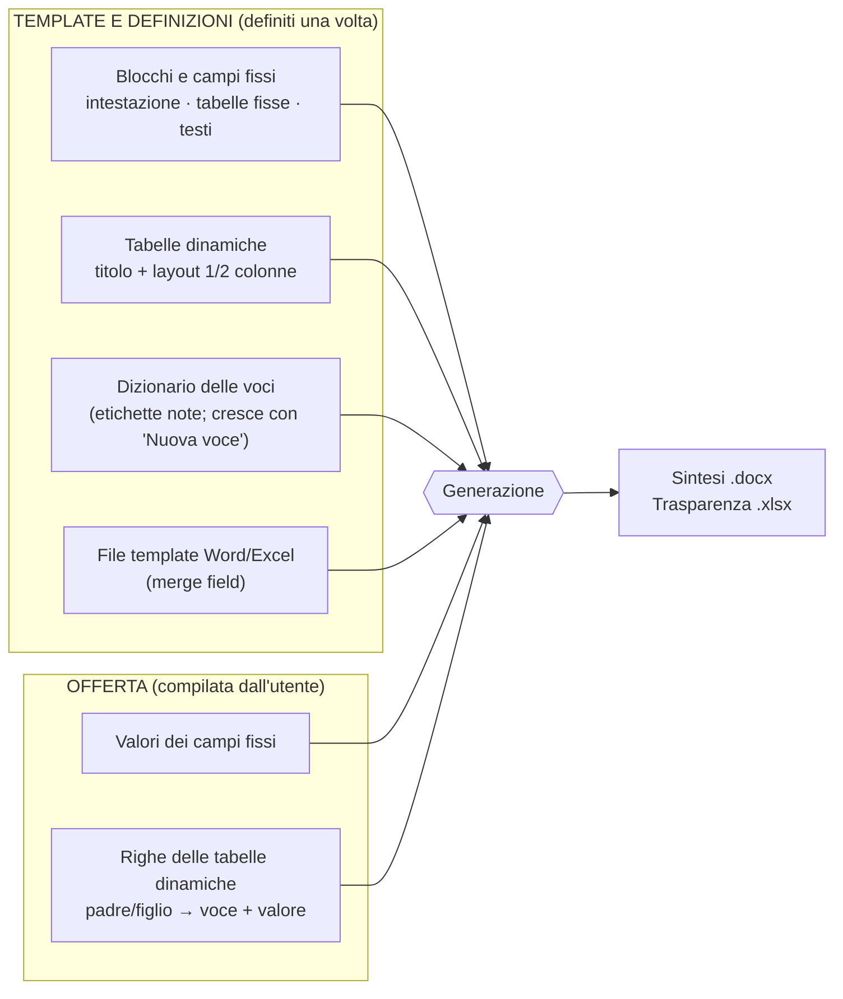
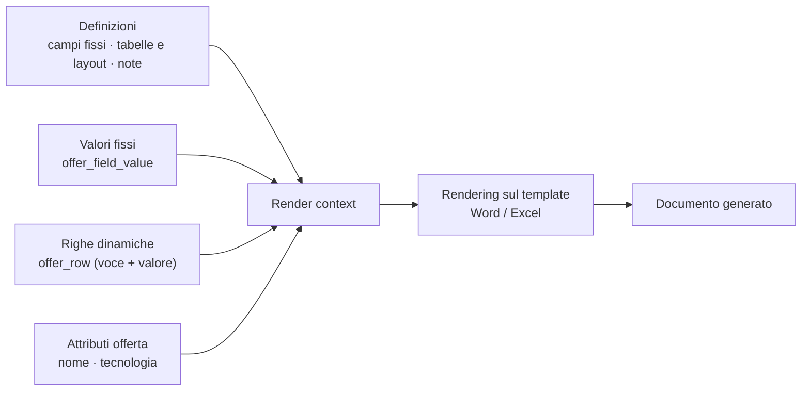
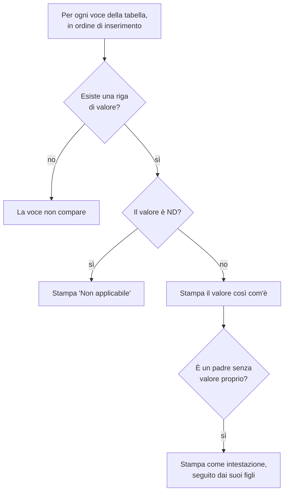
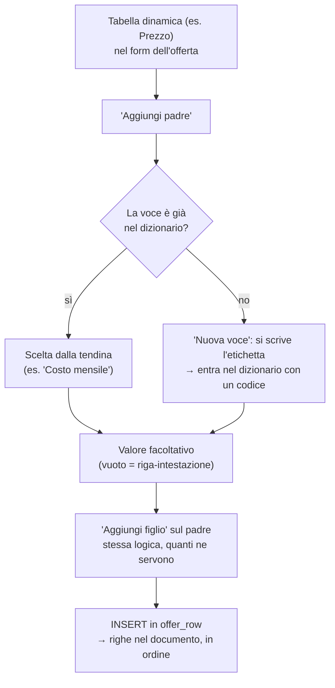
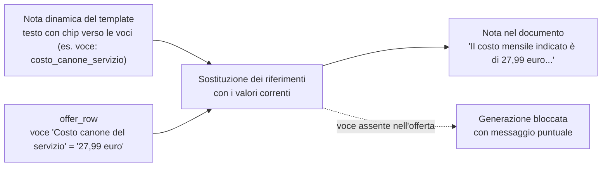
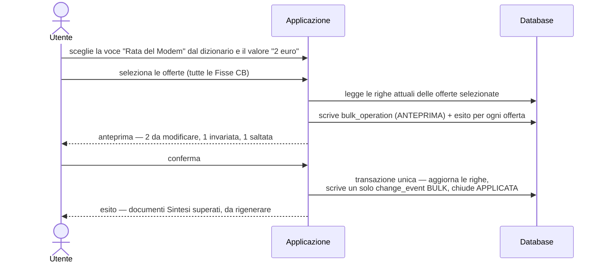
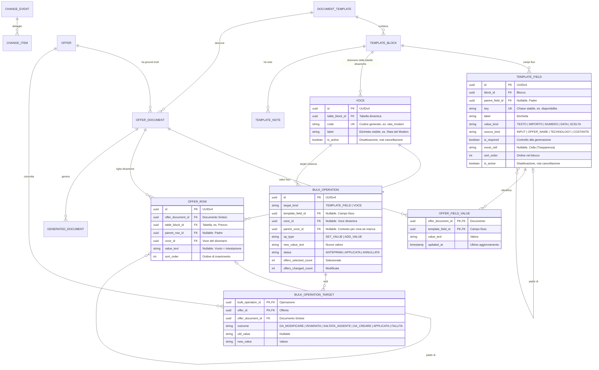
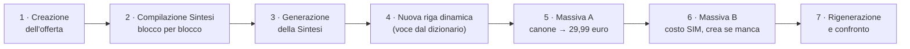

# Sintesi & Trasparenze — La soluzione spiegata passo passo

**Versione:** 0.2 (bozza per revisione) · **Data:** 10 ottobre 2026
**Riferimento:** `MVP_Sintesi_Trasparenze.md` (§6.4–§8). Questo documento **non introduce decisioni nuove**: spiega in modo più disteso la soluzione adottata per tabelle a righe variabili, azioni massive e note, con esempi e disegni. Le assunzioni da confermare sono etichettate **[IPOTESI]**; l'elenco completo delle domande resta nella §11 del documento principale.

**Novità della v0.2.** Per le tabelle **dinamiche** il modello è cambiato: **niente voci predefinite e niente obblighi**. Il template definisce solo titolo e layout; l'utente compone liberamente padri e figli (con "Aggiungi padre" / "Aggiungi figlio"), scegliendo le etichette da un **dizionario delle voci** che si popola automaticamente (tendina + "Nuova voce"). È il meccanismo descritto in §3.2.

---

## 1. Il problema, raccontato una volta

Una Sintesi è fatta di **sezioni**, **tabelle con voci padre/figlio** e **note**. Alcune tabelle hanno **righe variabili**: per un'offerta una voce c'è, per un'altra no. Le stesse informazioni compaiono in offerte diverse, ma scritte o posizionate diversamente.

Da qui nascono tre esigenze:

1. **Compilare** ogni offerta in un form: aggiungere e togliere padri e figli a seconda di ciò che serve a quell'offerta.
2. **Generare** il documento Word con esattamente le voci compilate, nell'ordine giusto, con le note che si aggiornano da sole.
3. **Modificare in massa** lo stesso campo su molte offerte: "porta la Rata del Modem a 2 euro su tutte le offerte Fisse CB".

L'esigenza 3 è quella che rompe il modello a JSON: **per modificare "lo stesso campo" devo sapere che è lo stesso campo in offerte diverse**. Guardiamo due offerte reali salvate come JSON:

```json
// Offerta A — tabella Costi
{ "Costi": [
    { "padre": "Costo SIM",                 "valore": "10 euro" },
    { "padre": "Costo di disattivazione",   "valore": "10 euro" }
] }

// Offerta B — stessa tabella
{ "Costi": [
    { "padre": "Costo della SIM",           "valore": "12 euro" },
    { "padre": "Costo rete",                "valore": "5 euro" }
] }
```

Le due voci sono la stessa cosa? Per una persona probabilmente sì; per il sistema **no, non è dimostrabile**: il testo è diverso, l'ordine è diverso, e una voce può benissimo essere *assente* invece che *scritta diversamente*. Qualunque automatismo basato su somiglianza è una scommessa. E una scommessa, su documenti regolamentari, non è accettabile.

**La conclusione della soluzione:** l'identità di una voce non va cercata dentro il documento. Va **registrata una volta sola, fuori dal documento**, in un dizionario condiviso.

---

## 2. La soluzione in una frase

> **Il template definisce la struttura (campi fissi e tabelle); le voci delle tabelle dinamiche sono composte dall'utente, ma ogni etichetta scelta o creata entra in un dizionario: da lì in poi la stessa voce è riconoscibile ovunque.**

È lo stesso principio di un **modulo cartaceo**: il modulo definisce le caselle fisse; le righe libere si scrivono, ma ogni intestazione di riga viene registrata in un elenco condiviso. La modifica massiva diventa: *"su tutti i moduli selezionati, nella voce `Rata del Modem`, scrivi `2 euro`"*. Non serve confrontare testi né indovinare posizioni.



Le tre domande a cui la soluzione risponde, in modo esplicito:

| Domanda | Risposta nel modello |
|---|---|
| Che struttura ha un documento? | Il **template**: blocchi, campi fissi, tabelle (titolo e layout) |
| Quali voci ha **questa** offerta? | Le righe `offer_row` (padre/figlio), che puntano alle voci del dizionario |
| Come riconosco "la stessa voce" in offerte diverse? | La **voce del dizionario** (identità unica), non il testo digitato |

---

## 3. Pezzo 1 — Le definizioni: campi fissi e tabelle dinamiche

Un documento della Sintesi contiene due famiglie di elementi, gestite in modo diverso.

### 3.1 Campi fissi (definiti dal template)

Sono le parti con struttura decisa dal template: l'intestazione (Nome Offerta, Data, Validità), le tabelle fisse (es. "Servizi e apparecchiature", "Velocità", "Durata, rinnovo e risoluzione") e i testi. Per ogni campo il template dichiara:

| Attributo | Esempio | A cosa serve |
|---|---|---|
| `key` (chiave stabile) | `disponibilita` | Identità del campo, usata da massive e note |
| etichetta | "Disponibilità offerta" | Testo stampato (non editabile dall'utente) |
| origine | input utente / derivato (nome, tecnologia) / costante | Da dove viene il valore |
| obbligo | obbligatorio / derivato | Serve alla generazione e ai controlli |

L'utente compila i valori (anche `ND`); non cambia etichette né struttura. Nei blocchi fissi la struttura è quella del template: i campi vanno compilati, e la generazione segnala i mancanti.

### 3.2 Tabelle dinamiche: titolo e layout dal template, voci dall'utente

Per una tabella dichiarata **dinamica** (es. Prezzo, Costi) il template definisce solo:

- il **titolo** ("Tabella Prezzo");
- il **layout**: 1 colonna (etichetta e valore **incolonnati**: etichetta su una riga, valore sulla successiva) oppure 2 colonne (etichetta | valore sulla stessa riga). Il layout è deciso dal template (è presentazione del documento): **l'utente non lo cambia**.

Le righe si definiscono per **struttura**, non per presenza di valore:

- **Padre** = riga di primo livello (etichetta, di norma in grassetto) con valore proprio facoltativo e/o figli facoltativi;
- **Figlio** = riga di secondo livello sotto un padre: è una **sottovoce** con etichetta e valore facoltativo;
- **Valore** = attributo facoltativo di una riga (padre o figlio); non è una riga e non è un figlio.

**Le voci non sono predefinite.** L'utente compone i gruppi padre→figli direttamente nel form. Perché questo non distrugga massive e note, ogni etichetta che l'utente sceglie o digita viene registrata in un **dizionario delle voci**:

| `voce` (dizionario) | | |
|---|---|---|
| **id** | **code** (generato) | **label** |
| `a1…` | `costo_mensile` | Costo mensile |
| `b2…` | `costo_canone_servizio` | Costo canone del servizio |
| `c3…` | `rata_antenna` | Rata dell'Antenna |
| `d4…` | `rata_modem` | Rata del Modem |
| `e5…` | `costo_sim` | Costo SIM |
| … | … | … |

Come funziona in pratica:

- il dizionario **parte con un elenco iniziale** (le voci già note delle Sintesi Fisse) e **cresce con l'uso**: se una voce non c'è, "Nuova voce" la crea all'istante;
- da quel momento la voce è **visibile a tutti** (tendina) e **massivabile** come le altre;
- **nessuna voce è obbligatoria**: si crea solo ciò che serve a quell'offerta; il numero di padri e figli è libero;
- i **sinonimi** ("Rata Modem" senza "del") restano voci diverse finché non vengono uniti come alias: è un'estensione futura, non un requisito dell'MVP.

Il **dizionario è la fonte di verità dell'identità delle voci**; il file Word resta la **fonte della presentazione** (colonne, grassetti, bollini, impaginazione); il template dichiara dove ogni tabella si trova e con quale layout.

---

## 4. Pezzo 2 — I valori dell'offerta

Ci sono due forme di valore, una per famiglia di elementi:

**1. Campi fissi** → una riga in `offer_field_value`:

```
offer_field_value
┌───────────────────┬───────────────────┬─────────────────┐
│ offer_document_id │ template_field_id │ value_text      │
├───────────────────┼───────────────────┼─────────────────┤
│ Sintesi di O1     │ disponibilita     │ 15-01-2025      │
└───────────────────┴───────────────────┴─────────────────┘
```

**2. Tabelle dinamiche** → una riga in `offer_row`, che rappresenta **padre o figlio**:

```
offer_row
- id
- offer_document_id
- table_block_id      (es. "Tabella Prezzo")
- parent_row_id       (vuoto = padre; valorizzato = figlio di quella riga)
- voce_id             → punta alla voce del dizionario
- value_text          (facoltativo: vuoto = riga-intestazione)
- sort_order          (ordine di inserimento)
```

Esempio: la tabella Prezzo di due offerte, con le stesse voci (o voci diverse):

| Offerta | `voce` | Ruolo | `value_text` |
|---|---|---|---|
| O1 | Costo mensile | padre | *(vuoto: riga-intestazione)* |
| O1 | Costo canone del servizio | figlio di "Costo mensile" | `27,99 euro` |
| O1 | Rata del Modem | figlio di "Costo mensile" | `3 euro` |
| O2 | Costo mensile | padre | *(vuoto: riga-intestazione)* |
| O2 | Costo canone del servizio | figlio di "Costo mensile" | `19,99 euro` |
| O2 | Costo SIM | padre | `10 euro IVA inclusa` |

Lo stesso contenuto, prima e dopo la soluzione:

| | Modello JSON (vecchio) | Modello a voci (adottato) |
|---|---|---|
| Dove vive il valore | dentro un blob JSON per offerta | una riga, che punta a una voce del dizionario |
| Identità della voce | testo/posizione dentro il JSON | voce del dizionario (id + code) |
| "Voce assente" | ambigua (assente? rinominata?) | **una cosa sola: non esiste la riga** |
| Modifica in massa | ricerca euristica nel JSON | `UPDATE ... WHERE voce_id = :voce AND documento IN (...)` |
| Query e conteggi | in codice, offerta per offerta | SQL |

### I tre stati di una voce

| Stato | Cosa c'è in `offer_row` | Cosa compare nel documento |
|---|---|---|
| **Voce non inserita** | nessuna riga | la riga non compare |
| **Voce inserita, non applicabile** | riga con `ND` | "Non applicabile" |
| **Voce compilata** | riga con il valore (es. `3 euro`) | il valore così com'è |

Regole collegate:

- **niente è obbligatorio** nelle tabelle dinamiche: la voce o c'è o non c'è, per scelta dell'utente;
- una **riga-intestazione** (padre senza valore) serve a raggruppare i figli: di norma compare se almeno un figlio compare;
- **solo tabelle a 2 colonne**: la **cella valore può restare vuota** (nei campioni reali esistono righe simili, es. "Voce (non previsto se minuti illimitati)"): la riga si stampa così come creata — è una scelta dell'utente. Nelle **tabelle a 1 colonna** il problema non esiste: il figlio è già il valore;
- il confronto tra valori nelle massive è **per uguaglianza di stringa**: `2 euro` ≠ `2 €`.

---

## 5. Pezzo 3 — La proiezione: da template + righe al documento

Il documento non si "costruisce a mano": si **proietta** dalle definizioni (campi fissi, titolo e layout delle tabelle, note, ordine) e dai dati dell'offerta (valori fissi + righe).



Le regole di stampa, applicate a ogni voce:



**Esempio di proiezione.** Stessa tabella dinamica, due offerte:

| | Offerta A | Offerta B |
|---|---|---|
| voce "Costo mensile" (padre) | *(intestazione)* | *(intestazione)* |
| voce "Costo canone del servizio" | `27,99 euro` | `19,99 euro` |
| voce "Rata del Modem" | `3 euro` | *(riga assente)* |

Risultato nel documento:

```
Offerta A                                Offerta B
┌────────────────────────────┬─────────┐  ┌────────────────────────────┬─────────┐
│ Costo mensile              │         │  │ Costo mensile              │         │
│ Costo canone del servizio  │27,99 €  │  │ Costo canone del servizio  │19,99 €  │
│ Rata del Modem             │  3,00 € │  └────────────────────────────┴─────────┘
└────────────────────────────┴─────────┘
```

Le differenze tra le due tabelle **non sono scritte da nessuna parte**: emergono dalle righe. Non c'è nulla da tenere allineato.

**E per la Trasparenza?** L'Excel è a griglia fissa: i suoi campi sono definiti nel template (con la **cella** esatta) e i valori sono inseriti nel formato atteso dal file. Nessuna tabella dinamica, nessuna estrazione dalla Sintesi: sono due ground truth separati.

---

## 6. Aggiungere e togliere padri e figli

Nelle tabelle dinamiche il form offre sempre due comandi:

- **"Aggiungi padre"** → apre una riga di primo livello;
- **"Aggiungi figlio"** (su un padre) → apre una sotto-riga.

In entrambi i casi si sceglie l'etichetta dalla **tendina delle voci note** oppure si crea una **"Nuova voce"**; il valore è **facoltativo**.



Prima e dopo, sulla stessa offerta:

| Passo | Righe in `offer_row` (tabella Prezzo) | Nel documento |
|---|---|---|
| Prima | *(nessuna)* | tabella assente |
| "Aggiungi padre" → "Costo mensile" + "Aggiungi figlio" → "Costo canone del servizio" = `27,99 euro` | 2 righe (padre + figlio) | tabella con intestazione e un figlio |
| Aggiunge un figlio "Rata del Modem" = `3 euro` | 3 righe | compare la riga "Rata del Modem" |
| Rimuove "Rata del Modem" | 2 righe | la riga scompare |

Conseguenze da tenere a mente:

1. **Tutte le voci sono facoltative**: non esistono righe obbligatorie nelle tabelle dinamiche; l'utente crea solo ciò che serve.
2. **Più gruppi per tabella**: una tabella può avere più padri; possono esserci **solo padri** (con o senza valore), padri con figli, figli con o senza valore (nelle 2 colonne la cella valore vuota si stampa come creata).
3. **1 o 2 colonne** è un layout della tabella (template): non cambia il modello dei dati.
4. **Le etichette non si riscrivono a mano**: si scelgono dalla tendina o si creano come voce nuova. È questo che rende la voce riconoscibile per le massive (§8) e per le note (§7).
5. **Nuova voce**: chi la crea la rende disponibile a tutti; da quel momento è una voce normale (massivabile, citabile nelle note). Per evitare doppioni il form suggerisce le voci simili già esistenti.

---

## 7. Le note statiche e dinamiche

Le note **vivono nel template**, non nei dati dell'offerta. È questo che rende automatica la propagazione: non esiste una copia del valore dentro la nota.

- una **nota statica** è testo puro (es. la frase di validità);
- una **nota dinamica** contiene **riferimenti a voci o campi** (chip), mai valori copiati a mano;
- ogni tabella può avere **più note** (statiche e dinamiche insieme), ognuna con il proprio ordine: la numerazione è generata.



Esempio di rendering con due note sotto la stessa tabella:

| Nota | Tipo | Testo del template | Nel documento (offerta con canone 27,99) |
|---|---|---|---|
| N1 | DINAMICA | `Il costo mensile indicato è di [costo_canone_servizio] al mese per i primi 48 mesi.` | `Il costo mensile indicato è di 27,99 euro al mese per i primi 48 mesi.` |
| N2 | STATICA | `Le chiamate illimitate verso fissi e mobili Nazionali sono incluse.` | invariata |

Punti da ricordare:

1. **La propagazione è una conseguenza, non una funzione**: se un valore cambia (singolarmente o in massa), la nota *successiva* usa già il nuovo valore. Le note si risolvono al momento della generazione.
2. **Niente obblighi, ma attenzione alle note**: se una nota sempre stampata cita una voce che quell'offerta non ha, la generazione si **blocca con un messaggio chiaro** (offerta, nota, voce). In alternativa si possono usare note condizionate o frammenti opzionali nel testo. **[IPOTESI da confermare.]**
3. **Limite residuo**: un numero scritto **a mano** dentro una nota (es. `3 euro` senza chip) non è tracciato e non seguirà le modifiche. L'editor deve suggerire i chip; la garanzia completa non esiste.

---

## 8. Un'azione massiva, passo passo

Obiettivo dell'esempio: **portare la voce "Rata del Modem" a `2 euro`** su quattro offerte Fisse.



L'anteprima, offerta per offerta (nessun valore cambia ancora):

| Offerta | Ha la voce? | Valore attuale | Esito previsto | Perché |
|---|---|---|---|---|
| SUPER Internet Casa 5G Promo | sì | `3 euro` | **DA_MODIFICARE** | valore diverso |
| Internet Casa Light | sì | `2 €` | **DA_MODIFICARE** | `2 €` ≠ `2 euro` (uguaglianza di stringa) |
| Internet Casa Full | sì | `2 euro` | **INVARIATA** | già uguale |
| SUPER Internet Casa 5G | **no** | — | **SALTATA_ASSENTE** | la voce non esiste per questa offerta |

Sul database, in modo illustrativo:

```sql
-- Anteprima: chi ha la voce e con quale valore
SELECT od.offer_id, r.value_text
FROM offer_document od
LEFT JOIN offer_row r
  ON r.offer_document_id = od.id
 AND r.voce_id = :voce_rata_modem
WHERE od.doc_type = 'SINTESI' AND od.offer_id IN (:selezione);
-- NULL = voce assente → esito SALTATA_ASSENTE

-- Applicazione
UPDATE offer_row
SET value_text = '2 euro'
WHERE voce_id = :voce_rata_modem
  AND offer_document_id IN (:documenti_selezionati)
  AND value_text <> '2 euro';
```

Varianti, garanzie e limiti dell'operazione:

- **"crea se manca"**: con l'operazione di tipo `ADD_VALUE`, le offerte senza la voce ricevono una **nuova riga** (`DA_CREARE`). Se la voce è usata come **figlio**, la massiva deve indicare anche il **padre** (voce di contesto); se manca anche il padre, viene creato. Se la voce è usata come **padre di primo livello**, non serve alcun contesto.
- **Voce scritta diversamente = voce diversa**: chi ha "Rata Modem" (senza "del") non viene toccato: l'anteprima lo mostra come altra voce. Gli **alias** tra sinonimi sono un'estensione futura (§11).
- **Evento unico**: 2 modifiche su 2 offerte diventano **un solo** `change_event` di tipo BULK, con un `change_item` per valore cambiato.
- **Conflitti**: se un'offerta viene modificata da qualcun altro tra anteprima e conferma, il controllo di `row_version` la segnala (`FALLITA`).
- **Effetti sui documenti**: i file già generati **non si toccano**; risultano superati e si rigenerano. Le note che citano la voce sono aggiornate automaticamente alla rigenerazione (§7).

---

## 9. Il modello dati minimo della soluzione

Solo le tabelle coinvolte dalla soluzione (il dizionario completo è nella §7 del documento principale).



In parole povere:

| Tabella | A cosa serve |
|---|---|
| `document_template`, `template_block` | Struttura del documento: blocchi, tabelle (titolo, layout, fissa/dinamica), testi |
| `template_field` | I **campi fissi** del template (e le celle della Trasparenza) |
| `voce` | Il **dizionario delle voci** delle tabelle dinamiche: etichette note e nuove |
| `offer`, `offer_document` | L'**offerta** e i suoi due ground truth (Sintesi, Trasparenza) |
| `offer_field_value` | I **valori dei campi fissi** |
| `offer_row` | Le **righe dinamiche** (padre/figlio), che puntano alle voci |
| `bulk_operation`, `bulk_operation_target` | Le **azioni massive** e il loro esito per offerta |
| `generated_document` | I **file prodotti** |
| `change_event`, `change_item` | Lo **storico** di chi ha fatto cosa |

---

## 10. Prontuario delle regole

- **Nelle tabelle dinamiche non esistono voci obbligatorie**: si crea solo ciò che serve all'offerta.
- **Le etichette delle voci si scelgono dal dizionario o si creano come nuova voce**: mai testo libero fuori dal dizionario.
- **Le etichette delle voci sono uguali per tutti**: rinominare una voce si fa sul dizionario (tutte le offerte si aggiornano), non riga per riga.
- **Un valore per campo per documento** (campi fissi); per le voci dinamiche possono esistere più righe con la stessa voce, in gruppi diversi.
- **Nessun valore vuoto nei campi fissi**: nei fissi il valore è richiesto (anche `ND`); nelle dinamiche la riga si crea solo se serve.
- **Uguaglianza di stringa**: le massive confrontano i testi così come sono (`12 euro` ≠ `12 €`).
- **Nessun parsing tra i documenti**: la Sintesi conserva il testo scritto; la Trasparenza conserva valori nel formato delle celle.
- **Niente JSON per i dati operativi**: il JSON resta per criteri di selezione delle massive, snapshot storici e `render_context`.
- **Generazione bloccata** se manca un valore in un campo fisso o se un riferimento di una nota resta irrisolto.

---

## 11. Perché la soluzione regge le estensioni

| Estensione | Cosa cambia |
|---|---|
| **Nuova voce** | È già parte della soluzione: "Nuova voce" la registra nel dizionario, nessuna modifica al database |
| **Alias tra sinonimi** ("Rata Modem" ≈ "Rata del Modem") | Tabella di alias che punta alla stessa voce: le massive e le note riconoscono entrambe le scritture |
| **Valori ricorrenti suggeriti** (tabelle a 1 colonna) | Elenco di valori suggeriti per voce/tabella + "valore personalizzato"; il valore resta una stringa in `value_text`. Opzionale in futuro l'identità del valore, per rinomine globali |
| **Rinomina di una voce** | Si aggiorna l'etichetta nel dizionario: tutte le offerte che la usano cambiano insieme, i riferimenti restano validi (il codice non cambia) |
| **Nuova tabella dinamica** | Un blocco `TABELLA_DINAMICA` (titolo + layout) nel template, con il suo dizionario. Nessuna modifica al database |
| **Nuovo template** (Mobile, Very, variante di segmento) | Nuovo `document_template` + dizionario dedicato. Stesso codice |
| **Etichetta diversa per una singola offerta** | Estensione `label_override` sulla riga: la voce resta la stessa, le massive continuano a funzionare |
| **Collegamento Sintesi ↔ Trasparenza** (futuro) | Mappatura tra **voci** e **campi fissi** dei due cataloghi: possibile perché entrambi hanno identità stabili |
| **Controllo anti-deriva template/definizioni** | Alla pubblicazione di un template, verifica che le chiavi dei campi fissi e i codici delle voci esistano come merge field nel file (e viceversa) |

---

## Appendice — Esempio end-to-end: dalla creazione alla rigenerazione

**Scenario.** Segmento **Fisso CB Consumer** (categoria Fisse). Nel segmento ci sono quattro offerte (tutte fittizie). La protagonista è **O1**; le altre servono per le azioni massive. Template Sintesi: `SINTESI_FISSE`.

| Offerta | Tecnologia | Rilevante per l'esempio |
|---|---|---|
| **O1 — SUPER Internet Casa 5G** *(protagonista)* | FWA | canone `27,99 euro` |
| O2 — SUPER Internet Casa 5G Promo | FWA | canone `29,99 euro`; costo SIM `10 euro` |
| O3 — Internet Casa Light | FTTC | canone `22,99 euro` |
| O4 — Internet Casa Full | FTTH | canone `25,99 euro`; costo SIM `10 euro` |

Il percorso che seguiamo:



### A.1 Le definizioni del template (estratto semplificato)

**Blocchi e campi fissi**

| Blocco | Tipo | `key` / contenuto | Origine | Obbligo |
|---|---|---|---|---|
| Intestazione | intestazione | `nome_offerta` | offerta (derivato) | derivato |
| Intestazione | intestazione | `disponibilita` | input (data) | obbligatorio |
| Intestazione | intestazione | `validita` — "Offerta valida fino al…" | costante | — |
| Servizi e apparecchiature | tabella fissa | `servizi`, `traffico_internet`, `traffico_fonia`, `apparecchiature` | input | obbligatori |
| Velocità | tabella fissa | `download`, `upload` | tecnologia (derivato) | derivato |
| Durata, rinnovo e risoluzione | tabella fissa | `durata_minima`, `rinnovo`, `recesso` | input | obbligatori |

**Tabelle dinamiche e dizionario iniziale delle voci**

| Tabella | Layout | Voci iniziali (seed) |
|---|---|---|
| Prezzo | 2 colonne | Costo mensile · Costo canone del servizio · Rata dell'Antenna · Rata del Modem |
| Costi | 2 colonne | Costo di attivazione · Già clienti · Nuovi clienti · Costo SIM · Costo di disattivazione |

*(Per l'MVP il seed è provvisorio, definito a tavolino; l'utente può comunque creare nuove voci.)*

Note del blocco **Prezzo**:

| Nota | Tipo | Testo del template |
|---|---|---|
| N1 | DINAMICA | `Il costo mensile indicato è di [costo_canone_servizio] al mese per i primi 48 mesi.` |
| N2 | STATICA | `Le chiamate illimitate verso fissi e mobili Nazionali sono incluse.` |

### A.2 Passo 1 — Creazione dell'offerta

| Campo del form | Valore |
|---|---|
| Nome offerta | `SUPER Internet Casa 5G` |
| Categoria | `Fisse` |
| Segmento | `Fisso CB Consumer` |
| Tecnologia | `FWA` |

Cosa scrive il database: 1 riga in `offer`; 2 righe in `offer_document` (`SINTESI`, `TRASPARENZA`); 1 `change_event` `CREATE`. Il nome è univoco; la tecnologia determinerà bollino e velocità.

### A.3 Passo 2 — Compilazione della Sintesi, blocco per blocco

**A.3.1 Intestazione (fissa)**

| Cosa fa l'utente | Righe scritte | Nel documento |
|---|---|---|
| Compila la disponibilità: `15-01-2025` | 1 (campo fisso) | Riga con la data; nome e validità compaiono senza essere salvati |

**A.3.2 Servizi e apparecchiature (tabella fissa)**

| Cosa fa l'utente | Righe scritte | Nel documento |
|---|---|---|
| Compila i 4 campi: `Fisso, fonia e Internet in tecnologia FWA 5G`; `Illimitato`; `Illimitato`; `Modem e Antenna in vendita abbinata` | 4 (campi fissi) | Le quattro righe, con il bollino FWA accanto alla tecnologia |

**A.3.3 Velocità (derivata):** l'utente non compila nulla; il documento mostra `1000 Mbps` / `100 Mbps`.

**A.3.4 Prezzo (tabella dinamica)**

| Passo | Azione | Effetto |
|---|---|---|
| 1 | "Aggiungi padre" → tendina: sceglie la voce **"Costo mensile"**; nessun valore | `INSERT offer_row` (padre, voce Costo mensile) |
| 2 | "Aggiungi figlio" su "Costo mensile" → tendina: **"Costo canone del servizio"** → valore `27,99 euro` | `INSERT offer_row` (figlio) |
| 3 | (Per ora non aggiunge le rate) | — |

Nel documento: la tabella "Prezzo" con il padre come intestazione e un figlio. Sotto, le note N1 (dinamica) e N2 (statica).

**A.3.5 Costi (tabella dinamica)**

| Passo | Azione | Effetto |
|---|---|---|
| 1 | "Aggiungi padre" → **"Costo di attivazione"**; nessun valore | riga padre |
| 2 | "Aggiungi figlio" → **"Già clienti"** → `ND`; "Aggiungi figlio" → **"Nuovi clienti"** → `5 euro` | 2 righe figlie |
| 3 | "Aggiungi padre" → **"Costo di disattivazione"** → valore `10 euro` | riga padre con valore |

Nel documento: "Già clienti" → **Non applicabile** (regola `ND`); "Nuovi clienti" → `5 euro`; "Costo di disattivazione" → `10 euro`.

**A.3.6 Durata, rinnovo e risoluzione (fissa):** tre valori (`24 mesi`; `Rinnovo automatico ogni mese`; `Nessun costo di recesso`).

**A.3.7 Salvataggio: il database dopo la compilazione**

Campi fissi (`offer_field_value`): 8 righe (disponibilità, 4 servizi, 3 durata).

Righe dinamiche (`offer_row`):

| Tabella | Voce | Ruolo | `value_text` |
|---|---|---|---|
| Prezzo | Costo mensile | padre | *(vuoto)* |
| Prezzo | Costo canone del servizio | figlio | `27,99 euro` |
| Costi | Costo di attivazione | padre | *(vuoto)* |
| Costi | Già clienti | figlio | `ND` |
| Costi | Nuovi clienti | figlio | `5 euro` |
| Costi | Costo di disattivazione | padre | `10 euro` |

Più 1 `change_event` con un `change_item` per ciascuna riga. **Nessun JSON.**

### A.4 Passo 3 — Generazione della Sintesi

Il render context legge definizioni + valori + righe; il template Word stampa:

```
Sintesi contrattuale
┌──────────────────────────────────────────────────────────────────────────┐
│ Nome Offerta            │ SUPER Internet Casa 5G                          │
│ Disponibilità offerta   │ 15-01-2025                                      │
│ Offerta valida fino al  │ La sintesi contrattuale fornita è valida fino   │
│                         │ alla chiusura in sottoscrivibilità dell'offerta │
│                         │ descritta.                                      │
├─────────────────────────┴────────────────────────────────────────────────┤
│ Servizi e apparecchiature                                                │
│ Servizi                 │ Fisso, fonia e Internet in tecnologia FWA 5G ⬤ │
│ Traffico internet       │ Illimitato                                     │
│ Traffico fonia          │ Illimitato                                     │
│ Apparecchiature         │ Modem e Antenna in vendita abbinata            │
├──────────────────────────────────────────────────────────────────────────┤
│ Velocità                                                                 │
│ Velocità massima di connessione Internet (download)  │ 1000 Mbps         │
│ Velocità massima di connessione Internet (upload)    │ 100 Mbps          │
├──────────────────────────────────────────────────────────────────────────┤
│ Prezzo                                                                   │
│ Costo mensile                                                            │
│ Costo canone del servizio  │ 27,99 euro                                  │
│ (nota N1) Il costo mensile indicato è di 27,99 euro al mese per i primi  │
│           48 mesi.                                                       │
│ (nota N2) Le chiamate illimitate verso fissi e mobili Nazionali sono     │
│           incluse.                                                       │
├──────────────────────────────────────────────────────────────────────────┤
│ Costi                                                                    │
│ Costo di attivazione                                                     │
│ Già clienti                │ Non applicabile                            │
│ Nuovi clienti              │ 5 euro                                     │
│ Costo di disattivazione    │ 10 euro                                    │
├──────────────────────────────────────────────────────────────────────────┤
│ Durata, rinnovo e risoluzione                                            │
│ Durata minima del contratto │ 24 mesi                                   │
│ Rinnovo                     │ Rinnovo automatico ogni mese              │
│ Costo di recesso            │ Nessun costo di recesso                   │
└──────────────────────────────────────────────────────────────────────────┘
```

Regole all'opera: le voci non inserite (rate, Costo SIM) **non compaiono**; `ND` è diventato **Non applicabile**; velocità e bollino sono derivati dalla tecnologia; le note sono risolte (N1) o stampate così come sono (N2). Il file viene registrato in `generated_document`.

### A.5 Passo 4 — Aggiungere una voce dinamica

L'offerta prevede il modem in rate. L'utente riapre la tabella Prezzo: "Aggiungi figlio" su "Costo mensile" → tendina → **"Rata del Modem"** → valore `3 euro`. `INSERT` in `offer_row` (una riga in più); alla rigenerazione compare "Rata del Modem | 3 euro".

> **Se la voce non esistesse nel dizionario**: l'utente sceglie "Nuova voce", scrive l'etichetta (es. "Sconto canone dedicato"), il sistema genera il codice e la registra. Da quel momento la voce è nella tendina per tutti ed è massivabile come le altre.

### A.6 Passo 5 — Massiva A: "Costo canone del servizio" → `29,99 euro`

| Passo | Azione |
|---|---|
| 1 | L'utente apre "Modifica massiva" e sceglie dal dizionario la voce **"Costo canone del servizio"** |
| 2 | Inserisce il nuovo valore `29,99 euro` |
| 3 | Seleziona le 4 offerte del segmento |
| 4 | Il sistema prepara l'anteprima (nulla è ancora modificato) |

| Offerta | Valore attuale | Esito previsto |
|---|---|---|
| O1 | `27,99 euro` | **DA_MODIFICARE** |
| O2 | `29,99 euro` | **INVARIATA** |
| O3 | `22,99 euro` | **DA_MODIFICARE** |
| O4 | `25,99 euro` | **DA_MODIFICARE** |

Conteggi: **3 da modificare, 1 invariata**. Conferma: 3 `UPDATE` in `offer_row`, `row_version` +1 sulle tre offerte, **un solo** `change_event` `BULK` con 3 `change_item`. I documenti di O1, O3 e O4 risultano **superati**; quello di O2 resta corrente. La nota N1 di O1 cita la voce: alla rigenerazione mostrerà da sola `29,99 euro`. **Nessuno ha toccato la nota.**

### A.7 Passo 6 — Massiva B: "Costo SIM" `10 euro`, modalità "crea se manca"

| Passo | Azione |
|---|---|
| 1 | Nuova massiva sulla voce **"Costo SIM"**, valore `10 euro`, modalità **"crea se manca"** |
| 2 | Selezione: le 4 offerte del segmento. "Costo SIM" è usata come **padre di primo livello**, quindi non serve indicare un padre di contesto |

| Offerta | Valore attuale | Esito previsto |
|---|---|---|
| O1 | *(voce assente)* | **DA_CREARE** |
| O2 | `10 euro IVA inclusa`… *(stessa voce)* | **INVARIATA** |
| O3 | *(voce assente)* | **DA_CREARE** |
| O4 | `10 euro IVA inclusa`… *(stessa voce)* | **INVARIATA** |

Conferma: 2 `INSERT` (O1 e O3), un solo `change_event` `BULK` con 2 `change_item` (`old_value` vuoto). Nelle Sintesi di O1 e O3, alla rigenerazione, compare la riga `Costo SIM | 10 euro`.

### A.8 Passo 7 — Rigenerazione e confronto

Confronto della Sintesi di O1 con la prima generazione (passo 3):

| Posizione | Prima | Dopo | Causa |
|---|---|---|---|
| Prezzo → Costo canone del servizio | `27,99 euro` | `29,99 euro` | Massiva A |
| Nota N1 | `...è di 27,99 euro al mese...` | `...è di 29,99 euro al mese...` | Massiva A (riferimento alla voce) |
| Prezzo → Rata del Modem | *(riga assente)* | `3 euro` | Passo 4 (nuova riga) |
| Costi → Costo SIM | *(riga assente)* | `10 euro` | Massiva B ("crea se manca") |

Quali documenti sono superati e vanno rigenerati:

| Offerta | Modificata da | Documento Sintesi |
|---|---|---|
| O1 | passi 4, 5, 6 | **superato** → rigenerato |
| O2 | — (invariata in A e B) | resta corrente |
| O3 | passi 5, 6 | **superato** → da rigenerare |
| O4 | passo 5 | **superato** → da rigenerare |

### A.9 Riepilogo del viaggio

| Passo | Azione utente | Scritture nel database | Effetto sul documento |
|---|---|---|---|
| 1 | Crea l'offerta | `offer` + 2 `offer_document` + evento | — |
| 2 | Compila la Sintesi | 8 valori fissi + 6 righe dinamiche + evento | — |
| 3 | Genera | `generated_document` | Sintesi completa e coerente |
| 4 | Aggiunge "Rata del Modem" | 1 riga + `change_item` | Riga in più |
| 5 | Massiva A (canone) | 3 `UPDATE` + 1 evento BULK | Valori e nota aggiornati |
| 6 | Massiva B (Costo SIM, crea se manca) | 2 `INSERT` + 1 evento BULK | Riga creata dove mancava |
| 7 | Rigenera | nuovo `generated_document` | Sintesi aggiornata, note coerenti |

Tre cose da notare, perché sono il senso di tutta la soluzione:

1. **Le tabelle dinamiche non hanno bisogno di un JSON**: padri, figli e valori sono **righe** collegate a voci del dizionario.
2. **Le note non si aggiornano: sono già aggiornate**, perché contengono riferimenti alle voci, non copie dei valori.
3. **Le azioni massive hanno un bersaglio certo** (la voce del dizionario) e un esito dichiarato per ogni offerta: modificata, invariata, creata o saltata.
