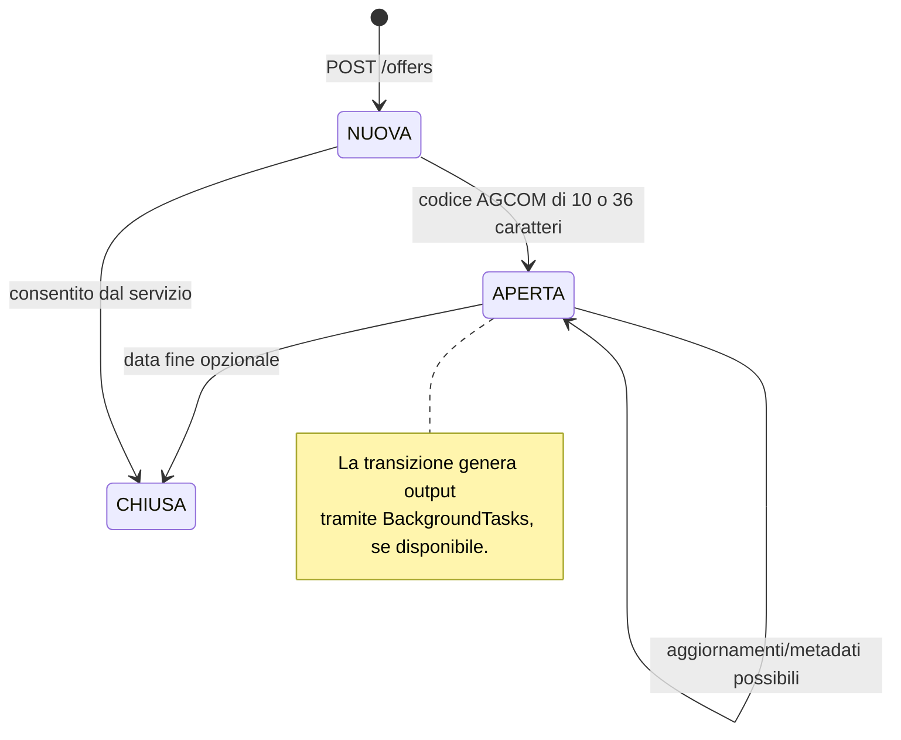
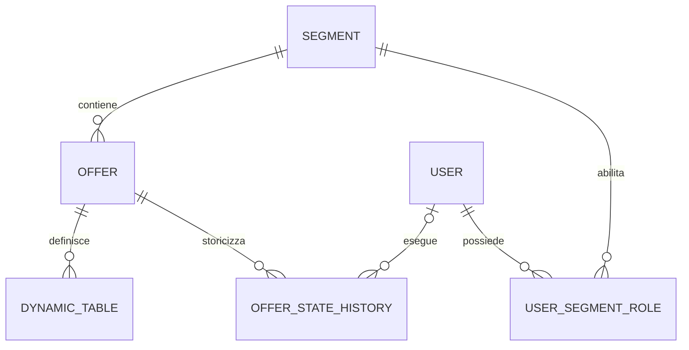

# Onboarding tecnico e di prodotto

## WINDTRE Sintesi & Trasparenze Automation

Questo documento è il punto di ingresso per chi deve mantenere, completare o portare in esercizio **WINDTRE Sintesi & Trasparenze Automation**. La repository contiene sia un prototipo funzionante in locale sia una progettazione di destinazione su Google Cloud. Le due cose non coincidono ancora: il codice esegue un'applicazione FastAPI monolitica, con SQLite e task in-process; Cloud Run, Cloud Spanner, Cloud Tasks, GCS, SSO e RBAC server-side sono requisiti o disegni di architettura, non integrazioni già attive. Tenere questa distinzione esplicita è essenziale per valutare correttamente copertura, sicurezza e maturità del sistema.

Il prodotto mira a sostituire l'aggiornamento manuale di file Word, Excel e PDF mantenuti sui PC dei team marketing. L'operatore deve modificare una base dati centrale una sola volta e generare gli output precontrattuali interessati: **Sintesi Contrattuale Word/PDF** e **Trasparenza Tariffaria Excel/PDF**. Il beneficio atteso è ridurre ripetizioni durante i canvas commerciali, mantenere coerenza tra documenti e diminuire il rischio di rigetto da parte di AGCOM o Adobe.

## Guida alla lettura

Questo file offre la visione d'insieme e le conclusioni architetturali. I dettagli sono stati articolati in capitoli specialistici, da leggere insieme al presente documento:

| Capitolo | Quando consultarlo | Contenuto |
| --- | --- | --- |
| [01 - Prodotto e dominio](onboarding/01_PRODOTTO_E_DOMINIO.md) | Per comprendere processo, segmenti, stati e requisiti | AS-IS/TO-BE, attori, casi d'uso, matrici per segmento e regole di lifecycle. |
| [02 - Architettura, dati e API](onboarding/02_ARCHITETTURA_DATI_E_API.md) | Per sviluppare backend o frontend | Componenti reali, schema, contratti endpoint, payload ed errori. |
| [03 - Rendering e template](onboarding/03_RENDERING_E_TEMPLATE.md) | Per gestire template, output e compliance | Placeholder, JSON padre-figlio, rich text, bollini, PDF e naming. |
| [04 - Operatività e roadmap](onboarding/04_OPERATIVITA_SICUREZZA_E_ROADMAP.md) | Per avviare o industrializzare il sistema | Setup, Docker, segreti, test, rischi, backlog e criteri di rilascio. |

Il materiale di progetto usa talvolta il tempo futuro per descrivere capacità non ancora implementate. Nei capitoli di dettaglio ogni argomento è classificato come **presente nel runtime**, **presente solo nel modello/progetto** oppure **mancante**.

## Contesto di business

Le Sintesi Contrattuali e le Trasparenze Tariffarie sono documenti distinti, pubblicati su canali diversi. Le trasparenze vengono caricate in PDF sui siti WINDTRE e Very Mobile e in Excel sul portale AGCOM. Le sintesi PDF alimentano Adobe, e-commerce, POS e pagine di trasparenza. La distribuzione finale resta responsabilità degli utenti business: l'applicazione deve preparare file validi, nomi univoci e una mappatura CSV per Adobe, non pubblicare direttamente sui canali.

La richiesta copre nove segmenti commerciali: `W3_MOB_GA_CNS`, `W3_MOB_CB_CNS`, `W3_MOB_GA_MB`, `W3_FIX_GA_CNS`, `W3_FIX_CB_CNS`, `W3_FIX_GA_MB`, `W3_FIX_CB_MB`, `W3_ETN_CNS` e `VERY_MOBILE`. Il requisito originale associa a ogni segmento specifici editor e prescrive segregazione dei dati: un operatore deve poter leggere e modificare solo le offerte del proprio mercato. Un ulteriore segmento, Mobile CB Microbusiness, è dichiarato non impattato.

Il ritmo principale è costituito da tre o quattro canvas all'anno; le modifiche regolamentari sono invece imprevedibili. Da qui nascono due esigenze apparentemente opposte: la struttura deve sostenere i limiti di riga noti oggi, ma deve restare estendibile senza migrazioni invasive quando AGCOM, marketing o legal richiedono nuove voci.

### Attori e responsabilità

| Attore | Bisogno operativo | Stato nell'implementazione |
| --- | --- | --- |
| Editor marketing | Gestire offerte del proprio segmento, tabelle, stati e nomi file | Dashboard demo e CRUD disponibili; autorizzazione solo simulata nel browser |
| Compliance/regolamentare | Verificare regole AGCOM, accessibilità e contenuti | Regole di rendering parzialmente codificate; audit PDF/UA manuale ancora necessario |
| Amministratore/auditor | Operare trasversalmente, aggiornare configurazioni comuni e controllare la storia | Modello dati presente; nessuna API o autenticazione effettiva |
| Template author | Disegnare master DOCX/XLSX e inserire placeholder | Convenzioni documentate e supportate dal renderer |
| Operatore di pubblicazione | Scaricare output e CSV di mapping, caricare nei canali esterni | Download locale e CSV disponibili; upload esterni assenti |
| Platform/DevOps | Eseguire il servizio e gestire segreti, storage, osservabilità | Docker presente; infrastruttura cloud e CI/CD non presenti |

## Stato della soluzione

Il codice è in una fase di **proof of concept avanzato / demo locale**. L'applicazione serve una dashboard HTML statica, espone endpoint REST, inizializza e popola automaticamente un database SQLite, genera DOCX e XLSX da template, e può produrre PDF. La Sintesi richiede sempre credenziali Microsoft Graph per il PDF; la Trasparenza prova Graph e usa Spire.XLS o LibreOffice come fallback. I test coprono validazioni e varie primitive del renderer, ma non l'intero flusso HTTP o l'infrastruttura target.

La documentazione HLD e il piano di implementazione definiscono invece il target: SPA ospitata su GCS/CDN, API e worker distinti su Cloud Run, Spanner PostgreSQL, Cloud Tasks, GCS privato, Google Identity/OIDC e notifiche SMTP. È una direzione coerente con carichi concentrati nei canvas, ma al momento è un blueprint. Non esistono manifest Terraform, pipeline CI/CD, client GCP, middleware JWT/OIDC, chiamate Cloud Tasks, upload GCS, signed URL né invio email.

```mermaid
flowchart LR
  U[Editor] --> UI[Dashboard HTML servita da FastAPI]
  UI --> API[/api/offers]
  API --> SVC[OfferService e DocumentService]
  SVC --> DB[(SQLite locale)]
  SVC --> BG[FastAPI BackgroundTasks]
  BG --> GEN[Renderer DOCX/XLSX]
  GEN --> G[Microsoft Graph per PDF Sintesi]
  GEN --> P[Graph, Spire.XLS o LibreOffice per PDF Trasparenza]
  GEN --> TMP[/tmp/compilation_workspace]
```

Il task di generazione riceve anche la stessa `Session` SQLAlchemy creata per la richiesta. Questa scelta è sufficiente per una demo, ma non è un confine affidabile per un worker separato: in produzione il job deve ricevere un identificativo dell'offerta e aprire una propria sessione nel processo worker.

## Architettura e flussi

### Lifecycle di un'offerta

Una nuova offerta viene creata nello stato `NUOVA`, con data di inizio e senza codice AGCOM. Alla disponibilità del codice può passare a `APERTA`; la transizione richiede una stringa lunga 10 o 36 caratteri. La chiusura imposta `CHIUSA` e usa la data di fine ricevuta, oppure la data corrente. Ogni transizione può accodare una generazione e la generazione registra una riga in `offer_state_history` con URL GCS costruiti come stringhe.



La macchina a stati implementata non impedisce tutte le transizioni non desiderate e non gestisce transizioni da `CHIUSA`. Inoltre l'aggiornamento metadati e il bulk update possono impostare `status` direttamente, aggirando il controllo del codice AGCOM e la generazione. Sono comportamenti importanti da preservare o correggere consapevolmente quando si industrializza il lifecycle.

### Creazione, modifica e generazione

1. La dashboard carica tutte le offerte con `GET /api/offers` e, per ciascuna, le tabelle dinamiche.
2. `POST /api/offers/` verifica che il segmento esista, crea l'offerta `NUOVA` e inizializza quattro blocchi: `PREZZO`, `COSTI`, `SERVIZI`, `DURATA`.
3. `PUT /api/offers/{id}/tables/{table_identifier}` salva il JSON padre-figlio dopo una seconda validazione con limite del segmento.
4. `POST /api/offers/{id}/compile` o una transizione aggiungono il renderer ai `BackgroundTasks` FastAPI.
5. `DocumentService` compone un payload di placeholder, produce DOCX e XLSX, converte in PDF, e inserisce un record di storico.

La regola business della coesistenza richiede la conservazione di quattro file logici quando un'offerta passa da nuova a codificata: DOCX/PDF per Sintesi e XLSX/PDF per Trasparenza, senza sovrascrivere la versione precedente. Il naming WINDTRE aggiunge `_NUOVA`, `_COD_<codice>` o lo stato; Very Mobile non aggiunge suffix automatici. Nel runtime locale i file vengono scritti nella stessa directory temporanea e non sono realmente caricati in GCS: gli URL nello storico sono quindi dichiarativi. Anche la coesistenza Very Mobile non è garantita se il nome personalizzato resta identico tra versioni.

## Dominio e persistenza

Il modello ORM in `app/database_models.py` è composto da sette entità. SQLite è il database effettivo, creato all'avvio in `pre_contratti.db`; il file SQL descrive l'equivalente obiettivo per Cloud Spanner in dialetto PostgreSQL.



| Entità | Scopo e dati principali |
| --- | --- |
| `segments` | Catalogo dei nove segmenti. Il bootstrap locale inserisce tutti i segmenti. |
| `users` | Identità prevista: email, nome, cognome e flag di attivazione. Non viene popolata né usata dal runtime. |
| `user_segment_roles` | Relazione N:N per il ruolo `viewer`, `editor` o `admin`; non è applicata da router o servizi. |
| `offers` | Anagrafica: segmento, nome, tecnologia, prezzo, PO, stato, date, nomi file, pagamento e tre prezzi di attivazione. |
| `dynamic_tables` | Tabelle per offerta, ordinate e identificate da una stringa; il contenuto flessibile è JSON. |
| `offer_state_history` | Traccia generazioni/transizioni e URI dei quattro output. `changed_by` non viene valorizzato. |
| `global_configs` | Configurazioni globali, incluso il coefficiente RDA nel DDL; non viene letto dal codice. |

### Tabelle padre-figlio

`structural_content` contiene `max_rows_limit` e una sequenza di righe padre. Ogni padre ha `id`, `label`, `value` e figli analoghi. I valori `null` o stringa vuota sono considerati non renderizzabili; `ND` è un valore esplicito da trasformare in “Non applicabile”. `note_links` è persistito separatamente e può contenere `html_content` usato per le note del documento.

Il limite è applicato contando solo righe con un valore truthy. Il servizio usa una tabella di limiti semplificata: sei segmenti sono mappati, mentre `W3_FIX_GA_MB`, `W3_FIX_CB_MB` e `W3_ETN_CNS` ricadono nel default 15. I limiti sono inoltre per contenuto complessivo e non per tabella/numero di padre-figli come richiesto dal documento business. Il campo `max_rows_limit` inviato dal client viene memorizzato ma non determina il limite autorizzato: vale la mappa del servizio.

## API e dashboard

Gli endpoint sono sotto il prefisso `/api/offers`. Non richiedono autenticazione; la dashboard mostra controlli di segmento e persone fittizie, ma il backend restituisce e modifica qualsiasi offerta conoscendone l'UUID.

| Metodo e percorso | Funzione | Note operative |
| --- | --- | --- |
| `GET /api/offers/` | Elenca tutte le offerte per data di creazione decrescente | Nessun filtro per segmento o paginazione. |
| `GET /api/offers/{id}` | Legge una singola offerta | `404` se assente. |
| `POST /api/offers/` | Crea una nuova offerta | Inizializza quattro tabelle vuote. |
| `PUT /api/offers/{id}` | Aggiorna metadati | Non riconvalida ordine delle date e consente lo stato diretto. |
| `GET /api/offers/{id}/tables` | Restituisce il JSON delle tabelle | Per un UUID inesistente restituisce `{}` anziché `404`. |
| `PUT /api/offers/{id}/tables/{table_identifier}` | Salva layout e note | Crea una nuova tabella se l'identificatore non esiste. |
| `POST /api/offers/{id}/transition?target_status=...` | Passa ad `APERTA` o `CHIUSA` | Parametri query, non body JSON. |
| `POST /api/offers/{id}/compile` | Richiede una generazione | Restituisce subito; il fallimento del task non viene esposto all'utente. |
| `POST /api/offers/bulk-update` | Modifica più offerte in una transazione | Non rigenera documenti e non applica autorizzazione. |
| `GET /api/offers/{id}/mapping` | Scarica CSV di mapping Adobe | I link sono URL convenzionali, non output registrati. |
| `GET /` e `GET /health` | Dashboard e health check | `health` non controlla DB, template o Graph. |

Esempio minimo di creazione:

```json
{
  "segment_id": "W3_FIX_GA_CNS",
  "commercial_name": "Super Fibra Casa",
  "technology_type": "FTTH",
  "base_price": 26.99,
  "date_start": "2026-09-02",
  "payment_method": "abbonamento"
}
```

La dashboard è un singolo file HTML/JavaScript, senza build frontend né framework a runtime. Espone scenari demo per pochi segmenti e un “system architect” fittizio; non elabora token. Per un nuovo frontend si raccomanda di trattare la UI come client non fidato: i limiti e l'ownership devono essere sempre applicati dall'API.

## Motore documentale

Il renderer in `app/document_generator.py` è il componente più ricco della repository. Non usa davvero `docxtpl`, malgrado alcune fonti di progetto lo dichiarino: usa `python-docx` per leggere e mutare il documento e `openpyxl` per il foglio di calcolo.

### Sintesi Word

Il motore sostituisce placeholder `{{nome}}` nei paragrafi e nelle celle, poi cerca i marker dinamici `{{parent_i_label}}`, `{{parent_i_value}}`, `{{child_i_j_label}}` e le varianti prefissate, per esempio `{{SERVIZI_parent_0_label}}`. Sono supportati due layout: tabella classica a due colonne, nella quale il valore è scritto nella cella adiacente, e layout verticale in cui label e value hanno marker distinti. Le righe non popolate vengono rimosse dall'XML della tabella; un padre senza valore ma con figli resta come intestazione.

Valori e note accettano una piccola sintassi rich text: `**grassetto**`, tag HTML `b`, `i`, `sup`, `sub`, apici in forma `^testo^`, URL semplici e link Markdown, inclusi tooltip opzionali. Il renderer converte la formattazione in run Word e crea hyperlink OpenXML. Questa è una superficie da trattare come contenuto non fidato: non viene eseguito HTML, ma le URL non sono sottoposte a allowlist.

Per le tecnologie `FTTH`, `FTTC`, `FWA` e `5G` il motore risolve un bollino da `templates/bollini/` e prova a impostare il testo alternativo nel descrittore dell'immagine. `4G` non ha un bollino. L'immagine può essere inserita da marker `$Bollino$` o quando una label contiene “tecnologia”; l'affermazione che sia sempre accanto alla parola chiave dipende quindi dal template effettivo e va verificata con test visivi/accessibilità.

### Trasparenza Excel e PDF

Il motore sostituisce placeholder in tutte le celle e popola velocità per tecnologia. Se trova il marcatore `[INIZIO_TABELLA_PREZZI]`, inserisce righe sotto il marker per ogni riga attiva; altrimenti lascia il template senza blocco dinamico. Le formule non vengono riscritte dopo `insert_rows`, nonostante la documentazione di design indichi questa funzionalità. La configurazione di stampa imposta A4 verticale, margini stretti e adattamento a una pagina in larghezza e altezza.

La conversione PDF della Sintesi utilizza esclusivamente Microsoft Graph/OneDrive: ottiene un token client-credentials, carica il DOCX, scarica `?format=pdf` e tenta la cancellazione del file remoto. Il client implementa cache del token e retry esponenziale per 400, 429 e 5xx, rispettando `Retry-After`. Per la Trasparenza, Graph è preferito ma il fallback prova Spire.XLS, rimuove pagine/watermark di valutazione con `pypdf`, e infine usa LibreOffice headless. Il controllo sotto 2 MB genera soltanto un warning, non blocca né comprime l'output; nessun codice verifica formalmente la conformità PDF/UA.

## Regole di conformità

| Regola | Copertura attuale | Limite da conoscere |
| --- | --- | --- |
| Valore `ND` | Convertito in “Non applicabile” per righe renderizzate | Il confronto è case-sensitive in vari punti; `N/A` non è uniformemente gestito. |
| Nessuna riga vuota | Righe con valore vuoto rimosse nel DOCX e saltate nell'XLSX | La presenza di un figlio può mantenere il padre vuoto; è una scelta supportata dai test. |
| Note a fine tabella | Note disponibili nel payload e come placeholder | Non esiste un algoritmo che le ancori automaticamente dopo ciascuna tabella. |
| Bollini con testo alternativo | Mappa e tentativo di descrizione OpenXML | Serve verifica PDF/UA con lettore e checker reale. |
| Nome Adobe | Spazi convertiti in `_`, caratteri proibiti rimossi, limite 160 inclusa estensione | Non verifica collisioni né lunghezza del percorso remoto. |
| PDF minore di 2 MB | Dimensione calcolata dopo conversione | Solo log di warning; nessun errore o ottimizzazione. |
| RDA e convergenza | DDL prevede configurazioni globali | Nessuna lettura, calcolo o rigenerazione massiva nel codice. |

Il requisito prevede inoltre schemi diversi per segmento, note fisse e variabili, campi liberi senza limite, multi-prezzo e generazione selettiva di Sintesi, Trasparenza o entrambe. Il JSON flessibile è una buona base per la prima esigenza, ma non rappresenta ancora configurazioni template/versione, scope del campo, selezione di output o invarianti specifiche di mercato.

## Struttura della repository

| Percorso | Contenuto e ruolo |
| --- | --- |
| `app/main.py` | App FastAPI, CORS permissivo, engine/session SQLite, seed, dashboard, download e health. |
| `app/api_routes.py` | Router REST e dependency della sessione DB. |
| `app/database_models.py` | ORM SQLAlchemy e modelli Pydantic. |
| `app/services/offer_service.py` | CRUD, limiti, transizioni e bulk update. |
| `app/services/document_service.py` | Costruzione payload, naming, invocazione renderer, audit e CSV. |
| `app/services/graph.py` | Client Microsoft Graph con autenticazione client credentials e retry. |
| `app/document_generator.py` | DOCX/XLSX, formattazione rich text, bollini, PDF e sanificazione nomi. |
| `app/database/spanner_schema.sql` | DDL obiettivo Spanner e seed SQL; contiene un errore sintattico nella definizione di `offer_state_history`. |
| `templates/` | Master DOCX/XLSX e asset dei bollini. Sono parte del contratto del renderer. |
| `admin_dashboard.html` | Dashboard monofile con mock di identità e chiamate API. |
| `tests/test_suite.py` | Test pytest di validazioni, renderer DOCX, rich text, hyperlink e bulk update. |
| `README.MD`, `GEMINI.md`, `implementation_plan.md`, `docs/` | Manuali e architettura target; alcune affermazioni sono aspirazionali. |
| `Requisito_Automazion_creazione_file_precontratti.txt` | Fonte business primaria, inclusi vincoli per segmento, canali e commenti di chiarimento. |
| `Dockerfile`, `requirements.txt`, `pyproject.toml` | Packaging e dipendenze. |
| `mcp_config.json` | Strumenti MCP pianificati; usa percorsi `/home/user/projects/pre_contratti` non validi per questo workspace. |

I file `*.metadata.json` sono sidecar dell'ambiente editoriale e non partecipano al runtime. Il file `extracted_requirements.txt` è una copia estratta del requisito e non dovrebbe diventare una seconda fonte normativa.

## Ambiente locale e Docker

### Prerequisiti

Il `pyproject.toml` richiede Python 3.13 o superiore, mentre il Dockerfile usa Python 3.11. Il codice adotta sintassi compatibile con entrambe, ma questa divergenza va risolta prima di fissare un ambiente supportato. Sono necessarie dipendenze Python elencate in `requirements.txt`; `email-validator` non è necessario al runtime attuale nonostante l'import di `EmailStr`, perché lo schema non lo usa. Per generare PDF di Sintesi servono anche le quattro credenziali Graph.

```bash
python3 -m venv .venv
source .venv/bin/activate
pip install -r requirements.txt
uvicorn app.main:app --reload --port 8000
```

All'avvio si crea o riusa `pre_contratti.db`, vengono create le tabelle e, se il database è vuoto, vengono inseriti nove segmenti e tre offerte dimostrative. Il servizio tenta di usare `/app/pre_contratti_db_init.lock` per serializzare il bootstrap; fuori dal container il percorso può non essere scrivibile, ma il codice effettua fallback senza lock. La dashboard è disponibile in `http://localhost:8000/`, OpenAPI in `http://localhost:8000/docs` e health in `http://localhost:8000/health`.

Configurare le credenziali senza versionarle in `.env`:

```dotenv
MS_GRAPH_TENANT_ID=...
MS_GRAPH_CLIENT_ID=...
MS_GRAPH_CLIENT_SECRET=...
MS_GRAPH_DRIVE_ID=...
```

Sono accettati anche i prefissi `ONEDRIVE_`. Il file `.gitignore` esclude `.env`, virtualenv e database locali. Non inserire segreti nei template, nei JSON di offerta, nel codice o nel log dei job.

### Docker

Il container installa LibreOffice Writer/Calc e font, copia i template in `/gcs/templates/`, esegue come utente non root e avvia quattro worker Uvicorn sulla porta 8080.

```bash
docker build -t pre-contratti-app .
docker run --rm -p 8080:8080 --env-file .env pre-contratti-app
```

Con quattro processi e SQLite locale, l'app non deve essere considerata sicura per persistenza concorrente. Inoltre il filesystem del container è effimero: database e `/tmp/compilation_workspace` non persistono oltre la vita dell'istanza. Il Dockerfile abilita LibreOffice per la Trasparenza, ma non costituisce un fallback per il PDF della Sintesi, che fallisce senza Graph.

## Sicurezza, operatività e qualità

La modellazione prevede RBAC, ma la sicurezza del runtime non è ancora adeguata a dati o documenti reali. CORS consente qualsiasi origine con credenziali, non esiste autenticazione, le query non sono filtrate per segmento e i download accettano un nome file senza normalizzarlo contro traversal. `download_compiled_file` crea inoltre un file mock se non trova l'output richiesto: è utile alla demo, ma non è comportamento da produzione perché può mascherare un errore di generazione.

Microsoft Graph usa il grant client credentials e non stampa il secret; resta necessario salvare i segreti in un secret manager e applicare principio del minimo privilegio al drive usato come scratch. La cancellazione dell'item OneDrive è best-effort: vanno previste retention, cleanup e monitoraggio degli oggetti rimasti. Gli URI GCS attuali sono pubblici per costruzione testuale e non sono signed URL.

La suite si esegue con:

```bash
pytest tests/
```

Copre sanificazione dei nomi, validazione data/PO/codice AGCOM, limiti padre-figlio, formattazione, hyperlink e bulk update. L'ultimo test usa il database SQLite reale e fa rollback, perciò la suite non è completamente isolata se esistono dati concorrenti. Mancano test API con autenticazione, autorizzazione, transizioni illegali, regressioni XLSX/formule, fallback PDF, Graph simulato, dimensioni PDF, PDF/UA, template reali e flusso end-to-end. Non esistono configurazioni di formatter, linter, type checker, coverage o CI.

## Gap, rischi e roadmap

La seguente matrice è il modo pratico per pianificare l'industrializzazione senza confondere l'intenzione progettuale con il comportamento disponibile.

| Area richiesta | Situazione | Priorità consigliata |
| --- | --- | --- |
| Identity, RBAC e segregazione | Tabelle e mock UI esistono; enforcement assente | Bloccante prima di utenti reali |
| Spanner, GCS, Cloud Tasks e worker separato | DDL e diagrammi esistono; runtime SQLite/in-process | Bloccante per scalabilità, affidabilità e persistenza |
| DDL Spanner | Incompleto: una riga isolata `UUID,` rende lo script non eseguibile | Correggere e provare su ambiente target |
| Stato e audit | Stati base e storico esistono; transizioni e attore non sono rigorosi | Definire matrice lifecycle per segmento |
| Coesistenza output | Naming e storico sono parziali; storage non reale | Implementare versionamento e storage immutabile |
| Template per segmento | Renderer generico; solo quattro tabelle iniziali | Modellare configurazioni/versioni e validazioni per sezione |
| Note fisse/variabili e campo libero | `note_links.html_content` unico | Aggiungere semantica e UI coerenti con requisito |
| Multi-prezzo e selezione output | Non implementati | Modellare offerte/punti prezzo e job selettivi |
| PDF/UA e limiti Adobe | Conversione e warning presenti; prova formale assente | Aggiungere validator, policy di errore e test manuale assistivo |
| Pubblicazione e notifiche | Fuori dal codice | Confermare confine: solo pacchetto/ZIP/email o integrazione canali |
| CI/CD e osservabilità | Assenti | Aggiungere pipeline, log strutturati, metriche e alert |

Un percorso ragionevole parte dalla definizione approvata dei contratti: modello per segmento, transizioni consentite, policy di naming e criterio oggettivo di PDF/UA. Il secondo passo è rendere sicuro il piano dati, con autenticazione OIDC, autorizzazione server-side e storage persistente. Solo dopo va estratto il renderer in worker idempotenti, con job tracciati e retry. Infine, template reali, verifiche AGCOM/Adobe e UAT con gli editor devono diventare test di accettazione ripetibili.

## Materiale di riferimento

Per il dettaglio funzionale prevale il requisito originale in `Requisito_Automazion_creazione_file_precontratti.txt`. Per le convenzioni dei placeholder consultare `SINTESI_TEMPLATE_MANUAL_ITA.md`; per l'architettura desiderata `implementation_plan.md`, `hld_presentation.md` e `low_level_design.md`. In caso di conflitto, verificare sempre il sorgente prima di dichiarare una funzionalità disponibile: i documenti di design includono API, componenti e garanzie non ancora realizzati.