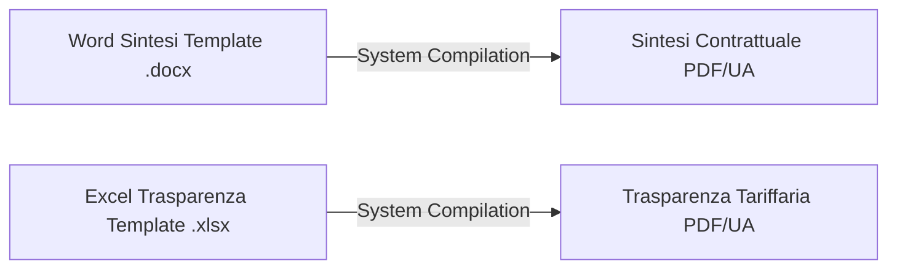

# WINDTRE Template Design Manual — Sintesi & Trasparenze Automation

Welcome! This manual is designed for **Template Authors, Marketing Teams, and Compliance Officers**. It explains how to design, edit, and format master templates for **Sintesi Contrattuali** (.docx Word documents) and **Trasparenze Tariffarie** (.xlsx Excel sheets) to ensure automatic, regulation-compliant document generation.

---

## 1. Document Synthesis Overview

The automated system reads your Word and Excel templates, replaces custom placeholders with official database fields, dynamically populates tariff tables, and outputs fully accessible, regulatory-compliant PDF documents.



---

## 2. Sintesi Contrattuali (.docx) Templates

Sintesi documents must be structured inside a standard Microsoft Word `.docx` file. You can use standard text styling, brand typography, and tables.

### A. Global Placeholders
These text-based placeholders can be placed anywhere in your document (inside paragraphs, headers, footers, or static tables). The system will automatically replace them with the current offer details:

| Placeholder | Replaced With | Example Output |
| :--- | :--- | :--- |
| `{{nome_offerta}}` | Commercial name of the offer | `WINDTRE Super Fibra Unlimited` |
| `{{tecnologia}}` | Primary network technology | `FTTH` |
| `{{prezzo}}` | Monthly base price (inc. VAT) | `29.99 €` |
| `{{agcom_code}}` | Official AGCOM offer code | `COD1234567` |
| `{{po_code}}` | Internal Very Mobile PO code | `PO123456` |

---

### B. Dynamic Tables: Layout & Syntax

Dynamic tables are used to render complex lists of services, tariffs, and specifications where the number of rows is variable. To make your table dynamic, **the system scans the placeholders you put inside your template cells**.

The system supports **two layout modes** for dynamic tables. Choose the one that matches your document's aesthetic needs.

---

#### 💡 Layout Option 1: Classic Side-by-Side (2-Column)
Use this option when you want a standard, clean list of features with labels on the left and values on the right.

*   **Design Rule**: Put **only the label placeholder** (`..._label`) in the left cell (column 1). Keep the right cell (column 2) blank or unpopulated.
*   **Behavior**: The system will write the feature name in the left cell and write the database value directly into the cell to its right.

##### Template Design (Word):
| Column 1 (Label) | Column 2 (Value) |
| :--- | :--- |
| `{{parent_0_label}}` | *[Keep empty in Word]* |
| `{{child_0_0_label}}` | *[Keep empty in Word]* |

##### Final Generated PDF:
| Column 1 | Column 2 |
| :--- | :--- |
| Canone Mensile | 29.99 € |
| &nbsp;&nbsp;&nbsp;&nbsp;↳ Sconto Convergenza | 5.00 € |

---

#### 💡 Layout Option 2: Vertical Stacked (1-Column) — *NEW*
Use this option when designing compact tables, single-column lists, or cards where labels and values look better stacked on top of one another.

*   **Design Rule**: Explicitly write **both the label placeholder** (`..._label`) **and the value placeholder** (`..._value`) in separate cells or consecutive rows.
*   **Behavior**: The system detects the explicit `_value` placeholder and writes the value exactly where you specified it, allowing you to use single-column tables.

##### Template Design (Word):
| Single Column |
| :--- |
| **`{{SERVIZI_parent_0_label}}`** |
| `{{SERVIZI_parent_0_value}}` |
| **`{{SERVIZI_parent_1_label}}`** |
| `{{SERVIZI_parent_1_value}}` |

##### Final Generated PDF:
| Single Column |
| :--- |
| **Giga Illimitati** |
| Incluso |
| **Hotspot Mobile** |
| Abilitato |

> [!IMPORTANT]
> **Regulatory Compliance (AGCOM Standard 229)**: 
> If a parent item (e.g. `Servizio Assistenza`) has no value in the database, the system will programmatically delete **both** the label row and the value row. No blank gaps or empty placeholder rows will ever remain in your document.

---

### C. Dynamic Row Combinations & Configurations

By combining **Parents (Padre)** and **Children (Figlio)** row types, you can build **four standard layout combinations** to represent different commercial scenarios. 

Below are the exact database structures, how to lay them out in Word, and how they appear in the final PDF.

---

#### 📦 Combination 1: Flat Row (Parent with Value, Zero Children)
Use this for simple standalone items that don't need any sub-items or further breakdown.

*   **Database JSON**:
    ```json
    { "id": "p_sim", "type": "padre", "label": "Costo SIM fisica", "value": "10,00 euro", "children": [] }
    ```
*   **Template Design (Word)**:
    | Column 1 (Label) | Column 2 (Value) |
    | :--- | :--- |
    | `{{SERVIZI_parent_0_label}}` | `{{SERVIZI_parent_0_value}}` |
*   **Final Output (PDF)**:
    | Column 1 | Column 2 |
    | :--- | :--- |
    | Costo SIM fisica | 10,00 euro |

---

#### 📦 Combination 2: Section Header (Parent with NO Value, N Children)
Use this when you want a parent to act purely as a group heading (with no price of its own), listing sub-features directly underneath.

*   **Database JSON**:
    ```json
    {
      "id": "p_extra", "type": "padre", "label": "Servizi Extra", "value": "", "children": [
        { "id": "c_segret", "type": "figlio", "label": "Segreteria Telefonica", "value": "Gratuito" },
        { "id": "c_sms_rep", "type": "figlio", "label": "SMS Reperibilità", "value": "Incluso" }
      ]
    }
    ```
*   **Template Design (Word)**:
    | Column 1 (Label) | Column 2 (Value) |
    | :--- | :--- |
    | `{{SERVIZI_parent_0_label}}` | `{{SERVIZI_parent_0_value}}` |
    | `{{SERVIZI_child_0_0_label}}` | `{{SERVIZI_child_0_0_value}}` |
    | `{{SERVIZI_child_0_1_label}}` | `{{SERVIZI_child_0_1_value}}` |
*   **Final Output (PDF)**:
    | Column 1 | Column 2 |
    | :--- | :--- |
    | **Servizi Extra** | |
    | &nbsp;&nbsp;&nbsp;&nbsp;↳ Segreteria Telefonica | Gratuito |
    | &nbsp;&nbsp;&nbsp;&nbsp;↳ SMS Reperibilità | Incluso |

---

#### 📦 Combination 3: Detailed Cost Breakdown (Parent with Value + N Children)
Use this when you want to show a primary price/status, followed by a granular breakdown of its specific conditions.

*   **Database JSON**:
    ```json
    {
      "id": "p_canone", "type": "padre", "label": "Canone mensile", "value": "29,99 euro", "children": [
        { "id": "c_primi_48", "type": "figlio", "label": "Primi 48 mesi", "value": "24,00 euro" },
        { "id": "c_dal_49", "type": "figlio", "label": "Dal 49esimo mese", "value": "29,99 euro" }
      ]
    }
    ```
*   **Template Design (Word)**:
    | Column 1 (Label) | Column 2 (Value) |
    | :--- | :--- |
    | `{{SERVIZI_parent_0_label}}` | `{{SERVIZI_parent_0_value}}` |
    | `{{SERVIZI_child_0_0_label}}` | `{{SERVIZI_child_0_0_value}}` |
    | `{{SERVIZI_child_0_1_label}}` | `{{SERVIZI_child_0_1_value}}` |
*   **Final Output (PDF)**:
    | Column 1 | Column 2 |
    | :--- | :--- |
    | Canone mensile | 29,99 euro |
    | &nbsp;&nbsp;&nbsp;&nbsp;↳ Primi 48 mesi | 24,00 euro |
    | &nbsp;&nbsp;&nbsp;&nbsp;↳ Dal 49esimo mese | 29,99 euro |

---

#### 📦 Combination 4: Label-Only Nested List (Parent with Value + N Children with Blank/Label-Only Values)
Use this when you want to list sub-items underneath a parent, but you only want to display their descriptions and keep the right-hand value column visually empty.
*(Uses the **Single-Space `" "` Trick** to prevent AGCOM Rule 229 from deleting the empty rows)*.

*   **Database JSON**:
    ```json
    {
      "id": "p_gratis", "type": "padre", "label": "Servizi gratuiti", "value": "Inclusi", "children": [
        { "id": "c_giga_soc", "type": "figlio", "label": "Giga illimitati per Social", "value": " " },
        { "id": "c_ti_ho_c", "type": "figlio", "label": "Ti ho cercato", "value": " " }
      ]
    }
    ```
*   **Template Design (Word)**:
    | Column 1 (Label) | Column 2 (Value) |
    | :--- | :--- |
    | `{{SERVIZI_parent_0_label}}` | `{{SERVIZI_parent_0_value}}` |
    | `{{SERVIZI_child_0_0_label}}` | `{{SERVIZI_child_0_0_value}}` |
    | `{{SERVIZI_child_0_1_label}}` | `{{SERVIZI_child_0_1_value}}` |
*   **Final Output (PDF)**:
    | Column 1 | Column 2 |
    | :--- | :--- |
    | Servizi gratuiti | Inclusi |
    | &nbsp;&nbsp;&nbsp;&nbsp;↳ Giga illimitati per Social | |
    | &nbsp;&nbsp;&nbsp;&nbsp;↳ Ti ho cercato | |

---

## 3. Crucial AGCOM Compliance Standards

To comply with AGCOM guidelines for accessibility and document clarity, the synthesis engine strictly enforces three rules on all Sintesi dynamic tables:

### 🚫 Standard 228: No "ND" Values
*   If a database cell value contains `"ND"`, the system will automatically translate it to **`"Non applicabile"`** in the final document.
*   Do not write `"ND"` manually into templates.

### 🗑️ Standard 229: Zero Gaps & Empty Rows
*   Unpopulated fields or rows that have empty values are **automatically and entirely deleted** from the document's XML structure.
*   The table will dynamically collapse in size to avoid white space gaps, ensuring accessibility screen readers do not hit blank items.

### ⚓ Standard 230: Footnote Placement
*   All regulatory notes, marketing disclosures, and variables are automatically compiled and anchored **directly beneath the bottom border of the table**.
*   They are never allowed to float arbitrarily in the page footer margins.

---

## 4. Technology Badges (Bollini AGCOM)

For fixed-line, FWA, and mixed technologies, the appropriate colored AGCOM badge is automatically injected into **Tabella 1** adjacent to the technology name:

| Technology Type | Injected Badge Image | Embedded Accessible Alt Text |
| :--- | :---: | :--- |
| `FTTH` | 🟢 Verde (FTTH) | `"Bollino Verde - Tecnologia Fibra Ottica FTTH"` |
| `FTTC` | 🟡 Giallo (Misto Fibra Rame) | `"Bollino Giallo - Misto Fibra Rame FTTC"` |
| `FWA` | 🟡 Giallo (Misto FWA) | `"Bollino Giallo - Misto Fibra Radio FWA"` |
| `5G` | 🔵 Grigio (Tecnologia 5G) | `"Bollino Grafico - Tecnologia Mobile 5G"` |

---

## 5. File Naming & Lifecycle Rules

The system manages dynamic document filenames based on the corporate segment to protect naming autonomy:

### Very Mobile Segment
Filenames are written **exactly** as typed in the user interface. No automated timestamps, dates, or suffixes are appended:
*   *Sintesi Name*: `Sintesi_Very_5G_Promo.pdf`
*   *Trasparenza Name*: `Trasparenza_Very_5G_Promo.xlsx`

### WINDTRE Segments
The system appends standard lifecycle suffixes to manage **"4-File Co-existence"**:
1.  **Before AGCOM Code (NUOVA)**: Appends `_NUOVA` (e.g. `Sintesi_Super_Fibra_NUOVA.pdf`).
2.  **Active (APERTA)**: Appends the official AGCOM code (e.g. `Sintesi_Super_Fibra_COD_M123456.pdf`).

During lifecycle transitions, **pre-code files are never deleted or overwritten**, allowing customer service representatives simultaneous access to historical revisions.

---

## 6. Rich-Text Formatting & Clickable Hyperlinks

Dynamic cell values entered in the administrative database or dynamic layouts support inline formatting. The system automatically parses and renders these segments as native Word formatting and interactive PDF links.

### A. Bold Text Formatting
You can apply bold styling to specific words or phrases inside any database field or note. The system supports two styles of tags:
*   **Markdown style**: Wrap text in double asterisks `**your text**` (e.g. `Incluso solo con **attivazione online**`).
*   **HTML style**: Wrap text in `<b>` tags `<b>your text</b>` (e.g. `<b>Incluso:</b> hotspot mobile`).

### B. Clickable Hyperlinks (URLs)
If you need to include a link (for example, to complete an offer's compliance notes or point to transparency portals), you can insert links in two ways:

1.  **Plain URLs**: Any standard website address starting with `http://` or `https://` is automatically converted into a blue, underlined, clickable hyperlink (e.g. `https://windtre.it/extra`).
    *   *Note*: Trailing punctuation (like periods or commas) is automatically cleaned and separated so the link remains fully valid and clickable.
2.  **Markdown-style Hyperlinks**: To display custom text instead of the raw link, use the `[Label](URL)` format.
    *   *Syntax*: `[Visita WINDTRE](https://www.windtre.it)`
    *   *Output in PDF*: **Visita WINDTRE** (as a clickable link)
3.  **Markdown Hyperlinks with ScreenTips (Hover Tooltips)**: To set a native Word hover tooltip or ScreenTip (which is read by screen readers and displays when a user hovers their mouse over the link), enclose the tooltip text in double or single quotes after the URL:
    *   *Syntax*: `[Label](URL "Tooltip Text")`
    *   *Example*: `[WINDTRE](https://www.windtre.it "Sito Ufficiale WINDTRE")`
    *   *Behavior in Word/PDF*: Displays as **WINDTRE** (as a clickable link). When the user hovers their mouse over it, a native Word ScreenTip saying `"Sito Ufficiale WINDTRE"` pops up automatically.

