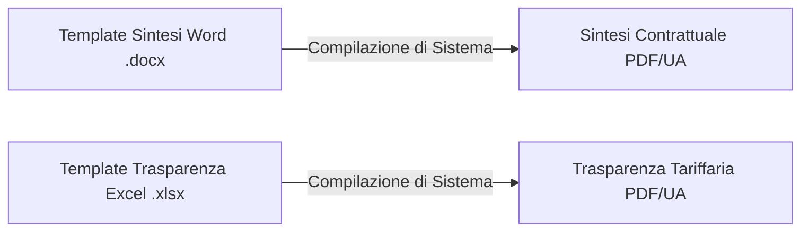

# Manuale di Progettazione dei Template WINDTRE — Automazione Sintesi & Trasparenze

Benvenuto! Questo manuale è pensato per **Autori dei Template, Team di Marketing e Responsabili della Compliance**. Spiega come progettare, modificare e formattare i template master per le **Sintesi Contrattuali** (documenti Word `.docx`) e le **Trasparenze Tariffarie** (fogli Excel `.xlsx`) per garantire la generazione automatica di documenti conformi alle normative vigenti.

---

## 1. Panoramica della Sintesi dei Documenti

Il sistema automatizzato legge i tuoi template Word ed Excel, sostituisce i segnaposto personalizzati (placeholder) con i campi ufficiali del database, popola dinamicamente le tabelle tariffarie e genera documenti PDF completamente accessibili e conformi alle normative AGCOM.



---

## 2. Template per le Sintesi Contrattuali (.docx)

I documenti di Sintesi devono essere strutturati all'interno di un file Microsoft Word standard `.docx`. È possibile utilizzare la formattazione di testo standard, i caratteri del brand e le tabelle.

### A. Segnaposto Globali (Global Placeholders)
Questi segnaposto testuali possono essere inseriti in qualsiasi punto del documento (all'interno di paragrafi, intestazioni, piè di pagina o tabelle statiche). Il sistema li sostituirà automaticamente con i dettagli dell'offerta corrente:

| Segnaposto (Placeholder) | Sostituito Con | Esempio di Output |
| :--- | :--- | :--- |
| `{{nome_offerta}}` | Nome commerciale dell'offerta | `WINDTRE Super Fibra Unlimited` |
| `{{tecnologia}}` | Tecnologia di rete principale | `FTTH` |
| `{{prezzo}}` | Prezzo base mensile (IVA inclusa) | `29.99 €` |
| `{{agcom_code}}` | Codice ufficiale dell'offerta AGCOM | `COD1234567` |
| `{{po_code}}` | Codice interno Very Mobile PO | `PO123456` |

---

### B. Tabelle Dinamiche: Struttura e Sintassi

Le tabelle dinamiche vengono utilizzate per mostrare elenchi complessi di servizi, tariffe e specifiche in cui il numero di righe è variabile. Per rendere dinamica una tabella, **il sistema esegue una scansione dei segnaposto che inserisci nelle celle del tuo template**.

Il sistema supporta **due modalità di layout** per le tabelle dinamiche. Scegli quella che meglio si adatta alle esigenze estetiche del tuo documento.

---

#### 💡 Opzione di Layout 1: Classico Affiancato (A 2 Colonne)
Usa questa opzione se desideri un elenco standard e pulito di caratteristiche, con i nomi a sinistra e i valori a destra.

*   **Regola di Progettazione**: Inserisci **solo il segnaposto del nome** (`..._label`) nella cella di sinistra (colonna 1). Mantieni la cella di destra (colonna 2) vuota nel file Word.
*   **Comportamento**: Il sistema scriverà il nome della caratteristica nella cella di sinistra e scriverà il valore del database direttamente nella cella alla sua destra.

##### Progettazione del Template (Word):
| Colonna 1 (Nome) | Colonna 2 (Valore) |
| :--- | :--- |
| `{{parent_0_label}}` | *[Mantieni vuoto in Word]* |
| `{{child_0_0_label}}` | *[Mantieni vuoto in Word]* |

##### PDF Finale Generato:
| Colonna 1 | Colonna 2 |
| :--- | :--- |
| Canone Mensile | 29.99 € |
| &nbsp;&nbsp;&nbsp;&nbsp;↳ Sconto Convergenza | 5.00 € |

---

#### 💡 Opzione di Layout 2: Incolonnato Verticale (A 1 Colonna)
Usa questa opzione per tabelle compatte, elenchi a colonna singola o schede (card) in cui i nomi e i valori appaiono più ordinati se disposti l'uno sull'altro.

*   **Regola di Progettazione**: Scrivi esplicitamente **sia il segnaposto del nome** (`..._label`) **sia il segnaposto del valore** (`..._value`) in celle separate o in righe consecutive.
*   **Comportamento**: Il sistema rileva il segnaposto `_value` esplicito e scrive il valore esattamente dove lo hai specificato, consentendoti di utilizzare tabelle a colonna singola.

##### Progettazione del Template (Word):
| Colonna Singola |
| :--- |
| **`{{SERVIZI_parent_0_label}}`** |
| `{{SERVIZI_parent_0_value}}` |
| **`{{SERVIZI_parent_1_label}}`** |
| `{{SERVIZI_parent_1_value}}` |

##### PDF Finale Generato:
| Colonna Singola |
| :--- |
| **Giga Illimitati** |
| Incluso |
| **Hotspot Mobile** |
| Abilitato |

> [!IMPORTANT]
> **Conformità Normativa (Standard AGCOM 229)**: 
> Se un elemento padre (ad es. `Servizio Assistenza`) non ha alcun valore nel database, il sistema eliminerà programmaticamente **sia** la riga del nome che la riga del valore. Nessun vuoto o riga segnaposto rimarrà nel documento finale.

---

### C. Combinazioni e Configurazioni delle Righe Dinamiche

Combinando i tipi di riga **Padre** e **Figlio**, è possibile creare **quattro combinazioni di layout standard** per rappresentare diversi scenari commerciali.

Di seguito sono riportate le strutture esatte del database, come disporle in Word e come appaiono nel PDF finale.

---

#### 📦 Combinazione 1: Riga Semplice / Piatta (Padre con Valore, Zero Figli)
Utilizza questa combinazione per singoli elementi stand-alone che non richiedono sotto-voci o ulteriori dettagli.

*   **JSON del Database**:
    ```json
    { "id": "p_sim", "type": "padre", "label": "Costo SIM fisica", "value": "10,00 euro", "children": [] }
    ```
*   **Progettazione del Template (Word)**:
    | Colonna 1 (Nome) | Colonna 2 (Valore) |
    | :--- | :--- |
    | `{{SERVIZI_parent_0_label}}` | `{{SERVIZI_parent_0_value}}` |
*   **PDF Finale**:
    | Colonna 1 | Colonna 2 |
    | :--- | :--- |
    | Costo SIM fisica | 10,00 euro |

---

#### 📦 Combinazione 2: Intestazione di Sezione (Padre SENZA Valore, N Figli)
Utilizza questa combinazione quando desideri che un elemento padre funga esclusivamente da intestazione di gruppo (senza un prezzo proprio), elencando le sotto-voci direttamente al di sotto.

*   **JSON del Database**:
    ```json
    {
      "id": "p_extra", "type": "padre", "label": "Servizi Extra", "value": "", "children": [
        { "id": "c_segret", "type": "figlio", "label": "Segreteria Telefonica", "value": "Gratuito" },
        { "id": "c_sms_rep", "type": "figlio", "label": "SMS Reperibilità", "value": "Incluso" }
      ]
    }
    ```
*   **Progettazione del Template (Word)**:
    | Colonna 1 (Nome) | Colonna 2 (Valore) |
    | :--- | :--- |
    | `{{SERVIZI_parent_0_label}}` | `{{SERVIZI_parent_0_value}}` |
    | `{{SERVIZI_child_0_0_label}}` | `{{SERVIZI_child_0_0_value}}` |
    | `{{SERVIZI_child_0_1_label}}` | `{{SERVIZI_child_0_1_value}}` |
*   **PDF Finale**:
    | Colonna 1 | Colonna 2 |
    | :--- | :--- |
    | **Servizi Extra** | |
    | &nbsp;&nbsp;&nbsp;&nbsp;↳ Segreteria Telefonica | Gratuito |
    | &nbsp;&nbsp;&nbsp;&nbsp;↳ SMS Reperibilità | Incluso |

---

#### 📦 Combinazione 3: Dettaglio dei Costi (Padre con Valore + N Figli)
Utilizza questa combinazione quando desideri mostrare un prezzo o uno stato principale, seguito da una scomposizione dettagliata delle sue specifiche condizioni.

*   **JSON del Database**:
    ```json
    {
      "id": "p_canone", "type": "padre", "label": "Canone mensile", "value": "29,99 euro", "children": [
        { "id": "c_primi_48", "type": "figlio", "label": "Primi 48 mesi", "value": "24,00 euro" },
        { "id": "c_dal_49", "type": "figlio", "label": "Dal 49esimo mese", "value": "29,99 euro" }
      ]
    }
    ```
*   **Progettazione del Template (Word)**:
    | Colonna 1 (Nome) | Colonna 2 (Valore) |
    | :--- | :--- |
    | `{{SERVIZI_parent_0_label}}` | `{{SERVIZI_parent_0_value}}` |
    | `{{SERVIZI_child_0_0_label}}` | `{{SERVIZI_child_0_0_value}}` |
    | `{{SERVIZI_child_0_1_label}}` | `{{SERVIZI_child_0_1_value}}` |
*   **PDF Finale**:
    | Colonna 1 | Colonna 2 |
    | :--- | :--- |
    | Canone mensile | 29,99 euro |
    | &nbsp;&nbsp;&nbsp;&nbsp;↳ Primi 48 mesi | 24,00 euro |
    | &nbsp;&nbsp;&nbsp;&nbsp;↳ Dal 49esimo mese | 29,99 euro |

---

#### 📦 Combinazione 4: Elenco di Sotto-Voci con Solo Nome (Padre con Valore + N Figli con Valore Vuoto)
Utilizza questa combinazione quando desideri elencare delle sotto-voci sotto un elemento padre, ma vuoi visualizzare solo la loro descrizione e mantenere la colonna di destra del valore visivamente vuota.
*(Sfrutta il **Trucco dello Spazio Singolo `" "`** per evitare che la regola AGCOM Standard 229 elimini le righe vuote)*.

*   **JSON del Database**:
    ```json
    {
      "id": "p_gratis", "type": "padre", "label": "Servizi gratuiti", "value": "Inclusi", "children": [
        { "id": "c_giga_soc", "type": "figlio", "label": "Giga illimitati per Social", "value": " " },
        { "id": "c_ti_ho_c", "type": "figlio", "label": "Ti ho cercato", "value": " " }
      ]
    }
    ```
*   **Progettazione del Template (Word)**:
    | Colonna 1 (Nome) | Colonna 2 (Valore) |
    | :--- | :--- |
    | `{{SERVIZI_parent_0_label}}` | `{{SERVIZI_parent_0_value}}` |
    | `{{SERVIZI_child_0_0_label}}` | `{{SERVIZI_child_0_0_value}}` |
    | `{{SERVIZI_child_0_1_label}}` | `{{SERVIZI_child_0_1_value}}` |
*   **PDF Finale**:
    | Colonna 1 | Colonna 2 |
    | :--- | :--- |
    | Servizi gratuiti | Inclusi |
    | &nbsp;&nbsp;&nbsp;&nbsp;↳ Giga illimitati per Social | |
    | &nbsp;&nbsp;&nbsp;&nbsp;↳ Ti ho cercato | |

---

## 3. Standard di Conformità AGCOM Cruciali

Per essere conformi alle linee guida AGCOM in materia di accessibilità e chiarezza dei documenti, il motore di sintesi applica rigorosamente tre regole a tutte le tabelle dinamiche delle Sintesi:

### 🚫 Standard 228: Nessun Valore "ND"
*   Se un valore nel database contiene `"ND"`, il sistema lo tradurrà automaticamente in **`"Non applicabile"`** nel documento finale.
*   Non scrivere `"ND"` manualmente nei template.

### 🗑️ Standard 229: Zero Spazi Vuoti e Righe Vuote
*   I campi o le righe non popolati che hanno valori vuoti vengono **eliminati automaticamente e interamente** dalla struttura XML del documento.
*   La tabella si ridurrà dinamicamente di dimensioni per evitare spazi bianchi, garantendo che gli screen reader per l'accessibilità non incontrino elementi vuoti.

### ⚓ Standard 230: Posizionamento delle Note a Piè di Pagina
*   Tutte le note regolatorie, informative di marketing e variabili vengono compilate automaticamente e ancorate **direttamente sotto il bordo inferiore della tabella**.
*   Non è mai consentito posizionarle arbitrariamente nei margini del piè di pagina.

---

## 4. Bollini Tecnologici (Bollini AGCOM)

Per le tecnologie di rete fissa, FWA e miste, il bollino AGCOM colorato appropriato viene inserito automaticamente nella **Tabella 1** accanto al nome della tecnologia:

| Tipo di Tecnologia | Bollino Inserito | Testo Alternativo Accessibile (Alt Text) |
| :--- | :---: | :--- |
| `FTTH` | 🟢 Verde (FTTH) | `"Bollino Verde - Tecnologia Fibra Ottica FTTH"` |
| `FTTC` | 🟡 Giallo (Misto Fibra Rame) | `"Bollino Giallo - Misto Fibra Rame FTTC"` |
| `FWA` | 🟡 Giallo (Misto FWA) | `"Bollino Giallo - Misto Fibra Radio FWA"` |
| `5G` | 🔵 Grigio (Tecnologia 5G) | `"Bollino Grafico - Tecnologia Mobile 5G"` |

---

## 5. Regole per il Naming dei File e Ciclo di Vita

Il sistema gestisce i nomi dei file in modo dinamico in base al segmento di clientela per proteggere l'autonomia del nome:

### Segmento Very Mobile
I nomi dei file vengono scritti **esattamente** come digitati nell'interfaccia utente. Non vengono aggiunti timestamp, date o suffissi automatici:
*   *Nome Sintesi*: `Sintesi_Very_5G_Promo.pdf`
*   *Nome Trasparenza*: `Trasparenza_Very_5G_Promo.xlsx`

### Segmenti WINDTRE
Il sistema aggiunge i suffissi standard per gestire la **"Coesistenza dei 4 File"**:
1.  **Prima del Codice AGCOM (NUOVA)**: Aggiunge `_NUOVA` (ad es. `Sintesi_Super_Fibra_NUOVA.pdf`).
2.  **Attivo (APERTA)**: Aggiunge il codice ufficiale AGCOM (ad es. `Sintesi_Super_Fibra_COD_M123456.pdf`).

Durante le transizioni dello stato dell'offerta, **i file precedenti all'assegnazione del codice non vengono mai cancellati o sovrascritti**, consentendo agli operatori del servizio clienti un accesso simultaneo alle revisioni storiche.

---

## 6. Formattazione Rich-Text e Collegamenti Ipertestuali (Hyperlink)

I valori inseriti nel database o nei layout dinamici supportano la formattazione inline. Il sistema li interpreta e li renderizza come formattazione nativa Word e link PDF interattivi.

### A. Formattazione in Grassetto (Bold)
È possibile applicare lo stile grassetto a parole o frasi specifiche all'interno di qualsiasi campo del database o nota. Il sistema supporta due stili di tag:
*   **Stile Markdown**: Racchiudi il testo in doppi asterischi `**il tuo testo**` (ad es. `Incluso solo con **attivazione online**`).
*   **Stile HTML**: Racchiudi il testo nei tag `<b>` `<b>il tuo testo</b>` (ad es. `<b>Incluso:</b> hotspot mobile`).

### B. Collegamenti Ipertestuali Cliccabili (URL)
Se devi includere un link (ad esempio, per completare le note di conformità o fare riferimento ai portali di trasparenza), puoi inserire i collegamenti in due modi:

1.  **URL Semplici**: Qualsiasi indirizzo web standard che inizia con `http://` o `https://` viene convertito automaticamente in un collegamento ipertestuale blu, sottolineato e cliccabile (ad es. `https://windtre.it/extra`).
    *   *Nota*: La punteggiatura finale (come punti o virgole) viene automaticamente ripulita e separata in modo che il link rimanga completamente valido e cliccabile.
2.  **Collegamenti in Stile Markdown**: Per visualizzare un testo personalizzato anziché l'URL non elaborato, utilizza il formato `[Nome](URL)`.
    *   *Sintassi*: `[Visita WINDTRE](https://www.windtre.it)`
    *   *Output nel PDF*: **Visita WINDTRE** (come collegamento cliccabile)
3.  **Collegamenti in Stile Markdown con ScreenTip (Tooltip al Passaggio del Mouse)**: Per impostare una descrizione o uno ScreenTip nativo di Word (che viene letto dagli screen reader e appare quando si passa il mouse sopra il link), racchiudi il testo della descrizione tra virgolette doppie o singole dopo l'URL:
    *   *Sintassi*: `[Nome](URL "Testo Descrizione")`
    *   *Esempio*: `[WINDTRE](https://www.windtre.it "Sito Ufficiale WINDTRE")`
    *   *Comportamento in Word/PDF*: Viene visualizzato como **WINDTRE** (come collegamento cliccabile). Quando l'utente passa il mouse sopra di esso, viene visualizzato automaticamente lo ScreenTip `"Sito Ufficiale WINDTRE"`.
