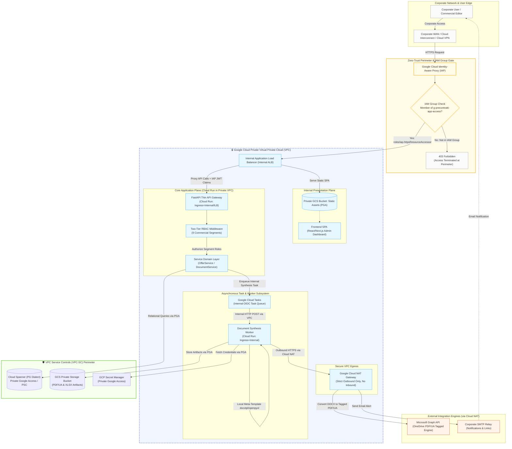
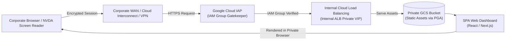
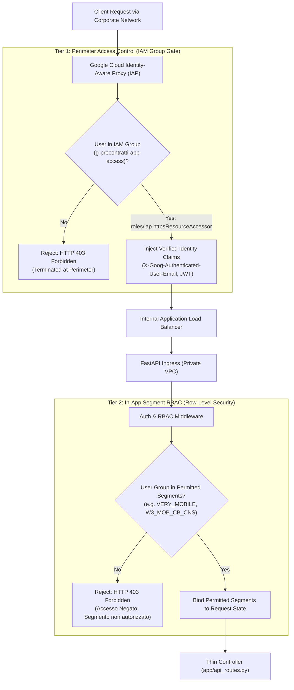
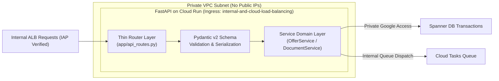
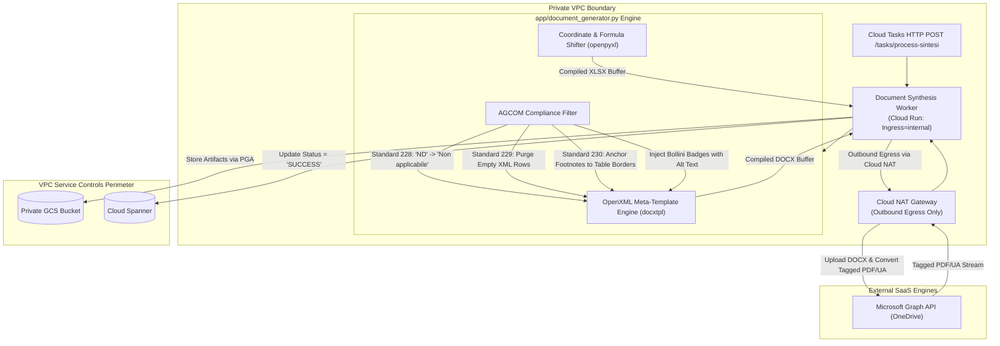
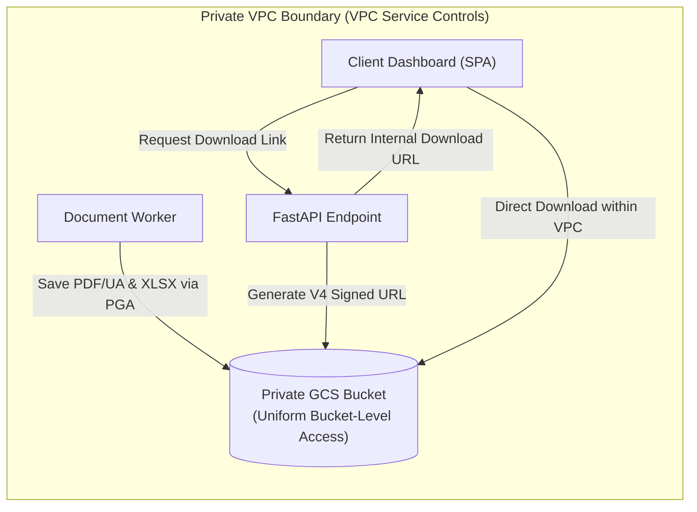
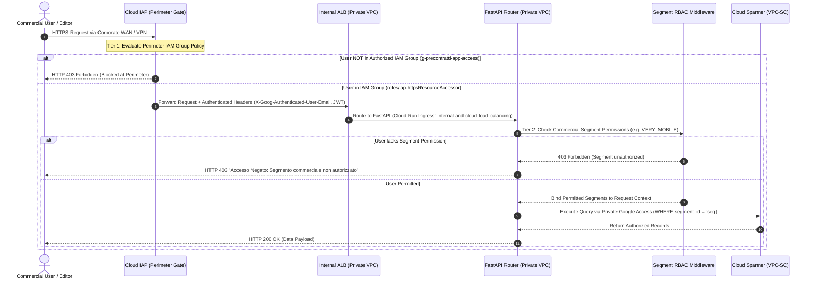
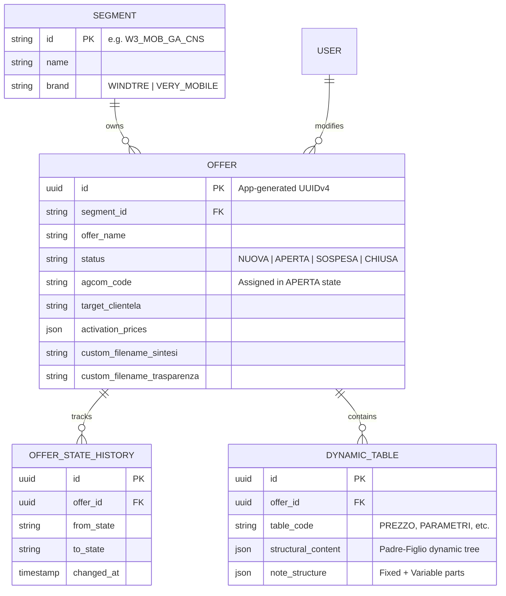
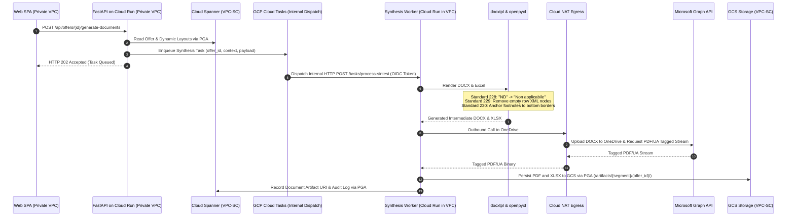
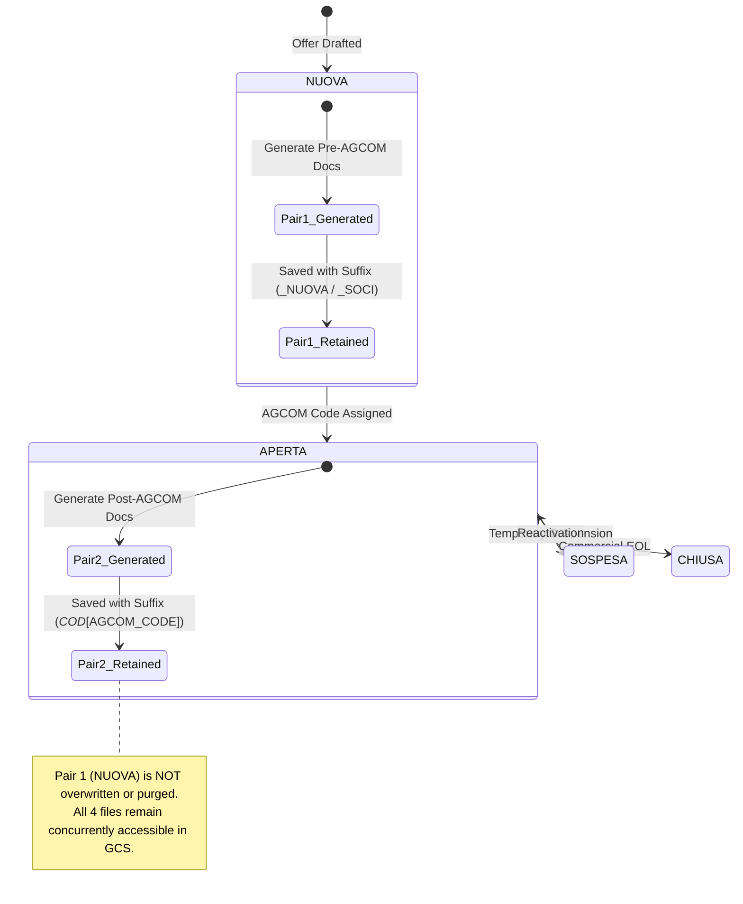

# Cloud Architecture Blueprint & Engineering Rationale
## WINDTRE Sintesi & Trasparenze Automation Platform

This document outlines the enterprise-grade, serverless, and highly secure cloud architecture deployed on **Google Cloud Platform (GCP)** to automate the generation, lifecycle management, and publishing of **Sintesi Contrattuali (PDF/UA)** and **Trasparenze Tariffarie (Excel/PDF/UA)**.

---

## 🗺️ 1. High-Level Serverless Architecture

The platform is designed around a strict **Separation of Concerns (SoC)** model and is entirely contained within a dedicated **Private Virtual Private Cloud (VPC)** on Google Cloud Platform. Public internet exposure is strictly eliminated.

Perimeter ingress is governed by a **Zero-Trust Identity-Aware Proxy (IAP) Gateway** enforcing a **Mandatory IAM Group Access Gate**: **only corporate users belonging to a specific designated IAM Group** (e.g., `group:g-precontratti-app-access@windtre.it` via `roles/iap.httpsResourceAccessor`) are permitted to enter the application perimeter. Inside the Private VPC, traffic is managed by an **Internal Application Load Balancer (Internal ALB)**, routing requests to the static SPA presentation layer and the serverless FastAPI microservice on Cloud Run (configured with internal ingress and Direct VPC Egress). All backend persistence (Cloud Spanner), artifact storage (GCS), task queues (Cloud Tasks), and secrets are sequestered within a **VPC Service Controls (VPC-SC)** security perimeter via Private Google Access (PGA), while external dependencies (Microsoft Graph API for Tagged PDF/UA conversion and Corporate SMTP) route exclusively via **Cloud NAT**.



---

---

## 🛠️ 2. Component-by-Component Architecture, Diagrams & Engineering Rationale

Each piece of the infrastructure was selected to balance **security, sub-second latency, zero maintenance overhead, cost efficiency (scale-to-zero)**, and **strict regulatory compliance**.

```
+---------------------------------------------------------------------------------------------------+
|                                 INFRASTRUCTURE TOPOLOGY OVERVIEW                                  |
+---------------------------------------------------------------------------------------------------+
|  [Network Boundary]   --> Dedicated GCP Private VPC + VPC Service Controls (VPC-SC) Perimeter     |
|  [Perimeter IAM Gate] --> Google Cloud IAP (Strictly restricted to designated Corporate IAM Group) |
|  [Ingress Routing]    --> Internal Application Load Balancer (Internal ALB) in Private Subnet      |
|  [Client Presentation]--> Private Static SPA delivered via Internal ALB & Private GCS Storage    |
|  [Application Plane]  --> FastAPI on Cloud Run (Private VPC Ingress: internal-and-cloud-load-bal) |
|  [Domain Services]    --> OfferService & DocumentService (Multi-Segment Isolation & Business Rules)|
|  [Persistence Plane]  --> Cloud Spanner (PG Dialect, UUIDv4 PKs) via Private Google Access + PSC  |
|  [Queue Subsystem]    --> Google Cloud Tasks (Internal VPC HTTP Dispatch with OIDC Service Token) |
|  [Worker Plane]       --> Document Synthesis Worker (Cloud Run: Ingress=Internal, Direct VPC Egress)|
|  [Compliance Engine]  --> docxtpl / openpyxl Meta-Template Engine (AGCOM Rules 228, 229, 230)     |
|  [Egress Gateway]     --> Cloud NAT Gateway (Strict Outbound Only for MS Graph & Corporate SMTP)  |
|  [Artifact Storage]   --> Private GCS Bucket locked within VPC Service Controls (VPC-SC)          |
+---------------------------------------------------------------------------------------------------+
```

---

### Component 1: Private Ingress & Client Presentation (Private VPC Delivery & IAM Group Gate)



*   **Technologies:** Next.js / React Single-Page Application (SPA), Internal Application Load Balancer (Internal ALB), Google Cloud Storage (GCS) with Private Google Access (PGA), Google Cloud Identity-Aware Proxy (IAP).
*   **Architecture & Flow:** The client dashboard is completely sequestered within the **Private VPC**. Rather than being publicly exposed to the internet via Cloud Armor and public CDN, the SPA artifacts (`index.html`, JS bundles, CSS) are hosted in an internal private GCS bucket behind an **Internal Application Load Balancer (Internal ALB)**. Inbound access is guarded by **Cloud IAP**: only requests coming from authenticated corporate identities belonging to the **authorized IAM Group** can traverse the load balancer.
*   **Engineering Rationale & Trade-offs:**
    *   *Why Private VPC Ingress over Public Cloud CDN?* Sintesi Contrattuali and Trasparenze Tariffarie contain sensitive pre-market commercial tariff data and unreleased product pricing. Exposing the administration console on the public internet—even with a WAF—introduces unnecessary perimeter risk. Hosting the application strictly inside a Private VPC guarantees zero public IP exposure.
    *   *IAM Group Perimeter Gate:* Before any static asset or API request is evaluated, Cloud IAP enforces identity verification against the designated corporate IAM group. Users who are not in this group cannot resolve or interact with the frontend.
    *   *Zero Document Logic on Client:* The frontend strictly consumes RESTful JSON endpoints over the private load balancer. No rendering engines (`docxtpl`, `openpyxl`) or database drivers exist on the client side.

---

### Component 2: Ingress & Identity / Two-Tier RBAC Enforcement Plane



*   **Technologies:** Google Cloud Identity-Aware Proxy (IAP), Google Cloud IAM (`roles/iap.httpsResourceAccessor`), Google Workspace Groups, OpenID Connect (OIDC) JWT, FastAPI Dependency Injection (`Depends(get_current_active_user)`).
*   **Architecture & Flow (Two-Tier Security Model):**
    1.  **Tier 1 — Perimeter IAM Group Gate:** Every inbound connection to the Private VPC passes through Google Cloud IAP. IAP enforces an explicit IAM policy: **only members of a designated Corporate IAM Group** (e.g., `group:g-precontratti-app-access@windtre.it`) holding the `roles/iap.httpsResourceAccessor` role are permitted entry. Any unauthorized account or external user is rejected with HTTP 403 Forbidden directly at the perimeter gate before traffic ever enters the Private VPC or touches backend containers.
    2.  **Tier 2 — In-App Multi-Segment RBAC:** Upon successful perimeter authorization, IAP signs and passes cryptographically verifiable assertion headers (`X-Goog-Authenticated-User-Email` and `X-Goog-IAP-JWT-Assertion`) to the FastAPI ingress. The FastAPI RBAC middleware extracts the user's commercial segment roles (e.g., `g-very-mobile`, `g-w3-mob-cb-cns`, `g-w3-fix-ga-cns`) and binds them to the request state, enforcing row-level access control on every database query.
*   **Engineering Rationale & Trade-offs:**
    *   *Defense-in-Depth:* Tier 1 prevents unauthorized corporate personnel from probing the application interface or API contracts, while Tier 2 guarantees strict commercial segregation between the 9 distinct WINDTRE and Very Mobile market divisions.
    *   *Centralized IAM Governance:* Access to the entire application can be immediately revoked at the enterprise level by removing a user from the primary IAM Group in Google Workspace / Cloud Identity, without modifying application code or database records.

---

### Component 3: API Routing & Application Plane (Thin Controllers in Private VPC)



*   **Technologies:** FastAPI, Pydantic v2, Google Cloud Run, Direct VPC Egress / Serverless VPC Access Connector.
*   **Architecture & Flow:** The routing layer (`app/api_routes.py`) operates as a thin controller inside the **Private VPC**. Container ingress is locked to `internal-and-cloud-load-balancing`, completely deactivating the default public `*.run.app` URLs. Outbound traffic uses Direct VPC Egress into the VPC private subnet. It validates incoming request schemas, unpacks route parameters, checks segment privileges, and immediately delegates all state changes and business logic to `app/services/offer_service.py` or `app/services/document_service.py`.
*   **Engineering Rationale & Trade-offs:**
    *   *Why Cloud Run inside Private VPC?* Telecommunications marketing cycles have pronounced traffic spikes (e.g., end-of-month canvass changes or tariff updates) punctuated by long idle periods. Cloud Run automatically scales containers from 0 to dozens of instances in milliseconds and scales back to zero when idle, eliminating idle compute costs. Enforcing private ingress guarantees that the API is unreachable from the public internet.
    *   *Thin Controllers & Strict Separation of Concerns:* Direct database queries and document manipulation inside route handlers are strictly prohibited. This decouples API contract changes from database schema evolutions and enables isolated unit testing of business rules without mocking HTTP servers.

---

### Component 4: Database Layer — Cloud Spanner (Private Google Access & VPC-SC)

```mermaid
graph TD
    AppLayer["FastAPI Service Layer (SQLAlchemy 2.0 ORM in VPC)"]
    
    subgraph VPCSCPerimeter["🛡️ VPC Service Controls (VPC-SC) Boundary"]
        subgraph SpannerCluster["GCP Cloud Spanner (PostgreSQL Dialect)"]
            SplitRouter["Split Partition Router (Key-Range Sharding)"]
            Node1["Spanner Node A (Split 1: UUIDs 0x0... - 0x5...)"]
            Node2["Spanner Node B (Split 2: UUIDs 0x5... - 0xA...)"]
            Node3["Spanner Node C (Split 3: UUIDs 0xA... - 0xF...)"]
        end
    end
    
    AppLayer -->|Private Google Access (PGA) / PSC| SplitRouter
    SplitRouter --> Node1
    SplitRouter --> Node2
    SplitRouter --> Node3
```

*   **Technologies:** Google Cloud Spanner (PostgreSQL Dialect), SQLAlchemy 2.0 ORM, Application-side `uuid.uuid4()`, Private Google Access (PGA), VPC Service Controls (VPC-SC).
*   **Architecture & Flow:** Entities are modeled with standard relational integrity for core attributes (`offers`, `segments`, `offer_state_history`) and native `JSON` columns for tabular layouts (`structural_content`, `note_structure`). All primary keys are generated client-side via `uuid.uuid4()`. Database access occurs strictly over Google's internal private backbone via Private Google Access / Private Service Connect (PSC), shielded within a **VPC Service Controls** perimeter that blocks data exfiltration to unauthorized networks.
*   **Engineering Rationale & Trade-offs:**
    *   *Why Cloud Spanner over Cloud SQL (PostgreSQL)?* Cloud Spanner offers 99.999% SLA availability with multi-region synchronous replication and zero-downtime maintenance. In telecom environments where contract availability is legally audited, Spanner eliminates failover windows and replication lag.
    *   *Why App-Side UUIDv4 instead of DB-Side Auto-Increment or `gen_random_uuid()`?* Spanner splits data based on key ranges. Sequential integers or monotonically increasing IDs write all rows into a single split, causing split hotspots and throughput degradation. Client-generated random `UUIDv4` values distribute data uniformly across all Spanner splits, ensuring linear horizontal write scaling.
    *   *VPC-SC Data Protection:* Cloud Spanner is placed within a VPC Service Controls perimeter, guaranteeing that database calls can only originate from within the authorized Private VPC subnet.

---

### Component 5: Asynchronous Task Queue & Rate-Limiting Subsystem

```mermaid
graph LR
    subgraph PrivateVPC["Private VPC Boundary"]
        API["FastAPI API Server"]
        CloudTasks["Google Cloud Tasks<br/>(Private PGA Dispatch)"]
        DocWorker["Cloud Run Document Worker<br/>(Ingress: internal)"]
    end

    API -->|1. Enqueue Task (Payload + Metadata)| CloudTasks
    API -.->|2. Return HTTP 202 Accepted| Client["Client Web App (ILB)"]
    CloudTasks -->|3. Controlled Rate HTTP POST via VPC| DocWorker
    DocWorker -->|4. Return 200 OK / 5xx Retry| CloudTasks
```

*   **Technologies:** Google Cloud Tasks, OIDC Service Account Tokens, Private Google Access.
*   **Architecture & Flow:** When an editor requests document compilation or performs a bulk update across dozens of offers, the API enqueues a task payload to Cloud Tasks and immediately returns HTTP 202 Accepted. Cloud Tasks throttles dispatch rates and triggers the synthesis worker via secure HTTP POST directly over the Private VPC network using Google-signed OIDC service account tokens.
*   **Engineering Rationale & Trade-offs:**
    *   *Why Cloud Tasks over Pub/Sub or Celery + Redis?* Celery requires managing dedicated Redis/RabbitMQ clusters and maintaining long-running worker daemon pools. Pub/Sub is designed for high-volume stream ingestion but lacks individual task-level rate-limiting, deduplication, and scheduled delivery controls. Cloud Tasks is fully serverless, provides token-bucket rate limiting per queue, supports exponential backoff retries, and can dispatch directly to private serverless HTTP endpoints on Cloud Run.
    *   *Private In-VPC Invocation:* The Cloud Run document worker has its ingress restricted to `internal`, rejecting all calls that do not originate from within the Private VPC or Google internal infrastructure.

---

### Component 6: Document Synthesis & Egress Architecture



*   **Technologies:** Python `docxtpl` (OpenXML Jinja DOM manipulation), `openpyxl` (formula rewriting & coordinate shifting), Microsoft Graph / OneDrive API, Google Cloud Storage, Google Cloud NAT.
*   **Architecture & Flow:** The worker runs inside the Private VPC as an isolated high-memory Cloud Run container (`ingress = "internal"`). It loads master templates, interpolates dynamic Padre-Figlio tree structures, purges empty rows from the OpenXML DOM, adjusts Excel formulas down the sheet, and initiates outbound HTTPS calls via **Cloud NAT** to the Microsoft Graph API for 100% compliant Tagged PDF/UA compilation.
*   **Engineering Rationale & Trade-offs:**
    *   *Why Exclusive Microsoft Graph API over Headless LibreOffice or ReportLab?* Headless LibreOffice on Linux frequently introduces minor font metrics drift, inconsistent table layout borders, and incomplete PDF/UA tagging structures. Microsoft Graph converts DOCX files using native Microsoft Word rendering engines, guaranteeing 100% compliant Tagged PDF/UA outputs that pass strict PAC3 / PDF/UA accessibility checkers required by AGCOM.
    *   *Cloud NAT Security Boundary:* The worker instances possess zero public IP addresses. Outbound internet connectivity required to contact the Microsoft Graph API and Corporate SMTP relay is strictly brokered by Cloud NAT, ensuring no unsolicited inbound connections can ever penetrate the rendering tier.

---

### Component 7: Document Persistence & Secure Delivery Layer



*   **Technologies:** Google Cloud Storage (Private Bucket), V4 Pre-Signed URLs, VPC Service Controls (VPC-SC), Private Google Access (PGA).
*   **Architecture & Flow:** All generated documents (`.docx`, `.xlsx`, `.pdf`) are stored in private GCS buckets organized by segment and offer ID (`/artifacts/{segment_id}/{offer_id}/`). The bucket is locked within a VPC Service Controls perimeter. Authorized clients (who have entered through the IAM Group perimeter gate) download documents via short-lived (15-minute) cryptographic V4 signed URLs restricted to the private VPC domain.
*   **Engineering Rationale & Trade-offs:**
    *   *VPC-SC Perimeter Isolation:* Unsigned or external requests from the public internet cannot access the storage bucket, preventing data leaks even if a URL is inadvertently exposed.
    *   *Why Signed URLs over Streaming Files through FastAPI?* Streaming multi-megabyte PDF and Excel files through API instances consumes web server bandwidth and socket connections. V4 signed URLs offload all file transfer bandwidth directly to Google Cloud Storage's private infrastructure, keeping API latencies negligible while preserving zero-trust security.

---

## ⚡ 3. Advanced Database Architecture & Schema Optimization

Designing on Cloud Spanner requires specialized techniques to ensure performance in a distributed environment:

### A. Application-Side UUIDv4 Keys (Hotspotting Prevention)
*   **Problem:** Sequential database primary keys (like auto-incrementing integers) or timestamps cause Spanner to write all consecutive inserts to the same physical storage split (node), creating a **hotspot** that degrades write throughput.
*   **Solution:** We generate cryptographic `UUIDv4` strings strictly on the Python application side using `uuid.uuid4()`. Because UUIDs are completely randomized, Spanner distributes consecutive row writes evenly across all active cluster splits and hardware nodes, enabling linear write scalability.

### B. Schema-on-Read JSON Columns
*   **Problem:** The required tables (`PREZZO`, `COSTI`, `SERVIZI`) vary widely by corporate segment and are updated frequently due to AGCOM directives. Static schemas would require frequent DDL schema migrations, database lockouts, and expensive multi-table JOINs during synthesis.
*   **Solution:** Dynamic table rows are stored inside native Spanner **`JSON`** columns (`structural_content` and `note_links`). This allows storing deep Padre-Figlio (Parent-Child) hierarchies in a single cell. The Service Layer extracts and deserializes this JSON on-the-fly, eliminating database-level structural locks and allowing immediate layout updates from the front-end form builder.

### C. Performance-Optimized Indexes
To ensure sub-second latency, we implement dedicated indices:
*   `idx_users_email` (Unique Index): Fast authentication on every API request.
*   `idx_offers_segment`: Partitions offer queries by the user's active segment to enforce data isolation instantly.
*   `idx_offers_po`: Accelerates query resolution for Very Mobile's PO-coded custom files.
*   `idx_dynamic_tables_offer` (Composite Index on `(offer_id, sequence_order)`): Ensures the document worker retrieves all table blocks sequentially in a single disk scan.

---

## 🔄 4. Asynchronous Orchestration: Cloud Tasks vs. Cloud Run Jobs

| Architectural Feature | Google Cloud Tasks (Targeting Cloud Run Service) | Cloud Run Jobs | Rationale for Choice |
| :--- | :--- | :--- | :--- |
| **Startup Latency** | **Extremely Low (~ms)** (Uses warm container pools) | **High (Several Seconds)** (Spins up a cold container instance per run) | **Cloud Tasks:** Interactive users need documents generated in real-time. Cold-start delays are unacceptable for standard "Save & Compile" triggers. |
| **Rate Limiting** | **Native** (Queue-level controls on dispatches & concurrency) | **None** (Executes independently at maximum speed) | **Cloud Tasks:** Prevents API rate-limiting blocks on external APIs (e.g., Microsoft Graph/OneDrive) during bulk changes. |
| **Retry Policies** | **Advanced** (Exponential backoff, jitter, attempt ceilings) | **Basic** (Standard task restart toggles) | **Cloud Tasks:** Built-in resilience against transient API network drops without writing custom application-side retry logic. |
| **Resource Efficiency**| **High** (Concurrent request processing within warm instances) | **Low** (Isolated container overhead per execution task) | **Cloud Tasks:** Dramatically reduces container compute costs by maximizing request concurrency on warm service instances. |

---

## 🛡️ 5. Compliance & Security by Design

Our cloud architecture is hardened to enforce network perimeter isolation, zero-trust identity policies, and Italian regulatory guidelines programmatically:

### A. Private VPC Network Isolation & Zero-Trust IAM Group Gateway
The application follows a strict zero-trust, private network architecture:
1.  **Complete Network Containment (Private VPC):**
    *   No compute instances (FastAPI or Document Worker on Cloud Run) or persistence services have public IP addresses.
    *   Cloud Run services enforce private ingress controls (`ingress: "internal-and-cloud-load-balancing"` and `ingress: "internal"`), blocking default `*.run.app` URLs entirely.
    *   Outbound traffic from Cloud Run services uses Direct VPC Egress routed through private VPC subnets.
2.  **Mandatory IAM Group Perimeter Gate:**
    *   **Perimeter Access Control:** Google Cloud Identity-Aware Proxy (IAP) sits in front of the Internal Application Load Balancer as the sole entry point.
    *   **Single Authorized IAM Group Policy:** Entry into the application requires the IAM role `roles/iap.httpsResourceAccessor` assigned strictly to the designated Corporate IAM Group: `group:g-precontratti-app-access@windtre.it`.
    *   **Edge Block:** Any corporate account that is not an active member of this specific IAM Group is blocked immediately with an **HTTP 403 Forbidden** before any packets cross the perimeter into the Private VPC.
3.  **VPC Service Controls (VPC-SC) Perimeter:**
    *   Cloud Spanner, Google Cloud Storage buckets, Secret Manager, and Cloud Tasks are encapsulated in a hardened VPC-SC security perimeter.
    *   Prevents data exfiltration and blocks API requests originating from unauthorized networks or external identities.
4.  **Cloud NAT Egress:**
    *   All outbound communication to external third-party endpoints (Microsoft Graph API for Tagged PDF/UA conversion and Corporate SMTP Relay) is funneled through **Cloud NAT** inside the Private VPC. Inbound traffic from the internet is completely denied.

### B. Two-Tier Identity & Multi-Segment RBAC Model
The platform operates a defense-in-depth authorization model:
*   **Tier 1 (Perimeter Gateway Gatekeeper):** Handled by Google Cloud IAP at the network boundary, ensuring only members of `group:g-precontratti-app-access@windtre.it` can enter the Private VPC.
*   **Tier 2 (In-App Commercial Segregation):** Once inside, FastAPI decodes the user identity assertion (`X-Goog-Authenticated-User-Email` and `X-Goog-IAP-JWT-Assertion`). Group-level claims corresponding to the 9 commercial segments (such as `g-very-mobile`, `g-w3-mob-cb-cns`, `g-w3-fix-ga-cns`) are validated:
```python
# FastAPI Dependency Injection Layer (app/api_routes.py)
if segment_id not in current_user.permitted_segments:
    raise HTTPException(
        status_code=403, 
        detail="Accesso Negato: Gruppo IAM non autorizzato per questo segmento commerciale."
    )
```
Database queries dynamically append segment predicates (`WHERE segment_id IN (:user_segments)`), preventing cross-segment data leaks.

### C. The "4-File Co-existence" Rule
For compliance audits, the system must retain and serve **4 separate output files** simultaneously per active offer:
1.  **Pair 1 (NUOVA State):** Sintesi PDF/Word + Trasparenza Excel/PDF compiled *before* AGCOM code assignment.
2.  **Pair 2 (APERTA State):** Sintesi PDF/Word + Trasparenza Excel/PDF compiled *after* the 10-char or 36-char AGCOM code is assigned and the offer goes active.

Cloud Tasks manages this state-machine by writing distinct, structured directories on GCS (e.g. `/{offer_id}/sintesi/{custom_name}_SOCI.pdf` and `/{offer_id}/sintesi/{custom_name}_COD_{code}.pdf`) ensuring the transition never overwrites previous files.

### D. Naming Autonomy Policies
*   **Very Mobile:** The filename is compiled **exactly** as specified in `custom_filename_sintesi` and `custom_filename_trasparenza`. We strictly bypass automated timestamp suffixes (`_YYYYMMDD_HHMM`) to prevent layout-level naming violations.
*   **WINDTRE:** Automatic logical suffixes (`_NUOVA` / `_COD_[CODE]`) are appended to maintain file uniqueness and support co-existence.
*   **Sanitization:** The `Adobe Filename Normalizer` strictly enforces character safety (`[A-Za-z0-9._-]`) and caps the absolute path length to **< 160 characters** with a size limit of **< 2.0 MB** to guarantee error-free Adobe processing.

### E. AGCOM Accessibility Document Standards
The rendering pipeline programmatically enforces Italian regulatory accessibility guidelines:
*   **Standard 228 (ND Mapping):** The compilation parser intercepts cell values equal to `"ND"` or `"N/A"` and replaces them with `"Non applicabile"` in final PDF outputs.
*   **Standard 229 (No Blank Gaps):** The `docxtpl` compiler removes unpopulated rows directly from the OpenXML template structure (`docxtpl` / `<w:tr>`) rather than leaving empty borders, avoiding screen-reader (NVDA) navigation traps.
*   **Standard 230 (Footnote Anchoring):** Injects footnotes and marketing variables immediately below the bottom border of the target table, ensuring they do not float disconnected.
*   **Technology Badge (Bollino) Injection:** Programmatically inserts the correct AGCOM Technology Badge adjacent to the technology name in **Tabella 1** for fixed-line and FWA. Descriptive screen-reader friendly Alt-Text is embedded directly inside the XML draw elements.

---

## 📊 6. Detailed Component Sequence & Data Flow Diagrams

### A. Ingress Security, IAM Group Perimeter Gate & RBAC Enforcement Flow
Every incoming request is verified first at the Private VPC perimeter against the designated corporate IAM Group, and then internally against commercial segment permissions:



### B. Relational & Dynamic Schema Model (Cloud Spanner)
Cloud Spanner models combine strict relational integrity for core entities with native JSON documents for dynamic Padre-Figlio tabular configurations:



### C. Asynchronous Document Synthesis Worker Pipeline
Rendering is decoupled from the web server thread using Google Cloud Tasks and Microsoft Graph, contained entirely within the Private VPC:



### D. Lifecycle Transitions & The "4-File Co-existence" State Machine
WINDTRE business rules require each active offer to preserve both pre-code and post-code document pairs without overwrites:



