# Database Design — Sistema Gestione Offerte Commerciali (v2)

> Documento di riferimento per tutti gli stakeholder (sviluppo, prodotto, compliance/AGCOM).
> Aggiorna la v1 con: soft-delete parziale, snapshot audit-strict obbligatorio, FK composita su `offer_document`, normalizzazione `technology` e campo `payment_method` in `offer`, limiti di riga AGCOM per segmento, e i chiarimenti di business ricevuti.

---

## 1. Introduzione

Questo documento descrive il modello dati che governa il ciclo di vita di un'offerta commerciale, dalla bozza fino alla chiusura, con particolare attenzione alla **tracciabilità richiesta in ambito regolamentato (AGCOM/Telco)**.

Il documento è diviso in tre parti:

1. **Il diagramma ER** — ciò che un database relazionale può esprimere nativamente tramite PK/FK/UK e cardinalità.
2. **Le regole che il diagramma NON può esprimere** — vincoli condizionali, FK composite, trigger, regole di minimo/massimo cardinalità, che vanno implementati esplicitamente in fase di creazione del DB (DDL) o a livello applicativo.
3. **Gli scenari operativi** — cosa succede concretamente, tabella per tabella, nei 5 momenti chiave del ciclo di vita di un'offerta.

Ogni volta che una regola di business non è ancora stata confermata, è segnalata esplicitamente nella sezione **7 — Domande aperte**, con il relativo impatto sul database.

---

## 2. Diagramma ER aggiornato

```mermaid
erDiagram
    SEGMENT ||--o{ USER_SEGMENT_ROLE : permits
    USER ||--o{ USER_SEGMENT_ROLE : holds
    SEGMENT ||--o{ OFFER : isolates

    TECHNOLOGY ||--o{ OFFER : classifies

    OFFER ||--o{ OFFER_ACTIVATION_FEE : defines
    OFFER ||--o{ DYNAMIC_TABLE : contains

    OFFER ||--o{ OFFER_STATE_HISTORY : records
    USER ||--o{ OFFER_STATE_HISTORY : triggers

    OFFER_STATE_HISTORY ||--|| DYNAMIC_TABLE_SNAPSHOT : freezes

    OFFER ||--o{ OFFER_DOCUMENT : owns
    OFFER_STATE_HISTORY |o--o{ OFFER_DOCUMENT : generates
    USER ||--o{ OFFER_DOCUMENT : uploads

    SEGMENT {
        uuid id PK "Cryptographic UUIDv4"
        string code UK "Unique identifier code (e.g. VERY_MOBILE)"
        string name "Human-readable name"
        string description "Detailed description"
        integer max_dynamic_table_rows "AGCOM row limit for this segment's dynamic tables"
        timestamp created_at "Creation timestamp"
        timestamp updated_at "Last update timestamp"
    }

    USER {
        uuid id PK "Cryptographic UUIDv4"
        string email UK "User primary email address"
        string first_name "First Name"
        string last_name "Last Name"
        boolean is_active "Operational status (suspended/enabled), NOT a delete flag"
        timestamp created_at "Sync timestamp"
        timestamp updated_at "Last update timestamp"
    }

    USER_SEGMENT_ROLE {
        uuid user_id PK, FK "References user.id"
        uuid segment_id PK, FK "References segment.id"
        string role "viewer | editor | admin"
    }

    TECHNOLOGY {
        uuid id PK "Cryptographic UUIDv4"
        string code UK "FTTH | FTTC | FWA | 5G | 4G"
        string network_name "Trasparenza-only: full network description"
        string badge_filename "Bollino: asset file path/name"
        string badge_alt_text "Trasparenza-only: accessibility alt label"
        string badge_color "Bollino: pantone/hex color code"
        integer max_download_mbps "Max download speed in Mbps"
        integer max_upload_mbps "Max upload speed in Mbps"
        boolean is_active "Hides from new-offer dropdowns; past offers unaffected"
        timestamp created_at "Creation timestamp"
        timestamp updated_at "Last update timestamp"
    }

    OFFER {
        uuid id PK "Cryptographic UUIDv4"
        uuid segment_id FK "References segment.id"
        uuid technology_id FK "References technology.id"
        string payment_method "CREDITO_RESIDUO | ABBONAMENTO | SEPA_PA"
        string commercial_name "Market name of the offer"
        decimal base_price "Monthly cost"
        string po_code "Nullable. Populated ONLY if segment.code = VERY_MOBILE"
        string current_agcom_code "Nullable. Setting it auto-transitions NUOVA -> APERTA"
        string status "NUOVA | APERTA | CHIUSA (soft CHECK for now)"
        date date_start "Validity start"
        date date_end "Validity end. Must be > date_start"
        string custom_filename_sintesi "Purpose TBD — see Open Questions"
        string custom_filename_trasparenza "Purpose TBD — see Open Questions"
        timestamp created_at "Creation timestamp"
        timestamp updated_at "Update timestamp"
        timestamp deleted_at "Soft delete: only for cancelled drafts / admin rollback"
    }

    OFFER_ACTIVATION_FEE {
        uuid id PK "Cryptographic UUIDv4"
        uuid offer_id FK "References offer.id"
        string target_type "gia_clienti | nuovi_nativi | nuovi_portabilita"
        decimal price "Activation fee amount"
    }

    DYNAMIC_TABLE {
        uuid id PK "Cryptographic UUIDv4"
        uuid offer_id FK "References offer.id"
        string table_identifier "PREZZO | COSTI | SERVIZI"
        integer sequence_order "Sequential compilation sorting index"
        string title "Table header label"
        json structural_content "Nested Padre-Figlio multi-columns array (working draft). Row count bounded by segment.max_dynamic_table_rows"
        json note_links "Footnotes text and anchored link markers"
        timestamp created_at "Creation timestamp"
        timestamp updated_at "Update timestamp"
    }

    OFFER_STATE_HISTORY {
        uuid id PK "Cryptographic UUIDv4. Also part of composite UK (id, offer_id)"
        uuid offer_id FK "References offer.id"
        string old_status "Previous status"
        string new_status "Target status"
        string agcom_code_used "Code assigned/used during this transition"
        uuid changed_by FK "References user.id"
        timestamp timestamp "Transition execution date"
    }

    DYNAMIC_TABLE_SNAPSHOT {
        uuid id PK "Cryptographic UUIDv4"
        uuid state_history_id FK, UK "References offer_state_history.id — 1:1 mandatory"
        json tables_payload "Frozen array of ALL dynamic tables at state change"
        timestamp created_at "Snapshot creation timestamp"
    }

    OFFER_DOCUMENT {
        uuid id PK "Cryptographic UUIDv4"
        uuid offer_id FK "References offer.id — always required"
        uuid state_history_id FK "Nullable. Part of composite FK (state_history_id, offer_id)"
        string doc_type "SINTESI_PDF | TRASPARENZA_PDF | TEMPLATE_DOCX | TEMPLATE_XLSX"
        string gcs_uri "Immutable file URI in GCS"
        integer version "Document revision number"
        boolean is_current "Flag for current active document per (offer_id, doc_type)"
        uuid created_by FK "References user.id — always the triggering user"
        timestamp created_at "Generation or upload timestamp"
    }
```



### Come leggere il diagramma

- `PK` = Primary Key, `FK` = Foreign Key, `UK` = Unique Key (a livello di singola colonna).
- La relazione `OFFER_STATE_HISTORY ||--|| DYNAMIC_TABLE_SNAPSHOT` usa `||` su **entrambi** i lati: significa cardinalità **obbligatoria 1:1** (ogni transizione di stato ha esattamente uno snapshot, mai zero). Vedi §6.2.
- La relazione `OFFER_STATE_HISTORY |o--o{ OFFER_DOCUMENT` usa `|o` sul lato sinistro: significa **zero o uno** (un documento può non essere legato a nessuna transizione, es. un template caricato in bozza). Vedi §6.5 e §5.2.
- **Limite della notazione**: Mermaid (come la maggior parte dei tool ER) non sa disegnare una **foreign key composita** (`OFFER_DOCUMENT.(state_history_id, offer_id)` → `OFFER_STATE_HISTORY.(id, offer_id)`). Il diagramma mostra solo la FK semplice su `state_history_id`; il vincolo reale, più stringente, è descritto in §5.2 e va creato esplicitamente in DDL.

---

## 3. Riferimento tabelle — PK / FK / UK

| Tabella | PK | FK | UK (a colonna singola) | Note |
|---|---|---|---|---|
| `segment` | `id` | — | `code` | — |
| `user` | `id` | — | `email` | — |
| `user_segment_role` | `(user_id, segment_id)` composita | `user_id → user.id`, `segment_id → segment.id` | — | PK composita, niente `id` surrogato: è una tabella di associazione pura |
| `technology` | `id` | — | `code` | — |
| `offer` | `id` | `segment_id`, `technology_id` | `po_code` (parziale), `current_agcom_code` (parziale) | Vedi §5.1 per il parziale. `payment_method` vincolato da CHECK in §4.3 |
| `offer_activation_fee` | `id` | `offer_id` | `(offer_id, target_type)` composita | Vedi §5.1 |
| `dynamic_table` | `id` | `offer_id` | `(offer_id, table_identifier)`, `(offer_id, sequence_order)` composite | Vedi §5.1 |
| `offer_state_history` | `id` | `offer_id`, `changed_by` | `(id, offer_id)` composita — **serve solo da supporto alla FK composita di `offer_document`**, non è una vera regola di business | Vedi §5.2 |
| `dynamic_table_snapshot` | `id` | `state_history_id` | `state_history_id` (UK → relazione 1:1) | Vedi §6.2 |
| `offer_document` | `id` | `offer_id`; `(state_history_id, offer_id)` composita | `(offer_id, doc_type)` parziale WHERE `is_current` | Vedi §5.1 e §5.2 |

---

## 4. Cosa NON è rappresentabile nel diagramma (da creare in DDL)

Un ER diagram mostra bene cardinalità 1:N, N:M e PK/FK "semplici". Non può esprimere: indici parziali, FK su più colonne, regole condizionali cross-column, minimi di cardinalità ("almeno 1 riga figlia"), o automazioni (trigger). Qui sotto tutto ciò che va scritto esplicitamente nello script di creazione del database.

### 4.1 Indici UNIQUE parziali (soft delete-safe)

Il problema: se `po_code` è `UNIQUE` in senso classico, e un'offerta viene soft-cancellata (`deleted_at` valorizzato), quel `po_code` resta "bruciato" per sempre — nessuna nuova offerta potrà mai riusarlo, anche se quella vecchia non esiste più logicamente.

**Soluzione**: unique index parziale, che ignora le righe cancellate.

```sql
-- offer.po_code univoco solo tra le offerte NON soft-deleted
CREATE UNIQUE INDEX uq_offer_po_code_active
  ON offer (po_code)
  WHERE deleted_at IS NULL AND po_code IS NOT NULL;

-- offer.current_agcom_code univoco solo tra le offerte NON soft-deleted
CREATE UNIQUE INDEX uq_offer_agcom_code_active
  ON offer (current_agcom_code)
  WHERE deleted_at IS NULL AND current_agcom_code IS NOT NULL;
```

Lo stesso pattern si applica a `offer_document.is_current`: vogliamo che esista **al massimo un** documento "corrente" per ogni combinazione `(offer_id, doc_type)`, ma solo tra quelli marcati come tali:

```sql
CREATE UNIQUE INDEX uq_offer_document_current
  ON offer_document (offer_id, doc_type)
  WHERE is_current = true;
```

### 4.2 Foreign Key composita (`offer_document` → `offer_state_history`)

**Il problema**: con due FK semplici (`offer_document.offer_id → offer.id` e `offer_document.state_history_id → offer_state_history.id`), il database non impedisce un'incoerenza tipo: documento con `offer_id = A` ma `state_history_id` che in realtà appartiene all'offerta `B`.

**Perché `offer_id` resta obbligatorio anche se sembra ridondante**: un utente può caricare un template `.docx`/`.xlsx` mentre l'offerta è ancora in bozza (`NUOVA`), **prima** che esista qualunque riga in `offer_state_history`. Se `offer_id` non fosse presente direttamente su `offer_document`, non sapremmo a quale offerta appartiene quel file finché non avviene una transizione di stato — il che costringerebbe a inventare transizioni fittizie solo per poter salvare un upload. Quindi:

- `state_history_id` **deve** poter essere `NULL` (documenti di bozza).
- `offer_id` **deve** essere sempre presente e obbligatorio.
- Per evitare il disallineamento, la coerenza va garantita dal DB con una FK composita.

```sql
-- 1. offer_state_history espone la coppia (id, offer_id) come chiave referenziabile
ALTER TABLE offer_state_history
  ADD CONSTRAINT uq_state_history_offer UNIQUE (id, offer_id);

-- 2. offer_document referenzia la COPPIA, non solo l'id
ALTER TABLE offer_document
  ADD CONSTRAINT fk_document_state_history_offer
  FOREIGN KEY (state_history_id, offer_id)
  REFERENCES offer_state_history (id, offer_id)
  ON DELETE CASCADE;
```

Comportamento: se `state_history_id` è valorizzato, Postgres verifica che **anche** l'`offer_id` coincida con quello della riga di history referenziata. Se `state_history_id` è `NULL`, il controllo composito è ignorato e resta valida solo la FK semplice su `offer_id`. Errore strutturale impossibile "by design".

> ⚠️ **Nota infrastrutturale**: questa soluzione richiede una FK reale nel motore di database. Vedi §6.8 per l'impatto se si sceglie Cloud Spanner invece di PostgreSQL.

### 4.3 CHECK constraint "semplici" (colonne nella stessa riga)

Queste si possono scrivere come normali `CHECK` perché coinvolgono solo colonne della stessa tabella:

```sql
-- date_end successiva a date_start
ALTER TABLE offer
  ADD CONSTRAINT ck_offer_dates CHECK (date_end IS NULL OR date_end > date_start);

-- domini enum "soft" (vedi §6.7 per il perché di questa scelta)
ALTER TABLE offer
  ADD CONSTRAINT ck_offer_status CHECK (status IN ('NUOVA','APERTA','CHIUSA'));

ALTER TABLE offer
  ADD CONSTRAINT ck_offer_payment_method CHECK (payment_method IN ('CREDITO_RESIDUO','ABBONAMENTO','SEPA_PA'));

ALTER TABLE offer_activation_fee
  ADD CONSTRAINT ck_activation_target CHECK (target_type IN ('gia_clienti','nuovi_nativi','nuovi_portabilita'));

ALTER TABLE dynamic_table
  ADD CONSTRAINT ck_table_identifier CHECK (table_identifier IN ('PREZZO','COSTI','SERVIZI'));

ALTER TABLE offer_document
  ADD CONSTRAINT ck_doc_type CHECK (doc_type IN ('SINTESI_PDF','TRASPARENZA_PDF','TEMPLATE_DOCX','TEMPLATE_XLSX'));

ALTER TABLE user_segment_role
  ADD CONSTRAINT ck_role CHECK (role IN ('viewer','editor','admin'));
```

E i vincoli di unicità composita già citati:

```sql
ALTER TABLE offer_activation_fee
  ADD CONSTRAINT uq_activation_fee_target UNIQUE (offer_id, target_type);

ALTER TABLE dynamic_table
  ADD CONSTRAINT uq_dynamic_table_identifier UNIQUE (offer_id, table_identifier);

ALTER TABLE dynamic_table
  ADD CONSTRAINT uq_dynamic_table_sequence UNIQUE (offer_id, sequence_order);
```

### 4.4 Regole che coinvolgono un'ALTRA tabella (non esprimibili con CHECK puro)

Un `CHECK` standard SQL non può fare una lookup su un'altra tabella (`CHECK` deve essere valutabile riga per riga, senza sub-query). Le seguenti regole richiedono un **trigger** (se il motore lo supporta) o un'enforcement **applicativa** (validazione nel livello di servizio/backend, dentro la stessa transazione):

**a) `po_code` valorizzato solo per il segmento VERY_MOBILE**

```sql
-- Esempio PostgreSQL: trigger BEFORE INSERT/UPDATE su offer
CREATE OR REPLACE FUNCTION check_po_code_segment() RETURNS trigger AS $$
BEGIN
  IF NEW.po_code IS NOT NULL THEN
    IF NOT EXISTS (
      SELECT 1 FROM segment WHERE id = NEW.segment_id AND code = 'VERY_MOBILE'
    ) THEN
      RAISE EXCEPTION 'po_code può essere valorizzato solo per il segmento VERY_MOBILE';
    END IF;
  END IF;
  RETURN NEW;
END;
$$ LANGUAGE plpgsql;

CREATE TRIGGER trg_check_po_code
  BEFORE INSERT OR UPDATE OF po_code, segment_id ON offer
  FOR EACH ROW EXECUTE FUNCTION check_po_code_segment();
```

**b) Ogni offerta deve avere ALMENO 1 riga in `offer_activation_fee`**

Questo è un classico caso di "vincolo di cardinalità minima su tabella figlia", che **nessun DB relazionale standard sa esprimere direttamente** (una FK/CHECK può solo vincolare righe già esistenti, non obbligare la loro esistenza al momento della creazione del genitore). Due strade:

- **Applicativa (consigliata)**: il backend crea `offer` + almeno una riga `offer_activation_fee` nella **stessa transazione**; se la transazione fallisce, tutto va in rollback. È l'approccio più semplice e più portabile tra motori diversi (Postgres/Spanner).
- **DB-level (solo Postgres, più complesso)**: constraint trigger `DEFERRABLE INITIALLY DEFERRED` che, a fine transazione, verifica che esista almeno una riga collegata. Va valutato solo se la disciplina applicativa non è sufficientemente affidabile.

**c) Limite di righe di `dynamic_table.structural_content` secondo `segment.max_dynamic_table_rows`**

Anche questa è cross-table (il limite vive su `segment`, il dato da validare è dentro un campo JSON su `dynamic_table`). Le opzioni sono:

- **Applicativa (consigliata)**: validazione nel backend prima del salvataggio — è anche il posto giusto per dare all'utente un messaggio di errore comprensibile ("hai superato il limite di 12 righe per questo segmento"), cosa che un errore SQL grezzo non farebbe.
- **DB-level (Postgres)**: trigger che calcola `jsonb_array_length(structural_content->'rows')` (o struttura equivalente) e lo confronta con `segment.max_dynamic_table_rows` via lookup — tecnicamente fattibile ma fragile a ogni cambio di struttura del JSON.

**d) Transizione automatica `NUOVA → APERTA` all'inserimento del codice AGCOM**

Vedi la logica completa in §6.4 — è anch'essa un trigger cross-cutting che tocca `offer` e genera una riga in `offer_state_history`.

**e) Generazione PDF Sintesi/Trasparenza solo per offerte `APERTA`**

Non è un vincolo di integrità referenziale in senso stretto (nessuna riga "sbagliata" verrebbe scritta), ma una regola di processo: il job/servizio che genera `offer_document` con `doc_type IN ('SINTESI_PDF','TRASPARENZA_PDF')` deve verificare `offer.status = 'APERTA'` prima di procedere. Consigliata enforcement applicativa; volendo irrigidire ulteriormente si può aggiungere un `CHECK` a livello di vista/trigger che rifiuta l'insert se lo stato non è coerente, ma è raramente necessario dato che il trigger di §6.4 è già il "cancello" che abilita la generazione.

---

## 5. Scelte di business derivate dal modello

### 5.1 `deleted_at` (soft delete) vs `is_active` — NON sono ridondanti

Sono due concetti distinti, applicati a livello diverso:

| Meccanismo | Dove si usa | Significato |
|---|---|---|
| `is_active` | `user`, `technology` | **Stato operativo/disponibilità**, reversibile. Un utente disattivato è sospeso (password errata troppe volte, aspettativa, accessi revocati) — non cancellato: la differenza conta anche per GDPR. Una tecnologia disattivata sparisce dai form per le nuove offerte ma le offerte passate che la referenziano restano intatte (nessuna JOIN rotta). |
| `deleted_at` | `offer` | **Cancellazione logica**, di norma non reversibile nel flusso applicativo standard. Si usa solo quando un operatore elimina una bozza mai pubblicata, o un admin fa un rollback. Un'offerta che arriva naturalmente a `CHIUSA` **non** viene soft-deleted: `CHIUSA` è uno stato di business valido gestito da `status`, non una cancellazione. |

**Conseguenza pratica per lo sviluppo**: ogni query che elenca offerte "vive" deve filtrare `WHERE deleted_at IS NULL`; ogni query che elenca opzioni disponibili nei form deve filtrare `WHERE is_active = true` sulle tabelle lookup. Sono due filtri diversi, applicati in contesti diversi — non vanno confusi né unificati.

### 5.2 Audit-strict: snapshot 1:1 obbligatorio

**Decisione**: ogni riga di `offer_state_history` genera **sempre ed esclusivamente una** riga di `dynamic_table_snapshot` (cardinalità `1..1`, non `0..1`).

**Perché ha senso in questo contesto**: in un ambito regolamentato come Telco/AGCOM, vale il principio della tracciabilità totale senza eccezioni. Nessuno deve poter dire "non sappiamo cosa c'era scritto nella tabella prezzi quando l'offerta è stata sospesa" — esiste sempre un JSON congelato per ogni transizione.

**Come si automatizza**: un trigger `AFTER INSERT` su `offer_state_history` che legge le `dynamic_table` correnti dell'offerta e scrive la riga in `dynamic_table_snapshot` nella stessa transazione:

```sql
CREATE OR REPLACE FUNCTION freeze_dynamic_tables() RETURNS trigger AS $$
BEGIN
  INSERT INTO dynamic_table_snapshot (id, state_history_id, tables_payload, created_at)
  VALUES (
    gen_random_uuid(),
    NEW.id,
    (
      SELECT jsonb_agg(to_jsonb(dt))
      FROM dynamic_table dt
      WHERE dt.offer_id = NEW.offer_id
    ),
    now()
  );
  RETURN NEW;
END;
$$ LANGUAGE plpgsql;

CREATE TRIGGER trg_freeze_dynamic_tables
  AFTER INSERT ON offer_state_history
  FOR EACH ROW EXECUTE FUNCTION freeze_dynamic_tables();
```

**Costo della scelta**: ogni transizione di stato scrive un blob JSON aggiuntivo — overhead di storage e di scrittura accettabile in cambio di difendibilità totale in sede di audit.

**Effetto collaterale da tenere presente**: questo trigger scatta **solo** sulle transizioni di stato registrate in `offer_state_history`. Le modifiche fatte a `dynamic_table` **mentre l'offerta è ancora in bozza (`NUOVA`)** non generano alcuno snapshot, perché non c'è alcuna transizione di stato associata. Se un domani servisse tracciare anche la storia delle bozze (non solo lo stato pubblicato), servirebbe un meccanismo separato — vedi Domanda aperta §7.2.

### 5.3 `po_code` condizionato al segmento `VERY_MOBILE`

`po_code` è l'identificativo commerciale interno usato solo per il segmento `VERY_MOBILE`; per tutti gli altri segmenti resta `NULL`. È un vincolo cross-table (dipende da `segment.code`), quindi enforced via trigger (§4.4.a), non via `CHECK` semplice.

### 5.4 Transizione automatica `NUOVA → APERTA`

Il processo di business è: l'utente crea l'offerta in `NUOVA` e invia la richiesta di codice AGCOM; il codice arriva dall'ente **giorni o settimane dopo**; nel momento in cui l'utente lo inserisce in `current_agcom_code`, l'offerta passa automaticamente in stato `APERTA` — non è un cambio di stato manuale separato, è una conseguenza diretta della valorizzazione del codice.

```sql
CREATE OR REPLACE FUNCTION auto_publish_on_agcom_code() RETURNS trigger AS $$
BEGIN
  IF OLD.current_agcom_code IS NULL
     AND NEW.current_agcom_code IS NOT NULL
     AND OLD.status = 'NUOVA' THEN

    NEW.status := 'APERTA';

    INSERT INTO offer_state_history (id, offer_id, old_status, new_status, agcom_code_used, changed_by, timestamp)
    VALUES (gen_random_uuid(), NEW.id, 'NUOVA', 'APERTA', NEW.current_agcom_code, NEW.updated_by /* vedi nota sotto */, now());
    -- L'INSERT sopra fa scattare automaticamente trg_freeze_dynamic_tables (§5.2)
  END IF;
  RETURN NEW;
END;
$$ LANGUAGE plpgsql;

CREATE TRIGGER trg_auto_publish
  BEFORE UPDATE OF current_agcom_code ON offer
  FOR EACH ROW EXECUTE FUNCTION auto_publish_on_agcom_code();
```

> **Nota implementativa**: il trigger ha bisogno di sapere *chi* ha fatto l'operazione per valorizzare `changed_by`. Se l'update arriva dal backend applicativo, la via più pulita è passare l'utente come parametro di sessione (es. `SET LOCAL app.current_user_id = '...'` prima dell'update) piuttosto che affidarsi a una colonna `updated_by` inesistente nello schema attuale — da allineare con il team backend.

Questa automazione è anche il "cancello" che abilita la generazione dei documenti PDF (§5.5): finché lo status è `NUOVA`, Sintesi e Trasparenza non possono esistere.

### 5.5 Generazione Sintesi/Trasparenza solo per offerte `APERTA`

I documenti `SINTESI_PDF` e `TRASPARENZA_PDF` in `offer_document` possono essere generati **solo** quando `offer.status = 'APERTA'`. Praticamente, il job di generazione documenti si aggancia proprio al trigger di §5.4: quando la transizione `NUOVA → APERTA` avviene, il sistema (subito dopo, nella stessa richiesta o in un job asincrono) genera i due PDF e li inserisce in `offer_document` con `state_history_id` valorizzato alla riga di transizione appena creata.

### 5.6 Limiti di riga AGCOM per segmento

Ogni segmento ha un numero massimo di righe consentite nelle proprie `dynamic_table`, imposto dalla normativa AGCOM. È stato aggiunto il campo `segment.max_dynamic_table_rows` per modellarlo come dato di configurazione, invece di un valore hardcoded nel codice applicativo — così un cambio normativo si traduce in un `UPDATE` sulla tabella `segment`, non in un deploy.

Valori di riferimento noti (da caricare come seed data):

| `segment.code` | `max_dynamic_table_rows` |
|---|---|
| `W3_MOB_GA_CNS` | 12 |
| `W3_MOB_CB_CNS` | 15 |
| `W3_MOB_GA_MB` | 11 |
| `W3_FIX_GA_CNS` | 14 |
| `W3_FIX_CB_CNS` | 14 |
| `VERY_MOBILE` | 3 |

L'enforcement del limite resta comunque cross-table (§4.4.c) e va validato lato applicativo per poter dare un messaggio d'errore chiaro all'utente.

### 5.7 Campi ancora a stringa libera — debito tecnico accettato

`status`, `role`, `target_type`, `doc_type`, `table_identifier`, `payment_method` restano colonne `string` vincolate solo da `CHECK` (§4.3), non promosse a tabelle di lookup come `technology`. `payment_method` è stato de-normalizzato rispetto alla v1 per semplicità: assume direttamente i valori ammessi senza tabella master. È una scelta consapevole di **velocità di iterazione**: questi domini sono considerati stabili ma non ancora "congelati" a livello di prodotto. Il `CHECK` garantisce comunque che il database rifiuti valori non validi.

**Da rivalutare in futuro se**: il dominio di valori cresce (es. nuovi `doc_type`), serve reportistica dedicata per valore (es. dashboard "quante offerte per stato"), o servono metadati aggiuntivi per valore (come già successo con `technology`, che è passata da stringa a tabella con bollino/velocità/ecc.).

### 5.8 PostgreSQL vs Google Cloud Spanner — impatto sulle automazioni

Diverse regole di questo documento (§4.2, §5.2, §5.4) si appoggiano a **trigger** e **foreign key composite** — entrambi nativamente supportati da PostgreSQL. Se l'infrastruttura dovesse orientarsi su **Google Cloud Spanner**, va tenuto presente che Spanner **non supporta stored procedure/trigger lato server** allo stesso modo dei database relazionali tradizionali. Questo significa che, in caso di migrazione a Spanner:

- La creazione dello snapshot (§5.2), l'auto-transizione di stato (§5.4) e il check su `po_code` (§4.4.a) andrebbero **spostate interamente a livello applicativo**, tipicamente dentro una singola transazione del backend (Spanner supporta transazioni multi-tabella forti, quindi la coerenza resta garantita — cambia solo *dove* vive la logica, non la garanzia di atomicità).
- Sul fronte performance/indicizzazione (FK su tabelle figlie come `offer_state_history`, `dynamic_table`, `offer_document`): se si resta su **PostgreSQL**, vanno aggiunti esplicitamente `CREATE INDEX` su tutte le colonne FK nel DDL (Postgres non li crea automaticamente). Se si passa a **Spanner**, la scelta migliore è modellare queste tabelle figlie come **interleaved** sotto `offer`, ottenendo performance elevate su tutto l'albero "offerta → figlie" senza bisogno di indici aggiuntivi per questo pattern di accesso.

Questa è una decisione infrastrutturale ancora aperta (vedi §7.9) che va presa **prima** di finalizzare gli script DDL definitivi, perché cambia dove va scritta la logica di business critica.

---

## 6. Domande aperte / dubbi con impatto sul database

Queste sono le zone grigie del modello attuale. Ognuna è scritta come: **domanda → impatto pratico sul DB se la risposta è A vs B**.

### 6.1 A cosa servono `custom_filename_sintesi` / `custom_filename_trasparenza`?

**Non ancora chiarito.** Ipotesi plausibile: nome file personalizzato mostrato all'utente in fase di download/export (diverso dal nome interno del blob su GCS), utile ad esempio per rispettare naming convention richieste da AGCOM o da processi interni ("Autonomy name" nel commento originale suggerisce un collegamento a un sistema esterno chiamato Autonomy). **Da chiarire con il team prodotto** prima di decidere se questi campi restano su `offer` (validi per tutta la vita dell'offerta) o se andrebbero spostati su `offer_document` (se il nome può cambiare per ogni versione generata).

### 6.2 L'utente può modificare l'offerta in stato `NUOVA` senza limiti, finché non arriva il codice AGCOM?

Ipotesi di lavoro: sì, fino all'arrivo del codice. Ma il codice AGCOM può arrivare **giorni o settimane dopo** la creazione — durante questa finestra l'offerta sarebbe modificabile un numero indefinito di volte, e **nessuna di queste modifiche viene fotografata** (§5.2: lo snapshot scatta solo sulle transizioni di stato, non sulle modifiche in bozza).

**Impatto sul DB a seconda della risposta**:
- Se le modifiche in bozza **non** necessitano di audit trail → il modello attuale va bene così com'è.
- Se invece serve tracciare anche la storia delle bozze (es. per motivi di dispute interne, non regolamentari) → servirebbe una tabella aggiuntiva tipo `dynamic_table_revision` (versioning applicativo, es. "salva ogni N minuti" o "salva a ogni submit esplicito"), separata dallo snapshot regolamentare che resta legato solo alle transizioni ufficiali di stato.

### 6.3 L'utente può modificare l'offerta quando è in stato `APERTA`?

Ipotesi di lavoro: **no**, perché a quel punto ha ricevuto un codice AGCOM ufficiale e i documenti (Sintesi/Trasparenza) sono già stati generati e pubblicati sulla base di quel contenuto.

**Impatto sul DB se confermato "no"**: serve un vincolo che impedisca `UPDATE` su colonne di business (`commercial_name`, `base_price`, `dynamic_table.structural_content`, `offer_activation_fee`, ecc.) quando `offer.status = 'APERTA'`, con eccezione della sola transizione verso `CHIUSA`. Esempio di enforcement via trigger:

```sql
CREATE OR REPLACE FUNCTION block_edit_when_open() RETURNS trigger AS $$
BEGIN
  IF OLD.status = 'APERTA' AND NEW.status = 'APERTA' THEN
    IF NEW.commercial_name IS DISTINCT FROM OLD.commercial_name
       OR NEW.base_price IS DISTINCT FROM OLD.base_price THEN
      RAISE EXCEPTION 'Offerta APERTA: campi di business non modificabili';
    END IF;
  END IF;
  RETURN NEW;
END;
$$ LANGUAGE plpgsql;
```

(da estendere anche a `dynamic_table` e `offer_activation_fee` con trigger analoghi che verificano lo stato dell'offerta collegata).

**Impatto sul DB se invece la risposta fosse "sì, con limitazioni"**: bisognerebbe definire *quali* campi restano modificabili anche da `APERTA` (es. solo `date_end` per anticipare/posticipare una chiusura?) e se ogni modifica in questo stato genera comunque un nuovo snapshot per tracciabilità (probabile sì, dato l'approccio audit-strict di §5.2).

**Questo è probabilmente il punto a più alto impatto rimasto** — va confermato prima di scrivere i trigger definitivi.

### 6.4 Cosa succede a `offer_document` in fase di `CHIUSA`?

Non è chiaro se la chiusura (`APERTA → CHIUSA`) debba generare nuovi PDF "di chiusura" (nuova riga in `offer_document` agganciata alla transizione) oppure se restino validi gli ultimi Sintesi/Trasparenza pubblicati in `APERTA`. Impatta se il trigger di generazione documenti (§5.5) va richiamato anche su questa transizione o solo sulla prima pubblicazione.

### 6.5 Cosa succede se l'utente deve correggere un codice AGCOM errato?

Il trigger di §5.4 scatta solo sul passaggio `NULL → valorizzato`. Se in seguito il codice deve essere corretto (es. refuso, codice riassegnato dall'ente), è collegato direttamente al punto 6.3: se l'offerta è già `APERTA` e le modifiche sono bloccate, come si gestisce una correzione legittima del codice? Serve un flusso eccezionale dedicato (es. solo ruolo `admin`, con propria riga di history) o si riapre temporaneamente l'offerta?

### 6.6 Il `segment_id` di un'offerta può cambiare dopo la creazione?

Se sì, il trigger di §4.4.a (`po_code`) deve rivalidarsi anche su `UPDATE OF segment_id`, non solo alla creazione — è già previsto nell'esempio SQL (`BEFORE INSERT OR UPDATE OF po_code, segment_id`), ma va confermato che il cambio di segmento in corsa sia effettivamente un caso d'uso reale, altrimenti si può semplificare rendendo `segment_id` immutabile dopo la creazione.

### 6.7 Minimo 1 `offer_activation_fee` per offerta: enforcement applicativo è sufficiente?

Come spiegato in §4.4.b, questo vincolo non è esprimibile in modo pulito con FK/CHECK standard. Va deciso se la disciplina transazionale a livello applicativo è considerata sufficientemente affidabile per un requisito regolamentare, o se serve rinforzarla con un constraint trigger deferred a livello DB (più complesso da mantenere, ma più a prova di bug applicativi futuri).

### 6.8 PostgreSQL o Google Cloud Spanner?

Come descritto in §5.8, questa scelta infrastrutturale non è ancora presa e determina **dove** vive la logica critica di audit (trigger DB vs. codice applicativo). È il prerequisito per scrivere il DDL definitivo — consigliato chiuderla prima di procedere all'implementazione dei punti 5.2, 5.4 e 4.2.

---

## 7. Scenari operativi end-to-end

Per ciascuno scenario viene descritto il flusso dal punto di vista operativo, seguito dall’impatto tabella per tabella (`INSERT`/`UPDATE`/`DELETE` o nessun impatto) e dalle tabelle lette per lookup o controllo. Le informazioni di business sono le stesse già definite nelle sezioni precedenti, ma presentate in un formato più vicino all’implementazione concreta.

### Scenario 1: Creazione della bozza di una nuova offerta (Stato `NUOVA`)

Un utente del marketing crea una nuova offerta commerciale (es. *"Very 100GB 5G"*), inserisce i dati di base, definisce i costi di attivazione per i vari target e compone le tabelle dinamiche (Prezzi, Costi, Servizi).

- **`OFFER`**: **`INSERT`**

  Viene creata una nuova riga con `status = 'NUOVA'`, `payment_method` valorizzato, `current_agcom_code = NULL` e `deleted_at = NULL`. Il trigger di §4.4.a valida `po_code` (valorizzato solo se il segmento è `VERY_MOBILE`, altrimenti resta `NULL`).

- **`OFFER_ACTIVATION_FEE`**: **`INSERT`**

  Vengono inserite $N$ righe per definire le tariffe d'ingresso (es. una riga per `nuovi_nativi` a 0€, una per `gia_clienti` a 9.99€). Devono essere presenti almeno una riga e tutte nella stessa transazione di `offer` (§4.4.b).

- **`DYNAMIC_TABLE`**: **`INSERT`**

  Vengono inserite le righe corrispondenti ai blocchi dell'editor (es. 1 riga per la tabella "Prezzi", 1 per "Costi", 1 per "Servizi"). Il campo `structural_content` contiene il JSON modificabile della bozza, con conteggio righe limitato da `segment.max_dynamic_table_rows` (§5.6).

- **`OFFER_DOCUMENT`**: **`INSERT`** *(Opzionale)*

  Se l'operatore carica dei file di partenza (es. template `.docx` o `.xlsx`), vengono salvati qui con `version = 1`, `is_current = true`, `state_history_id = NULL` e `created_by` = utente corrente.

- **`OFFER_STATE_HISTORY`**: **Nessun impatto**

  La creazione di una bozza non è una transizione di stato da uno stato precedente; nessuna riga di history è richiesta in questa fase.

- **`DYNAMIC_TABLE_SNAPSHOT`**: **Nessun impatto**

  In bozza non viene congelato alcuno snapshot: lo snapshot audit-strict scatta solo sulle transizioni di stato (§5.2).

* **Tabelle impattate in scrittura**: `offer`, `offer_activation_fee`; opzionalmente `dynamic_table` e `offer_document`.
* **Tabelle NON toccate**: `offer_state_history`, `dynamic_table_snapshot`.
* **Tabelle lette come lookup**: `segment`, `technology`, `user_segment_role`.

### Scenario 2: Modifiche e affinamenti della bozza prima del lancio (Stato `NUOVA`)

Fintanto che l'offerta è in `NUOVA` e `current_agcom_code` è ancora `NULL`, l'utente autorizzato può iterare liberamente sui contenuti. Nessuna di queste modifiche è audit-trail obbligatorio ai fini AGCOM, a meno che non si decida di introdurre un versioning separato per le bozze (Domanda aperta §6.2).

- **`OFFER`**: **`UPDATE`**

  Campi modificabili in bozza: `commercial_name`, `base_price`, `date_start`/`date_end`, `payment_method`, `technology_id`, `custom_filename_sintesi`, `custom_filename_trasparenza`. `updated_at` si aggiorna automaticamente.

- **`OFFER_ACTIVATION_FEE`**: **`INSERT` / `UPDATE` / `DELETE`**

  L'utente può aggiungere, modificare o rimuovere target; deve sempre rimanere almeno una riga collegata all'offerta (§4.4.b).

- **`DYNAMIC_TABLE`**: **`INSERT` / `UPDATE` / `DELETE`**

  Modifiche a `structural_content` e `note_links`; ogni salvataggio è validato contro il limite di righe del segmento (§5.6).

- **`OFFER_DOCUMENT`**: **`INSERT` / `UPDATE`**

  Ogni nuovo upload di template genera una nuova riga con `version` incrementata e `is_current = true`; la riga precedente per lo stesso `(offer_id, doc_type)` viene aggiornata a `is_current = false` (per rispettare l'indice unique parziale di §4.1).

- **`OFFER_STATE_HISTORY`**: **Nessun impatto**

  Le modifiche in bozza non generano transizioni di stato.

- **`DYNAMIC_TABLE_SNAPSHOT`**: **Nessun impatto**

  Coerentemente con §5.2, le iterazioni in bozza restano **non fotografate**. Questo è esattamente il punto della Domanda aperta §6.2: se servisse tracciare anche la storia delle bozze, andrebbe introdotto un meccanismo di versioning separato.

* **Tabelle impattate in scrittura**: `offer`, `dynamic_table`, `offer_activation_fee`, `offer_document`.
* **Tabelle NON toccate**: `offer_state_history`, `dynamic_table_snapshot`.
* **Tabelle lette come lookup**: `segment`, `technology`, `user_segment_role`.

### Scenario 3: Pubblicazione dell'offerta (`NUOVA → APERTA`)

Dopo giorni o settimane, l'ente AGCOM fornisce il codice ufficiale; l'utente lo inserisce in `current_agcom_code`. Il sistema esegue automaticamente la transizione a `APERTA`, congela le tabelle dinamiche e genera i documenti PDF.

- **`OFFER`**: **`UPDATE`**

  Valorizzazione di `current_agcom_code` e passaggio automatico a `status = 'APERTA'` tramite il trigger `trg_auto_publish` (§5.4).

- **`OFFER_STATE_HISTORY`**: **`INSERT`**

  Creazione della riga di transizione (`old_status='NUOVA'`, `new_status='APERTA'`, `agcom_code_used`, `changed_by`, `timestamp`). Questo `INSERT` è generato automaticamente dal trigger di pubblicazione.

- **`DYNAMIC_TABLE_SNAPSHOT`**: **`INSERT`**

  L'`INSERT` su `offer_state_history` scatta a cascata il trigger `trg_freeze_dynamic_tables` (§5.2), che copia tutte le `dynamic_table` correnti dell'offerta in `tables_payload` in modo immutabile.

- **`OFFER_DOCUMENT`**: **`INSERT`**

  Generazione dei PDF Sintesi e Trasparenza con `doc_type = 'SINTESI_PDF'` e `'TRASPARENZA_PDF'`, `state_history_id` valorizzato alla transizione appena creata, `is_current = true`, `created_by` = utente che ha inserito il codice AGCOM (§5.5).

- **`DYNAMIC_TABLE`**: **Letto ma non modificato**

  Letto per costruire lo snapshot e generare i PDF, ma non subisce `UPDATE` durante la pubblicazione.

* **Tabelle impattate in scrittura**: `offer`, `offer_state_history`, `dynamic_table_snapshot`, `offer_document`.
* **Tabelle NON toccate**: nessuna; tutte le tabelle coinvolte subiscono almeno una lettura o una scrittura.
* **Tabelle lette**: `dynamic_table` (per snapshot e PDF), `technology` (per bollino/network/alt-text nella Trasparenza), `user` (per `changed_by`/`created_by`).

### Scenario 4: Chiusura dell'offerta commerciale (`APERTA → CHIUSA`)

Un operatore autorizzato chiude l'offerta (es. fine campagna, sostituzione con nuova offerta). La chiusura è una transizione di stato e genera quindi un nuovo snapshot.

- **`OFFER`**: **`UPDATE`**

  Impostazione di `status = 'CHIUSA'` e, se necessario, valorizzazione/conferma di `date_end`.

- **`OFFER_STATE_HISTORY`**: **`INSERT`**

  Creazione della riga di transizione (`old_status='APERTA'`, `new_status='CHIUSA'`, `changed_by`, `timestamp`; `agcom_code_used` presumibilmente invariato — da chiarire se in chiusura venga comunicato un nuovo codice o resti quello di apertura).

- **`DYNAMIC_TABLE_SNAPSHOT`**: **`INSERT`**

  Come per lo Scenario 3, l'`INSERT` su `offer_state_history` fa scattare `trg_freeze_dynamic_tables` e fotografa lo stato esatto delle tabelle dinamiche al momento della chiusura.

- **`OFFER_DOCUMENT`**: **Aperto / Eventuale `INSERT`**

  Da chiarire se la transizione generi nuovi PDF "di chiusura" oppure restino validi gli ultimi Sintesi/Trasparenza pubblicati in fase `APERTA` (Domanda aperta §6.4).

- **`DYNAMIC_TABLE`**: **Letto ma non modificato**

  Letto solo per la creazione dello snapshot; non viene aggiornato.

* **Tabelle impattate in scrittura**: `offer`, `offer_state_history`, `dynamic_table_snapshot`; eventualmente `offer_document` a seconda della decisione su §6.4.
* **Tabelle NON toccate**: nessuna tra quelle centrali; `offer_document` potrebbe non essere modificato.
* **Tabelle lette**: `dynamic_table` (per snapshot), `user` (per `changed_by`).

### Scenario 5: Ispezione e Audit AGCOM (sola lettura)

Un auditor (interno o dell'ente) deve ricostruire con certezza cosa era pubblicato per una determinata offerta in un determinato istante. Nessuna scrittura: solo query di lettura.

- **`OFFER`**: **Lettura**

  Stato attuale, codice AGCOM corrente, segmento, tecnologia e metodo di pagamento.

- **`OFFER_STATE_HISTORY`**: **Lettura**

  Cronologia filtrata per `offer_id`, ordinata per `timestamp`; per ogni transizione si legge chi l'ha eseguita (`changed_by → user`) e quale codice AGCOM era in uso.

- **`DYNAMIC_TABLE_SNAPSHOT`**: **Lettura**

  Per ogni riga di history, join 1:1 con il relativo snapshot: il contenuto **esatto e immutabile** delle tabelle dinamiche in quel preciso istante, indipendentemente da come siano cambiate dopo (§5.2).

- **`OFFER_DOCUMENT`**: **Lettura**

  Filtrata per `offer_id` (e opzionalmente per `state_history_id` per isolare i documenti di una transizione specifica): i PDF Sintesi/Trasparenza esattamente come generati in quel momento, non la versione "corrente" se nel frattempo è cambiata.

- **`DYNAMIC_TABLE`**: **Nessuna lettura necessaria per l'audit**

  L'audit si basa sugli snapshot, non sullo stato "vivo" delle tabelle dinamiche.

* **Tabelle impattate in scrittura**: nessuna.
* **Tabelle NON toccate in scrittura**: tutte; si tratta di uno scenario di sola lettura.
* **Tabelle lette**: `offer`, `offer_state_history`, `dynamic_table_snapshot`, `offer_document`, `user` (per risolvere `changed_by`).

**Perché questo scenario è la prova a favore della scelta audit-strict (§5.2)**: proprio perché lo snapshot è **obbligatorio** e mai facoltativo, l'auditor non dipende mai dallo stato "vivo" (mutabile) di `dynamic_table` per ricostruire il passato — ogni transizione ha la sua fotografia indipendente e definitiva.

**Nota operativa**: essendo uno scenario di sola lettura ma potenzialmente su grandi volumi storici, le performance dipendono direttamente dagli indici su `offer_id`, `state_history_id` e `timestamp` — da qui la rilevanza della decisione Postgres/Spanner (§5.8) anche per questo caso d'uso.

---

## 8. Riepilogo — cosa fare prima di generare il DDL definitivo

| # | Azione | Blocca l'implementazione di |
|---|---|---|
| 1 | Confermare se le offerte `APERTA` sono immutabili (§6.3) | Trigger di blocco modifiche |
| 2 | Decidere PostgreSQL vs Spanner (§6.8) | Tutti i trigger (§4.2, §4.4, §5.2, §5.4) |
| 3 | Chiarire uso di `custom_filename_sintesi`/`_trasparenza` (§6.1) | Eventuale spostamento dei campi su `offer_document` |
| 4 | Confermare comportamento `offer_document` in chiusura (§6.4) | Trigger di generazione documenti su `CHIUSA` |
| 5 | Confermare se serve audit anche delle bozze in `NUOVA` (§6.2) | Eventuale tabella `dynamic_table_revision` |
| 6 | Confermare flusso di correzione codice AGCOM errato (§6.5) | Eccezioni al trigger di blocco modifiche |

Tutto il resto del modello (PK/FK/UK, unique parziali, FK composita, CHECK, snapshot obbligatorio, tabelle di lookup) è considerato stabile e pronto per l'implementazione.


# Perché questa versione è nettamente superiore alla versione originale
1. Disaccoppiamento e Gestione Flessibile dei Documenti
  * Problema v1: I file PDF erano salvati come campi URI direttamente dentro la tabella degli stati (OFFER_STATE_HISTORY). Questo impediva di caricare bozze (TEMPLATE_DOCX/XLSX) prima che avvenisse una transizione di stato, o costringeva a registrare "finti" cambi di stato per salvare un file.
  * Soluzione v2: La tabella OFFER_DOCUMENT disaccoppia i file. Un documento in bozza vive legato solo all'offerta (state_history_id = NULL), mentre i PDF ufficiali di pubblicazione vengono ancorati alla transizione storica corrispondente.
2. Garanzia di Integrità e Zero Disallineamenti Silenziosi
  * Problema v1: Con chiavi esterne semplici, il database non poteva impedire che un documento venisse associato all'offerta A ma legato allo storico dell'offerta B. Inoltre, il soft-delete rischiava di "bruciare" i codici univoci (po_code, agcom_code) delle bozze cancellate.
  * Soluzione v2: Introduzione della Foreign Key Composita (state_history_id, offer_id) che impedisce disallineamenti a livello di motore SQL, e degli Indici Parziali (WHERE deleted_at IS NULL) che liberano automaticamente i codici delle offerte eliminate.
3. Compliance Normativa AGCOM e Audit Trail Immutabile
 * Problema v1: Lo storico delle tabelle dinamiche (prezzi e condizioni) era vulnerabile a sovrascritture o disallineamenti retroattivi in caso di modifica dei listini master.
 * Soluzione v2: Introduzione della cardinalità obbligatoria 1..1 per DYNAMIC_TABLE_SNAPSHOT. Ogni cambio di stato congelato in OFFER_STATE_HISTORY genera automaticamente un payload JSON immutabile delle tabelle commerciali, garantendo tracciabilità legale al 100% per eventuali ispezioni AGCOM.
4. Normalizzazione del Catalogo e Protezione dei Dati Storici
 * Problema v1: Le tecnologie di rete erano stringhe libere o informazioni sparse, col rischio di modificare le velocità contrattuali delle vecchie offerte aggiornando i parametri di rete generali.
 * Soluzione v2: Creazione della tabella master TECHNOLOGY con flag is_active. La disattivazione o modifica di una tecnologia nel catalogo centrale non altera le condizioni tecniche e commerciali delle offerte passate già storicizzate. Il metodo di pagamento è invece rimasto un campo `payment_method` in `offer` con CHECK sui valori ammessi, per semplicità di implementazione.
5. Automazione del Processo di Business
 * Problema v1: Il cambio stato e la validazione dei limiti normativi erano processi manuali e scollegati dal database.
 * Soluzione v2: Transizione automatica dallo stato NUOVA a APERTA innescata direttamente dal popolamento del codice AGCOM, e centralizzazione delle regole di sintassi (limiti righe dinamiche per segmento) nella tabella SEGMENT.