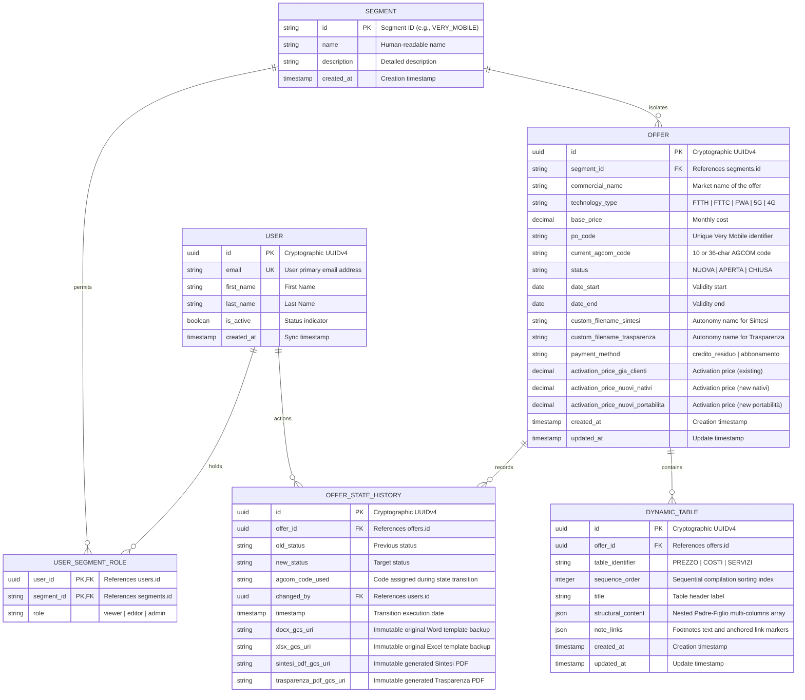

# Database Design: Logical & Physical Architecture

This document outlines the **Logical and Physical Database Architecture** for the WINDTRE Sintesi & Trasparenze Automation platform, designed specifically for **Google Cloud Spanner (PostgreSQL Dialect)**. It details our tables, entity-relationship schemas, index layouts, and the architectural rationales backing our engineering decisions.

---

## 🗺️ 1. Logical Table Design & Relationships

The system's database schema is designed to enforce data consistency, multi-tenant corporate segregation, and immutable regulatory auditing.

### Entity-Relationship Diagram

# V2

```mermaid
erDiagram
    SEGMENT ||--o{ USER_SEGMENT_ROLE : permits
    USER ||--o{ USER_SEGMENT_ROLE : holds
    SEGMENT ||--o{ OFFER : isolates

    TECHNOLOGY ||--o{ OFFER : classifies

    OFFER ||--o{ OFFER_ACTIVATION_FEE : defines
    OFFER ||--o{ DYNAMIC_TABLE : contains

    OFFER ||--o{ OFFER_STATE_HISTORY : records
    USER ||--o{ OFFER_STATE_HISTORY : triggers

    OFFER_STATE_HISTORY ||--|| DYNAMIC_TABLE_SNAPSHOT : freezes

    OFFER ||--o{ OFFER_DOCUMENT : owns
    OFFER_STATE_HISTORY |o--o{ OFFER_DOCUMENT : generates
    USER ||--o{ OFFER_DOCUMENT : uploads

    SEGMENT {
        uuid id PK "Cryptographic UUIDv4"
        string code UK "Unique identifier code (e.g. VERY_MOBILE)"
        string name "Human-readable name"
        string description "Detailed description"
        integer max_dynamic_table_rows "AGCOM row limit for this segment's dynamic tables"
        timestamp created_at "Creation timestamp"
        timestamp updated_at "Last update timestamp"
    }

    USER {
        uuid id PK "Cryptographic UUIDv4"
        string email UK "User primary email address"
        string first_name "First Name"
        string last_name "Last Name"
        boolean is_active "Operational status (suspended/enabled), NOT a delete flag"
        timestamp created_at "Sync timestamp"
        timestamp updated_at "Last update timestamp"
    }

    USER_SEGMENT_ROLE {
        uuid user_id PK, FK "References user.id"
        uuid segment_id PK, FK "References segment.id"
        string role "viewer | editor | admin"
    }

    TECHNOLOGY {
        uuid id PK "Cryptographic UUIDv4"
        string code UK "FTTH | FTTC | FWA | 5G | 4G"
        string network_name "Trasparenza-only: full network description"
        string badge_filename "Bollino: asset file path/name"
        string badge_alt_text "Trasparenza-only: accessibility alt label"
        string badge_color "Bollino: pantone/hex color code"
        integer max_download_mbps "Max download speed in Mbps"
        integer max_upload_mbps "Max upload speed in Mbps"
        boolean is_active "Hides from new-offer dropdowns; past offers unaffected"
        timestamp created_at "Creation timestamp"
        timestamp updated_at "Last update timestamp"
    }

    OFFER {
        uuid id PK "Cryptographic UUIDv4"
        uuid segment_id FK "References segment.id"
        uuid technology_id FK "References technology.id"
        string payment_method "CREDITO_RESIDUO | ABBONAMENTO | SEPA_PA"
        string commercial_name "Market name of the offer"
        decimal base_price "Monthly cost"
        string po_code "Nullable. Populated ONLY if segment.code = VERY_MOBILE"
        string current_agcom_code "Nullable. Setting it auto-transitions NUOVA -> APERTA"
        string status "NUOVA | APERTA | CHIUSA (soft CHECK for now)"
        date date_start "Validity start"
        date date_end "Validity end. Must be > date_start"
        string custom_filename_sintesi "Purpose TBD — see Open Questions"
        string custom_filename_trasparenza "Purpose TBD — see Open Questions"
        timestamp created_at "Creation timestamp"
        timestamp updated_at "Update timestamp"
        timestamp deleted_at "Soft delete: only for cancelled drafts / admin rollback"
    }

    OFFER_ACTIVATION_FEE {
        uuid id PK "Cryptographic UUIDv4"
        uuid offer_id FK "References offer.id"
        string target_type "gia_clienti | nuovi_nativi | nuovi_portabilita"
        decimal price "Activation fee amount"
    }

    DYNAMIC_TABLE {
        uuid id PK "Cryptographic UUIDv4"
        uuid offer_id FK "References offer.id"
        string table_identifier "PREZZO | COSTI | SERVIZI"
        integer sequence_order "Sequential compilation sorting index"
        string title "Table header label"
        json structural_content "Nested Padre-Figlio multi-columns array (working draft). Row count bounded by segment.max_dynamic_table_rows"
        json note_links "Footnotes text and anchored link markers"
        timestamp created_at "Creation timestamp"
        timestamp updated_at "Update timestamp"
    }

    OFFER_STATE_HISTORY {
        uuid id PK "Cryptographic UUIDv4. Also part of composite UK (id, offer_id)"
        uuid offer_id FK "References offer.id"
        string old_status "Previous status"
        string new_status "Target status"
        string agcom_code_used "Code assigned/used during this transition"
        uuid changed_by FK "References user.id"
        timestamp timestamp "Transition execution date"
    }

    DYNAMIC_TABLE_SNAPSHOT {
        uuid id PK "Cryptographic UUIDv4"
        uuid state_history_id FK, UK "References offer_state_history.id — 1:1 mandatory"
        json tables_payload "Frozen array of ALL dynamic tables at state change"
        timestamp created_at "Snapshot creation timestamp"
    }

    OFFER_DOCUMENT {
        uuid id PK "Cryptographic UUIDv4"
        uuid offer_id FK "References offer.id — always required"
        uuid state_history_id FK "Nullable. Part of composite FK (state_history_id, offer_id)"
        string doc_type "SINTESI_PDF | TRASPARENZA_PDF | TEMPLATE_DOCX | TEMPLATE_XLSX"
        string gcs_uri "Immutable file URI in GCS"
        integer version "Document revision number"
        boolean is_current "Flag for current active document per (offer_id, doc_type)"
        uuid created_by FK "References user.id — always the triggering user"
        timestamp created_at "Generation or upload timestamp"
    }
```

---

## ⚡ 2. Physical Design & Cloud Spanner Rationales

Designing relational tables on Google Cloud Spanner requires a shift from traditional single-instance databases (like PostgreSQL/MySQL) due to Spanner's **globally distributed, split-key architecture**.

### A. Rationale: Application-Layer UUIDv4 Primary Keys
*   **The Spanner Hotspotting Problem:** Cloud Spanner dynamically partitions (splits) data across multiple nodes based on primary key ranges. If sequential IDs (e.g. auto-incrementing integers) or timestamps are used as primary keys, all consecutive insertions route to the same split. This overloads a single node (creating a "hotspot") while the rest of the Spanner cluster sits idle.
*   **The Solution:** We enforce cryptographically secure `UUIDv4` keys generated exclusively at the application layer (`uuid.uuid4()` inside Python/FastAPI) before calling transactions. Since UUIDv4 characters are uniformly distributed, writes are balanced equally across all available Spanner partitions and hardware nodes, enabling linear write scalability.

### B. Rationale: Avoidance of PostgreSQL-Specific Schema Extensions
*   **The Compatibility Dilemma:** Cloud Spanner's PostgreSQL dialect supports PostgreSQL SQL semantics, but it runs on Spanner’s native distributed storage engine. Server-side PostgreSQL-specific functions (like `gen_random_uuid()` or PG extension libraries) are not supported.
*   **The Solution:** We keep our DDL schema and SQLAlchemy models standard-relational compliant. Primary key generation, timezone normalizations, and key distributions are orchestrated strictly on the Python application layer. This avoids database-level procedural lock-ins and ensures seamless migrations between local testing mock engines (SQLite) and Cloud Spanner.

### C. Rationale: Schema-on-Read JSON Column for Dynamic Table Contents
*   **The Heterogeneous Data Dilemma:** AGCOM's required structural layout for tables (`PREZZO`, `COSTI`, `SERVIZI`) varies widely between segments and can change dynamically whenever regulations are updated. Representing Padre-Figlio relationships (parent-child nested rows with variable columns like pricing steps, speed thresholds, and connection options) in fully normalized, static SQL columns would require:
    1. Frequent, complex schema migrations (DDL lockups) during regulatory shifts.
    2. Dozens of relational joins, resulting in slow query performance during synthesis.
*   **The Solution:** We map `structural_content` and `note_links` to Spanner’s native, highly optimized **`JSON`** column data type. This provides schema-on-read flexibility to store any nested multi-column Padre-Figlio array dynamically. The service layer extracts and maps this JSON payload on the fly, eliminating database locking and allowing instant updates to layout forms without modifying a single physical database column.

---

## 🚀 3. Index Layout & Performance Optimization

To guarantee sub-second read latency for client dashboards and synthesis workers, we implement specific indexes targeting database partition keys:

### 1. `idx_users_email` (Unique Index on `users.email`)
*   **Purpose:** Instantaneous account authentication.
*   **Rationale:** The user identity validation dependency (`get_current_active_user`) triggers on every API request. This index ensures that checking if an OIDC-authenticated email address exists in our local authorization table completes in constant $O(1)$ time, avoiding full table scans.

### 2. `idx_offers_segment` (Index on `offers.segment_id`)
*   **Purpose:** Segment-level data segregation (RBAC).
*   **Rationale:** Users are strictly partitioned into one or more of the 9 corporate segments. Every dashboard fetch automatically appends a segment-level filter (e.g. `WHERE segment_id = 'VERY_MOBILE'`). This index partitions queries so that our Role-Based Access Control filters execute instantaneously.

### 3. `idx_offers_po` (Index on `offers.po_code`)
*   **Purpose:** Unique PO code query acceleration.
*   **Rationale:** Very Mobile offers strictly use unique custom PO identifiers as their reference key. When the backend or worker validates Very Mobile files, it queries by `po_code`. This index avoids table scanning when managing Very Mobile's autonomous files.

### 4. `idx_dynamic_tables_offer` (Composite Index on `dynamic_tables(offer_id, sequence_order)`)
*   **Purpose:** Supercharging the Document Synthesis engine.
*   **Rationale:** During document generation, the worker must query all table layouts belonging to an offer in their precise rendering order. By creating a composite index on `(offer_id, sequence_order)`, Cloud Spanner stores these rows consecutively, enabling the query to retrieve the entire meta-template layout in a single sequential disk scan.

---

## 📊 4. Detailed Table Schema Specifications

A granular database dictionary detailing columns, data types, relational bindings, and constraint logic for each of our 7 physical Cloud Spanner tables.

---

### 1. Table: `segments`
The central administrative partitioning table. Defines the 9 distinct corporate segments across WINDTRE and Very Mobile, guaranteeing rigorous data isolation and Role-Based Access Control (RBAC).

| Column Name | Physical Data Type | Key / Constraint | Description & Rationale |
| :--- | :--- | :--- | :--- |
| **`id`** | `VARCHAR(50)` | **PRIMARY KEY** | Unique code identifier for the segment (e.g., `'VERY_MOBILE'`, `'W3_MOB_GA_CNS'`). |
| **`name`** | `VARCHAR(100)` | `NOT NULL` | Descriptive commercial name of the segment (e.g., *"Very Mobile Commercial Segment"*). |
| **`description`** | `VARCHAR(500)` | `NULL` | Technical description of segment coverage, boundaries, and associated corporate teams. |
| **`created_at`** | `TIMESTAMP WITH TZ` | `DEFAULT CURRENT_TIMESTAMP` | Auditing timestamp recording when the segment was initialised. |

---

### 2. Table: `users`
Synchronized administrative accounts fetched dynamically via OIDC login assertions from corporate identity services (Google Workspace, Active Directory).

| Column Name | Physical Data Type | Key / Constraint | Description & Rationale |
| :--- | :--- | :--- | :--- |
| **`id`** | `UUID` | **PRIMARY KEY** | Application-side generated cryptographic `UUIDv4` primary key. |
| **`email`** | `VARCHAR(150)` | `NOT NULL`, **UNIQUE KEY** | The operator's corporate email address. Targeted by `idx_users_email` for high-speed authentication. |
| **`first_name`** | `VARCHAR(100)` | `NULL` | First name of the operator. |
| **`last_name`** | `VARCHAR(100)` | `NULL` | Last name of the operator. |
| **`is_active`** | `BOOLEAN` | `DEFAULT TRUE` | Toggle flag indicating whether this user account has active authorization access. |
| **`created_at`** | `TIMESTAMP WITH TZ` | `DEFAULT CURRENT_TIMESTAMP` | Timestamp indicating when the user first logged in and was synchronized. |

---

### 3. Table: `user_segment_roles`
The core relational bridge enforcing Role-Based Access Control. Maps users to one or multiple corporate segments, defining granular editing and viewing privileges.

| Column Name | Physical Data Type | Key / Constraint | Description & Rationale |
| :--- | :--- | :--- | :--- |
| **`user_id`** | `UUID` | **PRIMARY KEY**, **FOREIGN KEY** | References `users.id` with `ON DELETE CASCADE`. |
| **`segment_id`** | `VARCHAR(50)` | **PRIMARY KEY**, **FOREIGN KEY** | References `segments.id` with `ON DELETE CASCADE`. |
| **`role`** | `VARCHAR(50)` | `NOT NULL`, **CHECK** | Role-level string. Validated by constraint: `CHECK (role IN ('editor', 'viewer', 'admin'))`. |

---

### 4. Table: `offers`
The master record detailing all commercial, regulatory, and technical attributes of a specific contract offer.

| Column Name | Physical Data Type | Key / Constraint | Description & Rationale |
| :--- | :--- | :--- | :--- |
| **`id`** | `UUID` | **PRIMARY KEY** | Application-side generated cryptographic `UUIDv4` primary key. |
| **`segment_id`** | `VARCHAR(50)` | `NOT NULL`, **FOREIGN KEY** | References `segments.id` with `ON DELETE RESTRICT` to protect against orphan offer records. |
| **`commercial_name`** | `VARCHAR(255)` | `NOT NULL` | The marketing name of the offer displayed to consumers. |
| **`technology_type`**| `VARCHAR(50)` | `NOT NULL` | Network technology used (e.g., `'FTTH'`, `'FTTC'`, `'FWA'`, `'5G'`, `'4G'`). |
| **`base_price`** | `DECIMAL(10, 2)`| `NOT NULL` | Recurring monthly standard fee (incl. VAT). |
| **`po_code`** | `VARCHAR(50)` | `NULL` | Technical code required strictly for Very Mobile's custom filename compliance. |
| **`current_agcom_code`**| `VARCHAR(50)`| `NULL`, **CHECK** | Assigned alphanumeric code from AGCOM. Enforced by `CHECK (length IS NULL OR length IN (10, 36))`. |
| **`status`** | `VARCHAR(20)` | `NOT NULL`, **CHECK** | Lifecycle state machine bounds. Enforced by `CHECK (status IN ('NUOVA', 'APERTA', 'CHIUSA'))`. |
| **`date_start`** | `DATE` | `NOT NULL` | Campaign validation and activation start date. |
| **`date_end`** | `DATE` | `NULL` | Campaign expiration and closure date. |
| **`custom_filename_sintesi`**| `VARCHAR(255)`| `NULL` | User-defined filename for the Sintesi PDF, supporting Very Mobile naming autonomy. |
| **`custom_filename_trasparenza`**| `VARCHAR(255)`| `NULL` | User-defined filename for the Trasparenza sheet, supporting Very Mobile autonomy. |
| **`payment_method`**| `VARCHAR(50)` | `DEFAULT 'credito_residuo'` | Enforced by constraint: `CHECK (payment_method IN ('credito_residuo', 'abbonamento'))`. |
| **`activation_price_gia_clienti`**| `DECIMAL(10,2)`| `NULL` | One-off activation cost applied to existing clients. |
| **`activation_price_nuovi_nativi`**| `DECIMAL(10,2)`| `NULL` | One-off activation cost applied to native new acquisitions. |
| **`activation_price_nuovi_portabilita`**| `DECIMAL(10,2)`| `NULL` | One-off activation cost applied to port-in acquisitions. |
| **`created_at`** | `TIMESTAMP WITH TZ`| `DEFAULT CURRENT_TIMESTAMP` | Offer creation audit timestamp. |
| **`updated_at`** | `TIMESTAMP WITH TZ`| `DEFAULT CURRENT_TIMESTAMP` | Last updated timestamp, tracking modification changes. |

---

### 5. Table: `offer_state_history`
A comprehensive, immutable audit log tracking every transition phase of an offer. It stores historical metadata alongside GCS URI pointers to original files, satisfying the "4-file co-existence" regulatory rule.

| Column Name | Physical Data Type | Key / Constraint | Description & Rationale |
| :--- | :--- | :--- | :--- |
| **`id`** | `UUID` | **PRIMARY KEY** | Application-side generated cryptographic `UUIDv4` primary key. |
| **`offer_id`** | `UUID` | `NOT NULL`, **FOREIGN KEY** | References `offers.id` with `ON DELETE CASCADE`. |
| **`old_status`** | `VARCHAR(20)` | `NULL` | The origin lifecycle state (e.g., `NUOVA`, `APERTA`). |
| **`new_status`** | `VARCHAR(20)` | `NOT NULL` | The destination lifecycle state after transition commit. |
| **`agcom_code_used`**| `VARCHAR(50)` | `NULL` | The specific AGCOM code assigned during this transition. |
| **`changed_by`** | `UUID` | `NULL`, **FOREIGN KEY** | References `users.id` with `ON DELETE SET NULL` to preserve histories of departed operators. |
| **`timestamp`** | `TIMESTAMP WITH TZ`| `DEFAULT CURRENT_TIMESTAMP` | Immutable execution date of state transition. |
| **`docx_gcs_uri`** | `VARCHAR(512)` | `NULL` | GCS URI pointing to the immutable snapshot of the compiled Word document (.docx). |
| **`xlsx_gcs_uri`** | `VARCHAR(512)` | `NULL` | GCS URI pointing to the immutable snapshot of the compiled Excel sheet (.xlsx). |
| **`sintesi_pdf_gcs_uri`**| `VARCHAR(512)`| `NULL` | GCS URI pointing to the immutable converted accessible Sintesi PDF. |
| **`trasparenza_pdf_gcs_uri`**| `VARCHAR(512)`| `NULL` | GCS URI pointing to the immutable converted accessible Trasparenza PDF. |

---

### 6. Table: `dynamic_tables`
Holds the actual layout builder data. Stores variable-column tables (`PREZZO`, `COSTI`, `SERVIZI`) using flexible JSON formats to dynamically generate Padre-Figlio row structures.

| Column Name | Physical Data Type | Key / Constraint | Description & Rationale |
| :--- | :--- | :--- | :--- |
| **`id`** | `UUID` | **PRIMARY KEY** | Application-side generated cryptographic `UUIDv4` primary key. |
| **`offer_id`** | `UUID` | `NOT NULL`, **FOREIGN KEY** | References `offers.id` with `ON DELETE CASCADE`. |
| **`table_identifier`**| `VARCHAR(100)`| `NOT NULL` | Block identifier tag (e.g., `'PREZZO'`, `'COSTI'`, `'SERVIZI'`). |
| **`sequence_order`**| `INT` | `NOT NULL` | Sorter sequence index used by `idx_dynamic_tables_offer` to compile blocks sequentially. |
| **`title`** | `VARCHAR(255)` | `NULL` | Text string rendered as the table's header. |
| **`structural_content`**| `JSON` | `NOT NULL` | Highly flexible JSON array containing Father-Child (Padre-Figlio) rows and nested data. |
| **`note_links`** | `JSON` | `NULL` | JSON structure holding footnote links, custom annotations, and compliance text anchors. |
| **`created_at`** | `TIMESTAMP WITH TZ`| `DEFAULT CURRENT_TIMESTAMP` | Block creation timestamp. |
| **`updated_at`** | `TIMESTAMP WITH TZ`| `DEFAULT CURRENT_TIMESTAMP` | Last modified timestamp. |

---

### 7. Table: `global_configs`
A centralized metadata parameters store. Retains system-wide global variables and regulatory constants (such as the EU Roaming RDA constant).

| Column Name | Physical Data Type | Key / Constraint | Description & Rationale |
| :--- | :--- | :--- | :--- |
| **`config_key`** | `VARCHAR(100)` | **PRIMARY KEY** | Unique identifier key string (e.g., `'RDA_COEFFICIENT_2026'`). |
| **`config_value`** | `VARCHAR(500)` | `NOT NULL` | Value associated with the parameter key string. |
| **`description`** | `VARCHAR(500)` | `NULL` | Detailed explanation of parameter purpose and annual revision requirements. |
| **`updated_at`** | `TIMESTAMP WITH TZ`| `DEFAULT CURRENT_TIMESTAMP` | Timestamp of the last configuration modification. |

