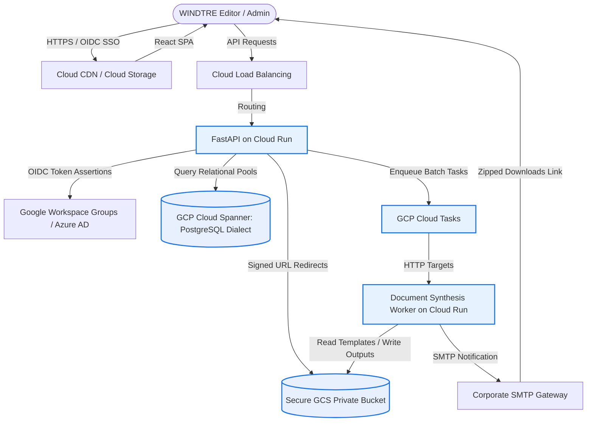
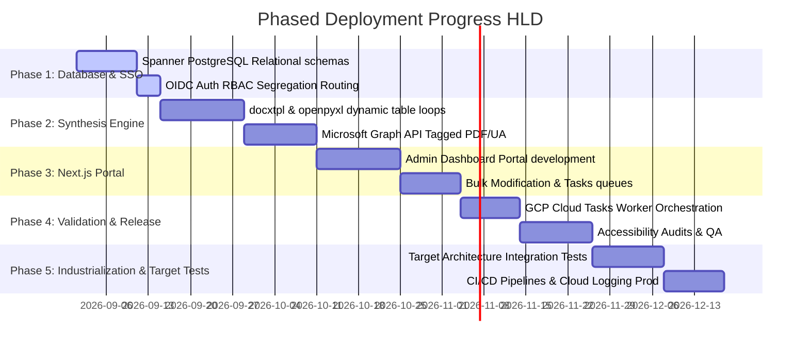

# High-Level Design: WINDTRE Sintesi & Trasparenze Automation
An enterprise, secure, and accessible serverless document synthesis platform on Google Cloud.

---

````carousel
# Slide 1: Executive Summary & Goals
## Automazione Creazione Sintesi Contrattuali e Trasparenze Tariffarie

### Current Problems:
* **Manual Bottleneck:** High-frequency, slow manual updates to contractual summaries and tariff transparency spreadsheets.
* **Compliance Risk:** High risk of AGCOM compliance failures and file format violations.
* **Aesthetic & Structural Inconsistency:** Rigid templates leading to rendering gaps, breaking Italian accessibility regulations (rules 228, 229, 230).

### HLD Solution Vision:
* **One Point of Update:** Centralized administration web interface.
* **Meta-Template Engine:** Dynamic XML table expansion using a single baseline structure.
* **Bulletproof Security:** Strict row-level isolation via corporate OIDC/SSO and Google IAM Groups.
* **Serverless Scale:** Decoupled FastAPI backend and Dockerized Cloud Run workers handling high-throughput PDF/UA compilation.

> [!NOTE]
> All generated PDFs strictly adhere to **PDF/UA accessibility guidelines**, with absolute naming sanitization (< 160 chars) and size boundaries (< 2.0 MB) to guarantee flawless Adobe intake processing.

<!-- slide -->
# Slide 2: Serverless GCP HLD Architecture
A fully decoupled, event-driven, scale-to-zero microservices blueprint.



> [!TIP]
> Using **Google Cloud Run** for the FastAPI server and the Document Worker allows both services to scale down to zero when idle, minimizing operating costs during off-peak canvass cycles.

<!-- slide -->
# Slide 3: Google IAM Groups & Row-Level Security
Multi-tenant segregation mapping corporate identity directly to active data rows.

### 🛡️ Access Control & Segregation Matrix
Corporate Workspace Groups are asserted via OIDC bearer tokens. Row-Level Security (RLS) filters database selections dynamically:

| Google Workspace Group | Active Segment ID | Segment Description | Permitted Editors |
| :--- | :--- | :--- | :--- |
| `g-w3-mob-cb-cns` | **W3_MOB_CB_CNS** | Mobile CB Consumer | Silvia Miletto, Fakir Manal |
| `g-w3-mob-ga-cns` | **W3_MOB_GA_CNS** | Mobile GA Consumer | Beatrice Vaccari, Alissa Leone |
| `g-very-mobile` | **VERY_MOBILE** | Very Mobile | Germana Serafini, Mauro Delrio |
| `g-w3-admin` | **ALL SEGMENTS** | Super Admin / Auditor | System Administrators |

### 🔒 Security Check Pipeline:
1. **SSO Assertions:** User authenticates. The API extracts their group membership from the JWT claims.
2. **Access Verification:** The backend verifies if the user belongs to the target `segment_id` role mapping:
   ```python
   # Enforced in FastAPI API Dependency injection layer
   if segment_id not in user_token.permitted_segments:
       raise HTTPException(status_code=403, detail="Accesso Negato: Gruppo IAM non autorizzato.")
   ```
3. **Database Segregation:** Queries dynamically append isolation boundaries based on permitted segments to isolate active offer pools.

<!-- slide -->
# Slide 4: Spanner Database Design & Meta-Templates
Combining relational schemas with Spanner PostgreSQL dynamic JSON columns to avoid layout locking.

### 1. The Relational Schema
Using **Google Cloud Spanner** to guarantee transactional integrity and global consistency:
* **The Unified `offers` Model:** Houses core metadata, segment identifiers, and logical boundaries, including custom file-naming overrides, and target-based activation prices (such as Già Clienti, Nuovi Clienti Nativi, and Nuovi Clienti in Portabilità).
* **The `dynamic_tables` Model:** Connects structural content defined by the editor dynamically to each offer. No rigid layouts are hardcoded in tables.
* **Architectural Simplification:** The redundant `price_points` metadata field has been retired. Multi-pricing setups are now managed entirely through the modular `PREZZO` dynamic table to prevent redundancy and keep our database schemas simple and clean.

### 2. Padre-Figlio Meta-Template Rendering
* **Word XML Table Loops:** Inside cell borders, dynamic XML loops are parsed. If a parent (`padre`) has children (`figlio`), rows are appended.
* **Coordinate Excel Scaling:** `openpyxl` shifts cells and rewrites formula bounds dynamically when rows expand, ensuring macros and equations never break.

<!-- slide -->
# Slide 5: Document Synthesis Worker & MS Graph Pipeline
Asynchronous Tagged PDF/UA generation and atomic bulk updates.

### Asynchronous Worker Execution (Exclusive MS Graph Pipeline):
```
[User Clicks Save] --> [API Updates DB] --> [Cloud Tasks Enqueues Job]
                                                   |
                                                   v
[GCS Output Saved] <-- [Size Check < 2MB] <-- [MS Graph Tagged PDF/UA (OneDrive)]
```

### 📋 Dynamic Compilation & Regulatory Rules (Compliance Shield)
1. **Exclusive Microsoft Graph API Compilation:**
   * Handless LibreOffice and ReportLab fallbacks have been completely retired for `.docx` (Sintesi) generation.
   * Compiles strictly through high-fidelity OneDrive MS Graph conversion to ensure 100% compliant, native Tagged PDF/UA files.
2. **Dynamic Target Clientela compilation:**
   * Synthesizes `target_clientela` on-the-fly depending on checked activation price tags (e.g. `"Già clienti, Nuovi clienti nativi"`).
3. **Adobe Filename Normalizer:**
   * Enforces Very Mobile custom filename autonomy.
   * Strips all forbidden characters: `[^A-Za-z0-9._-]`. Path length strictly **< 160 characters**.
4. **Accessibility Compliance (AGCOM Italian Laws):**
   * **Rule 228 (ND standard):** Converts empty value fields to `"Non applicabile"`.
   * **Rule 229 (No blank gaps):** Programmatically purges empty layout lines to avoid screen reader traps.
   * **Rule 230 (Footnote anchoring):** Aligns footnotes directly under active table borders.

### 📝 Brand New: Aggiornamento Massivo (Bulk Update)
* **High-Throughput Operations:** Administrators can select multiple offers inside any commercial segment and perform simultaneous metadata edits on common attributes (pricing, valid dates, payment types, status) in a single transactional API cycle.

<!-- slide -->
# Slide 6: Phased Implementation Roadmap
A serverless deployment and industrialization plan on Google Cloud Platform.



### 📈 Current Execution Status
* **Phase 1 (Database & Security SSO):** **In Progress (Active)**. Initial Spanner migrations and OIDC authentication router definitions are currently underway.
* **Phase 2 (Synthesis Engine):** **Scheduled**. docxtpl/openpyxl engine setup and Microsoft Graph API integration planned for mid-September.
* **Phase 3 (Admin Dashboard UI):** **Scheduled**. Administrative portal development with mass/bulk update features scheduled for October.
* **Phase 4 (Validation & Release):** **Scheduled**. Google Cloud Tasks orchestration and compliance audits scheduled for November.
* **Phase 5 (Industrializzazione & Test su Architettura Target):** **Scheduled**.
  * **Test su Architettura Target:** End-to-end integration tests are scheduled to run directly on the live infrastructure (Google Cloud Run, active Google Cloud Tasks queues, real Cloud Spanner, and authentic MS Graph tokens) rather than local Docker.
  * **Industrializzazione:** Automated CI/CD deployment pipelines and GCP Secret Manager setup scheduled for December.
````
