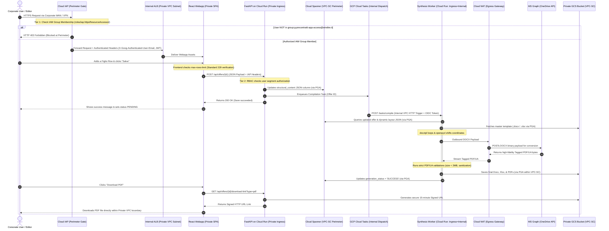

# Low-Level Design (LLD): Dynamic Synthesis Engine & Private VPC Architecture
A comprehensive technical deep-dive into database schema mapping, OpenXML tag interpolation, Excel cell shifting, execution flows, and private VPC infrastructure security.

> [!IMPORTANT]
> **Network & Security Boundary:** All runtime components (FastAPI application plane, asynchronous Document Synthesis Worker, Cloud Spanner database, and Cloud Storage buckets) reside strictly inside a dedicated **Google Cloud Private VPC** with zero public IP exposure. Inbound perimeter access is strictly gated by **Google Cloud IAP** checking membership in the designated corporate IAM Group (`group:g-precontratti-app-access@windtre.it`), followed by in-app multi-segment RBAC.

---

## 1. Database Representation: Padre-Figlio Schema in Spanner
To prevent layout locking, dynamic tables are stored inside Google Cloud Spanner's PostgreSQL dialect using the native `JSON` type.

```
                  +-----------------------------------+
                  |           offers table            |
                  +-----------------------------------+
                                    | (1)
                                    |
                                    | (1..N)
                  +-----------------------------------+
                  |       dynamic_tables table        |
                  +-----------------------------------+
                  | id: UUID (PK)                     |
                  | offer_id: UUID (FK)               |
                  | structural_content: JSON --------+
                  +-----------------------------------+
                                                      |
                                                      v
             +--------------------------------------------------+
             |            structural_content JSON               |
             +--------------------------------------------------+
             | [                                                |
             |   {                                              |
             |     "id": "p_cost_mensile",                      |
             |     "type": "padre",                             |
             |     "label": "Costo canone del servizio",        |
             |     "value": "29,99 euro",                       |
             |     "children": [                                |
             |       {                                          |
             |         "id": "c_cost_1",                        |
             |         "type": "figlio",                        |
             |         "label": "Canone primi 48 mesi",          |
             |         "value": "24,00 euro"                    |
             |       }                                          |
             |     ]                                            |
             |   }                                              |
             | ]                                                |
             +--------------------------------------------------+
```

### Python Pydantic v2 Structural Assertions
The FastAPI backend uses Pydantic to validate input payloads before serializing them into Spanner. This ensures no corrupted schemas enter the database.

```python
from pydantic import BaseModel, Field
from typing import List, Optional
from datetime import date
from decimal import Decimal

class FiglioRowSchema(BaseModel):
    id: str = Field(..., description="Unique child identifier generated at frontend (e.g. c_1784949)")
    type: str = Field("figlio", pattern="^figlio$")
    label: str = Field(..., min_length=1, max_length=255, description="Subfield label (e.g., 'Dopo i 48 mesi')")
    value: str = Field(..., description="Value associated (can be 'ND' or numeric/text representation)")

class PadreRowSchema(BaseModel):
    id: str = Field(..., description="Unique parent identifier generated at frontend (e.g. p_1784949)")
    type: str = Field("padre", pattern="^padre$")
    label: str = Field(..., min_length=1, max_length=255, description="Primary field label")
    value: Optional[str] = Field("ND", description="Parent value (can be 'ND' if split into children)")
    children: List[FiglioRowSchema] = Field(default_factory=list, description="Associated child subfields")

class DynamicTableContentSchema(BaseModel):
    table_identifier: str = Field("PREZZO", description="Identifies target section in the template")
    max_rows_limit: int = Field(15, description="Dynamic segment boundary limit")
    structural_content: List[PadreRowSchema]

class OfferBase(BaseModel):
    commercial_name: str = Field(..., min_length=2, max_length=255)
    technology_type: str = Field(..., description="FTTH, FTTC, FWA, 5G, or 4G")
    base_price: Decimal = Field(..., gt=Decimal("0.00"), decimal_places=2)
    po_code: Optional[str] = Field(None, pattern=r"^PO\d+$", description="Unique PO code for Very Mobile, e.g. PO123456")
    date_start: date
    date_end: Optional[date] = None
    custom_filename_sintesi: Optional[str] = Field(None, max_length=255, description="Custom filename override for Sintesi")
    custom_filename_trasparenza: Optional[str] = Field(None, max_length=255, description="Custom filename override for Trasparenza")
    payment_method: str = Field("credito_residuo", description="credito_residuo or abbonamento")
    activation_price_gia_clienti: Optional[Decimal] = Field(None, ge=Decimal("0.00"), decimal_places=2)
    activation_price_nuovi_nativi: Optional[Decimal] = Field(None, ge=Decimal("0.00"), decimal_places=2)
    activation_price_nuovi_portabilita: Optional[Decimal] = Field(None, ge=Decimal("0.00"), decimal_places=2)
```

```python
class OfferUpdate(BaseModel):
    commercial_name: Optional[str] = Field(None, min_length=2, max_length=255)
    technology_type: Optional[str] = Field(None)
    base_price: Optional[Decimal] = Field(None, gt=Decimal("0.00"), decimal_places=2)
    po_code: Optional[str] = Field(None, pattern=r"^PO\d+$")
    date_start: Optional[date] = None
    date_end: Optional[date] = None
    custom_filename_sintesi: Optional[str] = Field(None, max_length=255)
    custom_filename_trasparenza: Optional[str] = Field(None, max_length=255)
    payment_method: Optional[str] = Field(None)
    status: Optional[str] = Field(None)

class OfferBulkUpdate(BaseModel):
    offer_ids: List[UUID] = Field(..., description="List of targeted offer IDs")
    fields: OfferUpdate = Field(..., description="Properties to apply in bulk")

class IAPUserContext(BaseModel):
    """
    Decoded and cryptographically verified from Cloud IAP perimeter headers:
    - X-Goog-Authenticated-User-Email (format: 'accounts.google.com:user@windtre.it')
    - X-Goog-Authenticated-User-Id
    - X-Goog-IAP-JWT-Assertion
    """
    email: str = Field(..., description="Corporate identity email (e.g. mario.rossi@windtre.it)")
    user_id: str = Field(..., description="Google Subject ID (accounts.google.com sub)")
    iam_group_verified: bool = Field(True, description="Enforced by Cloud IAP: caller must belong to group:g-precontratti-app-access@windtre.it")
    permitted_segments: List[str] = Field(default_factory=list, description="Commercial segment IDs authorized for this user")
```

> [!IMPORTANT]
> **Schema Simplification:** The redundant `price_points` property has been fully removed from the `Offer` models and schemas. All multi-pricing campaigns are now structured inside the dynamic tables of the `PREZZO` block, maintaining a lean relational model.

---

## 2. Word (.docx) OpenXML Mechanics & `docxtpl`
A `.docx` file is a ZIP archive containing XML. The primary file is `word/document.xml`. Word tables are constructed using tags:
* `<w:tbl>`: Declares a table.
* `<w:tr>`: Declares a table row.
* `<w:tc>`: Declares a table cell.

### The Jinja XML Abstract Loop
Instead of static cell contents, our master template table cells are injected with abstract OpenXML-compatible Jinja control statements.

Inside `word/document.xml`, the table is represented as:

```xml
<w:tbl>
  <!-- Table headers... -->

  <!-- Loop Start Directive (docxtpl syntax) -->
  <w:tr>
    <w:tc>
      <w:p><w:r><w:t></w:t></w:r></w:p>
    </w:tc>
  </w:tr>

  <!-- Padre Parent Row -->
  <w:tr>
    <w:tc>
      <!-- Padre Label -->
      <w:p><w:r><w:t>{{ p.label }}</w:t></w:r></w:p>
    </w:tc>
    <w:tc>
      <!-- Padre Value (Maps 'ND' to 'Non applicabile' in Jinja context) -->
      <w:p><w:r><w:t>{{ p.value | map_nd }}</w:t></w:r></w:p>
    </w:tc>
  </w:tr>

  <!-- Nested Figlio Loop Start -->
  <w:tr>
    <w:tc>
      <w:p><w:r><w:t></w:t></w:r></w:p>
    </w:tc>
  </w:tr>

  <!-- Figlio Child Row -->
  <w:tr>
    <w:tc>
      <!-- Figlio Label (Rendered with indentation style in Word) -->
      <w:p><w:r><w:t>  - {{ c.label }}</w:t></w:r></w:p>
    </w:tc>
    <w:tc>
      <!-- Figlio Value -->
      <w:p><w:r><w:t>{{ c.value | map_nd }}</w:t></w:r></w:p>
    </w:tc>
  </w:tr>

  <!-- Nested Figlio Loop End -->
  <w:tr>
    <w:tc>
      <w:p><w:r><w:t></w:t></w:r></w:p>
    </w:tc>
  </w:tr>

  <!-- Loop End Directive -->
  <w:tr>
    <w:tc>
      <w:p><w:r><w:t></w:t></w:r></w:p>
    </w:tc>
  </w:tr>
</w:tbl>
```

### Python XML Synthesis Logic
The Python worker executes the `synthesize_sintesi_docx` script, mapping database states directly to OpenXML nodes:

```python
from docxtpl import DocxTemplate

def nd_filter(value: str) -> str:
    """AGCOM standard 228 mapping utility."""
    if not value or value.strip().upper() in ["ND", "N/A"]:
        return "Non applicabile"
    return value

def synthesize_sintesi_docx(template_path: str, output_path: str, db_record: dict):
    # Initialize the template using docxtpl
    doc = DocxTemplate(template_path)
    
    # Register the AGCOM filters inside the Jinja environment
    doc.jinja_env.filters['map_nd'] = nd_filter
    
    # Dynamically compile target_clientela list based on populated activation prices
    targets = []
    if db_record.get("activation_price_gia_clienti") is not None:
        targets.append("Già clienti")
    if db_record.get("activation_price_nuovi_nativi") is not None:
        targets.append("Nuovi clienti nativi")
    if db_record.get("activation_price_nuovi_portabilita") is not None:
        targets.append("Nuovi clienti in portabilità")
    
    if not targets:
        # Standard default fallback
        targets = ["Già clienti", "Nuovi clienti nativi", "Nuovi clienti in portabilità"]
    target_clientela_str = ", ".join(targets)
    
    # Extract variables
    context = {
        "commercial_name": db_record["commercial_name"],
        "technology_type": db_record["technology_type"],
        "base_price": f"{db_record['base_price']} euro",
        "po_code": db_record["po_code"] or "N/A",
        "target_clientela": target_clientela_str,
        # This contains the dynamic Padre-Figlio array queried from Spanner
        "structural_content": db_record["dynamic_tables"]["structural_content"]
    }
    
    # docxtpl replaces placeholders and duplicates <w:tr> loops dynamically in the XML
    doc.render(context)
    
    # Save finished docx to output path (which will be processed exclusively by Microsoft Graph API)
    doc.save(output_path)
```

---

## 3. Excel (.xlsx) Dynamic Coordinate Scaling Mechanics
For Excel files, the AGCOM template is extremely rigid. Adding or removing rows dynamically requires **cell shifting** and **formula recalculation** using `openpyxl` to avoid corrupting AGCOM macro equations.

```
      ORIGINAL EXCEL                         ROW INSERTION & COORDINATE SHIFTING
   +-----------------------+               +-----------------------------------------+
10 | Prezzo Base  | 19.99  |            10 | Prezzo Base            | 19.99          |
11 | SUM Formula  | =B10   |            11 | Sotto-voce (Figlio)    | +5.00  (New!)  | <-- Inserted!
   +-----------------------+            12 | SUM Formula            | =SUM(B10:B11)  | <-- Shifted & recalculated!
                                           +-----------------------------------------+
```

### The Coordinate Recalculation Code
```python
from openpyxl import load_workbook

def synthesize_trasparenza_xlsx(template_path: str, output_path: str, db_record: dict):
    wb = load_workbook(template_path)
    ws = wb.active # Load AGCOM sheet
    
    # Target row where pricing details start in the rigid AGCOM template (e.g. Row 15)
    target_start_row = 15
    structural_data = db_record["dynamic_tables"]["structural_content"]
    
    # 1. Loop through data and dynamically shift rows downwards to accommodate arrays
    current_row = target_start_row
    for padre in structural_data:
        # Write Padre row
        ws.cell(row=current_row, column=1, value=padre["label"])
        ws.cell(row=current_row, column=2, value=padre["value"])
        
        # If Padre has children, insert new excel rows directly below it
        if padre["children"]:
            num_children = len(padre["children"])
            # openpyxl utility shifts subsequent cells down to preserve document bottom blocks
            ws.insert_rows(current_row + 1, amount=num_children)
            
            for child in padre["children"]:
                current_row += 1
                # Write Figlio (indented)
                ws.cell(row=current_row, column=1, value=f"  - {child['label']}")
                ws.cell(row=current_row, column=2, value=child["value"])
                
        current_row += 1
        
    # 2. Shift Excel formulas downwards so they refer to the expanded cells
    # If we shifted 5 rows, formulas referencing columns must be programmatically remapped
    for row in range(current_row, ws.max_row + 1):
        for col in range(1, ws.max_column + 1):
            cell = ws.cell(row=row, column=col)
            if cell.value and isinstance(cell.value, str) and cell.value.startswith("="):
                # Using regex to rewrite coordinates (e.g. SUM(B15:B16) shifted by 5 -> SUM(B15:B21))
                cell.value = shift_formula_references(cell.value, shift_amount=current_row - target_start_row)
                
    wb.save(output_path)
```

---

## 4. Execution Sequence: Adding/Removing Rows (Private VPC & Zero-Trust Flow)
This sequence diagram tracks the entire execution flow from the corporate user crossing the Cloud IAP perimeter gate down to the asynchronous generation of the PDF/UA asset inside the Private VPC.



---

## 5. Summary of Why the Template Remains Untouched
* **Abstraction of Data:** The template only defines the visual design (logos, margins, typography, page numbers, border colors) and an **abstract processing loop**.
* **Zero Layout Invalidation:** Because the loop duplicates XML tags dynamically, a table can grow from a single row to a maximum of 15 rows with no hardcoded edits needed inside Word.
* **No File Uploads Needed:** The user interacts solely with the visual table builder, separating standard business operations from design file management.

---

## 6. Massive/Bulk Update Transactional Flow
The bulk updates allow updating common metadata properties across multiple selected offers atomically.

### The Backend Router Controller (`app/api_routes.py`)
```python
@router.post("/offers/bulk-update", response_model=List[OfferResponse])
def bulk_update_offers(
    payload: OfferBulkUpdate,
    db: Session = Depends(get_db),
    current_user: User = Depends(get_current_active_user)
):
    # Enforces role-based segment segregation and triggers transactional service logic
    return OfferService.bulk_update_offers(db, payload, current_user)
```

### The Transactional Service Layer (`app/services/offer_service.py`)
```python
class OfferService:
    @classmethod
    def bulk_update_offers(cls, db: Session, payload: OfferBulkUpdate, current_user: User):
        # 1. Fetch targeted offers inside a relational database boundary
        stmt = select(Offer).where(Offer.id.in_(payload.offer_ids))
        offers = db.scalars(stmt).all()
        
        # 2. Assert all requested records exist
        found_ids = {o.id for o in offers}
        missing_ids = [str(uid) for uid in payload.offer_ids if uid not in found_ids]
        if missing_ids:
            raise HTTPException(status_code=404, detail=f"Target offers not found: {missing_ids}")
            
        # 3. Enforce segment-level authorization per offer row
        for offer in offers:
            if offer.segment_id not in current_user.permitted_segments:
                raise HTTPException(status_code=403, detail="Forbidden segment operation.")
                
        # 4. Apply non-null metadata updates
        update_data = payload.fields.model_dump(exclude_unset=True)
        for offer in offers:
            for key, val in update_data.items():
                setattr(offer, key, val)
                
        # 5. Commit transaction safely
        db.commit()
        for offer in offers:
            db.refresh(offer)
            
        return offers
```

---

## 7. Private VPC Infrastructure & Two-Tier Security Architecture Specifications

The entire pre-contract synthesis platform is isolated within a dedicated Google Cloud **Private VPC**. Perimeter entry is restricted strictly to members of the authorized corporate IAM Group, followed by in-app segment RBAC.

```
+--------------------------------------------------------------------------------------------------------+
|                                  WINDTRE PRIVATE VPC BOUNDARY                                          |
|                                                                                                        |
|   Corporate WAN / Interconnect                                                                         |
|            │                                                                                           |
|            ▼                                                                                           |
|   +──────────────────────────+                                                                         |
|   |   Google Cloud IAP       |  Tier 1 Gate: IAM Group Check (group:g-precontratti-app-access)         |
|   +──────────────────────────+  (Non-members terminated immediately: HTTP 403 Forbidden)               |
|            │                                                                                           |
|            ▼ (roles/iap.httpsResourceAccessor verified)                                                |
|   +──────────────────────────+                                                                         |
|   |  Internal ALB (Private)  |  Private Subnet: 10.10.10.0/24                                          |
|   +──────────────────────────+                                                                         |
|            │                                                                                           |
|            ├─────────────────────────────────────────┐                                                 |
|            ▼                                         ▼                                                 |
|   +──────────────────────────+              +──────────────────────────+                               |
|   | React Static SPA (GCS)   |              | FastAPI API (Cloud Run)  | Ingress: internal-and-load-bal|
|   | Internal Web Presentation|              | Subnet: 10.10.20.0/24    | Tier 2: Segment RBAC Check    |
|   +──────────────────────────+              +──────────────────────────+                               |
|                                                      │                                                 |
|                      ┌───────────────────────────────┼──────────────────────────────┐                  |
|                      ▼                               ▼                              ▼                  |
|             +──────────────────+            +──────────────────+           +──────────────────+        |
|             | Cloud Tasks (PGA)|            |  Cloud Spanner   |           | GCS Storage      |        |
|             | Internal Queue   |            |  PostgreSQL via  |           | Artifact Bucket  |        |
|             +──────────────────+            |  Private Access  |           | (VPC-SC Guarded) |        |
|                      │                      +──────────────────+           +──────────────────+        |
|                      ▼                                                                                 |
|             +──────────────────+                                                                       |
|             | Document Worker  | (Cloud Run Ingress: internal)                                         |
|             +──────────────────+                                                                       |
|                      │                                                                                 |
|                      ▼ (Outbound Egress Only)                                                          |
|             +──────────────────+                                                                       |
|             | Cloud NAT        | ──► [Microsoft Graph API (OneDrive) / Corporate SMTP Relay]           |
|             +──────────────────+                                                                       |
+--------------------------------------------------------------------------------------------------------+
```

### 7.1 Private VPC Network & Subnet Topology
The virtual private network architecture enforces absolute separation between ingress proxies, compute runtimes, and external SaaS gateways:

| Subnet Identifier | CIDR Range | Purpose & Hosted Resources | Ingress/Egress Constraints |
| :--- | :--- | :--- | :--- |
| `subnet-internal-alb` | `10.10.10.0/24` | Internal Application Load Balancer proxies, backend forwarding rules, and health-check targets. | Inbound from Corporate Interconnect/VPN only; IAP-verified traffic. |
| `subnet-serverless-egress` | `10.10.20.0/24` | Direct VPC Egress for FastAPI Cloud Run and Document Synthesis Worker Cloud Run instances. | No public IPs; routed strictly through VPC routing tables. |
| `subnet-cloud-nat` | `10.10.30.0/24` | Cloud NAT Gateway for strictly brokered outbound internet calls. | Outbound-only to external SaaS endpoints; zero unsolicited inbound. |

### 7.2 Cloud Run Private VPC Service Configuration
All Cloud Run services reject public traffic at the infrastructure level:

```bash
# 1. Deploy FastAPI API: Ingress locked to Internal & Cloud Load Balancing
gcloud run deploy w3-precontratti-api \
    --image="gcr.io/w3-dataeng/precontratti-api:latest" \
    --ingress="internal-and-cloud-load-balancing" \
    --network="w3-precontratti-vpc" \
    --subnet="subnet-serverless-egress" \
    --vpc-egress="all-traffic" \
    --no-allow-unauthenticated \
    --region="europe-west1"

# 2. Deploy Synthesis Worker: Ingress locked strictly to Internal VPC calls
gcloud run deploy w3-precontratti-worker \
    --image="gcr.io/w3-dataeng/precontratti-worker:latest" \
    --ingress="internal" \
    --network="w3-precontratti-vpc" \
    --subnet="subnet-serverless-egress" \
    --vpc-egress="all-traffic" \
    --cpu=4 --memory=8Gi \
    --no-allow-unauthenticated \
    --region="europe-west1"
```

### 7.3 Tier 1: Cloud IAP Perimeter IAM Group Gate Configuration
Perimeter authorization is enforced at the Google Cloud IAP layer before traffic reaches the Internal ALB:

```bash
# Enable IAP on the Internal Application Load Balancer Backend Service
gcloud compute backend-services update w3-precontratti-backend \
    --iap=enabled,oauth2-client-id="${IAP_CLIENT_ID}",oauth2-client-secret="${IAP_CLIENT_SECRET}" \
    --region="europe-west1"

# Restrict Perimeter Entry strictly to the Authorized Corporate IAM Group
gcloud iap web add-iam-policy-binding \
    --resource-type=backend-services \
    --service=w3-precontratti-backend \
    --region="europe-west1" \
    --member="group:g-precontratti-app-access@windtre.it" \
    --role="roles/iap.httpsResourceAccessor"
```

> [!NOTE]
> **Perimeter Rejection Guarantee:** Any corporate user who is not a member of `group:g-precontratti-app-access@windtre.it` is blocked at the Google edge with an **HTTP 403 Forbidden**. No network packets, TCP sessions, or HTTP payloads from unauthorized accounts ever reach the Private VPC or the FastAPI compute containers.

### 7.4 Tier 2: FastAPI IAP Identity Interceptor & Multi-Segment RBAC Middleware
Once a request passes the Tier 1 perimeter gate, the FastAPI application extracts and cryptographically validates the user identity claims to enforce Tier 2 segment isolation:

```python
import jwt
from jwt import PyJWKClient
from fastapi import Request, HTTPException, Security, status
from fastapi.security import HTTPBearer
from app.database_models import IAPUserContext

# Google Cloud IAP Public Key Endpoint
IAP_JWKS_URL = "https://www.gstatic.com/iap/verify/public_key-jwk"
EXPECTED_AUDIENCE = "/projects/1234567890/global/backendServices/w3-precontratti-backend"

jwks_client = PyJWKClient(IAP_JWKS_URL)

async def get_current_iap_user(request: Request) -> IAPUserContext:
    """
    Tier 2 Identity Interceptor:
    1. Extracts and verifies the cryptographic IAP JWT assertion.
    2. Validates user email against the authorized commercial segments registry.
    """
    iap_jwt = request.headers.get("x-goog-iap-jwt-assertion")
    raw_user_email = request.headers.get("x-goog-authenticated-user-email", "")
    user_id = request.headers.get("x-goog-authenticated-user-id", "")

    # Strip Google prefix: 'accounts.google.com:mario.rossi@windtre.it' -> 'mario.rossi@windtre.it'
    clean_email = raw_user_email.replace("accounts.google.com:", "").strip()

    if not iap_jwt:
        raise HTTPException(
            status_code=status.HTTP_401_UNAUTHORIZED,
            detail="Missing required Cloud IAP JWT assertion header."
        )

    try:
        # Cryptographically verify signature using Google's public JWKS certificates
        signing_key = jwks_client.get_signing_key_from_jwt(iap_jwt)
        decoded_token = jwt.decode(
            iap_jwt,
            signing_key.key,
            algorithms=["ES256"],
            audience=EXPECTED_AUDIENCE
        )
    except Exception as e:
        raise HTTPException(
            status_code=status.HTTP_403_FORBIDDEN,
            detail=f"Invalid or forged Cloud IAP assertion: {str(e)}"
        )

    # Resolve commercial segments assigned to this corporate user (from user_segment_roles table or directory)
    permitted_segments = resolve_user_segments(clean_email)
    
    return IAPUserContext(
        email=clean_email,
        user_id=user_id,
        iam_group_verified=True,
        permitted_segments=permitted_segments
    )

def require_segment_permission(target_segment: str):
    """Dependency factory enforcing row-level segment isolation."""
    def _dependency(current_user: IAPUserContext = Security(get_current_iap_user)):
        if target_segment not in current_user.permitted_segments:
            raise HTTPException(
                status_code=status.HTTP_403_FORBIDDEN,
                detail=f"Accesso Negato: L'utente {current_user.email} non dispone delle autorizzazioni per il segmento {target_segment}."
            )
        return current_user
    return _dependency
```

### 7.5 Cloud NAT Egress Configuration (Outbound SaaS Integration)
Compute containers inside the Private VPC have zero public IP addresses. Outbound communication required to interact with the **Microsoft Graph API (OneDrive)** for Tagged PDF/UA rendering is funneled through Cloud NAT:

```bash
# 1. Create a Cloud Router in the Private VPC
gcloud compute routers create w3-precontratti-router \
    --network="w3-precontratti-vpc" \
    --region="europe-west1"

# 2. Configure Cloud NAT for strictly outbound egress from serverless subnets
gcloud compute routers nats create w3-precontratti-nat \
    --router="w3-precontratti-router" \
    --region="europe-west1" \
    --auto-allocate-nat-external-ips \
    --nat-custom-subnet-ip-ranges="subnet-serverless-egress" \
    --enable-logging
```

### 7.6 VPC Service Controls (VPC-SC) Perimeter Enclosure
A hardened VPC Service Controls perimeter encloses all sensitive data persistence layers, prohibiting any API calls from crossing outside the authorized Private VPC boundary:

```
+─────────────────────────────────────────────────────────────────────────────+
|               🛡️ VPC SERVICE CONTROLS REGULATORY PERIMETER                  |
|                                                                             |
|   Protected Managed Services:                                               |
|   - Cloud Spanner (spanner.googleapis.com)                                  |
|   - Google Cloud Storage (storage.googleapis.com)                           |
|   - Google Cloud Tasks (cloudtasks.googleapis.com)                          |
|   - Secret Manager (secretmanager.googleapis.com)                           |
|                                                                             |
|   Authorized Ingress:                                                       |
|   - Origin: Projects/w3-precontratti-prod (VPC Network: w3-precontratti-vpc)|
|   - Identities: Service Accounts w3-api-sa@, w3-worker-sa@                  |
|                                                                             |
|   Prohibited:                                                               |
|   - Any direct public API calls from the public internet or external IP     |
|   - Data exfiltration to unapproved external GCS buckets or DB instances     |
+─────────────────────────────────────────────────────────────────────────────+
```

