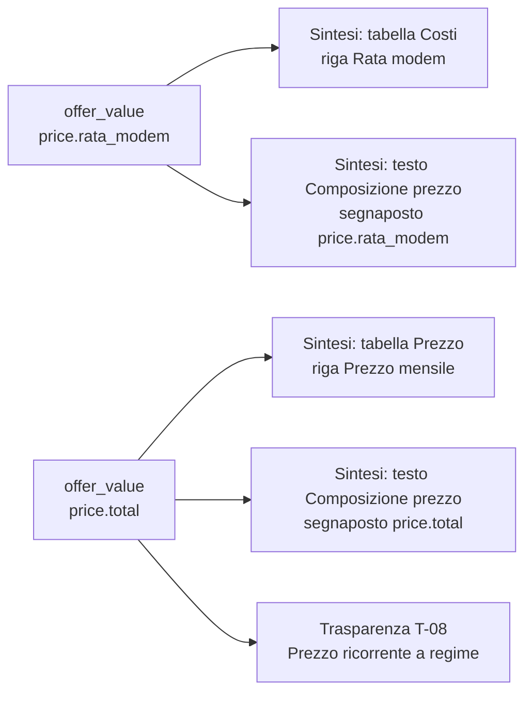
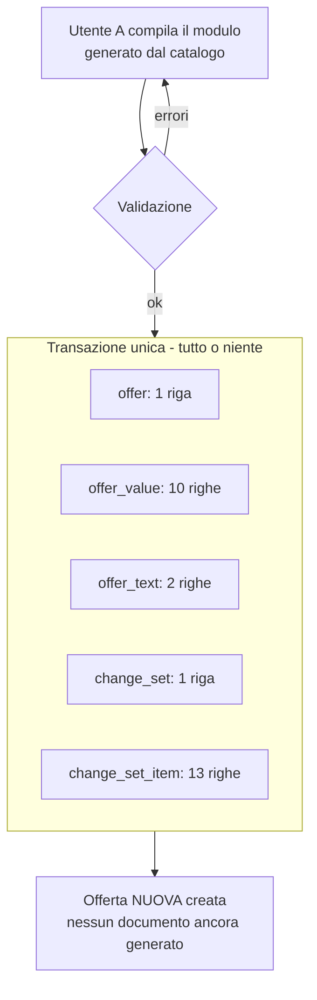
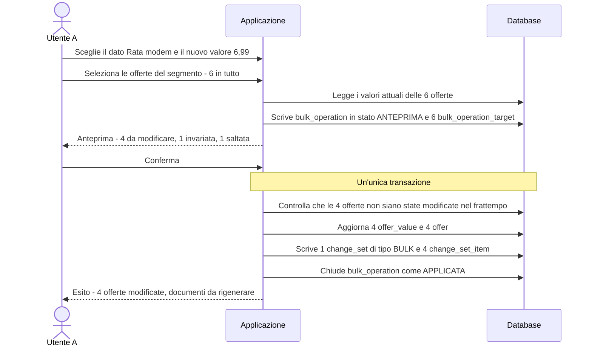

# Sintesi & Trasparenze — Esempio illustrato del modello dati

**Versione:** 0.1 · **Data:** 5 ottobre 2026
**Documento complementare a:** *Modello dati e modello di business v0.1*
**Scopo:** mostrare con dati concreti che cosa contiene il database e che cosa succede quando (1) si crea un'offerta e (2) si fa una modifica massiva.

> **Tutti i dati di questo documento sono fittizi** (nomi di offerte, prezzi, velocità, utenti, date). Servono solo a rendere visibile il funzionamento del modello.

---

## 1. Come leggere l'esempio

**Lo scenario.** Un utente del marketing del segmento *Fisso GA e Cross Selling Consumer* (**Utente A**) crea una nuova offerta, **"Casa Fibra Smart"**, e genera Sintesi e Trasparenza. Un'ora dopo decide di alzare di 1 € la rata mensile del modem su tutte le offerte del segmento, con una **modifica massiva**.

**Il percorso**

| Parte | Cosa si vede |
|---|---|
| **A** | Il **catalogo**: le tabelle del database che servono per avere dei valori da inserire |
| **B** | Lo **stato iniziale**: le cinque offerte già presenti |
| **C** | La **creazione** dell'offerta: cosa scrive il database |
| **D** | La **generazione** di Sintesi e Trasparenza |
| **E** | La **modifica massiva**: anteprima, conferma, scritture, effetti |
| **F** | Le **domande che lo storico permette** |
| **G** | Quale esigenza dimostra ciascun passaggio |

**Convenzioni**

- Gli identificativi (`O-SMART`, `DP-…`) sono abbreviati per leggibilità. Nel database sono UUID.
- Nelle tabelle del database i decimali usano il punto (`31.99`). Nei documenti generati la virgola (`31,99 €`).
- Un'etichetta in grassetto indica lo stato di una riga: **[NUOVA]**, **[MODIFICATA]**, **[INVARIATA]**, **[SALTATA]**.
- Dove un dato è lungo, si mostra una "vista a matrice" (una riga per offerta, una colonna per dato). Nel database sono comunque righe di `offer_value`.

---

# Parte A. Il catalogo

Il catalogo è l'insieme di tabelle che un **amministratore del catalogo** (Utente B) popola prima che gli utenti inseriscano offerte. Contiene tutto ciò che può comparire in un'offerta. Qui si mostrano solo le tabelle che servono all'esempio.

## A.1 Segmenti, tecnologie, utenti

**`segment`**

| id | code | name | vat_included |
|---|---|---|---|
| SEG-FISSO-CONS | FISSO_GA_CS_CONS | Fisso GA e Cross Selling Consumer | true |
| SEG-FISSO-MICRO | FISSO_GA_CS_MICRO | Fisso GA e Cross Selling Microbusiness | false |

**`technology`** (velocità e bollino stanno qui, non sull'offerta)

| id | code | network_name | badge_filename | max_download_mbps | max_upload_mbps |
|---|---|---|---|---|---|
| TECH-FTTH | FTTH | Fibra FTTH | bollino_ftth.png | 1000 | 300 |
| TECH-FTTC | FTTC | Fibra FTTC | bollino_fttc.png | 200 | 20 |

**`user` e `user_segment_role`**

| Utente | Ruolo | Segmenti |
|---|---|---|
| Utente A | editor | SEG-FISSO-CONS |
| Utente B | catalog_admin | SEG-FISSO-CONS, SEG-FISSO-MICRO |

## A.2 I dati: `data_point_definition`

Il **dato** è l'informazione con identità stabile. Il suo valore, per un'offerta, si scrive una volta sola.

| id | key | Nome | Tipo | Unità | Sorgente |
|---|---|---|---|---|---|
| DP-TOT | `price.total` | Prezzo mensile totale | IMPORTO | € | INPUT |
| DP-CAN | `price.canone` | Canone | IMPORTO | € | INPUT |
| DP-CHI | `price.chiamate` | Chiamate illimitate | IMPORTO | € | INPUT |
| DP-DUR | `price.durata_promo` | Durata del prezzo | DURATA_MESI | mesi | INPUT |
| DP-RATA | `price.rata_modem` | Rata mensile modem | IMPORTO | € | INPUT |
| DP-ATT-GIA | `activation_cost.gia_clienti.listino` | Attivazione, già clienti, a listino | IMPORTO | € | INPUT |
| DP-ATT-NUO | `activation_cost.nuovi_nativi.listino` | Attivazione, nuovi clienti nativi, a listino | IMPORTO | € | INPUT |
| DP-DIS | `deactivation.cost` | Costo di disattivazione | IMPORTO | € | INPUT |
| DP-MIN | `contract.durata_minima` | Durata minima del contratto | DURATA_MESI | mesi | INPUT |
| DP-PAG | `payment.method` | Modalità di pagamento | ELENCO_CHIUSO | — | INPUT |
| DP-INI | `availability.date_start` | Data inizio sottoscrivibilità | DATA | — | INPUT |
| DP-VEL-DL | `speed.download.max` | Velocità massima in download | INTERO | Mbps | TECNOLOGIA (`max_download_mbps`) |
| DP-VEL-UL | `speed.upload.max` | Velocità massima in upload | INTERO | Mbps | TECNOLOGIA (`max_upload_mbps`) |
| DP-TEC | `tech.code` | Tecnologia | TESTO | — | TECNOLOGIA (`code`) |
| DP-NOME | `offer.name` | Nome commerciale | TESTO | — | OFFERTA (`commercial_name`) |

I primi 11 dati sono **inseriti dall'utente** e finiscono in `offer_value`. Gli ultimi 4 sono **derivati** (da tecnologia o dall'offerta stessa): il database non li copia sull'offerta, li legge al momento della generazione.

**`enum_value`** (per il dato `payment.method`, un elenco chiuso)

| id | data_point | code | display_text |
|---|---|---|---|
| PAG-ADDEBITO | DP-PAG | ADDEBITO_CC | Addebito su conto corrente |
| PAG-CARTA | DP-PAG | CARTA | Carta di credito |
| PAG-BOLLETTINO | DP-PAG | BOLLETTINO | Bollettino postale |

## A.3 Tabelle e voci della Sintesi

**`table_definition`**

| id | code | title |
|---|---|---|
| TAB-PREZZO | PREZZO | Prezzo |
| TAB-COSTI | COSTI | Costi |
| TAB-VELOCITA | VELOCITA | Velocità |
| TAB-DURATA | DURATA | Durata, rinnovo e risoluzione |

**`row_definition`**: l'albero padre → figlio. Ogni voce è agganciata a un dato (o è solo un'intestazione).

| id | Tabella | Padre | Dato agganciato | Etichetta predefinita |
|---|---|---|---|---|
| R-PRE-TOT | TAB-PREZZO | — | `price.total` | Prezzo mensile |
| R-PRE-CAN | TAB-PREZZO | R-PRE-TOT | `price.canone` | Canone |
| R-PRE-CHI | TAB-PREZZO | R-PRE-TOT | `price.chiamate` | Chiamate illimitate |
| R-PRE-DUR | TAB-PREZZO | — | `price.durata_promo` | Durata del prezzo |
| R-COS-ATT | TAB-COSTI | — | *(solo intestazione)* | Costo di attivazione |
| R-COS-GIA | TAB-COSTI | R-COS-ATT | `activation_cost.gia_clienti.listino` | Già clienti |
| R-COS-NUO | TAB-COSTI | R-COS-ATT | `activation_cost.nuovi_nativi.listino` | Nuovi clienti nativi |
| R-COS-MOD | TAB-COSTI | — | `price.rata_modem` | Rata modem |
| R-COS-DIS | TAB-COSTI | — | `deactivation.cost` | Costo di disattivazione |
| R-VEL-DL | TAB-VELOCITA | — | `speed.download.max` | Velocità massima di connessione Internet (download) |
| R-VEL-UL | TAB-VELOCITA | — | `speed.upload.max` | Velocità massima di connessione Internet (upload) |
| R-DUR-MIN | TAB-DURATA | — | `contract.durata_minima` | Durata minima del contratto |

La stessa struttura, letta come albero:

```
PREZZO
├─ Prezzo mensile ............................ [price.total]
│  ├─ Canone ................................. [price.canone]
│  └─ Chiamate illimitate .................... [price.chiamate]
└─ Durata del prezzo ......................... [price.durata_promo]

COSTI
├─ Costo di attivazione ...................... (solo intestazione)
│  ├─ Già clienti ............................ [activation_cost.gia_clienti.listino]
│  └─ Nuovi clienti nativi ................... [activation_cost.nuovi_nativi.listino]
├─ Rata modem ................................ [price.rata_modem]
└─ Costo di disattivazione ................... [deactivation.cost]

VELOCITÀ
├─ Velocità massima ... (download) ........... [speed.download.max]   (dalla tecnologia)
└─ Velocità massima ... (upload) ............. [speed.upload.max]     (dalla tecnologia)

DURATA, RINNOVO E RISOLUZIONE
└─ Durata minima del contratto ............... [contract.durata_minima]
```

## A.4 Regole per segmento

Le regole dicono quali tabelle e voci compaiono nel segmento, in che ordine e con quale obbligatorietà.

**`segment_table_rule`** (segmento Consumer)

| segment | table | sort_order | applicability |
|---|---|---|---|
| SEG-FISSO-CONS | TAB-PREZZO | 1 | OBBLIGATORIA |
| SEG-FISSO-CONS | TAB-COSTI | 2 | OBBLIGATORIA |
| SEG-FISSO-CONS | TAB-VELOCITA | 3 | OBBLIGATORIA |
| SEG-FISSO-CONS | TAB-DURATA | 4 | OBBLIGATORIA |

**`segment_row_rule`** (segmento Consumer; le voci con dato derivato sono sempre compilate dal sistema)

| segment | row | sort_order | applicability | label_override |
|---|---|---|---|---|
| SEG-FISSO-CONS | R-PRE-TOT | 1 | OBBLIGATORIA | — |
| SEG-FISSO-CONS | R-PRE-CAN | 2 | OBBLIGATORIA | — |
| SEG-FISSO-CONS | R-PRE-CHI | 3 | FACOLTATIVA | — |
| SEG-FISSO-CONS | R-PRE-DUR | 4 | OBBLIGATORIA | — |
| SEG-FISSO-CONS | R-COS-ATT | 5 | OBBLIGATORIA | — |
| SEG-FISSO-CONS | R-COS-GIA | 6 | OBBLIGATORIA | — |
| SEG-FISSO-CONS | R-COS-NUO | 7 | OBBLIGATORIA | — |
| SEG-FISSO-CONS | R-COS-MOD | 8 | FACOLTATIVA | — |
| SEG-FISSO-CONS | R-COS-DIS | 9 | FACOLTATIVA | — |
| SEG-FISSO-CONS | R-VEL-DL | 10 | OBBLIGATORIA | — |
| SEG-FISSO-CONS | R-VEL-UL | 11 | OBBLIGATORIA | — |
| SEG-FISSO-CONS | R-DUR-MIN | 12 | OBBLIGATORIA | — |
| SEG-FISSO-MICRO | R-VEL-DL | 10 | OBBLIGATORIA | **Velocità massimo di connessione Internet (download)** |

L'ultima riga mostra l'unico livello di personalizzazione ammesso dell'etichetta: **per segmento** (nei file reali il Microbusiness scrive "massimo", il Consumer "massima"). Nessuna etichetta propria per singola offerta.

## A.5 Note e testi

**`note_definition`**: nota sotto tabella, con numerazione generata automaticamente.

| id | row | body |
|---|---|---|
| N-VEL-DL | R-VEL-DL | Velocità massima stimata: la velocità effettiva dipende dalle condizioni della linea. |

**`text_block_definition`**

| id | code | title | kind |
|---|---|---|---|
| TB-COMP | COMPOSIZIONE_PREZZO | Composizione del prezzo | CONDIVISO |
| TB-NOTE | NOTE_OFFERTA | Note dell'offerta | SPECIFICO_OFFERTA |

**`text_variant`** (solo per i blocchi CONDIVISI; i numeri sono **segnaposto**, non cifre scritte)

| id | block | code | body |
|---|---|---|---|
| TV-COMP-STD | TB-COMP | STANDARD | `{{dp:price.total}}` euro è composto, per i primi `{{dp:price.durata_promo}}` mesi, da: `{{dp:price.canone}}` euro di canone, `{{dp:price.chiamate}}` euro di chiamate illimitate e `{{dp:price.rata_modem}}` euro di rata del modem. |
| TV-COMP-NOCALL | TB-COMP | SENZA_CHIAMATE | `{{dp:price.total}}` euro è composto, per i primi `{{dp:price.durata_promo}}` mesi, da: `{{dp:price.canone}}` euro di canone. |

## A.6 La griglia della Trasparenza

La griglia Excel ha etichette fisse. L'offerta fornisce solo i valori, calcolati dai dati. *(Posizioni di riga e colonna indicative: la mappatura reale richiede il Vademecum AGCOM.)*

**`trasparenza_field_definition`** e **`trasparenza_field_source`**

| id | Etichetta fissa nell'Excel | Riga | Colonna | Sorgente (dato) | Pattern |
|---|---|---|---|---|---|
| T-01 | Nome commerciale dell'offerta | 5 | C | `offer.name` | `{1}` |
| T-02 | Data di inizio sottoscrivibilità | 6 | C | `availability.date_start` | `{1}` |
| T-03 | Modalità di pagamento | 9 | C | `payment.method` | `{1}` |
| T-04 | Tecnologia | 12 | C | `tech.code` | `{1}` |
| T-05 | Velocità massima in download (Mbps) | 13 | C | `speed.download.max` | `{1}` |
| T-06 | Velocità massima in upload (Mbps) | 14 | C | `speed.upload.max` | `{1}` |
| T-07 | Costo di attivazione, nuovi clienti nativi, a listino | 20 | C | `activation_cost.nuovi_nativi.listino` | `{1}` |
| T-08 | Prezzo ricorrente a regime | 30 | C | `price.total` | `{1}` |

Per i valori composti con "/" (es. lo scatto alla risposta, quattro valori) un campo avrebbe quattro sorgenti e pattern `{1}/{2}/{3}/{4}`.

## A.7 Template dei documenti

**`document_template`**

| id | doc_type | version | is_active |
|---|---|---|---|
| DT-W-3 | SINTESI_DOCX | 3 | true |
| DT-X-2 | TRASPARENZA_XLSX | 2 | true |

## A.8 L'idea chiave: un dato, molte posizioni

Il valore di un dato sta in `offer_value` una sola volta. Tabelle, testi e griglia lo **leggono**. Cambiarlo una volta lo cambia dappertutto.



---

# Parte B. Stato iniziale del database

Prima dell'esempio esistono cinque offerte del segmento Consumer.

**`offer`**

| id | commercial_name | name_key | technology | status | agcom_code | row_version | created_at |
|---|---|---|---|---|---|---|---|
| O-PLUS | Casa Fibra Plus | casa fibra plus | TECH-FTTH | APERTA | 7c1e… | 7 | 2026-06-12 |
| O-PRO | Casa Fibra Pro | casa fibra pro | TECH-FTTH | APERTA | 9b04… | 5 | 2026-06-12 |
| O-LIGHT | Casa Fibra Light | casa fibra light | TECH-FTTC | APERTA | 41ad… | 4 | 2026-06-12 |
| O-TOP | Casa Fibra Top | casa fibra top | TECH-FTTH | NUOVA | — | 3 | 2026-09-20 |
| O-SOLO | Casa Solo Linea | casa solo linea | TECH-FTTC | APERTA | e83f… | 2 | 2026-03-02 |

**`offer_value`, vista a matrice** (solo 5 dei 11 dati; gli altri sono omessi per brevità). "—" significa **nessuna riga** in `offer_value`: la voce non esiste per quell'offerta.

| Offerta | price.total | price.canone | price.chiamate | price.durata_promo | price.rata_modem |
|---|---|---|---|---|---|
| O-PLUS | 34.99 | 24.00 | 5.00 | 48 | 5.99 |
| O-PRO | 37.99 | 27.00 | 5.00 | 48 | 5.99 |
| O-LIGHT | 25.99 | 15.00 | 5.00 | 48 | 5.99 |
| O-TOP | 41.99 | 30.00 | 5.00 | 48 | **6.99** |
| O-SOLO | 19.00 | 19.00 | — | 48 | — |

**`offer_text`** (variante scelta per il blocco "Composizione del prezzo")

| Offerta | Variante |
|---|---|
| O-PLUS, O-PRO, O-LIGHT, O-TOP | TV-COMP-STD |
| O-SOLO (non ha chiamate né modem) | TV-COMP-NOCALL |

Da notare, perché serviranno nella modifica massiva:
- **O-TOP** ha già la rata a 6,99.
- **O-SOLO** non ha proprio la voce "rata modem".

---

# Parte C. Creare l'offerta "Casa Fibra Smart"

**Quando:** 5 ottobre 2026, ore 10:12 · **Chi:** Utente A

## C.1 Che cosa vede l'utente

Il modulo di inserimento **non è scritto a mano**: è generato dal catalogo, in base alle regole del segmento (`segment_row_rule`). Se un amministratore aggiunge una voce al catalogo, il modulo cambia senza intervento degli sviluppatori.

| Campo del modulo | Obbligatorio? | Origine |
|---|---|---|
| Nome commerciale, tecnologia | Sì | Identità dell'offerta |
| Prezzo mensile, canone, durata del prezzo | Sì | Regole TAB-PREZZO |
| Chiamate illimitate | No | R-PRE-CHI facoltativa |
| Attivazione già clienti, attivazione nuovi nativi | Sì (ma può essere "Non applicabile") | Regole TAB-COSTI |
| Rata modem, costo di disattivazione | No | R-COS-MOD e R-COS-DIS facoltative |
| Durata minima, modalità di pagamento, data di inizio | Sì | Regole TAB-DURATA e Trasparenza |
| Variante del testo "Composizione del prezzo" | Sì | TB-COMP |
| Note dell'offerta | No | TB-NOTE (testo proprio) |
| *Velocità download/upload, bollino, nome per la Trasparenza* | **Non chiesti** | Derivati da tecnologia e offerta |

**Valori inseriti dall'Utente A**

| Campo | Valore |
|---|---|
| Nome commerciale | Casa Fibra Smart |
| Tecnologia | FTTH |
| Prezzo mensile / canone / chiamate | 31,99 / 21,00 / 5,00 |
| Durata del prezzo | 48 mesi |
| Attivazione già clienti | Non applicabile |
| Attivazione nuovi clienti nativi | 1,99 |
| Rata modem | 5,99 |
| Costo di disattivazione | *(lasciato vuoto)* |
| Durata minima | 24 mesi |
| Modalità di pagamento | Addebito su conto corrente |
| Data inizio sottoscrivibilità | 15/10/2026 |
| Variante testo composizione | STANDARD |
| Note dell'offerta | "Offerta valida per le nuove attivazioni nelle aree coperte." |

## C.2 Che cosa fa il database



**Controlli prima di scrivere**

| Controllo | Esito |
|---|---|
| Il nome normalizzato `casa fibra smart` è unico? | OK, nessuna offerta con quel nome |
| I tipi sono validi (importi ≥ 0, durate intere, data valida, valore dell'elenco chiuso)? | OK |
| I dati obbligatori del segmento sono presenti? | OK (già clienti è ND, accettato) |
| Ogni segnaposto del testo scelto ha un valore? (`price.total`, `price.durata_promo`, `price.canone`, `price.chiamate`, `price.rata_modem`) | OK |
| Il totale 31,99 è uguale alla somma 21 + 5 + 5,99? | **Non verificato**: il totale è inserito a mano (decisione D11) |

## C.3 Le righe scritte

**`offer`: 1 riga** **[NUOVA]**

| id | segment | technology | commercial_name | name_key | status | agcom_code | row_version | created_at |
|---|---|---|---|---|---|---|---|---|
| O-SMART | SEG-FISSO-CONS | TECH-FTTH | Casa Fibra Smart | casa fibra smart | NUOVA | *(vuoto)* | 1 | 2026-10-05 10:12:07 |

**`offer_value`: 10 righe** **[NUOVE]**: una per dato valorizzato, con tre situazioni possibili.

| offer | dato | value_state | Colonna usata | Valore |
|---|---|---|---|---|
| O-SMART | `price.total` | VALORE | value_decimal | 31.99 |
| O-SMART | `price.canone` | VALORE | value_decimal | 21.00 |
| O-SMART | `price.chiamate` | VALORE | value_decimal | 5.00 |
| O-SMART | `price.durata_promo` | VALORE | value_int | 48 |
| O-SMART | `price.rata_modem` | VALORE | value_decimal | 5.99 |
| O-SMART | `activation_cost.gia_clienti.listino` | **ND** | *(nessuna)* | — |
| O-SMART | `activation_cost.nuovi_nativi.listino` | VALORE | value_decimal | 1.99 |
| O-SMART | `contract.durata_minima` | VALORE | value_int | 24 |
| O-SMART | `payment.method` | VALORE | enum_value_id | PAG-ADDEBITO |
| O-SMART | `availability.date_start` | VALORE | value_date | 2026-10-15 |

I tre casi di valore, applicati alle regole del Documento:

| Caso | Come è rappresentato | Nel documento |
|---|---|---|
| Valore inserito | Riga con `VALORE` | La riga compare |
| Non applicabile | Riga con `ND` e nessun valore | Compare "Non applicabile" |
| Vuoto (qui: costo di disattivazione) | **Nessuna riga** | La riga **non compare** |

**`offer_text`: 2 righe** **[NUOVE]**

| offer | blocco | variant | body_specific |
|---|---|---|---|
| O-SMART | TB-COMP | TV-COMP-STD | — |
| O-SMART | TB-NOTE | — | Offerta valida per le nuove attivazioni nelle aree coperte. |

**`change_set`: 1 riga** **[NUOVA]** · l'evento di creazione

| id | kind | user | committed_at |
|---|---|---|---|
| CS-001 | CREATE | Utente A | 2026-10-05 10:12:07 |

**`change_set_item`: 13 righe** **[NUOVE]** · una per ogni cosa scritta (1 offerta + 10 valori + 2 testi). Ne mostriamo alcune:

| # | change_set | offer | target_kind | target | old_value | new_value |
|---|---|---|---|---|---|---|
| 1 | CS-001 | O-SMART | OFFER_ATTR | offer | — | `{nome: "Casa Fibra Smart", tecnologia: "FTTH", stato: "NUOVA"}` |
| 2 | CS-001 | O-SMART | VALUE | `price.total` | — | `{stato: "VALORE", decimale: 31.99}` |
| 7 | CS-001 | O-SMART | VALUE | `activation_cost.gia_clienti.listino` | — | `{stato: "ND"}` |
| … | … | … | … | … | … | … |
| 12 | CS-001 | O-SMART | TEXT | TB-COMP | — | `{variante: "TV-COMP-STD"}` |
| 13 | CS-001 | O-SMART | TEXT | TB-NOTE | — | `{testo: "Offerta valida per…"}` |

## C.4 Che cosa il database NON scrive

| Non scritto | Perché |
|---|---|
| Velocità 1000/300, bollino FTTH, nome per la Trasparenza | Sono derivati da `technology` e `offer`: se la tecnologia cambia, seguono da soli |
| Una riga per il costo di disattivazione | Vuoto = assenza di riga |
| Le tabelle della Sintesi o la griglia della Trasparenza | Sono *viste* calcolate al momento della generazione, non dati salvati |
| Una revisione o dei file | Si creano solo alla generazione dei documenti (Parte D) |

---

# Parte D. Generare Sintesi e Trasparenza

**Quando:** ore 10:20 · **Chi:** Utente A

Un servizio dell'applicazione (`build_render_context`) legge i dati dell'offerta e il catalogo e prepara tutto ciò che serve ai template. Eccone il risultato.

## D.1 La Sintesi che ne risulta

**Prezzo**

| Voce | Valore |
|---|---|
| Prezzo mensile | 31,99 € |
|   Canone | 21,00 € |
|   Chiamate illimitate | 5,00 € |
| Durata del prezzo | 48 mesi |

**Costi** *(la riga "Costo di disattivazione" non compare: nessun valore)*

| Voce | Valore |
|---|---|
| Costo di attivazione | |
|   Già clienti | Non applicabile |
|   Nuovi clienti nativi | 1,99 € |
| Rata modem | 5,99 € |

**Velocità** *(valori dalla tecnologia FTTH)*

| Voce | Valore |
|---|---|
| Velocità massima di connessione Internet (download) **(1)** | 1000 Mbps |
| Velocità massima di connessione Internet (upload) | 300 Mbps |

**Durata, rinnovo e risoluzione**

| Voce | Valore |
|---|---|
| Durata minima del contratto | 24 mesi |

**Note:** (1) Velocità massima stimata: la velocità effettiva dipende dalle condizioni della linea. *(La numerazione "(1)" è generata, non scritta nell'etichetta.)*

**Testo "Composizione del prezzo"** *(variante STANDARD con i segnaposto sostituiti)*

> 31,99 euro è composto, per i primi 48 mesi, da: 21,00 euro di canone, 5,00 euro di chiamate illimitate e 5,99 euro di rata del modem.

**Note dell'offerta** *(testo proprio)*

> Offerta valida per le nuove attivazioni nelle aree coperte.

## D.2 La Trasparenza che ne risulta

| Campo | Etichetta fissa | Valore calcolato |
|---|---|---|
| T-01 | Nome commerciale dell'offerta | Casa Fibra Smart |
| T-02 | Data di inizio sottoscrivibilità | 15/10/2026 |
| T-03 | Modalità di pagamento | Addebito su conto corrente |
| T-04 | Tecnologia | FTTH |
| T-05 | Velocità massima in download (Mbps) | 1000 |
| T-06 | Velocità massima in upload (Mbps) | 300 |
| T-07 | Costo di attivazione, nuovi clienti nativi, a listino | 1,99 |
| T-08 | Prezzo ricorrente a regime | 31,99 |

Prima di generare, il sistema ha verificato che tutti i campi obbligatori della griglia fossero valorizzati.

## D.3 Le righe scritte dalla generazione

**`offer_revision`: 1 riga** **[NUOVA]**

| id | offer | change_set (fino a) | reason | status_at | render_context | created_at |
|---|---|---|---|---|---|---|
| REV-001 | O-SMART | CS-001 | GENERAZIONE | NUOVA | *Copia congelata di tutto D.1 e D.2: etichette, testi risolti, valori* | 2026-10-05 10:20:41 |

**`generated_document`: 4 righe** **[NUOVE]**

| id | offer | revision | template | doc_type | is_current |
|---|---|---|---|---|---|
| DOC-1 | O-SMART | REV-001 | DT-W-3 | SINTESI_DOCX | true |
| DOC-2 | O-SMART | REV-001 | DT-W-3 | SINTESI_PDF | true |
| DOC-3 | O-SMART | REV-001 | DT-X-2 | TRASPARENZA_XLSX | true |
| DOC-4 | O-SMART | REV-001 | DT-X-2 | TRASPARENZA_PDF | true |

La generazione **non cambia i dati** dell'offerta: nessun nuovo `change_set` e nessuna modifica a `offer` o `offer_value`. Crea una revisione (la fotografia di quel momento) e collega i file ad essa. Per questo, anche se i dati cambieranno, sarà sempre possibile dire con quali dati è stato prodotto ciascun file.

---

# Parte E. La modifica massiva

**Obiettivo:** portare la rata mensile del modem da 5,99 € a 6,99 € su tutte le offerte del segmento Consumer.
**Quando:** ore 11:03 (anteprima) e 11:05 (conferma) · **Chi:** Utente A

## E.1 Il flusso



## E.2 Anteprima: nessun dato delle offerte è ancora cambiato

L'utente sceglie il **dato** `price.rata_modem`, il nuovo valore e la modalità **"solo dove presente"**. Il sistema scrive solo il registro dell'operazione.

**`bulk_operation`: 1 riga** **[NUOVA]**

| id | created_by | op_type | target | parameters | selection | status | offers_selected | offers_changed |
|---|---|---|---|---|---|---|---|---|
| BO-001 | Utente A | SET_VALUE | `price.rata_modem` | `{valore: 6.99, modalità: "solo dove presente"}` | `{segmento: SEG-FISSO-CONS, stato: "qualsiasi"}` | **ANTEPRIMA** | 6 | 0 |

**`bulk_operation_target`: 6 righe** **[NUOVE]**, una per ogni offerta selezionata, con l'esito previsto

| bulk | offer | outcome | old_value | new_value | motivo |
|---|---|---|---|---|---|
| BO-001 | O-SMART | DA_MODIFICARE | 5.99 | 6.99 | |
| BO-001 | O-PLUS | DA_MODIFICARE | 5.99 | 6.99 | |
| BO-001 | O-PRO | DA_MODIFICARE | 5.99 | 6.99 | |
| BO-001 | O-LIGHT | DA_MODIFICARE | 5.99 | 6.99 | |
| BO-001 | O-TOP | INVARIATA | 6.99 | 6.99 | Già al valore richiesto |
| BO-001 | O-SOLO | SALTATA_ASSENTE | — | — | L'offerta non ha il dato "rata modem" |

**Quello che vede l'utente**

| Offerte selezionate | Verranno modificate | Già al valore richiesto | Saltate (dato assente) |
|---|---|---|---|
| 6 | **4** | 1 | 1 |

Questo è il punto in cui la rigidità del catalogo ripaga: il sistema sa distinguere con certezza *"questa offerta ha la voce con un altro valore"* (O-TOP, già a 6,99) da *"questa offerta non ha proprio la voce"* (O-SOLO). Con stringhe libere non potrebbe farlo.

## E.3 Conferma: le scritture, in una sola transazione

Alle 11:05 l'utente conferma. Il database scrive tutto insieme, oppure non scrive nulla.

**1) `offer_value`: 4 righe** **[MODIFICATE]** · O-TOP e O-SOLO non vengono toccate

| offer | dato | value_decimal prima | value_decimal dopo |
|---|---|---|---|
| O-SMART | `price.rata_modem` | 5.99 | **6.99** |
| O-PLUS | `price.rata_modem` | 5.99 | **6.99** |
| O-PRO | `price.rata_modem` | 5.99 | **6.99** |
| O-LIGHT | `price.rata_modem` | 5.99 | **6.99** |

**2) `offer`: 4 righe** **[MODIFICATE]** · la versione serve a evitare conflitti con chi modifica nello stesso momento

| offer | row_version prima | row_version dopo |
|---|---|---|
| O-SMART | 1 | **2** |
| O-PLUS | 7 | **8** |
| O-PRO | 5 | **6** |
| O-LIGHT | 4 | **5** |
| O-TOP | 3 | 3 **[INVARIATA]** |
| O-SOLO | 2 | 2 **[INVARIATA]** |

**3) `change_set`: 1 riga** **[NUOVA]** · una sola per tutta l'operazione, anche se tocca 4 offerte

| id | kind | user | committed_at | bulk_operation |
|---|---|---|---|---|
| CS-002 | BULK | Utente A | 2026-10-05 11:05:31 | BO-001 |

**4) `change_set_item`: 4 righe** **[NUOVE]**

| change_set | offer | target | old_value | new_value |
|---|---|---|---|---|
| CS-002 | O-SMART | `price.rata_modem` | `{decimale: 5.99}` | `{decimale: 6.99}` |
| CS-002 | O-PLUS | `price.rata_modem` | `{decimale: 5.99}` | `{decimale: 6.99}` |
| CS-002 | O-PRO | `price.rata_modem` | `{decimale: 5.99}` | `{decimale: 6.99}` |
| CS-002 | O-LIGHT | `price.rata_modem` | `{decimale: 5.99}` | `{decimale: 6.99}` |

**5) `bulk_operation` e `bulk_operation_target`** **[MODIFICATE]**

| bulk_operation | status | applied_at | offers_changed | change_set |
|---|---|---|---|---|
| BO-001 | ANTEPRIMA → **APPLICATA** | 2026-10-05 11:05:31 | 0 → **4** | CS-002 |

| offer | outcome prima | outcome dopo |
|---|---|---|
| O-SMART, O-PLUS, O-PRO, O-LIGHT | DA_MODIFICARE | **APPLICATA** |
| O-TOP | INVARIATA | INVARIATA |
| O-SOLO | SALTATA_ASSENTE | SALTATA_ASSENTE |

**Se qualcuno avesse modificato O-PLUS dopo l'anteprima**, il controllo di versione lo avrebbe rilevato (esito FALLITA) e, con la regola "tutto o niente", l'intera operazione non sarebbe stata applicata.

## E.4 Stato prima e dopo, a colpo d'occhio

| Offerta | Rata modem prima | Rata modem dopo | Esito |
|---|---|---|---|
| Casa Fibra Smart | 5,99 | **6,99** | **[MODIFICATA]** |
| Casa Fibra Plus | 5,99 | **6,99** | **[MODIFICATA]** |
| Casa Fibra Pro | 5,99 | **6,99** | **[MODIFICATA]** |
| Casa Fibra Light | 5,99 | **6,99** | **[MODIFICATA]** |
| Casa Fibra Top | 6,99 | 6,99 | **[INVARIATA]** |
| Casa Solo Linea | — | — | **[SALTATA]** nessuna voce |

## E.5 Effetti sui documenti

Il valore è cambiato in un posto solo, ma compare in due: **nella tabella Costi e nella frase "Composizione del prezzo"**. Entrambi si aggiornano alla prossima generazione, senza altre modifiche. Per O-SMART:

| Posizione | Prima (REV-001) | Dopo (alla prossima generazione) |
|---|---|---|
| Tabella Costi, riga Rata modem | 5,99 € | **6,99 €** |
| Frase di composizione | …e 5,99 euro di rata del modem. | …e **6,99** euro di rata del modem. |

**I documenti già emessi** (DOC-1…DOC-4 di O-SMART e quelli delle altre offerte) **non vengono toccati né sovrascritti**. Il sistema li riconosce come **superati**, perché l'ultimo evento sull'offerta (CS-002, 11:05) è successivo alla revisione da cui nascono (per O-SMART: REV-001, ore 10:20).

| Offerta | Documenti | Stato dopo la massiva |
|---|---|---|
| O-SMART, O-PLUS, O-PRO, O-LIGHT | Basati su dati precedenti a CS-002 | **Superati**: da rigenerare |
| O-TOP, O-SOLO | Nessuna modifica | Non interessati |

## E.6 Il punto di attenzione: il prezzo totale

Alla prossima generazione la frase di composizione di O-SMART direbbe: *"31,99 euro è composto da 21,00 + 5,00 + 6,99"*, e la somma è **32,99**. Il totale non si è aggiornato da solo perché, per decisione (D11), **il totale è un dato inserito a mano**.

| Offerta | Totale attuale | Totale coerente con la nuova rata |
|---|---|---|
| O-SMART | 31,99 | 32,99 |
| O-PLUS | 34,99 | 35,99 |
| O-PRO | 37,99 | 38,99 |
| O-LIGHT | 25,99 | 26,99 |

Oggi il sistema **non controlla** questa coerenza. I totali sono diversi per ogni offerta, quindi una sola massiva con un valore fisso non basta: vanno aggiornati offerta per offerta. Se l'area vorrà superare questo limite, le strade sono due: far calcolare il totale al sistema, oppure dichiarare nel catalogo che la rata è un componente del totale, così che l'anteprima segnali l'incoerenza.

**Correzione manuale per O-SMART, ore 11:08.** L'Utente A aggiorna il totale a 32,99. Il database scrive:

| Tabella | Scrittura |
|---|---|
| `offer_value` | `price.total` di O-SMART: 31.99 → **32.99** **[MODIFICATA]** |
| `offer` | `row_version` di O-SMART: 2 → **3** **[MODIFICATA]** |
| `change_set` | **[NUOVA]** CS-003, kind MANUAL_EDIT, Utente A, 11:08:12 |
| `change_set_item` | **[NUOVA]** 1 riga: `price.total` `{31.99}` → `{32.99}` |

## E.7 Rigenerare i documenti di O-SMART

**Quando:** ore 11:10 · **Chi:** Utente A

**`offer_revision`: 1 riga** **[NUOVA]**

| id | offer | change_set (fino a) | reason | created_at |
|---|---|---|---|---|
| REV-002 | O-SMART | CS-003 | GENERAZIONE | 2026-10-05 11:10:04 |

**`generated_document`: 4 righe nuove, 4 vecchie "declassate"**

| id | revision | doc_type | is_current | |
|---|---|---|---|---|
| DOC-1 | REV-001 | SINTESI_DOCX | true → **false** | **[MODIFICATA]** |
| DOC-2 | REV-001 | SINTESI_PDF | true → **false** | **[MODIFICATA]** |
| DOC-3 | REV-001 | TRASPARENZA_XLSX | true → **false** | **[MODIFICATA]** |
| DOC-4 | REV-001 | TRASPARENZA_PDF | true → **false** | **[MODIFICATA]** |
| DOC-5 | REV-002 | SINTESI_DOCX | **true** | **[NUOVA]** |
| DOC-6 | REV-002 | SINTESI_PDF | **true** | **[NUOVA]** |
| DOC-7 | REV-002 | TRASPARENZA_XLSX | **true** | **[NUOVA]** |
| DOC-8 | REV-002 | TRASPARENZA_PDF | **true** | **[NUOVA]** |

I file vecchi **restano disponibili**: cambia solo quale è quello corrente. Il file corrente della Trasparenza riporta ora, alla riga T-08, 32,99.

## E.8 Se la massiva fosse un errore

Il registro conserva i valori precedenti, quindi si può **annullare**. L'annullamento non cancella la storia: crea un **nuovo evento** (kind UNDO) che rimanda a CS-002 e rimette 5,99 sulle offerte che hanno ancora 6,99. Chi nel frattempo ha cambiato il dato a mano viene segnalato come conflitto. Dopo l'annullamento restano da riallineare a mano anche i totali già corretti (come quello di O-SMART).

---

# Parte F. Le domande a cui lo storico sa rispondere

Dopo i passaggi precedenti, ecco cosa si può ricostruire. Nessuna di queste risposte richiede di sapere in anticipo che sarebbe servita.

| Domanda | Dove si trova la risposta | Risposta nell'esempio |
|---|---|---|
| Com'era O-SMART alle 10:30? | `offer_revision` REV-001 | Rata 5,99; totale 31,99; testo con 5,99 |
| Quali file sono stati emessi con la rata a 5,99? | `generated_document` → REV-001 | DOC-1, DOC-2, DOC-3, DOC-4 |
| Chi ha cambiato la rata modem di O-SMART, quando e come? | `change_set_item` → `change_set` | Utente A, 5 ottobre 11:05, massiva BO-001, da 5,99 a 6,99 |
| Che cosa ha prodotto la massiva BO-001? | `bulk_operation` + `bulk_operation_target` | 4 modificate, 1 invariata, 1 saltata, con il motivo per ciascuna |
| Chi ha toccato O-SMART dalla creazione a oggi? | `change_set_item` per offerta | CS-001 creazione, CS-002 massiva, CS-003 correzione totale |
| Quali offerte hanno ancora documenti superati? | Confronto tra ultimo evento e revisione dei file | O-PLUS, O-PRO, O-LIGHT |
| Com'era la tabella Costi a una certa data, comprese le etichette? | `render_context` della revisione; per date intermedie, ricostruzione dal registro | Voci e valori di REV-001 |

---

# Parte G. Che cosa dimostra l'esempio

| Esigenza | Dove si vede |
|---|---|
| **Tabelle dinamiche, comparabili** | A.3 e A.4: voci con identità stabile; C.3: la voce vuota (disattivazione) non compare, quella ND compare come "Non applicabile" |
| **Struttura aggiornabile senza sviluppo** | C.1: il modulo nasce dal catalogo; una nuova voce nel catalogo cambia il modulo |
| **Un valore, una sola volta** | A.8, E.5: la rata sta in un posto e compare in tabella e frase |
| **Fonte unica per Sintesi e Trasparenza** | D.1 e D.2: dagli stessi dati escono entrambi i documenti |
| **La tecnologia determina velocità e bollino** | C.4: non sono copiate sull'offerta |
| **Modifiche massive affidabili** | E.2: distingue "ha un altro valore" da "non ha la voce"; anteprima con conteggi |
| **Modifica massiva come evento unico** | E.3: 1 `change_set` per 4 offerte |
| **Nessun conflitto con chi lavora nello stesso momento** | E.3: controllo di versione, tutto o niente |
| **Storico completo e file non sovrascritti** | E.7 e Parte F |
| **Limite noto: totale a mano** | E.6: il sistema non controlla la somma; richiede una decisione dell'area |
| **Rigidità del catalogo** | A.4: etichette solo per segmento, niente stringhe libere per offerta |

---

*Questo esempio illustra la versione 0.1 del modello. Se l'area dedicata modificherà alcune decisioni del registro (in particolare D1, D3, D9 e D11), le parti corrispondenti andranno aggiornate.*
