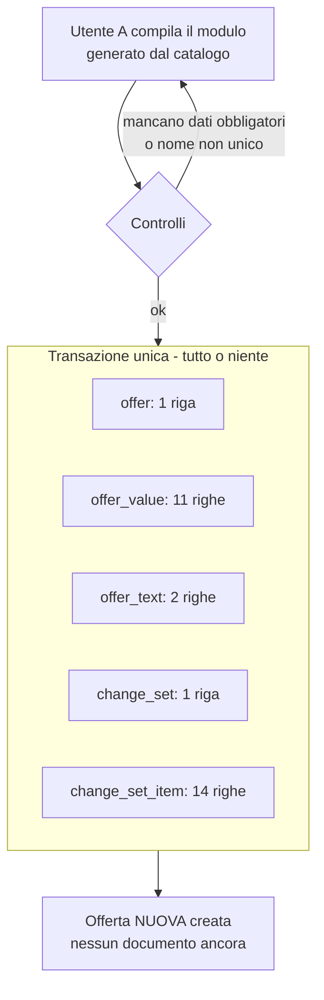
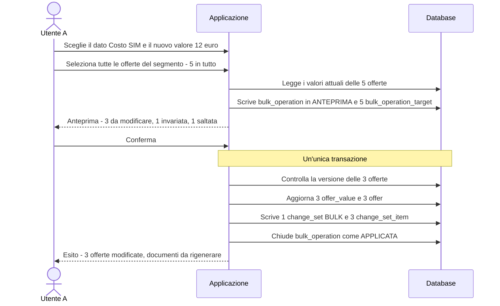

# Sintesi & Trasparenze — Esempio illustrato (modello v0.2)
## Inserimento, modifica e modifica massiva con tabelle fisse e dinamiche

**Versione:** 0.2 · **Data:** 5 ottobre 2026
**Basato su:** *Modello dati v0.2 sintetico* (valori come stringhe, mappatura Trasparenza in Python)

> **Tutti i dati sono fittizi** (offerte, prezzi, velocità, date, utenti). Servono solo a rendere visibile il funzionamento del modello.

---

## 1. Come leggere l'esempio

### 1.1 Lo scenario

Nel segmento **Mobile GA Consumer** esistono quattro offerte. L'**Utente A** (marketing) esegue, in questa sequenza:

| Ora | Azione | Parte |
|---|---|---|
| 10:12 | **Inserisce** la nuova offerta "Mobile Smart", compilando tabelle fisse e dinamiche | C |
| 10:20 | **Genera** Sintesi e Trasparenza | D |
| 10:40 | **Modifica** l'offerta: corregge un prezzo, aggiunge una voce, ne toglie un'altra | E |
| 11:03 / 11:05 | **Modifica massiva** del "Costo SIM" da 10 a 12 euro, su tutto il segmento | F |
| 11:10 | **Rigenera** i documenti di Mobile Smart | F.6 |
| 11:20 | Seconda massiva: **aggiunge** una voce a chi non la ha | F.7 |

### 1.2 Tabella fissa e tabella dinamica

Nel modello v0.2 la differenza **non è nello schema**, ma nelle **regole del segmento**:

| | Tabella **fissa** | Tabella **dinamica** |
|---|---|---|
| Regola delle voci (`segment_row_rule`) | Tutte **OBBLIGATORIE** | Almeno una **FACOLTATIVA** |
| Cosa fa l'utente | Compila sempre le stesse voci | **Sceglie dal catalogo** quali voci includere e ne scrive il valore |
| Cosa varia da offerta a offerta | Solo i valori | Valori **e** voci presenti |
| Se non ha alcuna voce | (non può accadere) | La tabella **non compare** nella Sintesi |
| Esempi qui | Prezzo, Durata, Velocità | Costi, Servizi |

In entrambi i casi **le etichette delle voci vengono dal catalogo**: l'utente non scrive nomi di padri e figli (decisioni D1 e D3). Se gli serve una voce che non esiste, la chiede all'amministratore del catalogo (vedi nota in C.1).

### 1.3 Convenzioni

- Gli identificativi (`O-SMART`, `DP-…`) sono abbreviati. Nel database sono UUID.
- Il valore di ogni dato è **la stringa completa scritta dall'utente**, unità inclusa (`10 euro`). Nelle tabelle del database è riportata esattamente così.
- Un'etichetta in grassetto indica lo stato di una riga: **[NUOVA]**, **[MODIFICATA]**, **[ELIMINATA]**, **[INVARIATA]**, **[SALTATA]**.
- "—" in una vista a matrice significa **nessuna riga** in `offer_value`: la voce non esiste per quell'offerta.

---

## 2. Estratto del modello usato nell'esempio

Sono le 18 tabelle toccate dall'esempio, tra le 28 del modello v0.2. Non compaiono quelle non coinvolte (opzioni, cluster, note, parametri globali, ecc.).

```mermaid
erDiagram
    SEGMENT ||--o{ OFFER : "contiene"
    TECHNOLOGY ||--o{ OFFER : "classifica"
    OFFER ||--o{ OFFER_VALUE : "ha valori"
    OFFER ||--o{ OFFER_TEXT : "ha testi"
    DATA_POINT_DEFINITION ||--o{ OFFER_VALUE : "identifica"
    DATA_POINT_DEFINITION |o--o{ ROW_DEFINITION : "alimenta"
    TABLE_DEFINITION ||--o{ ROW_DEFINITION : "contiene"
    ROW_DEFINITION |o--o{ ROW_DEFINITION : "padre di"
    ROW_DEFINITION ||--o{ SEGMENT_ROW_RULE : "regolata per"
    SEGMENT ||--o{ SEGMENT_ROW_RULE : "regola"
    TEXT_BLOCK_DEFINITION ||--o{ TEXT_VARIANT : "ha varianti"
    TEXT_BLOCK_DEFINITION ||--o{ OFFER_TEXT : "istanziato in"
    TEXT_VARIANT |o--o{ OFFER_TEXT : "scelta in"
    CHANGE_SET ||--o{ CHANGE_SET_ITEM : "contiene"
    OFFER |o--o{ CHANGE_SET_ITEM : "riguarda"
    BULK_OPERATION |o--o| CHANGE_SET : "produce"
    BULK_OPERATION ||--o{ BULK_OPERATION_TARGET : "elenca"
    OFFER ||--o{ BULK_OPERATION_TARGET : "coinvolta in"
    OFFER ||--o{ OFFER_REVISION : "ha revisioni"
    CHANGE_SET ||--o{ OFFER_REVISION : "punto di"
    OFFER_REVISION ||--o{ GENERATED_DOCUMENT : "genera"
    DOCUMENT_TEMPLATE ||--o{ GENERATED_DOCUMENT : "usato per"

    SEGMENT {
        uuid id PK "UUIDv4"
        string name "Nome del segmento"
    }
    TECHNOLOGY {
        uuid id PK "UUIDv4"
        string code UK "4G | 5G"
        int max_download_mbps "Velocita max download"
        int max_upload_mbps "Velocita max upload"
    }
    DATA_POINT_DEFINITION {
        uuid id PK "UUIDv4"
        string key UK "Chiave stabile del dato"
        string name "Nome del dato"
    }
    TABLE_DEFINITION {
        uuid id PK "UUIDv4"
        string title "Titolo uniforme"
        boolean is_printed "False = solo campi del modulo"
    }
    ROW_DEFINITION {
        uuid id PK "UUIDv4"
        uuid table_id FK "Tabella"
        uuid parent_id FK "Nullable. Vuoto = padre"
        uuid data_point_id FK "Nullable. Dato scritto dall'utente"
        string derived_ref "Nullable. Valore derivato"
        string label_default "Etichetta predefinita"
    }
    SEGMENT_ROW_RULE {
        uuid segment_id PK, FK "Segment"
        uuid row_id PK, FK "Voce"
        int sort_order "Ordine nel segmento"
        string applicability "OBBLIGATORIA | FACOLTATIVA | NON_AMMESSA"
    }
    TEXT_BLOCK_DEFINITION {
        uuid id PK "UUIDv4"
        string kind "CONDIVISO | SPECIFICO_OFFERTA"
    }
    TEXT_VARIANT {
        uuid id PK "UUIDv4"
        uuid text_block_id FK "Blocco"
        string body "Testo con segnaposto"
    }
    OFFER {
        uuid id PK "UUIDv4"
        uuid segment_id FK "Segment"
        uuid technology_id FK "Technology"
        string commercial_name "Nome dell'offerta"
        string name_key UK "Nome normalizzato, unico"
        string status "NUOVA | APERTA | CHIUSA"
        int row_version "Rilevamento conflitti"
    }
    OFFER_VALUE {
        uuid offer_id PK, FK "Offer"
        uuid data_point_id PK, FK "Dato"
        string value_text "Stringa completa scritta dall'utente"
    }
    OFFER_TEXT {
        uuid offer_id PK, FK "Offer"
        uuid text_block_id PK, FK "Blocco"
        uuid variant_id FK "Nullable. Variante scelta"
        string body_specific "Nullable. Testo proprio"
    }
    CHANGE_SET {
        uuid id PK "UUIDv4"
        string kind "CREATE | MANUAL_EDIT | BULK | ..."
        timestamp committed_at "Momento dell'evento"
    }
    CHANGE_SET_ITEM {
        uuid id PK "UUIDv4"
        uuid change_set_id FK "Evento"
        uuid offer_id FK "Offer"
        string target "Cosa e cambiato"
        json old_value "Prima"
        json new_value "Dopo"
    }
    OFFER_REVISION {
        uuid id PK "UUIDv4"
        uuid offer_id FK "Offer"
        uuid change_set_id FK "Ultimo evento incluso"
        json render_context "Contenuto dei documenti congelato"
    }
    BULK_OPERATION {
        uuid id PK "UUIDv4"
        string op_type "SET_VALUE | ADD_VALUE | ..."
        string status "ANTEPRIMA | APPLICATA | ..."
        int offers_selected_count "Selezionate"
        int offers_changed_count "Modificate"
    }
    BULK_OPERATION_TARGET {
        uuid bulk_id PK, FK "Operazione"
        uuid offer_id PK, FK "Offer"
        string outcome "DA_MODIFICARE | INVARIATA | SALTATA_ASSENTE | APPLICATA"
        string old_value "Prima"
        string new_value "Dopo"
    }
    GENERATED_DOCUMENT {
        uuid id PK "UUIDv4"
        uuid revision_id FK "Revisione di origine"
        uuid template_id FK "Template usato"
        string doc_type "SINTESI_DOCX | TRASPARENZA_XLSX | ..."
        boolean is_current "Documento corrente"
    }
    DOCUMENT_TEMPLATE {
        uuid id PK "UUIDv4"
        string doc_type "Tipo"
        int version "Versione"
    }
```



---

# Parte A. Il catalogo

Il catalogo lo popola l'**amministratore** (Utente B) prima che gli utenti inseriscano offerte.

## A.1 Segmento e tecnologie

**`segment`:** `SEG-MOB-GA-CONS` · Mobile GA Consumer

**`technology`** *(valori fittizi; velocità e bollino stanno qui, non sull'offerta)*

| id | code | max_download_mbps | max_upload_mbps |
|---|---|---|---|
| TECH-4G | 4G | 150 | 50 |
| TECH-5G | 5G | 1000 | 100 |

## A.2 I dati: `data_point_definition`

Solo dati **scritti dall'utente**. Nessun tipo, nessuna unità, nessuna validazione.

| id | key | Nome |
|---|---|---|
| DP-PRZ | `price.monthly` | Prezzo mensile |
| DP-DUR | `price.duration` | Durata del prezzo |
| DP-MIN | `contract.min_duration` | Durata minima del contratto |
| DP-REN | `contract.renewal` | Rinnovo |
| DP-ATT-GIA | `cost.activation.gia_clienti` | Attivazione, già clienti |
| DP-ATT-POR | `cost.activation.nuovi_portabilita` | Attivazione, nuovi clienti in portabilità |
| DP-SIM | `cost.sim` | Costo SIM |
| DP-DIS | `cost.deactivation` | Costo di disattivazione |
| DP-GIGA | `service.giga_giornaliero` | Giga extra giornaliero |
| DP-SMS | `service.sms_extra` | SMS oltre soglia |
| DP-INTL | `service.chiamate_intl` | Chiamate internazionali |
| DP-INI | `availability.date_start` | Data inizio sottoscrivibilità |
| DP-TER | `trasp.territorio` | Territorio |

## A.3 Tabelle, voci e regole

**`table_definition`**

| id | title | is_printed | Natura (secondo le regole) |
|---|---|---|---|
| TAB-PREZZO | Prezzo | sì | **Fissa** |
| TAB-DURATA | Durata, rinnovo e risoluzione | sì | **Fissa** |
| TAB-VELOCITA | Velocità | sì | **Fissa** (valori derivati) |
| TAB-COSTI | Costi | sì | **Dinamica** |
| TAB-SERVIZI | Servizi a pagamento | sì | **Dinamica** |
| TAB-TRASP | Dati Trasparenza | **no** | Fissa (solo campi del modulo) |

**`row_definition` + `segment_row_rule`** per il segmento Mobile GA Consumer (l'albero padre → figlio e la regola, in un'unica vista)

| id | Tabella | Padre | Sorgente del valore | Etichetta (dal catalogo) | Regola |
|---|---|---|---|---|---|
| R-PRE-MEN | Prezzo | — | `price.monthly` | Prezzo mensile | OBBLIGATORIA |
| R-PRE-DUR | Prezzo | — | `price.duration` | Durata del prezzo | OBBLIGATORIA |
| R-DUR-MIN | Durata | — | `contract.min_duration` | Durata minima del contratto | OBBLIGATORIA |
| R-DUR-REN | Durata | — | `contract.renewal` | Rinnovo | OBBLIGATORIA |
| R-VEL-DL | Velocità | — | *derivato:* `technology.max_download_mbps` | Velocità massima di connessione Internet (download) | OBBLIGATORIA |
| R-VEL-UL | Velocità | — | *derivato:* `technology.max_upload_mbps` | Velocità massima di connessione Internet (upload) | OBBLIGATORIA |
| R-COS-ATT | Costi | — | *(solo intestazione)* | Costo di attivazione | OBBLIGATORIA |
| R-COS-GIA | Costi | R-COS-ATT | `cost.activation.gia_clienti` | Già clienti | OBBLIGATORIA |
| R-COS-POR | Costi | R-COS-ATT | `cost.activation.nuovi_portabilita` | Nuovi clienti in portabilità | OBBLIGATORIA |
| R-COS-SIM | Costi | — | `cost.sim` | Costo SIM | **FACOLTATIVA** |
| R-COS-DIS | Costi | — | `cost.deactivation` | Costo di disattivazione | **FACOLTATIVA** |
| R-SER-GIGA | Servizi | — | `service.giga_giornaliero` | Giga extra giornaliero | **FACOLTATIVA** |
| R-SER-SMS | Servizi | — | `service.sms_extra` | SMS oltre soglia | **FACOLTATIVA** |
| R-SER-INTL | Servizi | — | `service.chiamate_intl` | Chiamate internazionali | **FACOLTATIVA** |
| R-TRA-INI | Dati Trasparenza | — | `availability.date_start` | Data inizio sottoscrivibilità | OBBLIGATORIA |
| R-TRA-TER | Dati Trasparenza | — | `trasp.territorio` | Territorio | OBBLIGATORIA |

Lo stesso albero, per le due tabelle dinamiche:

```
COSTI  (dinamica)
├─ Costo di attivazione ......... (solo intestazione, obbligatoria)
│  ├─ Già clienti ............... [cost.activation.gia_clienti]            obbligatoria
│  └─ Nuovi clienti in portabilità [cost.activation.nuovi_portabilita]     obbligatoria
├─ Costo SIM .................... [cost.sim]                               facoltativa
└─ Costo di disattivazione ...... [cost.deactivation]                      facoltativa

SERVIZI A PAGAMENTO  (dinamica: compare solo se almeno una voce ha valore)
├─ Giga extra giornaliero ....... [service.giga_giornaliero]               facoltativa
├─ SMS oltre soglia ............. [service.sms_extra]                      facoltativa
└─ Chiamate internazionali ...... [service.chiamate_intl]                  facoltativa
```

## A.4 Testi

| Blocco | kind | Variante | Testo (con segnaposto) |
|---|---|---|---|
| TB-VALIDITA | CONDIVISO | TV-STD | `L'offerta costa {{dp:price.monthly}} per i primi {{dp:price.duration}}.` |
| TB-NOTE | SPECIFICO_OFFERTA | — | *(testo scritto per ciascuna offerta)* |

Il segnaposto inserisce **la stringa così com'è scritta** (`8,99 euro al mese`). Per questo il testo non ripete l'unità dopo il segnaposto.

## A.5 La Trasparenza nel codice, non nel database

La griglia Excel è fissa. La mappatura vive in Python. Il database fornisce solo le **chiavi** dei dati.

| Cella della griglia (etichetta fissa) | Chiave | Funzione Python |
|---|---|---|
| Nome commerciale dell'offerta | `offer.commercial_name` | testo |
| Tecnologia | `technology.code` | testo |
| Velocità massima in download | `technology.max_download_mbps` | numero |
| Data inizio sottoscrivibilità | `availability.date_start` | data gg/mm/aaaa |
| Territorio | `trasp.territorio` | testo |
| Prezzo ricorrente a regime | `price.monthly` | estrae il numero (`8,99 euro al mese` → 8,99) |
| Costo di attivazione, nuovi clienti in portabilità | `cost.activation.nuovi_portabilita` | estrae il numero (`5 euro` → 5,00) |

*(Mappatura illustrativa: quella reale richiede il Vademecum AGCOM.)*

## A.6 Template

| id | doc_type | version |
|---|---|---|
| DT-W-3 | SINTESI_DOCX | 3 |
| DT-X-2 | TRASPARENZA_XLSX | 2 |

---

# Parte B. Stato iniziale del database

**`offer`** (quattro offerte esistenti)

| id | commercial_name | name_key | technology | status | row_version |
|---|---|---|---|---|---|
| O-EASY | Mobile Easy | mobile easy | TECH-4G | APERTA | 6 |
| O-PLUS | Mobile Plus | mobile plus | TECH-5G | APERTA | 4 |
| O-MAX | Mobile Max | mobile max | TECH-5G | APERTA | 3 |
| O-GIGA | Mobile Giga | mobile giga | TECH-5G | NUOVA | 2 |

**`offer_value`, vista a matrice** (4 dei 13 dati; gli altri sono omessi)

| Offerta | `price.monthly` | `cost.sim` | `service.sms_extra` | `service.giga_giornaliero` |
|---|---|---|---|---|
| O-EASY | 7,99 euro al mese | 10 euro | 0,29 euro | — |
| O-PLUS | 9,99 euro al mese | 10 euro | 0,29 euro | 0,99 euro |
| O-MAX | 14,99 euro al mese | **12 euro** | — | 0,99 euro |
| O-GIGA | 19,99 euro al mese | — | 0,29 euro | — |

Da notare, perché servirà nelle massive:
- **O-MAX** ha già il costo SIM a "12 euro".
- **O-GIGA** non ha proprio la voce "Costo SIM".
- Giga extra giornaliero è presente solo in O-PLUS e O-MAX.

---

# Parte C. Inserimento dell'offerta "Mobile Smart"

**Quando:** 5 ottobre 2026, ore 10:12 · **Chi:** Utente A

## C.1 Il modulo, generato dal catalogo

Il modulo si costruisce dalle regole del segmento. Le tabelle fisse chiedono tutto, quelle dinamiche chiedono **quali voci includere** e poi il loro valore.

| Sezione del modulo | Tipo | Cosa chiede |
|---|---|---|
| Identità | — | Nome commerciale, tecnologia |
| **Prezzo** | Fissa | Prezzo mensile, durata del prezzo |
| **Durata, rinnovo e risoluzione** | Fissa | Durata minima, rinnovo |
| **Velocità** | Fissa | *Nulla: derivata dalla tecnologia* |
| **Costi** | **Dinamica** | Attivazione già clienti e nuovi in portabilità (obbligatori). Poi **casella da spuntare** per Costo SIM e Costo di disattivazione |
| **Servizi a pagamento** | **Dinamica** | **Caselle da spuntare** per Giga extra giornaliero, SMS oltre soglia, Chiamate internazionali |
| **Dati Trasparenza** | Fissa, non stampata | Data inizio sottoscrivibilità, territorio |
| Testi | — | Variante di "Validità" (obbligatoria), note dell'offerta (facoltative) |

> **E se serve una voce che non c'è** (ad esempio "Costo roaming")? L'utente non può scriverla. La richiede all'Utente B (amministratore del catalogo), che crea la voce con un evento `CATALOG_EDIT`; da quel momento compare nel modulo di tutte le offerte del segmento. È il costo della rigidità (decisioni D1 e D2).

**Valori inseriti dall'Utente A** (stringhe scritte a mano)

| Campo | Valore scritto |
|---|---|
| Nome / tecnologia | Mobile Smart / 5G |
| Prezzo mensile | `8,99 euro al mese` |
| Durata del prezzo | `12 mesi` |
| Durata minima | `Nessun vincolo` |
| Rinnovo | `Rinnovo automatico ogni mese` |
| Attivazione già clienti | `ND` |
| Attivazione nuovi in portabilità | `5 euro` |
| Costo SIM *(spuntato)* | `10 euro` |
| Costo di disattivazione *(spuntato)* | `10 euro` |
| Giga extra giornaliero | *(non spuntato)* |
| SMS oltre soglia *(spuntato)* | `0,29 euro` |
| Chiamate internazionali | *(non spuntato)* |
| Data inizio / territorio | `15/10/2026` / `Nazionale` |
| Variante "Validità" | TV-STD |
| Note dell'offerta | "Offerta riservata ai nuovi clienti in portabilità." |

## C.2 Che cosa fa il database



I controlli del database sono pochi per scelta:

| Controllo | Esito |
|---|---|
| Il nome normalizzato `mobile smart` è unico? | OK |
| Le voci obbligatorie del segmento hanno un valore (anche `ND`)? | OK |
| Le voci spuntate hanno un valore? | OK |
| Il valore è nel formato giusto? | **Non verificato**: le stringhe sono libere (D21). Il primo controllo avviene alla generazione della Trasparenza |

## C.3 Le righe scritte

**`offer`: 1 riga** **[NUOVA]**

| id | segment | technology | commercial_name | name_key | status | row_version |
|---|---|---|---|---|---|---|
| O-SMART | SEG-MOB-GA-CONS | TECH-5G | Mobile Smart | mobile smart | NUOVA | 1 |

**`offer_value`: 11 righe** **[NUOVE]** · le voci non spuntate (Giga extra, Chiamate internazionali) **non hanno alcuna riga**

| Tabella | Natura | Dato | value_text |
|---|---|---|---|
| Prezzo | Fissa | `price.monthly` | 8,99 euro al mese |
| Prezzo | Fissa | `price.duration` | 12 mesi |
| Durata | Fissa | `contract.min_duration` | Nessun vincolo |
| Durata | Fissa | `contract.renewal` | Rinnovo automatico ogni mese |
| Costi | Dinamica | `cost.activation.gia_clienti` | ND |
| Costi | Dinamica | `cost.activation.nuovi_portabilita` | 5 euro |
| Costi | Dinamica | `cost.sim` | 10 euro |
| Costi | Dinamica | `cost.deactivation` | 10 euro |
| Servizi | Dinamica | `service.sms_extra` | 0,29 euro |
| Dati Trasparenza | Fissa | `availability.date_start` | 15/10/2026 |
| Dati Trasparenza | Fissa | `trasp.territorio` | Nazionale |

`ND` è una stringa come le altre: la riga esiste e Python la mostrerà come "Non applicabile".

**`offer_text`: 2 righe** **[NUOVE]**

| offer | blocco | variant | body_specific |
|---|---|---|---|
| O-SMART | TB-VALIDITA | TV-STD | — |
| O-SMART | TB-NOTE | — | Offerta riservata ai nuovi clienti in portabilità. |

**`change_set`: 1 riga** · CS-001, `CREATE`, Utente A, 10:12:07 **[NUOVA]**
**`change_set_item`: 14 righe** **[NUOVE]** · 1 offerta + 11 valori + 2 testi (per es. `price.monthly`: `—` → `"8,99 euro al mese"`).

## C.4 Che cosa il database NON scrive

| Non scritto | Perché |
|---|---|
| Velocità 1000/100, bollino 5G | Derivano dalla tabella `technology` tramite la chiave esterna |
| Le righe Giga extra e Chiamate internazionali | Voci non spuntate = nessuna riga |
| Le tabelle della Sintesi, la griglia Trasparenza | Sono viste calcolate alla generazione |
| Revisione e file | Nascono con la generazione (Parte D) |

---

# Parte D. Generazione di Sintesi e Trasparenza

**Quando:** ore 10:20 · **Chi:** Utente A

## D.1 La Sintesi

Il servizio di generazione legge dati e catalogo e li passa al template Word.

**Prezzo** *(fissa)*

| Voce | Valore |
|---|---|
| Prezzo mensile | 8,99 euro al mese |
| Durata del prezzo | 12 mesi |

**Durata, rinnovo e risoluzione** *(fissa)*

| Voce | Valore |
|---|---|
| Durata minima del contratto | Nessun vincolo |
| Rinnovo | Rinnovo automatico ogni mese |

**Velocità** *(fissa, derivata dalla tecnologia 5G; "Mbps" aggiunto da Python)*

| Voce | Valore |
|---|---|
| Velocità massima di connessione Internet (download) | 1000 Mbps |
| Velocità massima di connessione Internet (upload) | 100 Mbps |

**Costi** *(dinamica: sono presenti 4 voci su 5 possibili)*

| Voce | Valore |
|---|---|
| Costo di attivazione | |
|   Già clienti | Non applicabile |
|   Nuovi clienti in portabilità | 5 euro |
| Costo SIM | 10 euro |
| Costo di disattivazione | 10 euro |

**Servizi a pagamento** *(dinamica: 1 voce su 3; le altre due non compaiono)*

| Voce | Valore |
|---|---|
| SMS oltre soglia | 0,29 euro |

**Testi**

> L'offerta costa 8,99 euro al mese per i primi 12 mesi.
> Offerta riservata ai nuovi clienti in portabilità.

## D.2 La Trasparenza

Python legge i valori, li interpreta e riempie le celle fisse.

| Cella (etichetta fissa) | Valore salvato | Valore nell'Excel |
|---|---|---|
| Nome commerciale dell'offerta | Mobile Smart | Mobile Smart |
| Tecnologia | 5G | 5G |
| Velocità massima in download | 1000 | 1000 |
| Data inizio sottoscrivibilità | 15/10/2026 | 15/10/2026 |
| Territorio | Nazionale | Nazionale |
| Prezzo ricorrente a regime | 8,99 euro al mese | **8,99** |
| Costo di attivazione, nuovi clienti in portabilità | 5 euro | **5,00** |

**Controllo minimo (alla generazione):** per ogni cella obbligatoria Python verifica che il dato esista e sia interpretabile. Esito qui: 7 su 7 OK. Se l'utente avesse scritto `5 euri`, la generazione si fermerebbe con un messaggio del tipo:
*"Offerta 'Mobile Smart', cella 'Costo di attivazione, nuovi clienti in portabilità': valore '5 euri' non interpretabile."*

## D.3 Le righe scritte

| Tabella | Scrittura |
|---|---|
| `offer_revision` | **[NUOVA]** REV-001: offerta O-SMART, fino a CS-001, motivo GENERAZIONE, con il contenuto di D.1 e D.2 congelato in `render_context` |
| `generated_document` | **[NUOVE]** 4 righe (Sintesi DOCX e PDF, Trasparenza XLSX e PDF), tutte collegate a REV-001, `is_current = true` |

La generazione **non modifica i dati** dell'offerta: nessun nuovo `change_set`.

---

# Parte E. Modifica di una singola offerta

**Quando:** ore 10:40 · **Chi:** Utente A su Mobile Smart

L'utente apre l'offerta e, in un solo salvataggio, fa tre cose, una per ogni tipo di intervento possibile.

| # | Modifica | Natura | Che cosa succede in `offer_value` |
|---|---|---|---|
| 1 | Prezzo mensile: `8,99 euro al mese` → `9,99 euro al mese` | Valore di una **voce fissa** | **UPDATE** di una riga **[MODIFICATA]** |
| 2 | Spunta "Giga extra giornaliero" e scrive `0,99 euro` | **Aggiunta** di una voce dinamica | **INSERT** di una riga **[NUOVA]** |
| 3 | Toglie "SMS oltre soglia" | **Rimozione** di una voce dinamica | **DELETE** della riga **[ELIMINATA]** |

**Scritture, in una transazione**

| Tabella | Scrittura |
|---|---|
| `offer_value` | 1 UPDATE, 1 INSERT, 1 DELETE (come sopra) |
| `offer` | `row_version` di O-SMART: 1 → **2** **[MODIFICATA]** |
| `change_set` | **[NUOVA]** CS-002, `MANUAL_EDIT`, Utente A, 10:40:18 |
| `change_set_item` | **[NUOVE]** 3 righe, vedi sotto |

| change_set | dato | old_value | new_value |
|---|---|---|---|
| CS-002 | `price.monthly` | `"8,99 euro al mese"` | `"9,99 euro al mese"` |
| CS-002 | `service.giga_giornaliero` | *(assente)* | `"0,99 euro"` |
| CS-002 | `service.sms_extra` | `"0,29 euro"` | *(rimosso)* |

Le tre modifiche stanno **in un solo evento** (un solo salvataggio), perché sono state fatte insieme.

**Effetto sui documenti.** Il prezzo si aggiorna dappertutto (tabella Prezzo, frase di validità "…costa 9,99 euro al mese…", cella "Prezzo ricorrente a regime" = 9,99). La tabella Servizi ora mostra "Giga extra giornaliero" al posto di "SMS oltre soglia". I file di REV-001 non si toccano: risultano **superati**, perché l'ultimo evento (CS-002, 10:40) è più recente della revisione (CS-001, 10:20).

---

# Parte F. Modifica massiva

**Obiettivo:** portare il "Costo SIM" a `12 euro` su tutte le offerte del segmento.
**Quando:** ore 11:03 (anteprima) e 11:05 (conferma) · **Chi:** Utente A

È una voce di una **tabella dinamica** (Costi): alcune offerte la hanno, altre no. È il caso più difficile per le massive.

## F.1 Il flusso



## F.2 Anteprima: nessun valore delle offerte cambia ancora

**`bulk_operation`: 1 riga** **[NUOVA]**

| id | op_type | target | parametri | selezione | status | selezionate | modificate |
|---|---|---|---|---|---|---|---|
| BO-001 | SET_VALUE | `cost.sim` | `{valore: "12 euro", modalità: "solo dove presente"}` | tutte le offerte del segmento | **ANTEPRIMA** | 5 | 0 |

**`bulk_operation_target`: 5 righe** **[NUOVE]**

| offer | outcome | old_value | new_value | motivo |
|---|---|---|---|---|
| O-EASY | DA_MODIFICARE | 10 euro | 12 euro | |
| O-PLUS | DA_MODIFICARE | 10 euro | 12 euro | |
| O-SMART | DA_MODIFICARE | 10 euro | 12 euro | |
| O-MAX | INVARIATA | 12 euro | 12 euro | Già uguale |
| O-GIGA | SALTATA_ASSENTE | — | — | L'offerta non ha la voce "Costo SIM" |

| Selezionate | Verranno modificate | Già uguali | Saltate (voce assente) |
|---|---|---|---|
| 5 | **3** | 1 | 1 |

Il sistema distingue con certezza *"ha la voce con un altro valore"* (O-EASY) da *"non ha la voce"* (O-GIGA) perché la voce ha un'identità nel catalogo. Il confronto "già uguale" è però **per uguaglianza di stringa**: se O-MAX avesse scritto `12 €`, sarebbe risultata DA_MODIFICARE.

## F.3 Conferma: le scritture, in una sola transazione

**`offer_value`: 3 righe** **[MODIFICATE]** · O-MAX e O-GIGA non vengono toccate

| offer | dato | value_text prima | value_text dopo |
|---|---|---|---|
| O-EASY | `cost.sim` | 10 euro | **12 euro** |
| O-PLUS | `cost.sim` | 10 euro | **12 euro** |
| O-SMART | `cost.sim` | 10 euro | **12 euro** |

**`offer`: `row_version`**

| offer | prima | dopo | |
|---|---|---|---|
| O-EASY | 6 | **7** | **[MODIFICATA]** |
| O-PLUS | 4 | **5** | **[MODIFICATA]** |
| O-SMART | 2 | **3** | **[MODIFICATA]** |
| O-MAX | 3 | 3 | **[INVARIATA]** |
| O-GIGA | 2 | 2 | **[SALTATA]** |

**`change_set`:** **[NUOVA]** CS-003, `BULK`, Utente A, 11:05:31, operazione BO-001. **Un solo evento** per tre offerte.
**`change_set_item`:** **[NUOVE]** 3 righe (`cost.sim`: `"10 euro"` → `"12 euro"`, una per offerta).
**`bulk_operation` / `bulk_operation_target`:** BO-001 passa a **APPLICATA**, con 3 offerte modificate e le 3 righe `DA_MODIFICARE` che diventano `APPLICATA`.

Se qualcuno avesse modificato O-PLUS dopo l'anteprima, il controllo di versione avrebbe dato esito FALLITA e, con la regola "tutto o niente", l'operazione non sarebbe stata applicata.

## F.4 Prima e dopo

| Offerta | Costo SIM prima | Costo SIM dopo | Esito |
|---|---|---|---|
| Mobile Easy | 10 euro | **12 euro** | **[MODIFICATA]** |
| Mobile Plus | 10 euro | **12 euro** | **[MODIFICATA]** |
| Mobile Smart | 10 euro | **12 euro** | **[MODIFICATA]** |
| Mobile Max | 12 euro | 12 euro | **[INVARIATA]** |
| Mobile Giga | — | — | **[SALTATA]** nessuna voce |

## F.5 Effetti sui documenti

Il valore compare in un posto solo del database e alimenta la riga "Costo SIM" della tabella Costi. I documenti già emessi **non vengono toccati**: risultano **superati**.

| Offerta | Documenti | Stato |
|---|---|---|
| Mobile Easy, Mobile Plus | Emessi prima di CS-003 | **Superati**, da rigenerare |
| Mobile Smart | Emessi da REV-001, prima di CS-002 e CS-003 | **Superati**, da rigenerare |
| Mobile Max, Mobile Giga | Nessuna modifica | Non interessati |

## F.6 Rigenerazione dei documenti di Mobile Smart

**Quando:** ore 11:10 · **Chi:** Utente A

| Tabella | Scrittura |
|---|---|
| `offer_revision` | **[NUOVA]** REV-002: O-SMART, fino a CS-003, motivo GENERAZIONE |
| `generated_document` | **[NUOVE]** DOC-5…DOC-8 (REV-002), `is_current = true`. **[MODIFICATE]** DOC-1…DOC-4 (REV-001): `is_current` → false. Nessun file cancellato |

**Che cosa è cambiato nei documenti di Mobile Smart rispetto alla prima generazione**

| Posizione | REV-001 (10:20) | REV-002 (11:10) | Causa |
|---|---|---|---|
| Tabella Prezzo, Prezzo mensile | 8,99 euro al mese | **9,99 euro al mese** | Modifica singola CS-002 |
| Frase di validità | …costa 8,99 euro al mese per i primi 12 mesi. | …costa **9,99** euro al mese per i primi 12 mesi. | CS-002 (segnaposto) |
| Trasparenza, Prezzo ricorrente a regime | 8,99 | **9,99** | CS-002 |
| Tabella Costi, Costo SIM | 10 euro | **12 euro** | Massiva CS-003 |
| Tabella Servizi | SMS oltre soglia: 0,29 euro | **Giga extra giornaliero: 0,99 euro** | CS-002 (voce aggiunta e voce tolta) |

## F.7 Variante: aggiungere una voce in massa

**Quando:** ore 11:20 · **Chi:** Utente A · **Obiettivo:** far comparire "Giga extra giornaliero" a `0,99 euro` in tutte le offerte che non lo hanno.

La modalità è **"crea se manca"** (`op_type = ADD_VALUE`). Esito in anteprima:

| offer | outcome | old_value | new_value |
|---|---|---|---|
| O-EASY | DA_MODIFICARE (nuova riga) | — | 0,99 euro |
| O-GIGA | DA_MODIFICARE (nuova riga) | — | 0,99 euro |
| O-PLUS, O-MAX, O-SMART | INVARIATA | 0,99 euro | 0,99 euro |

Alla conferma: 2 **INSERT** in `offer_value` **[NUOVE]**, `row_version` di O-EASY 7 → 8 e di O-GIGA 2 → 3, un `change_set` **[NUOVO]** CS-004 (`BULK`) con 2 `change_set_item` che hanno `old_value` vuoto, e BO-002 APPLICATA. Mobile Smart non cambia, quindi i suoi documenti REV-002 restano aggiornati.

---

# Parte G. Le domande a cui lo storico sa rispondere

| Domanda | Dove si trova la risposta | Risposta nell'esempio |
|---|---|---|
| Com'era Mobile Smart alle 10:30? | `offer_revision` REV-001 | Prezzo 8,99; SMS 0,29; Costo SIM 10 |
| Quali file sono stati emessi con il prezzo a 8,99? | `generated_document` → REV-001 | DOC-1…DOC-4 |
| Che cosa è stato fatto a Mobile Smart oggi? | `change_set_item` per offerta | CS-001 creazione, CS-002 modifica, CS-003 massiva |
| Chi ha tolto "SMS oltre soglia" e quando? | `change_set_item` | Utente A, 10:40, CS-002 |
| Cosa ha prodotto la massiva BO-001? | `bulk_operation_target` | 3 modificate, 1 invariata, 1 saltata, con il motivo |
| Quali offerte hanno documenti superati? | Ultimo evento contro revisione dei file | Mobile Easy, Mobile Plus |

---

# Parte H. Che cosa dimostra l'esempio

| Esigenza | Dove si vede |
|---|---|
| **Tabelle fisse** | A.3, C.3: tutte le voci obbligatorie, cambiano solo i valori |
| **Tabelle dinamiche** | C.1, C.3, D.1: voci scelte dal catalogo; assenti = nessuna riga; tabella assente se vuota |
| **Etichette uniformi** | A.3: le etichette sono solo nel catalogo, mai nell'offerta |
| **Valori come stringhe** | C.3: `value_text` unica colonna; `ND` come stringa |
| **Valori derivati dalla tecnologia** | C.4: velocità e bollino non copiati sull'offerta |
| **Trasparenza nel codice** | A.5, D.2: mappatura in Python, controllo minimo |
| **Modifica, aggiunta e rimozione di voci** | Parte E: UPDATE, INSERT, DELETE in un solo evento |
| **Massiva su tabella dinamica** | F.2: distingue "altro valore" da "voce assente" |
| **Massiva come evento unico** | F.3: 1 `change_set` per 3 offerte |
| **Aggiunta di una voce in massa** | F.7 |
| **Storico e file non sovrascritti** | F.6, Parte G |

## Che cosa è emerso costruendo l'esempio

Punti da portare nella discussione, perché sono conseguenze dirette delle scelte fatte.

1. **Le stringhe devono essere scritte in modo uniforme.** `12 euro` e `12 €` sono due valori diversi per una massiva (esito "già uguale" falsato) e per la lettura dei numeri nella Trasparenza. Serve una convenzione di scrittura concordata con il marketing, eventualmente aiutata da un controllo di formato nell'interfaccia, senza colonne nel database.
2. **Le voci non nel catalogo si chiedono all'amministratore.** È il prezzo della rigidità. Va definito chi risponde e in quanto tempo.
3. **"Fissa" o "dinamica" è una proprietà delle regole.** Non serve alcuna colonna: una tabella è dinamica se ha voci facoltative. Se si vuole rendere esplicita (ad esempio per costruire il modulo) basta una colonna descrittiva, ma non è necessaria.
4. **Una voce facoltativa nella Sintesi può essere obbligatoria nella Trasparenza.** Se una cella della griglia la richiede, il catalogo deve renderla OBBLIGATORIA (permettendo `ND`), altrimenti il controllo minimo segnalerebbe l'errore solo in fase di generazione. Nell'esempio nessuna voce facoltativa è richiesta dalla Trasparenza (per questo "Costo di disattivazione" non compare nella mappatura di A.5).
5. **I segnaposto nei testi inseriscono anche l'unità.** Le frasi condivise non devono ripeterla (A.4).
