# Sintesi & Trasparenze — Modello dati e modello di business

**Versione:** 0.1 (bozza per revisione) · **Data:** 5 ottobre 2026
**Basato su:** Documento di inquadramento v1.1 (di seguito "il Documento") e MVP (`database_design.md`, usato come riferimento e non come vincolo).
**Focus:** gestire correttamente **(1) tabelle dinamiche**, **(2) modifiche massive**, **(3) storicizzazione**.

**Legenda delle etichette usate in questo documento**

| Etichetta | Significato |
|---|---|
| **[DA APPROVARE]** | Scelta che si discosta da un requisito o dall'idea dell'MVP, o che cambia il modo di lavorare del marketing. Va validata con l'area dedicata (sezione 11) |
| **[IPOTESI]** | Assunzione di lavoro dove il Documento lascia una decisione aperta. Si può cambiare senza stravolgere il modello |
| **[TECNICA]** | Scelta implementativa interna, senza impatto sul processo degli utenti |
| **[RISOLTO] / [PARZIALE] / [NON RISOLTO]** | Stato di un'esigenza rispetto al modello (sezione 10) |

---

## 1. Sintesi

### 1.1 L'idea in tre livelli

Il modello separa tre cose che nell'MVP erano mescolate:

1. **Catalogo**: cosa *può* esistere. Contiene dati, tabelle, voci (padri e figli), etichette, testi condivisi, campi della griglia Trasparenza. Lo gestisce un ruolo amministrativo e non richiede sviluppo.
2. **Offerta**: cosa esiste *per questa offerta*. Contiene solo valori, riferiti al catalogo. L'utente di segmento non scrive mai una voce a stringa libera: **sceglie dal catalogo e inserisce il valore**.
3. **Storia**: cosa è successo. Un registro append-only di tutte le modifiche, più istantanee (revisioni) nei momenti ufficiali, legate ai file generati.

Il passaggio chiave è che **ogni voce ha un'identità stabile nel catalogo, separata dalla sua etichetta**. Rinominare una voce non la cambia e due offerte condividono "la stessa voce" per costruzione.

### 1.2 Risposta alla domanda "possiamo avere padri e figli completamente liberi?"

**No, non con modifiche massive affidabili.** Se ogni offerta può avere una stringa propria per ogni padre e figlio, il sistema non può sapere che due stringhe diverse indicano la stessa voce, né che un'offerta *non* ha una voce (invece di averla scritta in altro modo). Le uniche strade sono la ricerca per somiglianza, che hai escluso, o la standardizzazione. Si è scelta la standardizzazione, ma **senza perdere la flessibilità nel tempo**: nuove voci, nuove tabelle e nuovi campi si aggiungono al catalogo senza sviluppo. La libertà passa dal "scrivo quello che voglio nell'offerta" al "chiedo e ottengo una nuova voce nel catalogo".

### 1.3 Il focus in tre righe

| Aspetto | Come lo risolve il modello | Cosa resta fuori |
|---|---|---|
| **Tabelle dinamiche** | Tabelle e voci sono definite nel catalogo (albero padre→figlio con identità stabile). L'offerta contiene solo i valori. Tabelle e voci si aggiungono dal catalogo senza sviluppo | Voci libere per singola offerta; ordine personalizzato per offerta; rinomina valida solo per alcune offerte |
| **Modifiche massive** | Un'operazione agisce su un *dato* identificato (non su una stringa), con anteprima, conteggio, conferma, esito per ogni offerta e un'unica registrazione di evento | Modifiche "solo Sintesi" o "solo Trasparenza" di un dato condiviso; modifica di testi con numeri scritti a mano |
| **Storicizzazione** | Registro append-only di ogni modifica (anche massive) + revisioni ufficiali con il contesto completo usato per generare i file. Ricostruzione dello stato a una data | Il periodo di conservazione e chi accede allo storico sono da decidere con l'area |

### 1.4 Cosa serve dall'area, in ordine di impatto

Il dettaglio è nella sezione 11. In sintesi, le approvazioni che sbloccano di più:

1. **Voci solo da catalogo** (niente stringhe libere per offerta), con un processo per richiedere nuove voci. [D1, D2]
2. **Una sola etichetta per voce** (per segmento, idealmente per tutti), senza esponenti né denominazioni commerciali nel testo dell'etichetta. [D3, D4, D5]
3. **Testi condivisi con varianti esplicite** e numeri scritti solo come riferimenti a dati, mai a mano. [D9]
4. **Ordine fisso di tabelle e voci** deciso nel catalogo. [D6]
5. **Chiarimento su "modifica massiva per Sintesi, Trasparenze o entrambe"**: un dato condiviso cambia in entrambe. [D12]

---

## 2. Punti di partenza e ipotesi

### 2.1 Vincoli recepiti dal Documento

- Un'offerta coincide con una sola Sintesi e una sola Trasparenza; nome unico (principi 1-2).
- Fonte unica di verità: ogni valore vive una volta sola e Sintesi e Trasparenza sono viste generate (principio 3, sezione 4.3).
- La tecnologia determina bollino, velocità e attributi collegati (principio 4).
- Nomi uniformi per le tabelle in tutti i segmenti (principio 6).
- Il modello non deve blindare la struttura: nuove righe, voci, tabelle e campi devono essere aggiungibili (principio 7).
- Generazione da template (Word con campi di unione, Excel a griglia fissa); i dati devono essere forniti ai template in forma ciclabile (principio 5, P7).
- Regole di valore: "ND" → "Non applicabile"; valore vuoto → la riga non compare (sezione 6.1).

### 2.2 Indicazioni dello sviluppatore recepite

| Indicazione | Effetto sul modello |
|---|---|
| Rigidità preferita alla ricerca fuzzy | Nessuna voce libera in tabella; identificazione per chiave del catalogo |
| La griglia Trasparenza ha etichette fisse; si inseriscono solo i valori | Le etichette dell'Excel sono nel catalogo (campi della griglia); l'offerta fornisce solo valori |
| Esponenti nelle etichette ("stimata(2)"): si può chiedere all'area di eliminarli | Gestito come [D4]; è proposta anche un'alternativa se l'area vuole mantenere il richiamo alla nota |
| Prezzo totale inserito a mano | Il totale è un dato come gli altri; nessun calcolo automatico ora |

### 2.3 Ipotesi di lavoro

| ID | Ipotesi | Se si rivela falsa |
|---|---|---|
| H1 | Per ogni offerta esiste **al massimo un valore per dato** del catalogo | Va aggiunto un qualificatore (es. "occorrenza") alla chiave del valore. Il resto del modello non cambia |
| H2 | Una modifica a un'offerta già avanzata di stato avviene **sul posto**, con storico completo; non nasce una nuova offerta o versione | Basta marcare come "versione" certe revisioni (le revisioni esistono già, sezione 7) |
| H3 | Le tabelle che nei file di esempio compaiono 2-3 volte (es. "Costi" nel Fisso) sono **tabelle logicamente distinte** con lo stesso titolo | Se sono ripetizioni della stessa tabella con contenuti diversi, serve il qualificatore di H1 |
| H4 | I **punti prezzo** (nuovi clienti, convergente, seconda linea) sono in numero finito e noto per segmento | Se sono aperti, servono varianti dinamiche del prezzo: è un'estensione, non un cambio di modello |
| H5 | La profondità delle tabelle è **due livelli** (padre → figlio) | Un terzo livello richiede solo di rimuovere un vincolo applicativo |
| H6 | Gli importi sono memorizzati nella **convenzione IVA del segmento** (Consumer inclusa, Microbusiness esclusa) | Se servono entrambe le convenzioni nello stesso segmento, ogni importo ha una coppia di dati |
| H7 | Volumi: **centinaia o poche migliaia di offerte**, circa 20 utenti, modifiche massive su decine o centinaia di offerte | Non cambia il modello, ma può cambiare la strategia di storico (sezione 7) |
| H8 | Il significato di CHIUSA e le transizioni di stato **non influenzano** questo modello | Vedi sezione 15 |

---

## 3. Architettura concettuale

```mermaid
erDiagram
    %% ===== ACCESSI =====
    SEGMENT ||--o{ USER_SEGMENT_ROLE : "permette"
    USER ||--o{ USER_SEGMENT_ROLE : "detiene"

    %% ===== OFFERTA (istanza) =====
    SEGMENT ||--o{ OFFER : "contiene"
    TECHNOLOGY ||--o{ OFFER : "classifica"
    OFFER ||--o{ OFFER_VALUE : "ha valori"
    OFFER ||--o{ OFFER_OPTION : "ha opzioni"
    OFFER ||--o{ OFFER_TEXT : "ha testi"

    %% ===== CATALOGO: DATI E TABELLE =====
    DATA_POINT_DEFINITION ||--o{ OFFER_VALUE : "tipizza"
    DATA_POINT_DEFINITION ||--o{ ENUM_VALUE : "ammette"
    ENUM_VALUE ||--o{ OFFER_VALUE : "scelto in"
    DATA_POINT_DEFINITION ||--o{ ROW_DEFINITION : "alimenta"
    DATA_POINT_DEFINITION ||--o{ TRASPARENZA_FIELD_SOURCE : "alimenta"
    OPTION_DEFINITION ||--o{ OFFER_OPTION : "assegnata"
    OPTION_DEFINITION ||--o{ DATA_POINT_DEFINITION : "possiede"
    OPTION_DEFINITION ||--o{ TABLE_DEFINITION : "possiede"
    OPTION_DEFINITION ||--o{ TEXT_BLOCK_DEFINITION : "possiede"
    TABLE_DEFINITION ||--o{ ROW_DEFINITION : "contiene"
    ROW_DEFINITION ||--o{ ROW_DEFINITION : "padre di"
    ROW_DEFINITION ||--o{ NOTE_DEFINITION : "annotata da"
    TABLE_DEFINITION ||--o{ NOTE_DEFINITION : "annotata da"
    TABLE_DEFINITION ||--o{ SEGMENT_TABLE_RULE : "regolata per"
    SEGMENT ||--o{ SEGMENT_TABLE_RULE : "regola"
    ROW_DEFINITION ||--o{ SEGMENT_ROW_RULE : "regolata per"
    SEGMENT ||--o{ SEGMENT_ROW_RULE : "regola"

    %% ===== CATALOGO: TESTI =====
    TEXT_BLOCK_DEFINITION ||--o{ TEXT_VARIANT : "ha varianti"
    TEXT_BLOCK_DEFINITION ||--o{ OFFER_TEXT : "istanziato in"
    TEXT_VARIANT |o--o{ OFFER_TEXT : "scelta in"

    %% ===== CATALOGO: TRASPARENZA =====
    TRASPARENZA_FIELD_DEFINITION ||--o{ TRASPARENZA_FIELD_SOURCE : "composto da"

    %% ===== STORIA E GOVERNO =====
    USER ||--o{ CHANGE_SET : "esegue"
    CHANGE_SET ||--o{ CHANGE_SET_ITEM : "contiene"
    OFFER |o--o{ CHANGE_SET_ITEM : "riguarda"
    CHANGE_SET |o--o| CHANGE_SET : "annulla"
    USER ||--o{ BULK_OPERATION : "lancia"
    BULK_OPERATION |o--o| CHANGE_SET : "produce"
    BULK_OPERATION ||--o{ BULK_OPERATION_TARGET : "elenca"
    OFFER ||--o{ BULK_OPERATION_TARGET : "coinvolta in"
    OFFER ||--o{ OFFER_REVISION : "ha revisioni"
    CHANGE_SET ||--o{ OFFER_REVISION : "punto di"
    OFFER_REVISION ||--o{ GENERATED_DOCUMENT : "genera"
    DOCUMENT_TEMPLATE ||--o{ GENERATED_DOCUMENT : "usato per"
    USER ||--o{ GENERATED_DOCUMENT : "genera"

    %% ===== CLUSTER (predisposto, non attivato) =====
    OFFER_CLUSTER ||--o{ OFFER_CLUSTER_MEMBER : "raggruppa"
    OFFER ||--o{ OFFER_CLUSTER_MEMBER : "membro di"
    OFFER_CLUSTER ||--o{ OFFER_CLUSTER_DATA_POINT : "abilita"
    DATA_POINT_DEFINITION ||--o{ OFFER_CLUSTER_DATA_POINT : "modificabile in"

    SEGMENT {
        uuid id PK "UUIDv4"
        string code UK "Es. VERY_MOBILE"
        string name "Nome leggibile"
        string description "Descrizione"
        boolean vat_included "Convenzione IVA del segmento"
        timestamp created_at "Creazione"
        timestamp updated_at "Ultimo aggiornamento"
    }

    USER {
        uuid id PK "UUIDv4"
        string email UK "Email aziendale"
        string first_name "Nome"
        string last_name "Cognome"
        boolean is_active "Abilitato o sospeso"
        timestamp created_at "Creazione"
    }

    USER_SEGMENT_ROLE {
        uuid user_id PK, FK "User"
        uuid segment_id PK, FK "Segment"
        string role "viewer | editor | admin | catalog_admin"
    }

    TECHNOLOGY {
        uuid id PK "UUIDv4"
        string code UK "FTTH | FTTC | FWA | 5G | 4G"
        string network_name "Descrizione rete per Trasparenza"
        string badge_filename "Bollino"
        string badge_alt_text "Testo alternativo bollino"
        string badge_color "Colore bollino"
        int max_download_mbps "Velocita max download"
        int max_upload_mbps "Velocita max upload"
        boolean is_active "Nascosta nelle nuove offerte"
    }

    DATA_POINT_DEFINITION {
        uuid id PK "UUIDv4"
        string key UK "Chiave stabile del dato"
        string name "Nome del dato"
        string value_type "IMPORTO | INTERO | DECIMALE | DURATA_MESI | DATA | TESTO | ELENCO_CHIUSO | BOOLEANO"
        string unit "Unita di misura"
        decimal min_value "Validazione minimo"
        decimal max_value "Validazione massimo"
        string source_kind "INPUT | TECNOLOGIA | SEGMENTO | PARAMETRO | COSTANTE"
        string source_ref "Riferimento della sorgente"
        uuid option_id FK "Nullable. Opzione proprietaria"
        boolean is_active "Disattivato, mai cancellato"
        string description "Descrizione"
    }

    ENUM_VALUE {
        uuid id PK "UUIDv4"
        uuid data_point_id FK "Dato di tipo elenco chiuso"
        string code "Codice"
        string display_text "Testo mostrato"
        int sort_order "Ordine"
        boolean is_active "Attivo"
    }

    TABLE_DEFINITION {
        uuid id PK "UUIDv4"
        string code UK "Codice tabella"
        string title "Titolo uniforme in tutti i segmenti"
        uuid option_id FK "Nullable. Esiste solo con questa opzione"
        boolean is_active "Attiva"
    }

    ROW_DEFINITION {
        uuid id PK "UUIDv4"
        uuid table_id FK "Tabella"
        uuid parent_id FK "Nullable. Vuoto = padre"
        uuid data_point_id FK "Nullable. Vuoto = solo intestazione"
        string label_default "Etichetta predefinita"
        boolean is_active "Attiva"
    }

    SEGMENT_TABLE_RULE {
        uuid segment_id PK, FK "Segment"
        uuid table_id PK, FK "Tabella"
        int sort_order "Ordine nel segmento"
        string applicability "OBBLIGATORIA | FACOLTATIVA | NON_AMMESSA"
    }

    SEGMENT_ROW_RULE {
        uuid segment_id PK, FK "Segment"
        uuid row_id PK, FK "Voce"
        int sort_order "Ordine nel segmento"
        string applicability "OBBLIGATORIA | FACOLTATIVA | NON_AMMESSA"
        string label_override "Nullable. Etichetta propria del segmento"
    }

    NOTE_DEFINITION {
        uuid id PK "UUIDv4"
        uuid table_id FK "Nullable. Nota di tabella"
        uuid row_id FK "Nullable. Nota di voce"
        string body "Testo con segnaposto"
        string link_url "Nullable. Link"
        string link_text "Nullable. Testo del link"
        int sort_order "Ordine e numerazione generata"
    }

    OPTION_DEFINITION {
        uuid id PK "UUIDv4"
        string code UK "Codice opzione"
        string name "Nome opzione"
        boolean is_active "Attiva"
    }

    TEXT_BLOCK_DEFINITION {
        uuid id PK "UUIDv4"
        string code UK "Codice blocco"
        string title "Titolo"
        string kind "CONDIVISO | SPECIFICO_OFFERTA"
        uuid option_id FK "Nullable. Blocco di un'opzione"
        int sort_order "Ordine"
        boolean is_active "Attivo"
    }

    TEXT_VARIANT {
        uuid id PK "UUIDv4"
        uuid text_block_id FK "Blocco"
        string code "Nome della variante"
        string body "Testo con segnaposto"
        string segment_scope "Segmenti ammessi"
        boolean is_active "Attiva"
    }

    TRASPARENZA_FIELD_DEFINITION {
        uuid id PK "UUIDv4"
        string code UK "Codice campo"
        string excel_label "Etichetta fissa nell'Excel"
        int excel_row "Riga nella griglia"
        string excel_column "Colonna: listino o promozione"
        string value_type "Tipo del valore"
        string compose_pattern "Es. {1}/{2}/{3}/{4}"
        boolean required "Obbligatorio"
        string segment_applicability "Segmenti in cui si applica"
    }

    TRASPARENZA_FIELD_SOURCE {
        uuid field_id PK, FK "Campo griglia"
        int position PK "Posizione nel pattern"
        uuid data_point_id FK "Dato sorgente"
    }

    GLOBAL_PARAMETER {
        uuid id PK "UUIDv4"
        string key "Es. RDA_COEFFICIENT"
        date valid_from "Inizio validita"
        date valid_to "Nullable. Fine validita"
        decimal tier_from "Nullable. Fascia di canone da"
        decimal tier_to "Nullable. Fascia di canone a"
        string value "Valore"
    }

    DOCUMENT_TEMPLATE {
        uuid id PK "UUIDv4"
        string doc_type "SINTESI_DOCX | TRASPARENZA_XLSX"
        int version "Versione del template"
        string gcs_uri "File del template"
        date valid_from "Inizio uso"
        boolean is_active "Attivo"
    }

    OFFER {
        uuid id PK "UUIDv4"
        uuid segment_id FK "Segment"
        uuid technology_id FK "Technology"
        string commercial_name "Nome dell'offerta"
        string name_key UK "Nome normalizzato, unico"
        string status "NUOVA | APERTA | CHIUSA"
        string agcom_code "Nullable. UUID di 36 caratteri"
        uuid duplicated_from_offer_id FK "Nullable. Offerta di origine"
        int row_version "Rilevamento conflitti"
        timestamp created_at "Creazione"
        timestamp updated_at "Ultimo aggiornamento"
        timestamp deleted_at "Nullable. Eliminazione logica"
    }

    OFFER_VALUE {
        uuid offer_id PK, FK "Offer"
        uuid data_point_id PK, FK "Dato"
        string value_state "VALORE | ND"
        decimal value_decimal "Per importi e decimali"
        int value_int "Per interi, durate, booleani"
        date value_date "Per date"
        string value_text "Per testi"
        uuid enum_value_id FK "Nullable. Per elenchi chiusi"
        timestamp updated_at "Ultimo aggiornamento"
    }

    OFFER_OPTION {
        uuid offer_id PK, FK "Offer"
        uuid option_id PK, FK "Opzione"
    }

    OFFER_TEXT {
        uuid offer_id PK, FK "Offer"
        uuid text_block_id PK, FK "Blocco"
        uuid variant_id FK "Nullable. Variante condivisa scelta"
        string body_specific "Nullable. Testo proprio dell'offerta"
    }

    CHANGE_SET {
        uuid id PK "UUIDv4"
        string kind "CREATE | MANUAL_EDIT | STATE_CHANGE | BULK | DUPLICATE | DELETE | CATALOG_EDIT | UNDO | MIGRATION"
        uuid user_id FK "Chi ha eseguito"
        timestamp committed_at "Momento dell'evento"
        string comment "Nota"
        uuid bulk_operation_id FK "Nullable. Operazione massiva"
        uuid reverts_change_set_id FK "Nullable. Evento annullato"
    }

    CHANGE_SET_ITEM {
        uuid id PK "UUIDv4"
        uuid change_set_id FK "Evento"
        uuid offer_id FK "Nullable. Vuoto per modifiche di catalogo"
        string target_kind "VALUE | OFFER_ATTR | TEXT | OPTION | CATALOG"
        uuid target_id "Elemento modificato"
        string field_name "Campo modificato"
        json old_value "Valore precedente"
        json new_value "Valore nuovo"
        timestamp committed_at "Copia dal change set per le ricerche"
    }

    OFFER_REVISION {
        uuid id PK "UUIDv4"
        uuid offer_id FK "Offer"
        uuid change_set_id FK "Ultimo evento incluso"
        string reason "CAMBIO_STATO | GENERAZIONE | MANUALE"
        string status_at "Stato al momento della revisione"
        json render_context "Dati risolti passati ai template"
        timestamp created_at "Creazione"
        uuid created_by FK "Chi"
    }

    BULK_OPERATION {
        uuid id PK "UUIDv4"
        uuid created_by FK "Chi"
        string op_type "SET_VALUE | ADD_VALUE | REMOVE_VALUE | SET_TECHNOLOGY | SET_TEXT_VARIANT | DUPLICATE"
        uuid target_ref "Dato, variante o tecnologia"
        json parameters "Nuovo valore e modalita"
        json selection_snapshot "Criteri di selezione usati"
        string status "BOZZA | ANTEPRIMA | APPLICATA | ANNULLATA | RIPRISTINATA"
        int offers_selected_count "Offerte selezionate"
        int offers_changed_count "Offerte modificate"
        timestamp previewed_at "Anteprima"
        timestamp applied_at "Applicazione"
        uuid change_set_id FK "Nullable. Evento prodotto"
    }

    BULK_OPERATION_TARGET {
        uuid bulk_id PK, FK "Operazione"
        uuid offer_id PK, FK "Offer"
        string outcome "DA_MODIFICARE | INVARIATA | SALTATA_ASSENTE | SALTATA_NON_VALIDA | SALTATA_PERMESSO | APPLICATA | FALLITA"
        string old_value "Valore prima"
        string new_value "Valore dopo"
        string reason "Motivo di esito diverso"
    }

    GENERATED_DOCUMENT {
        uuid id PK "UUIDv4"
        uuid offer_id FK "Offer"
        uuid revision_id FK "Revisione di origine"
        uuid template_id FK "Template usato"
        string doc_type "SINTESI_DOCX | SINTESI_PDF | TRASPARENZA_XLSX | TRASPARENZA_PDF"
        string gcs_uri "File immutabile"
        boolean is_current "Documento corrente per tipo"
        uuid generated_by FK "Chi"
        timestamp generated_at "Generazione"
    }

    OFFER_CLUSTER {
        uuid id PK "UUIDv4"
        string name UK "Es. Netflix, Amazon"
        string description "Descrizione"
    }

    OFFER_CLUSTER_MEMBER {
        uuid cluster_id PK, FK "Cluster"
        uuid offer_id PK, FK "Offer"
    }

    OFFER_CLUSTER_DATA_POINT {
        uuid cluster_id PK, FK "Cluster"
        uuid data_point_id PK, FK "Dato modificabile in massa"
    }
```

Lettura rapida del diagramma (le relazioni sono raggruppate per area; le tabelle con gli attributi completi seguono le relazioni):
- **Accessi**: `SEGMENT`, `USER`, `USER_SEGMENT_ROLE` (riusate dall'MVP).
- **Catalogo**: `TECHNOLOGY`, `DATA_POINT_DEFINITION`, `ENUM_VALUE`, `TABLE_DEFINITION`, `ROW_DEFINITION`, `SEGMENT_*_RULE`, `NOTE_DEFINITION`, `OPTION_DEFINITION`, `TEXT_*`, `TRASPARENZA_FIELD_*`, `GLOBAL_PARAMETER`, `DOCUMENT_TEMPLATE`.
- `OFFER`, `OFFER_VALUE`, `OFFER_OPTION`, `OFFER_TEXT`: **istanza**.
- `CHANGE_SET`, `CHANGE_SET_ITEM`, `OFFER_REVISION`, `BULK_OPERATION*`, `GENERATED_DOCUMENT`: **storia e governo**.
- `OFFER_CLUSTER*`: **predisposti** ma non attivati ora (UC14).

### 3.1 Il concetto che regge tutto: "dato" separato dalla sua posizione

Nell'MVP un valore "è" una cella JSON dentro una tabella. Qui si distingue:

- **Dato** (`data_point_definition`): l'informazione, con chiave stabile, tipo, unità e validazione. Esempio: `activation_cost.gia_clienti.listino`, di tipo importo. Il valore è memorizzato **una sola volta** per offerta.
- **Posizione**: i punti dove quel dato compare. Una riga di una tabella Sintesi (`row_definition`), un segnaposto in un testo, una cella della griglia Trasparenza (`trasparenza_field_source`). Il catalogo può mettere lo stesso dato in più posizioni.

Questo è ciò che risolve la ridondanza descritta nella sezione 7 del Documento (il 31,99 che compare in tre blocchi): si cambia il dato una volta e tutte le posizioni lo riflettono.

---

## 4. Dizionario delle tabelle

Si descrivono scopo e campi rilevanti. Tipi fisici, vincoli di dettaglio e DDL sono lasciati alla fase di implementazione, tranne dove la scelta influenza il modello.

### 4.1 Catalogo (gestito da amministratori del catalogo)

| Tabella | Scopo | Campi principali | Note |
|---|---|---|---|
| `segment` | I nove segmenti | `id`, `code`, `name`, `vat_included` | Riusata dall'MVP. `vat_included` esprime la convenzione IVA (H6) |
| `technology` | Tecnologie con bollino e velocità | `code`, `badge_filename`, `badge_alt_text`, `badge_color`, `max_download_mbps`, `max_upload_mbps`, `network_name`, `is_active` | Riusata dall'MVP v2. Per il principio 4 velocità e bollino **non** sono copiati sull'offerta |
| `data_point_definition` | **Il dato**: informazione con identità stabile | `key` (unica), `name`, `value_type`, `unit`, `min/max`, `source_kind`, `source_ref`, `option_id` (se appartiene a un'opzione), `is_active`, `description` | `value_type`: IMPORTO, INTERO, DECIMALE, DURATA_MESI, DATA, TESTO, ELENCO_CHIUSO, BOOLEANO. `source_kind`: INPUT (inserito dall'utente), TECNOLOGIA, SEGMENTO, PARAMETRO, COSTANTE. Un dato non si cancella mai: si disattiva |
| `enum_value` | Valori ammessi dei dati di tipo elenco chiuso | `data_point_id`, `code`, `display_text`, `sort_order`, `is_active` | Per vocabolari controllati: modalità di pagamento, target clientela, tipologia, ecc. [D10] |
| `table_definition` | Tabella della Sintesi con titolo uniforme | `code`, `title`, `option_id` (per tabelle che esistono solo con una data opzione), `is_active` | Il titolo è uguale in tutti i segmenti (principio 6) |
| `row_definition` | **Voce (padre o figlio) del catalogo** | `table_id`, `parent_id` (vuoto = padre), `data_point_id` (vuoto = solo intestazione), `label_default`, `is_active` | È l'albero padre→figlio. Un "Già clienti" sotto "Costo di attivazione" e uno sotto "Costo mensile" sono due voci diverse |
| `segment_table_rule` | Quali tabelle compaiono in quale segmento e in che ordine | `segment_id`, `table_id`, `sort_order`, `applicability` (OBBLIGATORIA / FACOLTATIVA / NON_AMMESSA) | Ordine fisso per segmento [D6] |
| `segment_row_rule` | Quali voci compaiono in quale segmento, con ordine ed eventuale etichetta propria del segmento | `segment_id`, `row_id`, `sort_order`, `applicability`, `label_override` | L'etichetta propria del segmento è l'unico livello di personalizzazione ammesso [D3] |
| `note_definition` | Note sotto tabella riferite a una tabella o a una voce | `table_id` o `row_id`, `body` (con segnaposto), `link_url`, `link_text`, `sort_order` | La numerazione/esponente è **generata**, non scritta a mano [D4] |
| `option_definition` | Opzioni collegate (Reload Forever, Più Sicuri Mobile) | `code`, `name`, `is_active` | Possiede propri dati, tabelle e blocchi di testo |
| `text_block_definition` | Blocco di testo della Sintesi (sezione "Modifiche", disabili, recesso, ecc.) | `code`, `title`, `kind` (CONDIVISO / SPECIFICO_OFFERTA), `option_id`, `sort_order`, `is_active` | Vedi sezione 8.2 |
| `text_variant` | Variante di un blocco condiviso | `text_block_id`, `code`, `body` (con segnaposto), `segment_scope`, `is_active` | Le varianti sono esplicite, in numero ridotto e con nome [D9] |
| `trasparenza_field_definition` | Campo della griglia Excel AGCOM | `code`, `excel_label`, `excel_row`, `excel_column`, `value_type`, `compose_pattern`, `required`, `segment_applicability` | Colonne "a listino" e "in promozione" sono campi distinti |
| `trasparenza_field_source` | Da quali dati si compone un campo | `field_id`, `position`, `data_point_id` | Più sorgenti + `compose_pattern` (es. `{1}/{2}/{3}/{4}`) per i valori composti con "/" |
| `global_parameter` | Parametri comuni (RDA e simili) | `key`, `valid_from`, `valid_to`, `value`, `tier_from`, `tier_to` | Sostituisce `global_configs`: ha validità temporale e fasce (RDA dipende dal canone) |
| `document_template` | Template Word/Excel con versione | `doc_type`, `version`, `gcs_uri`, `valid_from`, `is_active` | Risolve l'ambiguità dell'MVP su `TEMPLATE_DOCX/XLSX` |

### 4.2 Offerta (dati degli utenti)

| Tabella | Scopo | Campi principali | Note |
|---|---|---|---|
| `offer` | L'offerta: identità e ciclo di vita | `segment_id`, `technology_id`, `commercial_name`, `name_key` (nome normalizzato, **unico**), `status`, `agcom_code` (UUID 36 caratteri), `duplicated_from_offer_id`, `deleted_at`, `row_version` | Solo ciò che è identità, vincolo o chiave esterna. Il resto sono dati [TECNICA]. `row_version` serve a rilevare conflitti tra modifica manuale e massiva |
| `offer_value` | **Il valore di un dato per un'offerta** | PK (`offer_id`, `data_point_id`); `value_state` (VALORE / ND), colonne tipizzate (`value_decimal`, `value_int`, `value_date`, `value_text`, `enum_value_id`) | Una sola riga per dato (H1). Assenza di riga = valore vuoto = la riga non compare. Solo la colonna del tipo corretto è valorizzata |
| `offer_option` | Opzioni collegate all'offerta | `offer_id`, `option_id` | Abilita le tabelle e i dati dell'opzione |
| `offer_text` | Testo di un blocco per l'offerta | `offer_id`, `text_block_id`, `variant_id` **oppure** `body_specific` | Esattamente uno dei due: variante condivisa scelta o testo proprio dell'offerta |

### 4.3 Storia e governo delle modifiche

| Tabella | Scopo | Campi principali | Note |
|---|---|---|---|
| `change_set` | **Un evento**: una modifica, una massiva, un cambio di stato, una duplicazione | `kind`, `user_id`, `committed_at`, `comment`, `bulk_operation_id`, `reverts_change_set_id` | Tutte le modifiche passano da qui. Una massiva su 200 offerte è un solo `change_set` |
| `change_set_item` | Il dettaglio: cosa è cambiato, dove, da quale a quale valore | `change_set_id`, `offer_id` (vuoto per modifiche di catalogo), `target_kind`, `target_id`, `field_name`, `old_value`, `new_value`, `committed_at` | Append-only; i valori vecchi e nuovi sono in JSON perché il log è un registro, non una fonte di dati |
| `offer_revision` | **Istantanea ufficiale** di un'offerta | `offer_id`, `change_set_id` (fino a dove), `reason` (CAMBIO_STATO / GENERAZIONE / MANUALE), `status_at`, `render_context` (JSON) | `render_context` contiene esattamente ciò che è stato dato ai template: etichette, testi risolti, valori formattati |
| `bulk_operation` | Un'operazione massiva | `created_by`, `op_type`, `target_ref`, `parameters` (JSON), `selection_snapshot` (JSON), `status`, `offers_selected_count`, `offers_changed_count`, `previewed_at`, `applied_at`, `change_set_id` | Stati: BOZZA → ANTEPRIMA → APPLICATA / ANNULLATA / RIPRISTINATA |
| `bulk_operation_target` | Esito per ogni offerta coinvolta | `bulk_id`, `offer_id`, `outcome`, `old_value`, `new_value`, `reason` | `outcome`: DA_MODIFICARE, INVARIATA, SALTATA_ASSENTE, SALTATA_NON_VALIDA, SALTATA_PERMESSO, APPLICATA, FALLITA |
| `generated_document` | File prodotti | `offer_id`, `revision_id`, `template_id`, `doc_type` (SINTESI_DOCX / SINTESI_PDF / TRASPARENZA_XLSX / TRASPARENZA_PDF), `gcs_uri`, `generated_at`, `generated_by`, `is_current` | I file non si sovrascrivono: ogni generazione è una riga nuova legata a una revisione |
| `user`, `user_segment_role` | Utenti e ruoli per segmento | come MVP | Riusate. Si aggiunge un ruolo globale `catalog_admin` [D2] |

### 4.4 Predisposto, non attivato (UC14)

`offer_cluster` (nome), `offer_cluster_member` (offerta ↔ cluster) e `offer_cluster_data_point` (dati modificabili in massa per cluster). Non vengono usati dall'app ora, ma il flusso della sezione 8.3 del Documento (cluster → dati modificabili → offerte) si realizza con soli dati aggiunti, senza modificare le tabelle esistenti.

---

## 5. Tabelle dinamiche (P1)

### 5.1 Come funzionano

Una tabella della Sintesi non è più un JSON dentro l'offerta, ma la **proiezione** di tre cose:

1. la sua definizione nel catalogo (`table_definition` e l'albero di `row_definition`);
2. le regole del segmento (quali tabelle e voci, in che ordine, con quale etichetta);
3. i valori dell'offerta (`offer_value`) per i dati agganciati alle voci.

**Regole di presenza** (coerenti con la sezione 6.1 del Documento):

| Situazione | Rappresentazione | Risultato nel documento |
|---|---|---|
| La voce ha un valore | Riga `offer_value` con `value_state = VALORE` | La riga compare |
| Il valore non è applicabile | Riga `offer_value` con `value_state = ND` | Compare "Non applicabile" |
| Il valore non è stato inserito | Nessuna riga `offer_value` | La riga non compare |
| La voce è solo intestazione (padre senza valore) | `row_definition.data_point_id` vuoto | Compare se almeno un figlio compare |
| Una tabella non ha alcuna voce con valore | — | La tabella non compare |

La presenza di una tabella è quindi **derivata dai valori**, non memorizzata. Questo evita di tenere allineati due fatti (tabella presente / righe presenti). Le quattro combinazioni padre/figlio documentate nell'MVP (padre con valore, padre intestazione, figli con valore, ecc.) sono tutte espresse da `data_point_id` pieno o vuoto sul padre e sui figli.

### 5.2 Esempio

Catalogo della tabella `COSTI` (estratto):

| Voce (`row_definition`) | Padre | Dato agganciato |
|---|---|---|
| Costo di attivazione | — | *(solo intestazione)* |
| Già clienti | Costo di attivazione | `activation_cost.gia_clienti.listino` |
| Nuovi clienti in portabilità | Costo di attivazione | `activation_cost.nuovi_portabilita.listino` |
| Costo SIM | — | `cost.sim` |

Offerta A ha `cost.sim = 10,00`; offerta B non ha il dato. In A la riga "Costo SIM" compare, in B no. Se un utente modifica in massa `cost.sim`, il sistema sa distinguere "B non ha la voce" da "B ha la voce con altro valore" (sezione 6).

### 5.3 Perché non si può essere più flessibili

| Flessibilità desiderata | Perché non è compatibile con le esigenze | Cosa si offre al suo posto |
|---|---|---|
| **Padri e figli scritti liberamente per ogni offerta** | Le modifiche massive (UC5-UC7), lo storico per voce (P3) e la compilazione della griglia (P6) richiedono di riconoscere "la stessa voce" in offerte diverse. Con stringhe libere questo è affidabile solo se le stringhe sono identiche | Catalogo di voci con richiesta di nuove voci tramite amministratore del catalogo [D1, D2] |
| **Rinominare una voce solo in alcune offerte** | L'etichetta appartiene alla voce, non all'offerta. Un'etichetta diversa per offerta rende di nuovo la voce non identificabile a occhio e fa divergere i documenti | Etichetta unica per voce; al massimo una per segmento [D3]. Se un'offerta deve davvero avere una voce diversa, si crea una voce nuova nel catalogo |
| **Ordine diverso di tabelle e voci per ogni offerta** | L'ordine è una proprietà del catalogo per segmento. Un ordine per offerta richiederebbe di memorizzare e storicizzare un ordine per ogni coppia offerta-voce, senza benefici per le massive | Ordine fisso per segmento [D6] |
| **Una tabella uguale ripetuta con contenuti diversi nella stessa offerta** | La chiave di un valore è (offerta, dato): due celle diverse con lo stesso significato sono ambigue per una massiva | Tabelle distinte nel catalogo (H3). Da verificare con l'area perché la tabella si ripete |

### 5.4 Aggiungere voci, tabelle e campi senza sviluppo (principio 7, UC13)

Un amministratore del catalogo può, da interfaccia e senza rilascio software:

- creare un **dato** (tipo, unità, validazione);
- creare una **voce** e agganciarla a una tabella, a un padre e a un dato;
- creare una **tabella** e attivarla per i segmenti interessati;
- creare un **campo di griglia Trasparenza** e la sua composizione;
- disattivare (mai cancellare) elementi non più usati, che restano leggibili nello storico.

Il vincolo è che l'operazione non la fa il singolo utente di segmento ma l'amministratore del catalogo [D2]. Questo è il costo della rigidità richiesta.

### 5.5 Opzioni collegate

Le opzioni (Reload Forever, Più Sicuri Mobile) sono nel catalogo come `option_definition`, con propri dati, tabelle e blocchi di testo. Quando un'offerta ha un'opzione (`offer_option`), le tabelle e i testi dell'opzione compaiono. La stessa informazione ha **forme diverse per segmento** (tabella nel Mobile CB, blocco di testo nel Mobile GA/Etnico, voce di costo nel Fisso): è un fatto di *posizione*, quindi si risolve con regole di catalogo per segmento sullo stesso dato, non con dati diversi.

---

## 6. Modifiche massive (P2)

### 6.1 Cosa si può modificare in massa

| Tipo di modifica | Cosa agisce | Esempio | Garanzia |
|---|---|---|---|
| **Valore di un dato** | `offer_value` sulle offerte selezionate | Costo SIM da 10 € a 12 € | Completa: il dato è identificato per chiave |
| **Aggiunta di una voce** | Creazione di `offer_value` dove manca | Aggiungere "Costo SIM" alle offerte che non lo hanno | Completa (modalità "crea se manca") |
| **Rimozione di una voce** | Eliminazione di `offer_value` | Togliere "Costo SIM" da 20 offerte | Completa |
| **Tecnologia** | `offer.technology_id` | Passare da FTTC a FTTH; bollino e velocità seguono | Completa |
| **Variante di un testo condiviso** | `offer_text.variant_id` | Spostare 12 offerte dalla variante A alla B | Completa |
| **Contenuto di una variante di testo condiviso** | `text_variant.body` | Aggiornare un riferimento a delibera | Completa per le offerte che usano quella variante |
| **Etichetta di una voce** | `row_definition.label_default` o `segment_row_rule.label_override` | Rinominare "Prezzi gia clienti" | Vale per **tutte** le offerte del segmento, non selettiva [D3] |
| **Duplicazione di offerte** | Nuove `offer` con copia dei valori | Duplicare 5 offerte con suffisso | Completa; nomi nuovi unici (sezione 6.4) |

### 6.2 Flusso di una modifica massiva

1. **Selezione.** L'utente sceglie il dato (o testo/tecnologia) e le offerte (tutte, filtrate per segmento/tecnologia/stato, o scelte a mano).
2. **Anteprima (dry-run).** Il sistema crea la `bulk_operation` in stato ANTEPRIMA e un `bulk_operation_target` per ogni offerta con l'esito previsto: `DA_MODIFICARE`, `INVARIATA` (valore già uguale), `SALTATA_ASSENTE` (l'offerta non ha il dato e non è stato chiesto di crearlo), `SALTATA_NON_VALIDA` (il valore viola la validazione), `SALTATA_PERMESSO`. L'utente vede conteggi e dettaglio per offerta.
3. **Conferma.** L'utente conferma sapendo quante offerte cambiano.
4. **Applicazione.** In **una transazione**: controllo di `row_version` per ogni offerta, scrittura dei valori, un solo `change_set` di tipo BULK con un `change_set_item` per ogni valore cambiato. Le offerte che nel frattempo sono state modificate da altri risultano `FALLITA`.
5. **Esito.** Resta registrato chi, quando, quale selezione (JSON), quali esiti. Le offerte coinvolte risultano con documenti da rigenerare (sezione 7.5).

**Politica di atomicità** [IPOTESI]: tutto o niente per impostazione predefinita. Se l'area preferisce l'applicazione parziale (applica dove possibile, segnala il resto), è un'opzione di configurazione dell'operazione.

### 6.3 Annullamento

Poiché il registro conserva i valori precedenti (`old_value`), l'annullamento è una **nuova modifica massiva** di tipo ripristino che reimposta quei valori, con `change_set.reverts_change_set_id` valorizzato. Non cancella nulla. Funziona per le offerte non modificate nel frattempo; per le altre il sistema segnala il conflitto. Il dettaglio dell'esperienza utente è rimandato (8.4 del Documento).

### 6.4 Duplicazione

- Copia: scalari, `offer_value`, `offer_option`, `offer_text`.
- **Non** copia: `agcom_code`, stato (riparte da NUOVA), documenti generati, storico.
- Il nuovo nome deve essere unico: nella duplicazione singola lo sceglie l'utente; in blocco serve una regola (prefisso/suffisso) [IPOTESI, da confermare].
- Il legame di origine resta in `duplicated_from_offer_id` e in un `change_set` di tipo DUPLICATE.

### 6.5 Cluster (UC14)

Quando serviranno, i cluster aggiungono due livelli al flusso: la selezione del cluster restringe le offerte candidate (tramite `offer_cluster_member`) e l'elenco dei dati modificabili (tramite `offer_cluster_data_point`). Nessun cambiamento allo schema delle massive.

### 6.6 Limite: "per Sintesi, per Trasparenze o per entrambe" [D12]

Il Documento chiede di poter modificare in massa "per Sintesi, Trasparenze o entrambe". Poiché la fonte è unica, un dato che compare in entrambi i documenti cambia **in entrambi**. Una modifica "solo Sintesi" è possibile soltanto sui dati e sui testi usati solo dalla Sintesi; "solo Trasparenza" soltanto sui dati usati solo dalla Trasparenza (es. territorio, piani compatibili). Chiedere valori diversi per lo stesso dato nei due documenti contraddice il principio 3. Serve conferma dell'area che l'intento sia questo.

---

## 7. Storicizzazione (P3)

### 7.1 Le opzioni valutate

| Opzione | Cosa conserva | Pro | Contro |
|---|---|---|---|
| **A. Istantanea a ogni cambio di stato** (come MVP) | Una copia completa a ogni cambio di stato | Semplice; lettura immediata; legata ai file | Perde tutto ciò che accade *tra* due cambi di stato; nessun audit di chi ha cambiato cosa; una massiva non è un evento; nelle istantanee JSON la struttura storica è "congelata" ma non interrogabile |
| **B. Registro di eventi** (ogni modifica = evento) | Ogni cambiamento, con chi, quando, da/a | Audit completo (UC12); le massive sono eventi unici; dimensioni contenute | Ricostruire una data richiede di riapplicare/annullare eventi; più lento per consultare stati passati; serve disciplina: ogni scrittura deve passare dal servizio |
| **C. Righe temporali** (ogni valore ha `valido_dal`/`valido_al`) | Tutte le versioni di ogni valore | Query "com'era a una data" semplice e veloce; confronto tra date immediato | Tabelle più grandi e query più complesse (filtri su validità); il "chi/perché" va comunque registrato a parte; le massive non sono eventi senza una tabella aggiuntiva |
| **D. Ibrido: registro (B) + revisioni ufficiali con contesto completo** *(raccomandato)* | Ogni modifica nel registro **e** una revisione congelata nei momenti ufficiali | Audit completo; ricostruzione veloce per i momenti che contano (cambi di stato, generazione file); riproducibilità esatta dei documenti emessi; massive come eventi | Due meccanismi da mantenere; le revisioni occupano spazio (limitato: sono per momenti ufficiali) |

**Raccomandazione: D.** Il cliente non ha preferenze; D è l'unica opzione che soddisfa insieme UC2, UC3 e UC12 senza dipendere da una singola tecnica. A segue l'approccio dell'MVP ma non copre le modifiche intermedie; B e C da sole non garantiscono che un file già emesso sia riproducibile esattamente se cambiano catalogo o template.

### 7.2 Che cosa si registra

| Evento | `change_set.kind` | Dettaglio in `change_set_item` |
|---|---|---|
| Creazione offerta | CREATE | Tutti i valori iniziali |
| Modifica manuale di uno o più valori | MANUAL_EDIT | Un item per ogni valore cambiato (vecchio → nuovo) |
| Cambio di stato / assegnazione codice AGCOM | STATE_CHANGE | Stato e codice vecchio/nuovo |
| Modifica massiva | BULK | Un item per ogni valore cambiato su ogni offerta; l'operazione ha il suo record |
| Duplicazione | DUPLICATE | Offerta di origine e nuova |
| Eliminazione (logica) | DELETE | Chi e quando |
| Modifica di catalogo (etichetta, testo condiviso, nuova voce) | CATALOG_EDIT | Vecchio → nuovo; non ha `offer_id` |
| Ripristino | UNDO | Rimanda al `change_set` annullato |

Le scritture sulla storia avvengono **nella stessa transazione** della modifica. Per ridurre il rischio che qualche scrittura la aggirasse, le modifiche passano solo dal servizio applicativo [TECNICA]; come rete di sicurezza si può valutare in implementazione una funzione di tracciamento a livello di database (change streams di Spanner).

### 7.3 Storicizzare anche la struttura

Il Documento chiede di conservare *quali tabelle e voci esistevano*, non solo i valori. La struttura sta nel catalogo, quindi:

- il catalogo **non cancella mai** (le voci si disattivano);
- ogni modifica di catalogo (rinomina, spostamento, nuovo testo) è un `change_set` di tipo CATALOG_EDIT;
- ogni **revisione ufficiale** salva il `render_context`, cioè ciò che è stato effettivamente passato ai template (etichette, ordine, testi risolti, valori formattati). Per gli stati ufficiali non serve ricostruire la struttura: è già congelata.

### 7.4 Ricostruire "com'era l'offerta il giorno X"

| Richiesta | Come |
|---|---|
| Stato in un momento ufficiale (cambio di stato, file emesso) | Lettura diretta della `offer_revision` |
| Stato a una data qualsiasi | Si parte dallo stato attuale e si annullano all'indietro i `change_set_item` successivi alla data (valori e catalogo) |
| Confronto tra due date o due revisioni | Differenza tra i due stati ricostruiti o tra i due `render_context` |
| Cosa ha fatto un utente / cosa ha prodotto una massiva | Interrogazione del registro per utente, tipo o `bulk_operation_id` |
| Quali file sono stati generati da quale stato | `generated_document` → `offer_revision` |

### 7.5 Legame con i file generati

Ogni generazione di documento crea (o riusa se nulla è cambiato) una `offer_revision` e inserisce una riga in `generated_document` con revisione e versione di template. I file non si sovrascrivono. Per sapere se i file correnti sono **superati** si confronta il `committed_at` dell'ultimo `change_set` che riguarda l'offerta con quello della revisione su cui si basano; le modifiche di catalogo che toccano l'offerta si individuano dai dati o testi usati. Il comportamento dei file superati dopo una massiva è un punto rimandato (8.4 del Documento).

### 7.6 Decisioni da prendere con l'area

- **Granularità e accesso.** Con D si registra tutto; resta da decidere chi può consultare lo storico (12.1.1). [D16]
- **Conservazione.** Per quanto tempo si conservano revisioni e registro (obblighi regolamentari)? [D16]
- **Modifica sul posto o nuova versione.** Si assume la modifica sul posto (H2). Se l'area vuole che alcune modifiche generino una "versione" distinta, si marca la revisione come tale. [D13]

---

## 8. Valori ridondanti, derivati e testi (P4, P5)

### 8.1 Un valore, molte posizioni (P4)

| Posizione | Come si fa riferimento al dato |
|---|---|
| Cella in tabella Sintesi | `row_definition.data_point_id` |
| Frase in un testo | Segnaposto che rimanda al dato, es. `{{dp:price.total}}` (sintassi da definire in implementazione) |
| Nota sotto tabella | Idem, `note_definition.body` con segnaposto |
| Cella della griglia Trasparenza | `trasparenza_field_source.data_point_id` |

Il valore è scritto in `offer_value` una volta; tutte le posizioni lo leggono al momento della generazione. L'esempio della Sintesi Fisso "Professional" (31,99 in tre blocchi, rata 5,99 in tre) diventa: un dato `price.total`, un dato `price.rata_modem`, e un testo condiviso con due segnaposto.

### 8.2 Prezzo totale e componenti [D11]

Per decisione dello sviluppatore il totale è **inserito a mano**, come i componenti (canone, chiamate, rata modem). Conseguenze:

- non c'è calcolo automatico; il totale e le somme nelle frasi possono diventare incoerenti se un componente cambia e il totale no;
- il modello non lo impedisce a livello di dati ma lo rende **rilevabile**: sono tutti dati distinti. In futuro si potrà aggiungere una regola di coerenza (avviso o blocco) o trasformare il totale in dato calcolato (`source_kind` = CALCOLATO) senza cambiare le tabelle;
- lo stesso vale per la rateizzazione (importo totale, numero rate, importo rata).

### 8.3 Testi condivisi con varianti (P5)

Il Documento osserva che alcuni blocchi esistono in più varianti (la sezione "Modifiche" in 8 varianti su 18 documenti) e non è noto se le differenze siano volute. Il modello **non decide**: rende le varianti esplicite.

| Tipo di blocco | Come funziona | Modifica in massa |
|---|---|---|
| **CONDIVISO** | Esiste un catalogo di varianti nominate (`text_variant`); l'offerta ne sceglie una | Si modifica la variante (vale per chi la usa) oppure si spostano le offerte da una variante a un'altra |
| **SPECIFICO_OFFERTA** | Testo scritto per l'offerta (`offer_text.body_specific`), es. la parte iniziale delle note | Non in massa, salvo ricerca e sostituzione assistita con anteprima [vedi limite sotto] |

Non è ammessa la modifica locale di un testo condiviso (una "piccola variante" per una sola offerta): o diventa una nuova variante nominata, o il blocco è di tipo SPECIFICO_OFFERTA. [D9]

**Limite: numeri scritti a mano nei testi specifici.** Se in un testo SPECIFICO_OFFERTA qualcuno digita "31,99" invece del segnaposto, quella ripetizione non è tracciata e una massiva non la aggiorna. L'editor dovrà offrire l'inserimento di un segnaposto e, come controllo facoltativo, avvisare quando un testo contiene un numero uguale a un dato dell'offerta. Non si può garantire che non accada; è un rischio residuo (sezione 10).

---

## 9. Trasparenza e generazione dei documenti (P6, P7)

### 9.1 La griglia AGCOM

La Trasparenza è un template Excel con etichette fisse e circa 45 righe. Nel modello:

- ogni riga/colonna della griglia è un `trasparenza_field_definition` (con la posizione nell'Excel, il tipo e l'obbligatorietà);
- ogni campo si compone da uno o più dati tramite `trasparenza_field_source` e un `compose_pattern`;
- l'utente non vede mai la griglia come tale: inserisce **dati** e la griglia si calcola.

Tipi di sorgente di un campo:

| Sorgente | Esempio |
|---|---|
| Dato inserito dall'utente (`INPUT`) | Costo di attivazione per target |
| Attributo della tecnologia (`TECNOLOGIA`) | Velocità download/upload, tecnologia |
| Attributo del segmento (`SEGMENTO`) | Regime IVA, operatore |
| Parametro globale (`PARAMETRO`) | Coefficiente RDA |
| Costante (`COSTANTE`) | Valori fissi della griglia |
| Composizione di più dati | Scatto alla risposta con 4 valori: `{1}/{2}/{3}/{4}` da quattro dati |

I valori **specifici della sola Trasparenza** (territorio, piani compatibili, pagina web) sono dati del catalogo usati solo dalla Trasparenza. I valori **comuni** (prezzo, attivazione, durata, tecnologia) alimentano entrambi i documenti.

### 9.2 Dati strutturati e validabili

Ogni dato ha tipo e validazione (importo ≥ 0, data valida, UUID di 36 caratteri per il codice AGCOM, durata in mesi come intero). I vocabolari "quasi liberi" della Trasparenza diventano **elenchi chiusi** (`enum_value`) dove AGCOM lo consente [D10]. Prima di generare la Trasparenza il sistema verifica che tutti i campi `required` per il segmento siano valorizzati e segnala i mancanti.

Regole di assenza uniformi: "ND" è lo stato `ND`; valore vuoto è assenza di riga; il carattere "-" non è un valore del dato, ma un modo di rappresentare in output. La regola esatta di quando usare ND o vuoto è un punto rimandato (12.2 del Documento).

### 9.3 Alimentazione dei template (P7)

Un servizio applicativo, `build_render_context(offerta, [data o revisione])`, produce un'unica struttura per i template:

- **Scalari e tecnologia**: nome, stato, codice AGCOM, bollino e velocità dalla tecnologia;
- **Tabelle Sintesi**: per ogni tabella presente, titolo e righe con etichetta (del segmento), figli, valore formattato, note con numerazione generata;
- **Testi**: blocchi risolti (variante scelta o testo specifico) con segnaposto sostituiti;
- **Griglia Trasparenza**: mappa campo → valore formattato, già composto.

Il template Word cicla sulle tabelle e sulle righe (numero variabile); il template Excel scrive i valori nelle celle indicate dal catalogo. Il formato dei valori (virgola decimale, simbolo €, "Non applicabile") è deciso dal tipo del dato. Con una data o una revisione come argomento lo stesso servizio ricostruisce un documento del passato.

Il layout dei template, la sintassi dei segnaposto e la consegna dei file sono fuori da questo documento (12.3 del Documento).

---

## 10. Stato delle esigenze: risolte, parziali, non risolte

### 10.1 I problemi del Documento (P1-P7)

| # | Esigenza | Stato | Come / perché |
|---|---|---|---|
| P1 | Tabelle dinamiche comparabili | **[RISOLTO]** con condizione | Voci con identità stabile nel catalogo. Condizione: le voci vengono dal catalogo [D1] |
| P2 | Modifiche massive su struttura variabile | **[RISOLTO]** con condizione | Operano sul dato identificato, con anteprima, conferma ed evento unico. Condizioni: D1, D3, D12 |
| P3 | Storicizzazione adeguata | **[RISOLTO]** nel modello; **[PARZIALE]** sul processo | Registro + revisioni (sezione 7). Restano da decidere accesso e conservazione [D16] |
| P4 | Valori ridondanti e derivati | **[PARZIALE]** | Il riferimento al dato elimina la ridondanza. Il totale è manuale [D11] e i numeri scritti a mano in testi specifici non sono tracciati (sezione 8.3) |
| P5 | Testi comuni con varianti | **[PARZIALE]** | Varianti esplicite e modificabili in massa. Non si risolve il dubbio se le varianti attuali siano volute: richiede decisione dell'area [D9] |
| P6 | Formato AGCOM | **[PARZIALE]** | Struttura pronta (campi, sorgenti, composizione, validazione). **Il contenuto della mappatura non può essere scritto** senza "Schema Vademecum.xlsx" e scheda vuota (non forniti) |
| P7 | Alimentazione del template | **[RISOLTO]** | `build_render_context` (sezione 9.3). I dettagli di sintassi dei template sono fuori ambito |

### 10.2 Esigenze che il modello **non** può soddisfare con i requisiti attuali

| Esigenza | Perché non è soddisfacibile | Requisito più rigido che la risolve | Se l'area non lo accetta |
|---|---|---|---|
| **Padri e figli liberi per offerta** (idea dell'MVP) | Senza identità comune la stessa voce non è riconoscibile; la massiva è affidabile solo in parte | Voci da catalogo; nuove voci su richiesta [D1, D2] | Le massive su voci libere diventano "cerca e sostituisci" non completo: non adottata (scelta dello sviluppatore) |
| **Rinomina di una voce solo per alcune offerte** | L'etichetta è della voce | Una etichetta per voce (per segmento) [D3] | Si crea una voce nuova nel catalogo e si migrano le offerte con una massiva |
| **Ordine di tabelle e voci diverso per offerta** | Nessun beneficio per le massive; costo di storico | Ordine per segmento nel catalogo [D6] | Servirebbe un ordine per offerta (nuova tabella e storico dedicati) |
| **Modifica massiva "solo Sintesi" o "solo Trasparenza" di un dato condiviso** | Il dato è uno solo (principio 3) | Intendere la richiesta come "su dati e testi propri di quel documento" [D12] | Si dovrebbero duplicare i dati in due, riaprendo il rischio di disallineamento |
| **Aggiornamento in massa dei numeri scritti a mano nei testi** | Il sistema non vede un numero digitato | Numeri nei testi solo via segnaposto [D9] | Resta rischio residuo; solo avvisi facoltativi |
| **Coerenza automatica totale = somma dei componenti** | Totale inserito a mano per decisione [D11] | Totale calcolato dai componenti, oppure regola di controllo | Nessuna garanzia di coerenza; resta come oggi, ma rilevabile |
| **Eccezioni al principio "la tecnologia determina la velocità"** (es. Very con velocità diverse) | Velocità e bollino arrivano dalla tecnologia, non dall'offerta | Confermare il principio 4 senza eccezioni [D20] | Servirebbe una sovrascrittura per offerta, da storicizzare |
| **Più valori per lo stesso dato nella stessa offerta** (tabelle ripetute 2-3 volte con significato uguale) | La chiave è (offerta, dato) (H1) | Trattare le tabelle ripetute come tabelle distinte [D7] | Aggiungere un qualificatore alla chiave: estensione contenuta, ma da decidere subito |

### 10.3 Esigenze ancora da risolvere (non per colpa del modello)

| Esigenza | Cosa manca |
|---|---|
| Contenuto della mappatura Sintesi/offerta → griglia Trasparenza | Vademecum e scheda vuota (12.1.8) |
| Elenco puntuale dei dati modificabili in massa per segmento/cluster e frequenza | File non disponibili (12.1.4) |
| Standardizzazione definitiva delle voci | Il catalogo va popolato analizzando i file reali; il campione (32 file) non basta |
| Varianti di testo: volute o accidentali | Verifica con l'area (12.1.7) |
| Granularità, accesso e conservazione dello storico | Decisione dell'area [D16] |
| RDA con valore dipendente dal canone | Modellato con fasce (`global_parameter`), ma da verificare; secondario |
| Migrazione dai file esistenti | Fuori da questo documento; formati disomogenei e segnaposto residui |

---

## 11. Registro delle decisioni e delle richieste all'area

Colonne: **Area?** = serve l'approvazione dell'area dedicata. **Impatto** = peso sul modello se la decisione cambia: Alto (cambia lo schema), Medio (cambia regole o processo), Basso.

| ID | Decisione / richiesta | Requisito o idea toccata | Area? | Impatto | Alternativa / se rifiutata |
|---|---|---|---|---|---|
| D1 | **Le voci (padri e figli) devono provenire dal catalogo.** Non si scrivono stringhe libere per offerta | Idea MVP di massima libertà; flessibilità del principio 7 | Sì | Alto | Voci libere: le massive su di esse non sono affidabili (sezione 5.3) |
| D2 | **Esiste un ruolo di amministratore del catalogo**, che crea e disattiva dati, voci, tabelle, testi, campi griglia. Gli utenti di segmento richiedono le nuove voci | Autonomia degli utenti di segmento; UC13 senza sviluppo | Sì | Medio | Dare il diritto di creare voci a tutti gli editor: aumenta il rischio di voci duplicate e simili |
| D3 | **Una sola etichetta per voce**, con al massimo un'etichetta propria per segmento. Nessuna etichetta propria per singola offerta. Preferibile un'etichetta unica per tutti i segmenti | Fatto osservato: le etichette variano per segmento | Sì | Medio | Etichette per offerta: la voce resta riconoscibile per chiave, ma i documenti divergono e la massiva di rinomina non è selettiva |
| D4 | **Niente esponenti/numeri di nota dentro l'etichetta** ("stimata(2)"). Due strade: (a) eliminare l'esponente; (b) mantenerlo ma **generato** dalla nota associata alla voce | Aspetto grafico delle Sintesi | Sì (da chiedere) | Medio | Se l'esponente resta scritto a mano nell'etichetta, la stessa voce risulta diversa tra offerte e segmenti |
| D5 | **Denominazioni commerciali o di cluster fuori dall'etichetta** ("200 Giga Full Speed" non fa parte del nome della voce): sono un dato a parte | Wording di alcune Sintesi Etnico | Sì | Medio | Alternativa: una voce distinta per ogni cluster nel catalogo |
| D6 | **Ordine di tabelle e voci fisso per segmento** (nel catalogo) | Nessuno esplicito | Sì | Basso | Ordine per offerta: tabella aggiuntiva e storico dedicato |
| D7 | **La presenza di una tabella è derivata dai valori.** Le tabelle che si ripetono nell'offerta (es. "Costi" 2-3 volte nel Fisso) sono **tabelle distinte** nel catalogo (H3) | Struttura attuale dei file Fisso | Sì (capire perché si ripete) | Medio | Aggiungere un qualificatore all'identità del valore |
| D8 | **I punti prezzo sono dati distinti e predefiniti nel catalogo** (nuovi clienti, convergente, seconda linea…) | Il Documento li descrive come contenuto dell'offerta | Sì | Medio | Punti prezzo dinamici: estensione con un qualificatore |
| D9 | **Testi condivisi con varianti esplicite** (nessuna modifica locale di un testo condiviso); testi specifici dell'offerta in blocchi propri; **numeri nei testi solo tramite segnaposto** | Pratica attuale di copiare e modificare i testi | Sì | Alto | Senza questo le massive su testi (UC8) e su valori incorporati (P4) non sono affidabili |
| D10 | **Vocabolari della Trasparenza come elenchi chiusi** dove AGCOM lo consente | Vocabolari attualmente liberi | Sì (compatibilità AGCOM) | Medio | Testo libero: nessuna validazione, nessuna massiva sui valori |
| D11 | **Totale prezzo inserito a mano** | Coerenza della somma nei testi | No (decisione dello sviluppatore); da rivedere in futuro | Basso | Calcolo automatico o regola di controllo |
| D12 | **"Per Sintesi, Trasparenza o entrambe" significa: dati propri del documento oppure dati comuni (che cambiano in entrambi)** | Requisito 8.1 | Sì | Medio | Duplicare i dati: contraddice il principio 3 |
| D13 | **Modifica sul posto con storico completo**, senza creare un'offerta/versione nuova (H2) | 12.1.2 del Documento | Sì (confermare) | Basso | Marcare certe revisioni come "versione" |
| D14 | Sull'offerta restano come colonne solo identità e ciclo di vita; il resto (date, prezzi, pagamento, ecc.) sono dati | — | No [TECNICA] | Basso | — |
| D15 | **Il nome offerta è unico anche tra quelle eliminate** (la cancellazione è logica) | Principio 2 | Sì (scelta di processo) | Basso | Riuso del nome dopo la cancellazione |
| D16 | **Conservazione e accesso allo storico**: registro e revisioni conservati per un periodo da definire; chi può consultarli | 12.1.1 | Sì | Medio | Politica di archiviazione e permessi |
| D17 | **Duplicazione in blocco**: regola di nomina dei nuovi nomi (prefisso/suffisso), nome sempre unico | UC4 | Sì | Basso | Obbligo di nome manuale per ciascuna |
| D18 | **Una massiva coinvolge solo offerte di segmenti dove l'utente è editor**; niente massive trasversali finché i permessi non sono definiti | Rimandato (12.2) | Sì | Basso | Da riprendere con i permessi trasversali |
| D19 | **Profondità a due livelli** (padre → figlio) | Sezione 6.1 | No | Basso | Terzo livello: rimuovere un vincolo |
| D20 | **La tecnologia determina bollino e velocità, senza eccezioni per offerta** | Principio 4 | Sì (conferma) | Medio | Sovrascrittura per offerta con storico |

### 11.1 Priorità consigliata per il confronto con l'area

1. **Bloccanti** (senza di loro il modello perde affidabilità): D1, D2, D9, D12.
2. **Importanti** (cambiano parole nei documenti o regole di redazione): D3, D4, D5, D7, D8, D10, D20.
3. **Di confermare** (in genere non controversi): D6, D13, D15, D16, D17, D18.

---

## 12. Copertura dei casi d'uso

| # | Caso d'uso | Stato | Come |
|---|---|---|---|
| UC1 | Creare offerta con scalari e tabelle e generare Sintesi e Trasparenza dalla stessa fonte | Sì | `offer` + `offer_value` + `build_render_context` |
| UC2 | Registrare codice AGCOM e cambiare stato conservando i file | Sì | `change_set` STATE_CHANGE + `offer_revision` + `generated_document` |
| UC3 | Modificare un'offerta avanzata e ritrovare versione precedente di dati e file | Sì | Registro + revisioni; file non sovrascritti |
| UC4 | Duplicare offerte, singole o in blocco | Sì | Sezione 6.4. Regola di nomina in blocco da confermare [D17] |
| UC5 | Massiva di un campo scalare | Sì | Valore di un dato o tecnologia, con anteprima e conferma |
| UC6 | Massiva di un valore in una voce, che può non esistere in alcune offerte | Sì | `SALTATA_ASSENTE` o "crea se manca" |
| UC7 | Massiva che aggiunge, rinomina o elimina una voce/tabella | Parziale | Aggiunta/eliminazione: sì. Rinomina: vale per tutto il segmento, non selettiva [D3] |
| UC8 | Aggiornare un testo comune che esiste in varianti | Parziale | Modifica della variante o spostamento tra varianti. Richiede varianti esplicite [D9] |
| UC9 | Cambiare un componente e ottenere totale e frasi coerenti | Parziale | Le frasi seguono i dati tramite segnaposto; il totale è manuale [D11] |
| UC10 | Opzioni collegate con tabelle/prezzi o paragrafi | Sì | `option_definition`, `offer_option`, regole per segmento |
| UC11 | Aggiornamento annuale RDA dipendente dal canone | Parziale | `global_parameter` con validità e fasce; da verificare |
| UC12 | Audit completo e ricostruzione a una data | Sì | Sezioni 7.2 e 7.4 |
| UC13 | Aggiungere nuovo campo o tabella senza sviluppo | Sì | Via amministratore del catalogo [D2], non via utente di segmento |
| UC14 | Massiva per cluster | Predisposto | Sezione 6.5; non attivato ora |

---

## 13. Domande aperte per l'area dedicata

Oltre alle richieste del registro, servono informazioni che il Documento non contiene:

1. **Perché alcune tabelle si ripetono** nella stessa offerta (es. "Costi" 2-3 volte nel Fisso)? Sono punti prezzo diversi, condizioni diverse o duplicati?
2. **Le varianti dei testi comuni** ("Modifiche" in 8 varianti, disabili in 4, recesso Fisso in 3) sono volute? Si possono consolidare?
3. **Quali dati sono davvero modificati in massa**, con che frequenza, per segmento/cluster?
4. **Vademecum AGCOM e scheda vuota** per scrivere la mappatura della griglia.
5. **Le sigle e i casi particolari** (CVM, CDA, CR/CS) e il significato esatto di CHIUSA, quando si affronteranno i punti rimandati.
6. **Chi è l'amministratore del catalogo** e con quali tempi risponde alle richieste di nuove voci?
7. **Volumi reali**: numero di offerte attive e storiche, numero di massive l'anno (H7).
8. **Gli elenchi** "piani compatibili" e "servizi inclusi" sono testo libero o riferimenti ad altre offerte/servizi (nel secondo caso entrano in gioco le dipendenze tra offerte, rimandate)?

---

## 14. Rapporto con l'MVP

L'MVP è stato creato prima della raccolta dei requisiti. Si riusa ciò che è utile e si sostituisce il resto.

| Elemento MVP | Decisione | Motivo |
|---|---|---|
| `segments`, `users`, `user_segment_roles` | **Riusati** (con `vat_included` e ruolo `catalog_admin`) | Coerenti col Documento |
| `technologies` (v2) | **Riusata** | Bollino e velocità discendono dalla tecnologia (principio 4) |
| `offers` con scalari (prezzo base, costi di attivazione, pagamento, date, nome file) | **Ridotta** a identità e ciclo di vita; il resto diventa `offer_value` | Prezzo unico e attivazioni fisse non coprono punti prezzo, colonne "listino/promozione" e campi nuovi. I nomi file sono fuori ambito (12.3) |
| `offer_activation_fee` (v2) | **Sostituita** da dati del catalogo | Stesso meccanismo degli altri dati, con storico e massiva |
| `dynamic_tables` con JSON (`structural_content`, `note_links`) | **Sostituita** da `table_definition` + `row_definition` + `offer_value` + `note_definition` | Non interrogabile né modificabile in massa per voce |
| `offer_state_history` | **Assorbita** in `change_set` (tipo STATE_CHANGE) | Un solo registro per tutte le operazioni |
| `dynamic_table_snapshot` (JSON) | **Sostituita** da `offer_revision.render_context` | Contiene anche etichette e testi risolti e si lega ai file |
| `offer_document` (v2) | **Sostituita** da `generated_document` + `document_template` | Distingue template da file generati |
| `global_configs` | **Sostituita** da `global_parameter` | Validità temporale e fasce (RDA) |
| `segment.max_dynamic_table_rows` (v2) | **Rimandata** | Righe massime per sezione sono fuori ambito (12.3) |

**Vincoli tecnici mantenuti:** Cloud Spanner (dialetto PostgreSQL), chiavi UUIDv4 generate dall'applicazione, nessuna funzione lato server specifica di PostgreSQL, SQLite per i test. JSON si usa solo dove il dato è un registro o una copia congelata (`change_set_item`, `offer_revision`, `bulk_operation`), mai per i dati di lavoro.

**Indicazioni fisiche** [TECNICA]: indice su `offer_value (data_point_id, offer_id)` per selezionare rapidamente le offerte che hanno un dato (base delle massive); `offer_value` candidata all'interleaving con `offer`; indice su `change_set_item (offer_id, committed_at)` per le ricostruzioni a una data. Da verificare in fase di implementazione.

---

## 15. Punti rimandati e come il modello non li impedisce

| Punto rimandato (12.2 del Documento) | Come resta gestibile |
|---|---|
| **Significato di CHIUSA**, riapertura | `offer.status` e `change_set` STATE_CHANGE; regole di transizione sono applicative |
| **Date separate** di Sintesi e Trasparenza | Le date sono dati: basta creare due dati nel catalogo, nessuna modifica allo schema |
| **Permessi trasversali** | Il controllo sta nel servizio (D18) e in `SALTATA_PERMESSO`; il modello dei ruoli è già per segmento e si può estendere |
| **Dipendenze tra segmenti** (convergenza) | Predisposizione: un dato che riferisce un'altra offerta richiederebbe un tipo `RIFERIMENTO_OFFERTA`. Non necessario ora |
| **Regole Mobile CB** sulle trasparenze | Con 1 Sintesi = 1 Trasparenza non servono; se cambiassero si estenderebbe `generated_document` |
| **Cluster Giga**, velocità dipendenti da altro che la tecnologia | Si aggiunge un attributo/dato; l'eccezione alla tecnologia è [D20] |
| **Regola ND / vuoto / "-"** | `value_state` e assenza di riga già distinguono; la regola d'uso è applicativa |
| **Volumi e migrazione** | Il catalogo si popola dalla analisi dei file; migrazione come `change_set` di tipo MIGRATION |
| **Sigle** | Nessun impatto sul modello |

---

## Appendice A. Esempio completo: Sintesi Fisso "Professional" (dati sintetici)

**Catalogo (estratto)**

| Dato (`key`) | Tipo | Dove compare |
|---|---|---|
| `price.total` | Importo | Tabella Prezzo; testo "composto da…"; testo condizioni; Trasparenza (prezzo ricorrente a regime) |
| `price.canone` | Importo | Testo "composto da…" |
| `price.chiamate` | Importo | Testo "composto da…" |
| `price.rata_modem` | Importo | Tabella Costi (rata modem); testo "composto da…"; testo condizioni |
| `activation_cost.nuovi_nativi.listino` | Importo | Tabella Costi; testo; Trasparenza (attivazione, nuovi nativi, a listino) |

**Valori dell'offerta**

| Dato | Valore |
|---|---|
| `price.total` | 31,99 |
| `price.canone` | 21,00 |
| `price.chiamate` | 5,00 |
| `price.rata_modem` | 5,99 |
| `activation_cost.nuovi_nativi.listino` | 1,99 |

**Testo condiviso (variante)**

> `{{dp:price.total}}` euro è composto, per i primi 48 mesi, da: `{{dp:price.canone}}` euro di canone, `{{dp:price.chiamate}}` euro di chiamate illimitate e `{{dp:price.rata_modem}}` euro di rata del modem.

**Effetto di una modifica.** La rata del modem passa da 5,99 a 6,99 in 40 offerte Fisso. Una massiva sul dato `price.rata_modem`: anteprima con 40 offerte DA_MODIFICARE; conferma; un solo `change_set`; la rata si aggiorna nella tabella Costi, nel testo e nelle condizioni di tutte le 40 offerte. **Il totale non cambia da solo** [D11]: va aggiornato con una seconda massiva o a mano, e per questo l'anteprima mostra l'avviso. Le revisioni precedenti restano com'erano, e i file già emessi restano consultabili.

## Appendice B. Glossario del modello

- **Dato (data point):** informazione con chiave, tipo e validazione; il suo valore sta in `offer_value`.
- **Voce (row definition):** posizione di un dato in una tabella Sintesi; padre o figlio.
- **Catalogo:** l'insieme di dati, tabelle, voci, testi e campi griglia che gli utenti possono usare.
- **Change set:** evento che raggruppa una o più modifiche (anche su più offerte).
- **Revisione:** istantanea ufficiale di un'offerta, con il contesto completo passato ai template.
- **Render context:** la struttura dati che alimenta i template.
- **Segnaposto:** riferimento a un dato dentro un testo.
