# Sintesi & Trasparenze — Modello dati (versione sintetica v0.2)

**Data:** 5 ottobre 2026 · **Stato:** bozza breve per convalidare le semplificazioni
**Sostituisce, per le parti modificate:** *Modello dati v0.1*. Il documento completo verrà riscritto dopo la convalida di tutte le modifiche.

---

## 1. Che cosa è cambiato rispetto alla v0.1

| # | Semplificazione concordata | Effetto sul modello |
|---|---|---|
| S1 | **Ogni valore è una stringa completa** (es. `10 euro`). Nessuna validazione nel database | Spariscono tipo, unità, minimo/massimo del dato, la tabella `enum_value` e lo stato `ND` come colonna. `offer_value` ha **una sola colonna di valore** |
| S2 | **I valori derivati non sono "dati"**. La tecnologia sta nella tabella `technology` (chiave esterna dall'offerta) | Sparisce `source_kind`. `data_point_definition` contiene **solo dati inseriti dall'utente**. Una voce derivata usa un riferimento (`derived_ref`) risolto da Python |
| S3 | **La Trasparenza è un template fisso: la mappatura sta nel codice Python** | Spariscono `trasparenza_field_definition` e `trasparenza_field_source`. Python formatta i valori e riempie l'Excel |
| S4 | **Formattazione e interpretazione dei valori in Python**, non nel database | Il database non conosce `€`, `mesi`, `Mbps`, né "Non applicabile" |
| S5 | **Controllo minimo sulla Trasparenza**, in codice, alla generazione | Messaggi chiari tipo *"Offerta X, campo T-07: valore non interpretabile"* |
| S6 | **Nessuna selezione di offerte per valore** nelle massive | La selezione è "tutte le offerte del segmento" o "scelte a mano". Esiti di anteprima ridotti |

Tabelle passate da **31 a 28**. Il resto del modello (catalogo con voci a identità stabile, storico, revisioni, massive come evento unico) **non cambia**.

---

## 2. Il modello in breve

Tre livelli:

1. **Catalogo**: dati, tabelle, voci padre/figlio, testi, regole per segmento. Lo gestisce l'amministratore del catalogo.
2. **Offerta**: identità, tecnologia (chiave esterna) e valori, cioè stringhe riferite al catalogo.
3. **Storia**: registro di ogni modifica, revisioni ufficiali, file generati, operazioni massive.

Come risponde ai tre aspetti del focus:

| Aspetto | Soluzione |
|---|---|
| **Tabelle dinamiche** | Tabelle e voci sono nel catalogo con identità stabile. L'offerta salva solo il testo di ogni voce. Voce assente = riga non mostrata. Nuove voci e tabelle: l'amministratore le aggiunge senza sviluppo |
| **Modifiche massive** | Si sceglie il **dato** (per chiave) e le offerte. Anteprima con esito per offerta, conferma, un solo evento registrato |
| **Storicizzazione** | Registro append-only di ogni modifica + revisioni ufficiali con il contenuto completo dei documenti + file mai sovrascritti |

---

## 3. Diagramma ER

```mermaid
erDiagram
    %% ===== ACCESSI =====
    SEGMENT ||--o{ USER_SEGMENT_ROLE : "permette"
    USER ||--o{ USER_SEGMENT_ROLE : "detiene"

    %% ===== OFFERTA =====
    SEGMENT ||--o{ OFFER : "contiene"
    TECHNOLOGY ||--o{ OFFER : "classifica"
    OFFER ||--o{ OFFER_VALUE : "ha valori"
    OFFER ||--o{ OFFER_OPTION : "ha opzioni"
    OFFER ||--o{ OFFER_TEXT : "ha testi"

    %% ===== CATALOGO: DATI E TABELLE =====
    DATA_POINT_DEFINITION ||--o{ OFFER_VALUE : "identifica"
    DATA_POINT_DEFINITION |o--o{ ROW_DEFINITION : "alimenta"
    OPTION_DEFINITION ||--o{ OFFER_OPTION : "assegnata"
    OPTION_DEFINITION ||--o{ DATA_POINT_DEFINITION : "possiede"
    OPTION_DEFINITION ||--o{ TABLE_DEFINITION : "possiede"
    OPTION_DEFINITION ||--o{ TEXT_BLOCK_DEFINITION : "possiede"
    TABLE_DEFINITION ||--o{ ROW_DEFINITION : "contiene"
    ROW_DEFINITION |o--o{ ROW_DEFINITION : "padre di"
    ROW_DEFINITION ||--o{ NOTE_DEFINITION : "annotata da"
    TABLE_DEFINITION ||--o{ NOTE_DEFINITION : "annotata da"
    TABLE_DEFINITION ||--o{ SEGMENT_TABLE_RULE : "regolata per"
    SEGMENT ||--o{ SEGMENT_TABLE_RULE : "regola"
    ROW_DEFINITION ||--o{ SEGMENT_ROW_RULE : "regolata per"
    SEGMENT ||--o{ SEGMENT_ROW_RULE : "regola"

    %% ===== CATALOGO: TESTI =====
    TEXT_BLOCK_DEFINITION ||--o{ TEXT_VARIANT : "ha varianti"
    TEXT_BLOCK_DEFINITION ||--o{ OFFER_TEXT : "istanziato in"
    TEXT_VARIANT |o--o{ OFFER_TEXT : "scelta in"

    %% ===== STORIA E GOVERNO =====
    USER ||--o{ CHANGE_SET : "esegue"
    CHANGE_SET ||--o{ CHANGE_SET_ITEM : "contiene"
    OFFER |o--o{ CHANGE_SET_ITEM : "riguarda"
    CHANGE_SET |o--o| CHANGE_SET : "annulla"
    USER ||--o{ BULK_OPERATION : "lancia"
    BULK_OPERATION |o--o| CHANGE_SET : "produce"
    BULK_OPERATION ||--o{ BULK_OPERATION_TARGET : "elenca"
    OFFER ||--o{ BULK_OPERATION_TARGET : "coinvolta in"
    OFFER ||--o{ OFFER_REVISION : "ha revisioni"
    CHANGE_SET ||--o{ OFFER_REVISION : "punto di"
    OFFER_REVISION ||--o{ GENERATED_DOCUMENT : "genera"
    DOCUMENT_TEMPLATE ||--o{ GENERATED_DOCUMENT : "usato per"
    USER ||--o{ GENERATED_DOCUMENT : "genera"

    %% ===== CLUSTER (predisposto, non attivato) =====
    OFFER_CLUSTER ||--o{ OFFER_CLUSTER_MEMBER : "raggruppa"
    OFFER ||--o{ OFFER_CLUSTER_MEMBER : "membro di"
    OFFER_CLUSTER ||--o{ OFFER_CLUSTER_DATA_POINT : "abilita"
    DATA_POINT_DEFINITION ||--o{ OFFER_CLUSTER_DATA_POINT : "modificabile in"

    SEGMENT {
        uuid id PK "UUIDv4"
        string code UK "Es. VERY_MOBILE"
        string name "Nome leggibile"
        string description "Descrizione"
        timestamp created_at "Creazione"
        timestamp updated_at "Ultimo aggiornamento"
    }

    USER {
        uuid id PK "UUIDv4"
        string email UK "Email aziendale"
        string first_name "Nome"
        string last_name "Cognome"
        boolean is_active "Abilitato o sospeso"
        timestamp created_at "Creazione"
    }

    USER_SEGMENT_ROLE {
        uuid user_id PK, FK "User"
        uuid segment_id PK, FK "Segment"
        string role "viewer | editor | admin | catalog_admin"
    }

    TECHNOLOGY {
        uuid id PK "UUIDv4"
        string code UK "FTTH | FTTC | FWA | 5G | 4G"
        string network_name "Descrizione rete"
        string badge_filename "Bollino"
        string badge_alt_text "Testo alternativo bollino"
        string badge_color "Colore bollino"
        int max_download_mbps "Velocita max download"
        int max_upload_mbps "Velocita max upload"
        boolean is_active "Nascosta nelle nuove offerte"
    }

    DATA_POINT_DEFINITION {
        uuid id PK "UUIDv4"
        string key UK "Chiave stabile, es. price.rata_modem"
        string name "Nome del dato"
        uuid option_id FK "Nullable. Opzione proprietaria"
        boolean is_active "Disattivato, mai cancellato"
        string description "Descrizione"
    }

    TABLE_DEFINITION {
        uuid id PK "UUIDv4"
        string code UK "Codice tabella"
        string title "Titolo uniforme in tutti i segmenti"
        boolean is_printed "False = solo campi del modulo, non stampata nella Sintesi"
        uuid option_id FK "Nullable. Esiste solo con questa opzione"
        boolean is_active "Attiva"
    }

    ROW_DEFINITION {
        uuid id PK "UUIDv4"
        uuid table_id FK "Tabella"
        uuid parent_id FK "Nullable. Vuoto = padre"
        uuid data_point_id FK "Nullable. Dato inserito dall'utente"
        string derived_ref "Nullable. Es. technology.max_download_mbps"
        string label_default "Etichetta predefinita"
        boolean is_active "Attiva"
    }

    SEGMENT_TABLE_RULE {
        uuid segment_id PK, FK "Segment"
        uuid table_id PK, FK "Tabella"
        int sort_order "Ordine nel segmento"
        string applicability "OBBLIGATORIA | FACOLTATIVA | NON_AMMESSA"
    }

    SEGMENT_ROW_RULE {
        uuid segment_id PK, FK "Segment"
        uuid row_id PK, FK "Voce"
        int sort_order "Ordine nel segmento"
        string applicability "OBBLIGATORIA | FACOLTATIVA | NON_AMMESSA"
        string label_override "Nullable. Etichetta propria del segmento"
    }

    NOTE_DEFINITION {
        uuid id PK "UUIDv4"
        uuid table_id FK "Nullable. Nota di tabella"
        uuid row_id FK "Nullable. Nota di voce"
        string body "Testo con segnaposto"
        string link_url "Nullable. Link"
        string link_text "Nullable. Testo del link"
        int sort_order "Ordine e numerazione generata"
    }

    OPTION_DEFINITION {
        uuid id PK "UUIDv4"
        string code UK "Codice opzione"
        string name "Nome opzione"
        boolean is_active "Attiva"
    }

    TEXT_BLOCK_DEFINITION {
        uuid id PK "UUIDv4"
        string code UK "Codice blocco"
        string title "Titolo"
        string kind "CONDIVISO | SPECIFICO_OFFERTA"
        uuid option_id FK "Nullable. Blocco di un'opzione"
        int sort_order "Ordine"
        boolean is_active "Attivo"
    }

    TEXT_VARIANT {
        uuid id PK "UUIDv4"
        uuid text_block_id FK "Blocco"
        string code "Nome della variante"
        string body "Testo con segnaposto"
        string segment_scope "Segmenti ammessi"
        boolean is_active "Attiva"
    }

    GLOBAL_PARAMETER {
        uuid id PK "UUIDv4"
        string key "Es. RDA_COEFFICIENT"
        date valid_from "Inizio validita"
        date valid_to "Nullable. Fine validita"
        string value "Valore come stringa"
    }

    DOCUMENT_TEMPLATE {
        uuid id PK "UUIDv4"
        string doc_type "SINTESI_DOCX | TRASPARENZA_XLSX"
        int version "Versione del template"
        string gcs_uri "File del template"
        date valid_from "Inizio uso"
        boolean is_active "Attivo"
    }

    OFFER {
        uuid id PK "UUIDv4"
        uuid segment_id FK "Segment"
        uuid technology_id FK "Technology"
        string commercial_name "Nome dell'offerta"
        string name_key UK "Nome normalizzato, unico"
        string status "NUOVA | APERTA | CHIUSA"
        string agcom_code "Nullable. UUID di 36 caratteri"
        uuid duplicated_from_offer_id FK "Nullable. Offerta di origine"
        int row_version "Rilevamento conflitti"
        timestamp created_at "Creazione"
        timestamp updated_at "Ultimo aggiornamento"
        timestamp deleted_at "Nullable. Eliminazione logica"
    }

    OFFER_VALUE {
        uuid offer_id PK, FK "Offer"
        uuid data_point_id PK, FK "Dato"
        string value_text "Stringa completa scritta dall'utente, es. 10 euro"
        timestamp updated_at "Ultimo aggiornamento"
    }

    OFFER_OPTION {
        uuid offer_id PK, FK "Offer"
        uuid option_id PK, FK "Opzione"
    }

    OFFER_TEXT {
        uuid offer_id PK, FK "Offer"
        uuid text_block_id PK, FK "Blocco"
        uuid variant_id FK "Nullable. Variante condivisa scelta"
        string body_specific "Nullable. Testo proprio dell'offerta"
    }

    CHANGE_SET {
        uuid id PK "UUIDv4"
        string kind "CREATE | MANUAL_EDIT | STATE_CHANGE | BULK | DUPLICATE | DELETE | CATALOG_EDIT | UNDO | MIGRATION"
        uuid user_id FK "Chi ha eseguito"
        timestamp committed_at "Momento dell'evento"
        string comment "Nota"
        uuid bulk_operation_id FK "Nullable. Operazione massiva"
        uuid reverts_change_set_id FK "Nullable. Evento annullato"
    }

    CHANGE_SET_ITEM {
        uuid id PK "UUIDv4"
        uuid change_set_id FK "Evento"
        uuid offer_id FK "Nullable. Vuoto per modifiche di catalogo"
        string target_kind "VALUE | OFFER_ATTR | TEXT | OPTION | CATALOG"
        uuid target_id "Elemento modificato"
        string field_name "Campo modificato"
        json old_value "Valore precedente"
        json new_value "Valore nuovo"
        timestamp committed_at "Copia dal change set per le ricerche"
    }

    OFFER_REVISION {
        uuid id PK "UUIDv4"
        uuid offer_id FK "Offer"
        uuid change_set_id FK "Ultimo evento incluso"
        string reason "CAMBIO_STATO | GENERAZIONE | MANUALE"
        string status_at "Stato al momento della revisione"
        json render_context "Contenuto dei documenti congelato"
        timestamp created_at "Creazione"
        uuid created_by FK "Chi"
    }

    BULK_OPERATION {
        uuid id PK "UUIDv4"
        uuid created_by FK "Chi"
        string op_type "SET_VALUE | ADD_VALUE | REMOVE_VALUE | SET_TECHNOLOGY | SET_TEXT_VARIANT | DUPLICATE"
        uuid target_ref "Dato, variante o tecnologia"
        json parameters "Nuovo valore e modalita"
        json selection_snapshot "Elenco delle offerte scelte"
        string status "BOZZA | ANTEPRIMA | APPLICATA | ANNULLATA | RIPRISTINATA"
        int offers_selected_count "Offerte selezionate"
        int offers_changed_count "Offerte modificate"
        timestamp previewed_at "Anteprima"
        timestamp applied_at "Applicazione"
        uuid change_set_id FK "Nullable. Evento prodotto"
    }

    BULK_OPERATION_TARGET {
        uuid bulk_id PK, FK "Operazione"
        uuid offer_id PK, FK "Offer"
        string outcome "DA_MODIFICARE | INVARIATA | SALTATA_ASSENTE | SALTATA_PERMESSO | APPLICATA | FALLITA"
        string old_value "Valore prima"
        string new_value "Valore dopo"
        string reason "Motivo di esito diverso"
    }

    GENERATED_DOCUMENT {
        uuid id PK "UUIDv4"
        uuid offer_id FK "Offer"
        uuid revision_id FK "Revisione di origine"
        uuid template_id FK "Template usato"
        string doc_type "SINTESI_DOCX | SINTESI_PDF | TRASPARENZA_XLSX | TRASPARENZA_PDF"
        string gcs_uri "File immutabile"
        boolean is_current "Documento corrente per tipo"
        uuid generated_by FK "Chi"
        timestamp generated_at "Generazione"
    }

    OFFER_CLUSTER {
        uuid id PK "UUIDv4"
        string name UK "Es. Netflix, Amazon"
        string description "Descrizione"
    }

    OFFER_CLUSTER_MEMBER {
        uuid cluster_id PK, FK "Cluster"
        uuid offer_id PK, FK "Offer"
    }

    OFFER_CLUSTER_DATA_POINT {
        uuid cluster_id PK, FK "Cluster"
        uuid data_point_id PK, FK "Dato modificabile in massa"
    }
```

---

## 4. Come funziona, in sintesi

### 4.1 Valori come stringhe (S1, S4)

- `offer_value` contiene `(offerta, dato, testo)`. Il testo è **esattamente ciò che l'utente scrive**: `10 euro`, `31,99 €`, `ND`.
- **Voce assente = riga non mostrata**. "ND" è una stringa: Python la riconosce e scrive "Non applicabile".
- Nelle tabelle dinamiche l'utente scrive la **stringa completa con l'unità**, perché la riga è generata da un ciclo e il template non può aggiungerla.
- Nei testi, il segnaposto `{{dp:price.total}}` inserisce la stringa così com'è. Per questo le **frasi dei testi condivisi non devono ripetere l'unità** dopo il segnaposto (es. `{{dp:price.canone}} di canone`, non `{{dp:price.canone}} euro di canone`).

### 4.2 Valori derivati (S2)

- La **tecnologia** è una chiave esterna dell'offerta. Velocità e bollino vivono in `technology`: cambiando la tecnologia seguono da soli.
- Una voce della Sintesi può avere **o** un `data_point_id` (valore scritto dall'utente) **o** un `derived_ref` (es. `technology.max_download_mbps`, `offer.commercial_name`) **o** nessuno dei due (solo intestazione).
- Python risolve il `derived_ref` e lo formatta (es. `1000 Mbps`).
- L'unico limite: un nuovo attributo di tecnologia (es. una terza velocità) richiede una nuova colonna in `technology`.

### 4.3 Trasparenza nel codice (S3, S5)

- La griglia Excel è fissa. In Python c'è l'elenco "cella → chiave del dato (o `derived_ref`) → funzione di formattazione".
- Il database e il codice si parlano **solo tramite la chiave del dato** (`price.total`, ecc.), stabile per costruzione.
- I dati usati solo dalla Trasparenza (es. territorio) sono dati normali, raccolti nel modulo tramite una tabella con `is_printed = false`, che non compare nella Sintesi.
- **Controllo minimo (S5)**: prima di generare, Python verifica per ogni campo obbligatorio che il valore esista e sia interpretabile, e segnala *offerta, campo, motivo*. Non richiede colonne nel database.

### 4.4 Creare un'offerta

Una sola transazione scrive: 1 riga in `offer`, N righe in `offer_value` (solo per i dati compilati), le righe di `offer_text`, 1 `change_set` di tipo CREATE e un `change_set_item` per ogni cosa scritta. Non si scrive nulla per ciò che è derivato dalla tecnologia. I documenti si generano a parte e creano `offer_revision` e `generated_document`.

### 4.5 Modifica massiva

1. L'utente sceglie il **dato** (per chiave) e le offerte: tutte quelle del segmento o scelte a mano (S6).
2. **Anteprima**: si scrive `bulk_operation` (ANTEPRIMA) e un `bulk_operation_target` per offerta, con esito `DA_MODIFICARE`, `INVARIATA` (stringa già uguale), `SALTATA_ASSENTE` (l'offerta non ha il dato), `SALTATA_PERMESSO`.
3. **Conferma**: in una transazione si controlla `row_version`, si aggiornano i valori, si scrive **un solo** `change_set` BULK con un `change_set_item` per valore cambiato e si chiude l'operazione come APPLICATA. Tutto o niente.
4. I documenti già emessi non si toccano: risultano **superati** e si rigenerano.

Il confronto "INVARIATA" è per **uguaglianza di stringa**: `6,99 €` e `6,99 euro` sono due valori diversi.

### 4.6 Storico

Come nella v0.1: registro di ogni modifica (anche massive, come evento unico), revisioni ufficiali con il contenuto completo dei documenti (`render_context`), file mai sovrascritti, catalogo mai cancellato (solo disattivato).

---

## 5. Registro delle decisioni (aggiornato)

**Area?** = serve l'approvazione dell'area dedicata.

| ID | Decisione | Area? | Stato |
|---|---|---|---|
| D1 | Le voci (padri e figli) provengono dal catalogo; niente stringhe libere per offerta | Sì | Invariata |
| D2 | Esiste un amministratore del catalogo; gli utenti chiedono le nuove voci | Sì | Invariata |
| D3 | Una etichetta per voce, al massimo una per segmento; nessuna per singola offerta | Sì | Invariata |
| D4 | Niente esponenti nelle etichette (eliminarli, oppure generarli dalla nota) | Sì | Invariata |
| D5 | Denominazioni commerciali fuori dall'etichetta | Sì | Invariata |
| D6 | Ordine di tabelle e voci fisso per segmento | Sì | Invariata |
| D7 | Tabelle ripetute nell'offerta = tabelle distinte nel catalogo | Sì | Invariata |
| D8 | Punti prezzo come dati distinti nel catalogo | Sì | Invariata |
| D9 | Testi condivisi con varianti esplicite; valori nei testi solo tramite segnaposto | Sì | Invariata (vedi nota 4.1 sull'unità) |
| D10 | ~~Vocabolari chiusi nel database~~ | — | **Modificata**: nessun elenco chiuso nel database. I vocabolari AGCOM sono stringhe; eventuali menu a tendina sono gestiti da Python |
| D11 | Prezzo totale inserito a mano | No | Invariata |
| D12 | "Solo Sintesi / solo Trasparenza": vale solo per dati propri di un documento | Sì | Invariata |
| D13 | Modifica sul posto con storico completo | Sì | Invariata |
| D15–D18, D20 | Nome unico anche tra eliminate; conservazione e accesso allo storico; nomi in duplicazione; massive solo nei propri segmenti; tecnologia determina velocità | Sì | Invariate |
| **D21** | **Valori come stringhe complete, unità inclusa; nessuna validazione nel database** | No (scelta di progetto) | Nuova |
| **D22** | **Mappatura Trasparenza e formattazione in Python** | No | Nuova |
| **D23** | **Valori derivati tramite chiave esterna e `derived_ref`** | No | Nuova |
| **D24** | **Controllo minimo alla generazione della Trasparenza** | No | Nuova |

---

## 6. Rischi introdotti dalle semplificazioni

| Rischio | Perché | Mitigazione |
|---|---|---|
| Errori di battitura nei valori | Nessuna validazione all'inserimento | Controllo minimo sulla Trasparenza (D24); eventuale controllo di formato nell'interfaccia, senza colonne nel database |
| Parsing dei valori della Sintesi per la Trasparenza | Il numero va estratto da `10 euro`, `10,00 €`, ecc. | Parser tollerante in Python e messaggi chiari alla generazione; **da approfondire** |
| Unità incoerenti tra offerte | Ognuno scrive come vuole | Nessun controllo oggi. Convenzione da concordare con il marketing |
| Valori che alimentano sia tabella sia frase | La stessa stringa compare in contesti diversi | Frasi scritte senza ripetere l'unità (4.1) |
| "Invariata" per uguaglianza di stringa | `6,99 €` ≠ `6,99 euro` | Accettato: nessuna selezione per valore |
| Nuovi attributi di tecnologia | Richiedono una colonna | Raro; accettato |

---

## 7. Punti da convalidare prima del documento finale

1. **Convenzione dell'unità** (4.1): conferma che nelle frasi condivise il segnaposto sostituisce valore *e* unità.
2. **Dati usati solo dalla Trasparenza**: va bene raccoglierli con una tabella `is_printed = false` nel catalogo?
3. **Strategia di parsing** per estrarre i numeri dalle stringhe (tema aperto).
4. **Tabella `global_parameter`**: semplificata (valore come stringa, senza fasce). Il coefficiente RDA per fasce di canone si gestirebbe con una chiave per fascia. Va bene?
5. Il documento completo e l'esempio illustrato andranno riallineati a questa versione.
