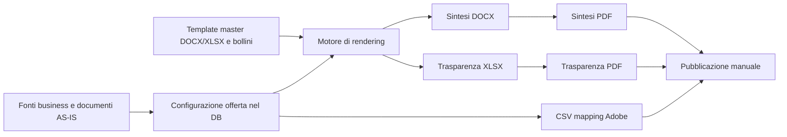

# Prodotto, processo e dominio

## Il problema che il prodotto risolve

Il processo attuale è document-centric: ogni team marketing conserva sui propri PC Word, Excel e PDF delle offerte del proprio mercato. Alla nascita di un'offerta, oppure a fronte di un canvas o di una delibera, un operatore parte da un documento esistente, modifica le parti interessate e ripete l'operazione per ogni variante. La manualità aumenta sia il tempo operativo sia il rischio che una modifica comune venga applicata solo a una parte della popolazione documentale.

La piattaforma proposta sposta il centro di gravità dai file alla **configurazione strutturata dell'offerta**. Il file è un output versionato di dati, template e regole. Questo consente di selezionare un insieme di offerte impattate e aggiornare attributi comuni, mantenendo distinti Sintesi e Trasparenze: un cambiamento a una delle due famiglie non deve propagarsi automaticamente all'altra senza una scelta dell'utente.

Il valore atteso non è soltanto velocità. Le informazioni critiche devono essere centralizzate, il lavoro deve essere confinato al segmento di ownership, gli output devono rispettare vincoli di formato e il sistema deve lasciare un audit trail delle generazioni. La responsabilità di pubblicare su Adobe, siti web e portale AGCOM resta comunque umana secondo il requisito.

## I file coinvolti: dalla fonte all'output

Nel progetto la parola “file” indica oggetti con ruoli molto diversi. Alcuni sono **fonti di conoscenza** per progettare la soluzione, altri sono **template master** che definiscono la forma dei documenti, altri ancora sono **artefatti generati** per una singola offerta. È importante non confonderli: un template non è un output pubblicabile, un PDF non è la sorgente modificabile dell'offerta e il database non è un semplice archivio di file.

Il ciclo che la soluzione intende realizzare è il seguente:

### Quadro completo degli artefatti

| Categoria | File o formato | Chi lo modifica | Ruolo nel processo | Destinazione/stato attuale |
| --- | --- | --- | --- | --- |
| Requisito | `Requisito_Automazion_creazione_file_precontratti.txt` | Business, marketing, regolamentare | Fonte primaria di vincoli, segmenti, canali, lifecycle e regole di output | Versionato nella repository; non è letto dall'applicazione |
| Requisito estratto | `extracted_requirements.txt` | Nessuno a runtime | Copia di lavoro del requisito | Documentazione ausiliaria; evitare divergenze dalla fonte primaria |
| Documentazione | `README.MD`, `GEMINI.md`, `implementation_plan.md`, `docs/*.md` | Team tecnico | Spiegano setup, design e convenzioni | Non parte del runtime; alcuni contenuti descrivono capacità future |
| Configurazione codice | `pyproject.toml`, `requirements.txt`, `Dockerfile`, `mcp_config.json`, `.gitignore` | Sviluppatori/DevOps | Definiscono dipendenze, immagine e strumenti | Usati per sviluppo/build; `mcp_config.json` contiene path obsoleti |
| Dati applicativi | `pre_contratti.db` | API e, indirettamente, editor | SQLite locale con offerte, segmenti, tabelle e storico | Creato/aggiornato a runtime; ignorato da Git; sostituito da Spanner nel target |
| Schema target | `app/database/spanner_schema.sql` | DBA/DevOps | DDL e seed per il database Cloud Spanner progettato | Non eseguito dal runtime locale; richiede correzione prima dell'uso |
| Template Sintesi | `templates/w3_meta_template.docx` | Template author approvato | Master Word con layout, stile e placeholder | Letto e mai modificato dal renderer; copiato in `/gcs/templates/` nel container |
| Template Trasparenza | `templates/template_trasaparenza.xlsx` | Template author/compliance | Master Excel AGCOM con layout, celle e marker dinamico | Letto e mai modificato dal renderer; copiato in `/gcs/templates/` nel container |
| Asset grafici | `templates/bollini/*.png` | Brand/compliance | Bollini tecnologia da inserire nella Sintesi | Letti durante il rendering se tecnologia e template lo richiedono |
| DOCX generato | `<nome>.docx` | Motore | Sintesi Contrattuale editabile generata da dati + template | Salvato temporaneamente in `/tmp/compilation_workspace` |
| XLSX generato | `<nome>.xlsx` | Motore | Trasparenza Tariffaria strutturata da inviare/verificare | Salvato temporaneamente nella stessa workspace |
| PDF generati | `<nome>.pdf` | Convertitore Graph/Spire/LibreOffice | Versione da sottoporre a validazione e pubblicare | Temporanea in locale; URI GCS solo dichiarato nello storico |
| CSV mapping | `adobe_mapping_<nome>.csv` | API su richiesta | Rappresentazione di mapping per il flusso Adobe | Stream HTTP, non persistito nel DB o nella workspace |
| Output di esempio | `templates/test_output.docx` | Team di sviluppo/test | Esempio di documento, non template di produzione | Non è richiamato dal servizio di generazione |
| Sidecar editoriale | `*.metadata.json` | Ambiente/editor | Metadati esterni ai file omonimi | Non sono importati o usati dall'applicazione |

### File di input: cosa entra davvero nel motore

Nel processo desiderato, la maggior parte dei dati non dovrebbe essere caricata come file a ogni generazione. L'input primario è il record `offers` e il JSON delle sue `dynamic_tables`, salvati nel database attraverso dashboard/API. Il record contiene identità dell'offerta, segmento, tecnologia, prezzo, stato, date, PO, metodo di pagamento, nomi personalizzati e prezzi di attivazione. Ogni tabella contiene invece label, valori, figli e note. Questa distinzione permette di correggere un valore una volta sola e riusarlo in output diversi.

I due file master costituiscono il secondo input essenziale. `w3_meta_template.docx` determina tipografia, tabelle statiche, intestazioni e placeholder da sostituire per la Sintesi. `template_trasaparenza.xlsx` determina il formato Excel, le celle di identità dell'offerta e, se presente, il marker `[INIZIO_TABELLA_PREZZI]` sotto cui il motore inserisce righe dinamiche. Il motore legge i template ma non dovrebbe mai salvarvi sopra: un master modificato accidentalmente altera tutte le generazioni successive.

I PNG nella cartella `templates/bollini/` sono input binari grafici. Gli asset presenti sono bollino fibra verde, fibra-rame giallo, fibra-radio giallo e tre varianti 5G; il codice mappa FTTH al verde, FTTC al fibra-rame giallo, FWA al fibra-radio giallo e 5G alla variante verde `stile=bollo-5G-verde.png`. L'asset rosso e quello giallo 5G sono presenti ma non selezionati dalla mappa corrente. Per `4G` non è previsto bollino.

Il requisito business cita inoltre documenti Word, Excel e PDF AS-IS conservati in una share o sui PC. Questi file storici sono la fonte da cui mappare contenuti e casi limite, ma non sono inclusi nella repository e non esiste una funzione di importazione automatica. Il loro censimento, classificazione per segmento e migrazione nel database rimangono attività necessarie prima della messa in esercizio.

### Sintesi Contrattuale: Word di lavoro e PDF finale

La **Sintesi Word (`.docx`)** è il primo output del ramo Sintesi. Viene costruita dal template Word e dal payload dell'offerta. È utile perché conserva struttura Word, tabelle, run formattate, hyperlink e descrizione alternativa dei bollini prima della conversione. Per WINDTRE il nome base è derivato normalmente da nome commerciale, tecnologia e prezzo, più il suffix dello stato; per Very Mobile può derivare dal nome scelto dall'utente. Prima del salvataggio il nome passa dal normalizzatore Adobe.

Il **PDF della Sintesi** è il secondo output dello stesso ramo ed è il file destinato ad Adobe e ai canali di pubblicazione. Nel codice corrente si ottiene soltanto tramite Microsoft Graph/OneDrive: il DOCX viene caricato su un drive configurato, richiesto in `format=pdf`, scaricato e poi cancellato in best effort. Senza credenziali Graph il task della Sintesi fallisce, anche se il DOCX era stato generato correttamente. Il requisito chiede PDF accessibile/PDF-UA, testo ricercabile, ordine di lettura strutturato e testo alternativo delle immagini; la conversione Graph è un mezzo tecnico, non una certificazione automatica di questi requisiti.

### Trasparenza Tariffaria: Excel di deposito e PDF di consultazione

La **Trasparenza Excel (`.xlsx`)** è il file strutturato soggetto alle regole del vademecum AGCOM. Viene generato dal master Excel e dalle tabelle dinamiche dell'offerta. Il codice può preservare celle e sostituire placeholder, ma inserire righe in Excel è un'operazione delicata: formule, intervalli nominati, macro, grafici, convalide e aree di stampa devono essere verificati sul template reale. La repository non contiene il vademecum AGCOM citato dal requisito né un importatore di tale file; il template presente è dunque il riferimento tecnico immediato, non una prova completa di conformità.

Il **PDF della Trasparenza** è la versione da pubblicare sulle pagine tariffarie e da verificare visivamente. Il convertitore prova prima Graph se le credenziali sono disponibili, poi Spire.XLS e infine LibreOffice headless. Questa catena rende possibile una demo offline per Excel, ma può generare differenze di impaginazione e accessibilità tra motori. Prima della produzione va scelta una catena approvata e ripetibile, con un controllo PDF/UA esterno e un esito bloccante quando dimensione, accessibilità o formato non rispettano la policy.

### PDF: stessa estensione, due finalità e vincoli comuni

I due PDF non sono intercambiabili. La Sintesi contiene le condizioni precontrattuali e viene caricata anche in Adobe/e-commerce/POS; la Trasparenza rappresenta il prospetto tariffario con specifiche AGCOM e ha come controparte l'Excel. Possono condividere dati, ma il requisito afferma espressamente che non ogni modifica di un ramo impatta l'altro. Un job maturo deve quindi dichiarare il proprio scope: solo Sintesi, solo Trasparenza oppure entrambe.

Per entrambi i PDF il requisito Adobe impone dimensione massima di 2 MB e un filename massimo di 160 caratteri inclusa l'estensione; sono vietati spazi e caratteri come slash, backslash, due punti, asterisco, punto interrogativo, virgolette, minore/maggiore e pipe. `sanitize_adobe_filename` applica una parte di queste regole: sostituisce spazi con underscore, rimuove gli altri caratteri non ammessi dalla base e tronca la base. Il controllo di 2 MB è oggi solo un messaggio di warning: non blocca il job, non comprime il PDF e non garantisce l'unicità richiesta da Adobe.

### Versioni, nomi e coesistenza degli output

La coesistenza non riguarda “quattro formati” di un solo istante, ma versioni generate in fasi diverse. Alla fase `NUOVA` dovrebbero esistere Sintesi DOCX/PDF e Trasparenza XLSX/PDF. Dopo l'assegnazione del codice AGCOM, una nuova generazione dovrebbe produrre una seconda coppia per ciascun ramo, conservando quella precedente. In caso di `CHIUSA`, il requisito domanda ulteriori file con data fine, ancora senza sovrascrittura.

| Segmento | Regola desiderata | Naming effettivamente applicato |
| --- | --- | --- |
| WINDTRE | Nome commerciale, tecnologia, prezzo e elemento distintivo; suffix lifecycle per evitare collisioni | Base Sintesi `<nome>_<tecnologia>_<prezzo>`, Trasparenza `trasparenza_<nome>`, più `_NUOVA`, `_COD_<codice>` o stato |
| Very Mobile | Convenzione con data, prezzo, giga, costo attivazione e PO; PO obbligatorio nel nome | Nome custom esatto, se fornito, altrimenti nome commerciale/`trasparenza_<nome>`; il PO non viene aggiunto automaticamente |

Il runtime non archivia realmente versioni: tutte le generazioni usano `/tmp/compilation_workspace` e lo stesso nome può sovrascrivere il precedente. Il record `offer_state_history` salva URL costruiti come se il file fosse in GCS, ma nessun upload è effettuato. La coesistenza è pertanto un obiettivo parzialmente rappresentato dal naming e dallo storico, non una proprietà verificabile del prototipo.

### CSV di mapping Adobe

Il CSV non è un documento contrattuale e non va confuso con il PDF. È un file tabellare di supporto al processo Adobe, generato al volo da `GET /api/offers/{id}/mapping`. Ha intestazione `ID_Offerta,Nome_Commerciale,Tecnologia,Codice_AGCOM,Stato,URL_Sintesi,URL_Trasparenza` e una sola riga per richiesta. Il nome download è `adobe_mapping_<nome offerta>.csv`, normalizzato con la stessa funzione dei documenti.

I due URL indicati dal CSV sono convenzioni `https://precontratti.windtre.it/sintesi/<id>.pdf` e `.../trasparenza/<id>.pdf`; non vengono verificati e non puntano ai nomi/versioni effettivamente memorizzati nello storico. Inoltre la riga CSV è costruita per concatenazione, senza escaping: un nome commerciale contenente una virgola produrrebbe un CSV malformato. Il file è utile per dimostrare il flusso, ma deve essere collegato agli artefatti persistiti e prodotto con una libreria CSV prima di essere usato operativamente.

### File temporanei, download e pulizia

Durante il rendering, DOCX, XLSX e PDF vengono salvati sotto `/tmp/compilation_workspace`. La route `/downloads/{filename}` li espone come download locale. Se il file non viene trovato, invece di restituire `404` la route crea un file testuale mock con quel nome. Questo comportamento è pensato per rendere la demo navigabile, ma è pericoloso in un processo reale: un operatore può scaricare un contenuto fittizio credendolo un output valido.

La directory temporanea non ha policy di cleanup, non è associata a un job e non persiste su un container Cloud Run. Nella soluzione target, ogni output deve essere salvato in storage privato, identificato da offerta, versione/lifecycle, tipo documento e checksum; la dashboard deve ricevere solo link firmati a breve scadenza per file con esito di validazione positivo. Il download deve fallire apertamente quando l'artefatto non esiste.

### File che non partecipano alla generazione

`templates/test_output.docx` può essere consultato come esempio visivo, ma il servizio non lo seleziona mai come master. I file `*.metadata.json` affiancati a HTML, Python, Dockerfile e SQL sono metadati dell'ambiente di lavoro: non sono importati da Python, non vengono copiati nell'immagine Docker e non influenzano gli output. Anche i Markdown sono input per persone, non per il renderer.

Questa classificazione suggerisce una regola operativa semplice: modificare un file sorgente o un template richiede revisione tecnica/compliance; modificare un record dati richiede autorizzazione del segmento; un file generato non va mai usato come sorgente per una nuova generazione, ma va conservato come evidenza della versione pubblicata.

## Vista operativa: quanti template, input e output

Questa sezione risponde al conteggio operativo, non alla sola classificazione dei formati. I **segmenti sono nove**, ma il codice non possiede nove famiglie di template: applica gli stessi due master a qualunque offerta, indipendentemente dal segmento. Non esistono neppure template PDF o CSV: il PDF deriva dalla conversione dell'output Word/Excel, mentre il CSV viene composto al volo dall'API.

### Inventario fisico presente oggi nella repository

| Oggetto | Quantità fisica | Come viene usato | Copertura segmenti |
| --- | ---: | --- | --- |
| Template master Sintesi Word (`.docx`) | **1**: `w3_meta_template.docx` | Input di tutte le generazioni Sintesi | **1 template condiviso per tutti i 9 segmenti** |
| Template master Trasparenza Excel (`.xlsx`) | **1**: `template_trasaparenza.xlsx` | Input di tutte le generazioni Trasparenza | **1 template condiviso per tutti i 9 segmenti** |
| Template PDF | **0** | Non previsto: il PDF è una conversione | Nessuno |
| Template CSV | **0** | Non previsto: il CSV viene costruito come testo dall'endpoint mapping | Nessuno |
| DOCX di esempio | **1**: `test_output.docx` | Esempio/test visivo; non viene letto dal servizio | Nessuno |
| Asset bollini PNG | **7** | Input condizionale della Sintesi | Condivisi; il codice seleziona una sola variante per generazione, se applicabile |
| Database dati | **1** file locale: `pre_contratti.db`, se creato | Input persistente delle offerte e delle tabelle | Contiene record di tutti i segmenti |
| PDF/XLSX/DOCX generati già versionati in repository | **0** | Non sono distribuiti come artefatti persistiti | Nessuno |

In pratica, **non c'è un template per ciascun segmento**. Il sistema attuale ha una coppia di template generica: 1 Word + 1 Excel per l'intera popolazione. Per ciascuno dei nove segmenti l'applicazione crea la stessa struttura iniziale di quattro blocchi dati (`PREZZO`, `COSTI`, `SERVIZI`, `DURATA`), non template separati. I documenti di requisito descrivono invece strutture molto differenti tra mobile, fisso, consumer, microbusiness, etnico e Very Mobile; il conteggio target dei template per segmento non è stato ancora deciso né implementato.

### Quanti input usa una singola generazione

Una generazione non riceve un file Word o Excel compilato dall'utente. Riceve un `offer_id` e legge i dati dal database. Per una **offerta appena creata**, il sistema dispone di un record offerta e crea quattro record `dynamic_tables`; può in seguito aggiungere tabelle ulteriori se l'utente usa un nuovo `table_identifier`.

| Input per una generazione di una offerta | Quantità normale | Dettaglio |
| --- | ---: | --- |
| Record offerta | **1** | Nome, segmento, tecnologia, prezzo, stato, date, PO, nomi e prezzi attivazione |
| Tabelle dinamiche | **4** al bootstrap | `PREZZO`, `COSTI`, `SERVIZI`, `DURATA`; possono essere 0 o più di 4 su offerte storiche/manipolate |
| Template DOCX | **1** | Sempre `w3_meta_template.docx` |
| Template XLSX | **1** | Sempre `template_trasaparenza.xlsx` |
| Asset bollino | **0 o 1** | Uno per FTTH/FTTC/FWA/5G, se il renderer trova l'asset e deve inserirlo; 4G non ne usa uno |
| Credenziali Graph | **4 variabili** per Sintesi PDF | Tenant, client id, client secret e drive id; sono obbligatorie per il PDF della Sintesi |

Le quattro tabelle non sono quattro file: sono quattro record JSON collegati all'offerta. Dentro ogni tabella può esserci un numero variabile di righe padre e figlio. Il dato di input effettivo è quindi “una offerta più le sue tabelle”, non “quattro documenti da modificare”.

### Quanti output produce una singola offerta

Quando viene eseguito `POST /api/offers/{id}/compile`, il codice chiama senza selezione entrambi i rami e produce, se tutte le conversioni riescono, esattamente **quattro file per offerta e per esecuzione**:

| Ramo | Output | Quantità | Destinazione attuale | Destinazione target |
| --- | --- | ---: | --- | --- |
| Sintesi | Word `.docx` | **1** | `/tmp/compilation_workspace` | Storage versionato |
| Sintesi | PDF `.pdf` | **1** | Stessa directory, dopo conversione Graph | Storage versionato e canali Adobe/web/POS |
| Trasparenza | Excel `.xlsx` | **1** | `/tmp/compilation_workspace` | Storage versionato e deposito AGCOM |
| Trasparenza | PDF `.pdf` | **1** | Stessa directory, dopo Graph/Spire/LibreOffice | Storage versionato e pagine tariffarie |
| Mapping Adobe | CSV `.csv` | **0 nella generazione**, **1 su richiesta** | Stream dell'endpoint `/mapping` | Download associato agli artefatti reali |

Il CSV va quindi conteggiato separatamente: non è uno dei quattro output documentali, né viene creato automaticamente quando parte la compilazione. Una chiamata a `GET /api/offers/{id}/mapping` restituisce un solo CSV, con una sola riga per l'offerta richiesta.

La Sintesi PDF è un punto bloccante: se Graph non è configurato, DOCX e XLSX possono anche essere generati, ma il task fallisce prima della registrazione completa dello storico. Di conseguenza “quattro output” è il risultato atteso di una generazione riuscita, non una garanzia dell'implementazione attuale.

### Conteggio per stato: cosa significa coesistenza

Ogni **esecuzione** produce quattro file. Se la stessa offerta viene generata in più stati e le versioni vengono davvero archiviate senza sovrascrittura, i file si accumulano.

| Momento del lifecycle | DOCX Sintesi | PDF Sintesi | XLSX Trasparenza | PDF Trasparenza | Totale incrementale per offerta |
| --- | ---: | ---: | ---: | ---: | ---: |
| Generazione in `NUOVA` | 1 | 1 | 1 | 1 | **4** |
| Nuova generazione in `APERTA` | +1 | +1 | +1 | +1 | **8 cumulati** |
| Nuova generazione in `CHIUSA` | +1 | +1 | +1 | +1 | **12 cumulati** |

La formula è semplice: per $N$ offerte selezionate e $R$ generazioni/versioni conservate, il sistema deve gestire $4 \times N \times R$ artefatti documentali. Se viene richiesto anche un CSV per ogni offerta, si aggiungono fino a $N$ file CSV, ma solo se l'utente li scarica/genera. Esempio: 10 offerte compilate nello stato `NUOVA` producono 40 file; se le stesse 10 vengono poi rigenerate in `APERTA` e le versioni restano disponibili, gli output diventano 80.

La regola business spesso viene chiamata “coesistenza di 4 file” con riferimento ai soli Excel/PDF delle Trasparenze in fase nuova e codificata: 2 file nella prima fase più 2 nella seconda. Il codice, però, genera sempre anche la coppia Sintesi, quindi la sua equivalenza operativa completa è **8 file** dopo le generazioni `NUOVA` e `APERTA`, oppure **12** includendo `CHIUSA`. La documentazione e gli stakeholder devono concordare quale delle due definizioni usare per il conteggio e la retention.

### Conteggio per segmento e per batch

Non è possibile dire quanti PDF, Word o Excel “ha” ogni segmento senza sapere quante offerte sono state create in quel segmento. Il repository contiene nove segmenti, non un catalogo di offerte produttive. Il conteggio corretto è pertanto parametrico:

| Perimetro operativo | Template Word | Template Excel | Input record offerta | Output per una generazione riuscita |
| --- | ---: | ---: | ---: | ---: |
| Una offerta di un segmento qualsiasi | 1 condiviso | 1 condiviso | 1 offerta + normalmente 4 tabelle | 1 DOCX + 1 PDF Sintesi + 1 XLSX + 1 PDF Trasparenza = **4** |
| Tutte le offerte di un segmento, $N_s$ offerte | 1 condiviso | 1 condiviso | $N_s$ offerte + relative tabelle | **$4N_s$** file |
| Tutti i 9 segmenti, $N$ offerte totali | 1 condiviso | 1 condiviso | $N$ offerte + relative tabelle | **$4N$** file |
| Una generazione selettiva solo Sintesi, richiesta target | 1 | 0 | 1 offerta + dati Sintesi | **2** file: DOCX + PDF |
| Una generazione selettiva solo Trasparenza, richiesta target | 0 | 1 | 1 offerta + dati Trasparenza | **2** file: XLSX + PDF |

Le ultime due righe sono **requisiti target**, non funzioni disponibili: il codice corrente non accetta un flag di scope e produce entrambe le famiglie. Allo stesso modo non implementa il caso di business con più punti prezzo per la stessa offerta. Nel target, una combinazione offerta-punto prezzo che richieda una Trasparenza distinta deve essere trattata come una unità di generazione aggiuntiva: ogni combinazione fa crescere almeno la coppia XLSX/PDF di 2 file, e di 4 se è richiesta anche la Sintesi.

### Esempio sui dati demo inclusi

Al primo avvio del database vuoto il seed crea **3 offerte demo**: una `W3_MOB_CB_CNS`, una `W3_FIX_GA_CNS` e una `VERY_MOBILE`. Se si compilassero con successo una volta ciascuna, il risultato teorico sarebbe **12 file**: 3 DOCX, 3 PDF Sintesi, 3 XLSX e 3 PDF Trasparenza. Non significa che il repository li contenga: vengono creati solo all'esecuzione e restano nella directory temporanea. Gli altri sei segmenti esistono come anagrafica, ma non ricevono un'offerta demo.

### Cosa manca per rendere questi conteggi affidabili

Oggi i contatori descrivono ciò che il codice tenta di fare, non ciò che è stato realmente conservato. Per una vista operativa affidabile occorrono: una tabella job con stato e scope, una tabella artefatti con tipo/versione/dimensione/checksum, storage persistente, relazione fra output e template usato, e dashboard con conteggi per segmento, offerta, stato e data. Solo allora sarà possibile rispondere in tempo reale, ad esempio, “il segmento Fisso GA Consumer ha 25 offerte, 50 PDF attivi e 100 output storici” senza dedurlo da nomi di file temporanei.

## Fonti e gerarchia delle decisioni

Il requisito in `Requisito_Automazion_creazione_file_precontratti.txt` è la fonte business più autorevole. Contiene commenti e conferme che segnalano decisioni ancora non uniformi tra segmenti; per esempio, alcuni gruppi usano solo lo stato `NUOVA`, mentre altri considerano utile una fase codificata per aggiornamenti live. Il codice rappresenta il comportamento effettivamente eseguibile; `implementation_plan.md`, `hld_presentation.md`, `low_level_design.md` e `GEMINI.md` descrivono in buona parte il target progettuale.

Quando le fonti divergono, applicare questa sequenza:

1. Il requisito determina il bisogno business da validare con gli stakeholder.
2. Il codice determina ciò che oggi funziona e ciò che va protetto da regressioni.
3. I documenti di design sono ipotesi da trasformare in backlog, non prova di disponibilità.

## Segmenti, ownership e copertura

| ID | Mercato | Ownership indicata nel requisito | Limite totale dichiarato per Sintesi | Stato nel runtime |
| --- | --- | --- | ---: | --- |
| `W3_MOB_GA_CNS` | Mobile Generazione Attiva Consumer | Vaccari, Leone | 12 | Seed e limite servizio: 12 |
| `W3_MOB_CB_CNS` | Mobile Customer Base Consumer | Miletto, Fakir | 15 | Seed e limite servizio: 15 |
| `W3_MOB_GA_MB` | Mobile GA Microbusiness | Risoluto | 11 | Seed e limite servizio: 11 |
| `W3_FIX_GA_CNS` | Fisso GA/Cross Selling Consumer | Colombo, Conta, Bitetto | 14 | Seed e limite servizio: 14 |
| `W3_FIX_CB_CNS` | Fisso CB Consumer | D'Amario, Amatori, Cicco | 14 | Seed e limite servizio: 14 |
| `W3_FIX_GA_MB` | Fisso GA/Cross Selling Microbusiness | Tucciarone, Prizzon, Intermoia | 14 | Seed; limite effettivo default: 15 |
| `W3_FIX_CB_MB` | Fisso CB Microbusiness | Cunsolo, Giraldi, Liguori | 14 | Seed; limite effettivo default: 15 |
| `W3_ETN_CNS` | Etnico Consumer GA/CB | Pavan, Cancian, Ronci, Laudisio | 10 | Seed; limite effettivo default: 15 |
| `VERY_MOBILE` | Very Mobile | Serafini, Delrio | 3 | Seed e limite servizio: 3 |

La tabella `user_segment_roles` potrebbe esprimere questa ownership con ruoli `viewer`, `editor` e `admin`. Tuttavia nessuna identità viene autenticata e nessun filtro SQL usa tale relazione: nel runtime corrente l'isolamento è puramente visuale nella dashboard, quindi non è una garanzia di sicurezza.

## Casi d'uso end-to-end

### Inserire una nuova offerta

L'editor sceglie il segmento, inserisce nome commerciale, tecnologia, prezzo, data iniziale e, se necessario, PO, prezzi di attivazione, metodo di pagamento e nomi file. L'API crea l'offerta in stato `NUOVA` e quattro tabelle vuote. L'editor popola poi le sezioni e le note; la generazione può essere avviata manualmente.

Nel requisito, una nuova Trasparenza viene inviata ad AGCOM con stato “Nuova”, riceve un codice entro circa dieci giorni e viene rigenerata con il codice. Il backend interpreta questo passaggio come `NUOVA -> APERTA`; va chiarito per ogni segmento se `APERTA` è uno stato business universale o l'etichetta interna per “codice AGCOM ricevuto”.

### Aggiornare un'offerta esistente

Un editor può cambiare metadati e JSON delle tabelle. Il bulk update modifica campi semplici di più offerte in una singola transazione; non seleziona per relazione di impatto, non distingue Sintesi/Trasparenze e non accoda rigenerazioni. L'interfaccia offre una rigenerazione in batch attraverso più richieste `compile`, ma la semantica di job, risultati parziali e retry non esiste.

### Chiudere e sostituire un'offerta

Una chiusura deve produrre XLSX e PDF con data di fine e stato chiuso, mantenendo i documenti precedenti. In seguito viene creato un nuovo record `NUOVA` per la nuova offerta. Il servizio corrente imposta `CHIUSA`, usa la data richiesta o quella odierna e tenta una generazione. Non duplica né crea automaticamente la nuova offerta, non collega successioni tra offerte e non obbliga la data di fine.

### Preparare la pubblicazione Adobe

Il requisito impone PDF sotto 2 MB, nome al massimo di 160 caratteri inclusa estensione, caratteri limitati a lettere, cifre, punto, underscore e trattino, e unicità per Adobe. L'API produce un CSV a una riga con id, nome, tecnologia, codice, stato e due URL convenzionali. Non legge lo storico né gli artefatti effettivamente prodotti; il responsabile di pubblicazione deve pertanto validare manualmente il file e la mappatura prima di usarli.

## Stati e invarianti di dominio

Il modello contiene `NUOVA`, `APERTA` e `CHIUSA`. Il servizio consente solo `APERTA` e `CHIUSA` come target del metodo di transizione; `APERTA` richiede codice di lunghezza 10 o 36, `CHIUSA` non richiede codice. La creazione stabilisce sempre `NUOVA`.

| Stato | Significato operativo previsto | Dati minimi attesi | Output richiesto dal requisito | Comportamento attuale |
| --- | --- | --- | --- | --- |
| `NUOVA` | Offerta in lancio, prima del codice | data inizio | Excel/PDF e, dove applicabile, Sintesi Word/PDF | Creato correttamente; output solo con compilazione manuale o transizione successiva |
| `APERTA` | Offerta codificata/live | codice AGCOM | Nuova versione con codice, senza cancellare la precedente | Codice validato solo per lunghezza; generazione accodata |
| `CHIUSA` | Fine sottoscrivibilità | data fine | Nuovi Excel/PDF chiusi, non sovrascritti | Data default odierna; generazione accodata |

Un lifecycle industriale dovrebbe rendere espliciti: transizioni consentite per segmento, idempotenza di ogni comando, actor, motivo della modifica, versione del template e stato del job. La colonna `old_status` è oggi calcolata a posteriori in funzione dello stato finale, quindi non rappresenta con affidabilità una transizione reale.

## Configurazione per segmento: requisito contro implementazione

Il requisito dettaglia tabelle e cardinalità per mercato. Ad esempio, Fixed GA/MB chiede fino a sette tabelle, campi liberi non limitati e una tabella Costi che possa accorpare servizi inclusi; Mobile GA Microbusiness chiede anche Daily Pass; Very Mobile arriva a cinque tabelle con struttura diversa. Il servizio crea invece sempre `PREZZO`, `COSTI`, `SERVIZI`, `DURATA` e consente la creazione di qualsiasi identificatore al primo `PUT`.

Questa elasticità è utile, ma non sostituisce una configurazione governata. Per ogni segmento occorrono almeno: catalogo sezioni, titolo ammesso, massimo padre, massimo figli per padre, massimo righe renderizzate, template applicabile, note fisse, campi liberi, regole di output e naming. Questi dati dovrebbero essere versionati, non hard-coded in una sola `LIMIT_MAPPING`.

## Regole trasversali da mantenere

* Un valore `ND` è semanticamente diverso da un valore assente: nel primo caso si stampa “Non applicabile”; nel secondo la riga non deve comparire.
* Le note devono seguire la tabella cui si riferiscono. Il requisito prevede note riferite anche a padre, figlio e link.
* RDA è un parametro comune aggiornato annualmente; il valore finale dipende dal canone dell'offerta. Il DDL registra una chiave `RDA_COEFFICIENT_2026`, ma non esiste calcolo applicativo.
* Naming e condizioni della convergenza mobile/luce/gas sono contenuti comuni da aggiornare centralmente; sono presenti nel DDL come possibile configurazione ma non nel runtime.
* Very Mobile richiede PO nel nome e una convenzione desiderata `yyyymmdd_x.xx_xxGB_x.xx_POXXXXXX`; l'implementazione corrente preferisce un nome personalizzato e non costruisce questa convenzione.

## Decisioni da ottenere prima dell'industrializzazione

L'analisi deve essere chiusa con una matrice approvata di template e regole per ogni segmento. Sono particolarmente importanti la definizione esatta del codice AGCOM/stato per i segmenti che usano solo `NUOVA`, la regola CB Mobile Consumer sui punti prezzo, la policy di coesistenza Very Mobile, la responsabilità della verifica PDF/UA e l'eventuale perimetro di invio ZIP/email. Senza queste decisioni, rendere il prototipo più veloce rischia di fissare assunzioni locali come regole corporate.