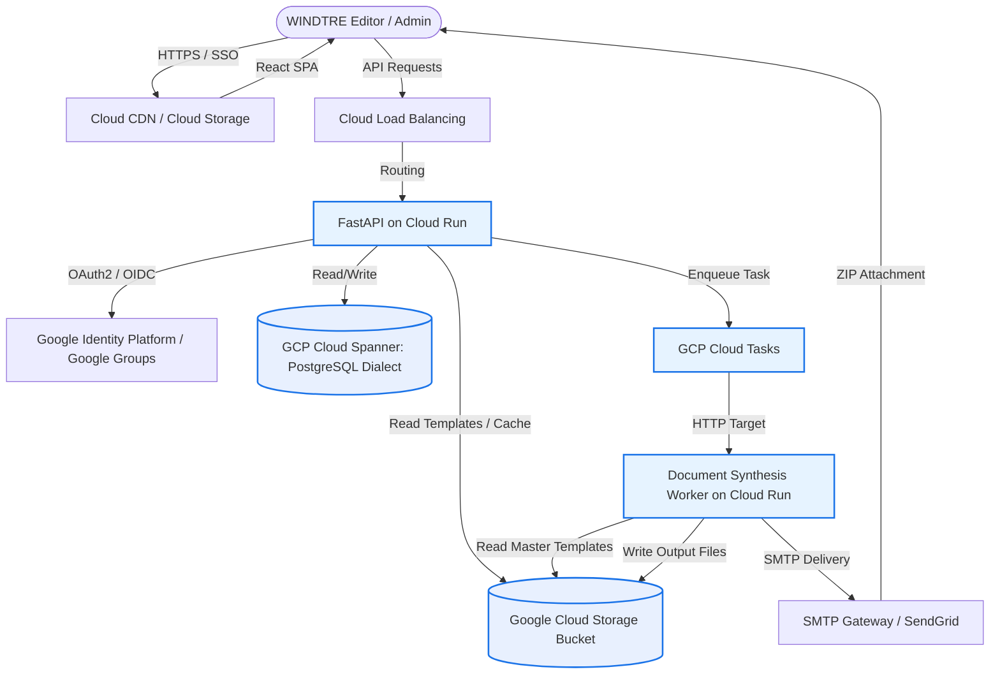
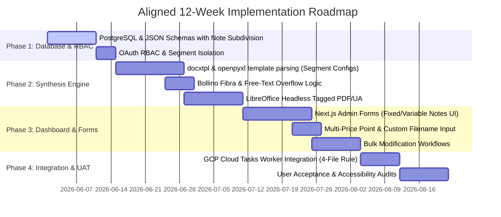

# Deep-Dive Architecture & Plan: WINDTRE Sintesi & Trasparenze Automation

This document outlines the software engineering and cloud architecture blueprint for the **Automazione Creazione Sintesi Contrattuali e Trasparenze Tariffarie** system on Google Cloud Platform (GCP), updated to fully align with the specifications defined in **Requisito_Automazion_creazione_file_precontratti.txt**.

---

## 1. System Design & GCP Architecture

A modular, serverless architecture handles dynamic parsing, high-throughput document synthesis, and event-driven worker execution on GCP.



### Components Rationale
1.  **Frontend**: Static single-page application (SPA) built using Next.js/React, served via **Google Cloud Storage (GCS)** and accelerated by **Cloud CDN**.
2.  **API Gateway & Application Server**: Managed Python **FastAPI** running on **Google Cloud Run**. It scales down to zero when idle to eliminate compute cost, and auto-scales rapidly during high-activity commercial canvasses (3–4 times/year).
3.  **Database Layer (Google Cloud Spanner - PostgreSQL Dialect)**:
    *   Leverages your existing Spanner instance by creating a new database configured with Spanner's PostgreSQL dialect. Relational schemas enforce RBAC security, transactional history tracking, and segment ownership. Native Spanner `JSON` columns are utilized to store dynamic Parent-Child table configurations, bypassing Cloud SQL provisioning restrictions while maintaining enterprise ACID consistency.
4.  **Asynchronous Document Worker**: Decoupled container running on Cloud Run. It executes document compilation in isolation, using `docxtpl` (Word), `openpyxl` (Excel), and headless `LibreOffice` for accessible Tagged PDF/UA exports.
5.  **Task Queue**: Managed via **GCP Cloud Tasks**. If a user triggers a bulk modification that impacts 40 documents, Cloud Tasks handles scheduling, rate limiting, and reliable retries, offloading the long-running process from the web interface.

---

## 2. Dynamic Relational-Document Schema Design

The core engineering challenge is to prevent "locking" the table structure while enforcing strict relationships and custom requirements such as **custom user-defined file names**, **subdivided notes**, and **multi-price point capabilities**.

### Relational Tables & DDL Blueprint
```sql
-- Enforce strict market and ownership segregation
CREATE TABLE segments (
    id VARCHAR(50) PRIMARY KEY, -- e.g., 'W3_MOB_GA_CNS', 'VERY_MOBILE'
    name VARCHAR(100) NOT NULL,
    description TEXT,
    created_at TIMESTAMP DEFAULT CURRENT_TIMESTAMP
);

CREATE TABLE users (
    id UUID PRIMARY KEY DEFAULT gen_random_uuid(),
    email VARCHAR(150) UNIQUE NOT NULL,
    first_name VARCHAR(100),
    last_name VARCHAR(100),
    is_active BOOLEAN DEFAULT TRUE,
    created_at TIMESTAMP DEFAULT CURRENT_TIMESTAMP
);

-- Access Control Mapping for Segment Ownership
CREATE TABLE user_segment_roles (
    user_id UUID REFERENCES users(id) ON DELETE CASCADE,
    segment_id VARCHAR(50) REFERENCES segments(id) ON DELETE CASCADE,
    role VARCHAR(50) CHECK (role IN ('editor', 'viewer', 'admin')),
    PRIMARY KEY (user_id, segment_id)
);

-- Core Offer Metadata with Support for Custom Naming and Multi-Price Points
CREATE TABLE offers (
    id UUID PRIMARY KEY DEFAULT gen_random_uuid(),
    segment_id VARCHAR(50) REFERENCES segments(id) ON DELETE RESTRICT,
    commercial_name VARCHAR(255) NOT NULL,
    technology_type VARCHAR(50) NOT NULL, -- e.g., 'FTTH', 'FTTC', 'FWA', '5G'
    base_price DECIMAL(10, 2) NOT NULL,
    price_points JSON, -- Array of additional price points for CB MOB CNS, e.g. [12.99, 14.99, 19.99]
    po_code VARCHAR(50), -- Used as primary key for Very Mobile (e.g. POXXXXXX)
    current_agcom_code VARCHAR(10) CHECK (length(current_agcom_code) = 10),
    status VARCHAR(20) CHECK (status IN ('NUOVA', 'APERTA', 'CHIUSA')) NOT NULL,
    date_start DATE NOT NULL,
    date_end DATE,
    custom_filename_sintesi VARCHAR(255), -- User defined filename for Sintesi document
    custom_filename_trasparenza VARCHAR(255), -- User defined filename for Trasparenza document
    created_at TIMESTAMP DEFAULT CURRENT_TIMESTAMP,
    updated_at TIMESTAMP DEFAULT CURRENT_TIMESTAMP
);

-- Audit History / Offer Transitions (Maintains 4-file history for active states)
CREATE TABLE offer_state_history (
    id UUID PRIMARY KEY DEFAULT gen_random_uuid(),
    offer_id UUID REFERENCES offers(id) ON DELETE CASCADE,
    old_status VARCHAR(20),
    new_status VARCHAR(20) NOT NULL,
    agcom_code_used VARCHAR(10),
    changed_by UUID REFERENCES users(id),
    timestamp TIMESTAMP DEFAULT CURRENT_TIMESTAMP,
    docx_gcs_uri VARCHAR(512),
    xlsx_gcs_uri VARCHAR(512),
    sintesi_pdf_gcs_uri VARCHAR(512),
    trasparenza_pdf_gcs_uri VARCHAR(512)
);

-- Flexible Layout Component Supporting Note Subdivision (Fixed/Variable)
CREATE TABLE dynamic_tables (
    id UUID PRIMARY KEY DEFAULT gen_random_uuid(),
    offer_id UUID REFERENCES offers(id) ON DELETE CASCADE,
    table_identifier VARCHAR(100) NOT NULL, -- e.g. 'PREZZO', 'SERVIZI', 'COSTI'
    sequence_order INT NOT NULL,
    title VARCHAR(255),
    structural_content JSON NOT NULL, -- Nested Padre/Figlio hierarchy (Spanner JSON data type)
    note_structure JSON, -- Subdivision of notes: {"fixed_part": "...", "variable_part": "..."}
    created_at TIMESTAMP DEFAULT CURRENT_TIMESTAMP,
    updated_at TIMESTAMP DEFAULT CURRENT_TIMESTAMP
);
```

### Advanced JSON Dynamic Table Structuring
The JSON structure stored in `dynamic_tables.structural_content` represents arbitrary tables with dynamic rows. This allows users to add fields without migrations:

```json
{
  "max_rows_limit": 15,
  "rows": [
    {
      "id": "p_cost_mensile",
      "type": "padre",
      "label": "Costo canone del servizio",
      "value": "29,99 euro",
      "children": [
        {
          "id": "c_cost_mensile_1",
          "type": "figlio",
          "label": "Composto per i primi 48 mesi da canone + modem",
          "value": "24,00 euro + 5,99 euro"
        },
        {
          "id": "c_cost_mensile_2",
          "type": "figlio",
          "label": "Dopo i 48 mesi",
          "value": "29,99 euro"
        }
      ]
    },
    {
      "id": "p_seconda_linea",
      "type": "padre",
      "label": "Per clienti che attivano una Seconda Linea",
      "value": "+ 10 euro",
      "children": []
    },
    {
      "id": "p_costo_attivazione",
      "type": "padre",
      "label": "Costo di attivazione servizio",
      "value": "ND",
      "children": []
    }
  ]
}
```

---

## 3. Core Engine Mechanics & Pipeline

### A. The "Meta-Template" Architecture & Synthesis Engine
To prevent the creation and maintenance of dozens of rigid files, the system implements a **Meta-Template Engine** (Proposta Meta-Template). Instead of hardcoding static layouts, we define unified abstract templates (e.g., one for W3 Mobile, W3 Fixed, and Very Mobile) that dynamically reconstruct tables on the fly based on the `Padre-Figlio` database structures.

1.  **Word (.docx) Meta-Template Table Loops**:
    The system reads a master template file containing a single baseline table structure. The document worker uses `docxtpl` to execute dynamic XML table mapping using conditional nesting loops.
    
    Inside the Word cells, dynamic Jinja tags dictate the table expansion:
    *   **Parent Row (Padre)**: Evaluated dynamically. If a Padre record has data, the row is generated.
    *   **Child Row (Figlio)**: Renders directly below its parent row. If multiple children exist, rows are appended automatically.
    *   **Conditional Omission**: If a row value is null or empty, the XML engine deletes the table row (`<w:tr>`) directly from the Word XML structure. This prevents empty space or placeholder rendering, satisfying strict document standards and accessibility rules without multiplying templates.
    
    ```jinja
    
    
      -- Renders Padre Row --
      [ {{ row.label }} ] : [ {{ row.value }} ]
      
        
          -- Renders Figlio Row --
          * {{ child.label }} : {{ child.value }}
        
      
    
      -- Handle ND standard --
      [ {{ row.label }} ] : [ Non applicabile ]
    
    
    ```

2.  **Excel (.xlsx) Meta-Template Coordinate Engine**:
    For AGCOM Trasparenze Excel sheets, we use `openpyxl`. Since AGCOM requires rigid formats, the engine:
    *   Reads the abstract Meta-Template sheet containing the baseline section headers.
    *   Dynamically shifts cells and inserts row arrays sequentially for each active Padre/Figlio record.
    *   Re-calculates formula cell boundaries (e.g., updating SUM or division arrays) dynamically so that dynamic row scaling never breaks Excel calculation macros.

### B. Segment-Specific Table Configurations (Requirements Mapping)
To strictly satisfy all segment rules provided in the requirements document, the database dynamic schemas and admin forms are governed by segment-specific configurations:

#### 1. FISSO GA / Cross Selling MB
*   **Table Layout**:
    *   **Tabella 1**: *Nessun titolo*, 3 Padri, 3 Figli max. **Technology Badge (Bollino Fibra)** is dynamically injected inside the first Figlio of the first Padre. Followed by an unbounded free-text "campo libero".
    *   **Tabella 2**: Titolo *“Servizio/i e apparecchiature”*, 4 Padri, 4 Figli max.
    *   **Tabella 3**: Titolo *“Velocità del servizio Internet e mezzi di ricorso”*, 1 Padre, 2 Figli max. Followed by a specific FWA Note `(1)` and an unbounded free-text "campo libero".
    *   **Tabella 4**: Titolo *“Prezzo”*, 1 Padre, 3 Figli max. Followed by an unbounded free-text "campo libero" (no character limit; examples up to 629 words).
    *   **Tabella 5**: Titolo *“Costi”*, merges the 3 Padri / 3 Figli Costi table with the *“Servizi inclusi nel costo mensile”* table (1 Padre, 7 Figli max) into a consolidated structure of **4 Padri and 10 Figli**.
    *   **Tabella 6**: Titolo *“Servizi non inclusi”*, 1 Padre, 4 Figli max. Followed by an unbounded free-text note.
    *   **Tabella 7**: Titolo *“Durata, rinnovo e risoluzione”*, 4 Padri, 5 Figli max. Followed by an unbounded free-text "campo libero" with structured sections.

#### 2. FISSO CNS CVM / Cross Selling
*   **Table Layout**:
    *   **Tabella 1**: *Nessun titolo*, 3 Padri, 3 Figli max. **Technology Badge (Bollino Fibra)** is dynamically injected inside the first Figlio of the first Padre. Followed by an unbounded free-text "campo libero".
    *   **Tabella 2**: Titolo *“Servizio/i e apparecchiature”*, 4 Padri, 4 Figli max.
    *   **Tabella 3**: Titolo *“Velocità del servizio Internet e mezzi di ricorso”*, 1 Padre, 2 Figli max. Followed by FWA Note `(1)` and free-text "campo libero".
    *   **Tabella 4**: Titolo *“Prezzo”*, 1 Padre, 1 Figlio max. Followed by a free-text "campo libero".
    *   **Tabella 5**: Titolo *“Costi”*, merges the 3 Padri / 3 Figli Costi table with the *“Servizi inclusi nel costo mensile”* table (1 Padre, 3 Figli max) into a consolidated structure of **4 Padri and 6 Figli**.
    *   **Tabella 6**: Titolo *“Servizi non inclusi”*, 1 Padre, 5 Figli max. Followed by a free-text "campo libero" note.
    *   **Tabella 7**: Titolo *“Durata, rinnovo e risoluzione”*, 4 Padri, 5 Figli max. Followed by a free-text "campo libero" with info/sections.

#### 3. MOBILE W3 GA MICROBUSINESS
*   **Table Layout**:
    *   **Tabella 1**: *Nessun titolo*, 3 Padri, 3 Figli max.
    *   **Tabella 2**: Titolo *“Servizio/i e apparecchiature”*, 5 Padri, 5 Figli max. Followed by free-text note `1`.
    *   **Tabella 3**: Titolo *“Daily Pass”*, 1 Padre, 1 Figlio max.
    *   **Tabella 4**: Titolo *“Velocità del servizio Internet e mezzi di ricorso”*, 1 Padre, 2 Figli max. Followed by free-text note `2`.
    *   **Tabella 5**: Titolo *“Prezzo”*, 4 Padri, 7 Figli max. Followed by free-text note.
    *   **Tabella 6**: Titolo *“Costo di attivazione servizio”*, 1 Padre, 4 Figli max. Followed by free-text note `3`.
    *   **Tabella 7**: *Nessun titolo*, 2 Padri, 5 Figli max.
    *   **Tabella 8**: Titolo *“Durata, rinnovo e risoluzione”*, 3 Padri, 3 Figli max. Followed by note `4` and structured free-text fields.
*   **Special Note / Link Rule**: "Sotto le tabelle deve essere possibile inserire note riferite ai padri o figli e link." This is supported in the metadata schema.

### C. Dynamic Table Hiding & "ND" Rules
The parser filters data fields sequentially:
*   **Omitting Nulls**: If a dynamic table row contains an empty or null `value` field, that row is omitted entirely from both Word tables and Excel files to comply with accessibility standard 229 (no blank structural gaps).
*   **Translating "ND"**: If a row value is explicitly `"ND"`, the parser outputs `"Non applicabile"` (complying with standard 228).
*   **Footnote Anchoring**: Notes, regulatory links, and variables are injected immediately at the bottom of the active table border, rather than the footer or middle of the sheet (standard 230).

### D. Separation of Notes in Trasparenze (Fixed vs. Variable)
To fulfill the requirement: *"Richiesto di suddividere il campo note in una parte fissa e in una parte variabile..."* and *"Sulle trasparenze, il campo ‘nota’ sul db sarà unica e l’utente modificherà solo la parte di testo che desidera."*:
*   **Database Level**: Stored as a single unified text string in the database or as a single `note_structure` JSON object (`{"fixed_part": "...", "variable_part": "..."}`).
*   **Admin UI Level**: The front-end renders the note as two distinct fields:
    1.  **Fixed Part**: Rendered as a read-only grayed-out block containing standard templates (e.g., regulatory or tech boilerplate).
    2.  **Variable Part**: Rendered as a rich text area where the marketing user edits the content specific to the offer.
*   **Generation Pipeline**: On save, the UI compiles both parts into a single string (maintaining a single DB field as requested), or the back-end API concatenates them dynamically when feeding the `openpyxl` / `docxtpl` synthesis pipeline.

### E. Unbounded Character Fields for Free Text (Campo Libero)
To support the request: *"Il desiderata è non avere limitazioni di caratteri nel campo libero..."*:
*   All free-text fields are stored as `TEXT` in the Spanner PostgreSQL database (no arbitrary character limits).
*   The `docxtpl` word generator does not enforce bounding boxes; text automatically flows and spans across multiple pages. Headless LibreOffice handles this dynamic layout expansion seamlessly when compiling the accessible PDF.

### F. Access Control & Segregation Matrix
RBAC mappings isolate users based on segment credentials:

| Segment ID | Segment Description | User Groups / Emails |
| :--- | :--- | :--- |
| **W3_MOB_GA_CNS** | WINDTRE Mobile GA Consumer | Vaccari Beatrice, Leone Alissa Lucia |
| **W3_MOB_CB_CNS** | WINDTRE Mobile CB Consumer | Miletto Silvia Virginia, Fakir Mahal |
| **W3_MOB_GA_MB** | WINDTRE Mobile GA Microbusiness | Ilaria Risoluto |
| **W3_FIX_GA_CNS** | WINDTRE Fisso GA / Cross Selling Consumer | Colombo Daniela, Conta Susanna, Bitetto Angela |
| **W3_FIX_CB_CNS** | WINDTRE Fisso CB Consumer | D'Amario Barbara, Alessandro Amatori, Cicco Laura |
| **W3_FIX_GA_MB** | WINDTRE Fisso GA / Cross Selling MB | Tucciarone Cinzia, Prizzon Valentina, Intermoia Alessandra |
| **W3_FIX_CB_MB** | WINDTRE Fisso CB Microbusiness | Cunsolo Giuseppe, Giraldi Barbara, Liguori Vincenzina |
| **W3_ETN_CNS** | WINDTRE Etnico Consumer GA/CB | Pavan Tatiana, Erika Cancian, Roberta Ronci, Immacolata Laudisio |
| **VERY_MOBILE** | Very Mobile Segment | Serafini Germana, Delrio Mauro |

### G. Annual & Global Update Strategy
*   **RDA Coefficient (Gigabytes in EU)**:
    *   Updated annually before December 31.
    *   **Implementation Strategy**: The RDA variable is configured as a global utility formula within Cloud Spanner:
        $$\text{EU Gigabytes} = \left( \frac{\text{Monthly Fee (excl. VAT)}}{\text{RDA Constant}} \right) \times 2$$
        Updating the `rda_constant` parameter in a single configuration view automatically calculates and updates the Giga values across all dynamic tables.
*   **Convergence and Pricing Packages**:
    *   Updated globally using **bulk edit tasks**. Users can query all offers matching specific technology tags (e.g., `FIBRA`) and execute a bulk change to apply new convergent terms across all related Sintesi files at once.

---

## 4. Adobe Naming, Life-Cycle States, & Co-existence Pipeline

A key business logic requirement is the **simultaneous coexistence of 4 output files** per active offer (Excel + PDF for pre-AGCOM code and Excel + PDF for post-AGCOM code) and **strict naming autonomy for Very Mobile** (no automatic date-time suffixes).

```
[Offer Created - Status: 'NUOVA']
        |
        +---> Generates Pair 1: [Custom_Name_Sintesi].docx/.pdf (No AGCOM Code)
        +---> Generates Pair 2: [Custom_Name_Trasparenza].xlsx/.pdf (No AGCOM Code)
        |
        v
[Admin Receives AGCOM Code & Enters it in UI]
        |
        v
[Offer Status Transitions to 'APERTA' / Active]
        |
        +---> Retains Pair 1 and Pair 2 on GCS (Immutable historical log)
        +---> Generates Pair 3: [Custom_Name_Sintesi_Coded].docx/.pdf (With AGCOM Code)
        +---> Generates Pair 4: [Custom_Name_Trasparenza_Coded].xlsx/.pdf (With AGCOM Code)
        |
        v
[Offer Reaches End of Commercial Validity - Status: 'CHIUSA']
        |
        +---> Regenerates final Pair with 'CHIUSO' label and Date End printed
```

### A. The 4-File Co-existence Rule
To prevent over-writing files when the AGCOM code is received, the GCP Storage bucket structures the offer files as follows:
*   **NUOVA Phase (No AGCOM Code)**:
    *   Sintesi: `/{offer_id}/sintesi/{custom_name}_SOCI.pdf` (or `_NUOVA.pdf`)
    *   Trasparenza: `/{offer_id}/trasparenza/{custom_name}_SOCI.xlsx` (or `_NUOVA.xlsx`)
*   **APERTA Phase (With AGCOM Code)**:
    *   Sintesi: `/{offer_id}/sintesi/{custom_name}_COD_{agcom_code}.pdf`
    *   Trasparenza: `/{offer_id}/trasparenza/{custom_name}_COD_{agcom_code}.xlsx`
This maintains the exact set of 4 documents concurrently, allowing users to reference both pre-code and post-code configurations.

### B. User-defined Naming Autonomy & Suffix Policies
In the input interface, users are provided with explicit input fields: `custom_filename_sintesi` and `custom_filename_trasparenza`.
*   **Very Mobile**:
    *   The file name is compiled **exactly** as typed by the user in the input interface.
    *   **No automated timestamp suffixes** (`_YYYYMMDD_HHMM`) are appended (strictly satisfying the constraint: *"l'aggiunta automatica di un suffisso data_ora_min è ridondante e non necessario"*).
    *   Validation only enforces character safety (`[A-Za-z0-9._-]` and length `< 160`).
*   **WINDTRE Segments**:
    *   WINDTRE uses standard, structured suffix additions (such as `_NUOVA` or `_COD_[AGCOM_CODE]`) to support the 4-file co-existence rule without causing directory collisions.

### C. CB MOB CNS (Customer Base Mobile) Multi-Price Point Logic
*   For the consumer Customer Base mobile segment, offers are generated for multiple price points.
*   **Process**:
    1.  The UI allows adding multiple prices to an offer.
    2.  The engine loops through each price point in `price_points` and generates the corresponding Sintesi and Trasparenza pairs on GCS.
    3.  The backend automatically analyzes the generated outputs and selects the document with the **highest price point** as the primary active reference or bundles them cleanly into a multi-output ZIP archive for easy user retrieval.

### D. File Validation & Size Optimization
All generated documents go through a pipeline:
*   **Path Length Validation**: Absolute path length in GCS and Adobe must be `< 160 characters`.
*   **Strict Size Check**: Headless LibreOffice PDF compiler checks if size `< 2.0 MB`. If it exceeds, a warning is raised and background image compression is automatically executed.

---

## 5. Phased Implementation Timeline



### Phase 1: Core Database & Identity Management (Weeks 1-2)
*   Deploy Spanner PostgreSQL schema, including `custom_filename` attributes, dynamic segment role maps, and JSON structure for subdivided notes (fixed/variable split).
*   Configure Google Cloud Identity OIDC integration, mapping Google Workspace Group claims to segment roles.
*   Verify access isolation between segments (e.g. Very Mobile editors restricted to Very Mobile PO-coded entries).

### Phase 2: Document Generation & PDF/UA Compliance (Weeks 3-6)
*   Develop Python backend parser using `docxtpl` for Word table loops, integrating the **Bollino Fibra** injection in Tabella 1, Child 1.
*   Enforce unbounded text fields for free text ("campo libero"), allowing seamless multi-page overflow.
*   Configure `openpyxl` pipeline for AGCOM Excel, incorporating cell shifters and dynamic formula adjustments.
*   Set up headless LibreOffice in GKE / Cloud Run to generate accessible PDF/UA documents under the 2MB size limit.

### Phase 3: Dynamic Admin Frontends & Custom Form Inputs (Weeks 7-9)
*   Develop Next.js admin interface. Implement separate visual inputs for **Fixed Notes (read-only)** and **Variable Notes (editable)**.
*   Integrate input fields for user-defined filenames, ensuring Very Mobile naming remains completely clean and free of automated date-time suffixes.
*   Develop the bulk update dashboard for global parameters like the annual RDA constant and convergent bundles.

### Phase 4: Integration & UAT (Weeks 10-12)
*   Deploy GCP Cloud Tasks to trigger background generation and manage the **4-file co-existence rule** during state transitions.
*   Implement CB MOB CNS point-price iteration logic, packaging outputs for all price points and highlighting the highest.
*   Conduct accessibility tests using JAWS/NVDA screen-readers to confirm standard compliance. Deliver training and host the final UAT sessions.
