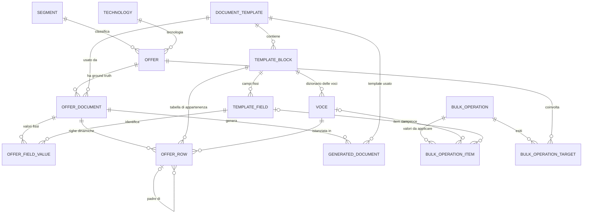

# 03 — Modello dati

Database relazionale su **SQLite** (`data/mvp.db`), gestito con SQLAlchemy 2.0.
Schema creato dai modelli (`Base.metadata.create_all`); **nessuna migrazione**
(Alembic) in questa fase — cambiare i modelli su un DB esistente richiede di
ricrearlo.

## 1. Mappa delle relazioni

Lettura concettuale:

- **Catalogo** (definizioni): `document_templates`, `template_blocks`,
  `template_fields`, `voci`, più `segments` e `technologies`.
- **Offerta** (dati): `offers` e, per ogni offerta, uno o più **documenti**
  (`offer_documents`) che rappresentano i ground truth (oggi solo `SINTESI`).
  I dati del documento stanno in `offer_field_values` (campi fissi) e
  `offer_rows` (tabelle dinamiche).
- **Governo**: `bulk_operations` (+ `items` e `targets`) e
  `generated_documents`. Lo storico (`change_events`/`change_items`) e la
  colonna `row_version` sono stati **eliminati**: scritti ma mai letti; la
  procedura per reintrodurli è nel documento 04 §12.

## 2. Convenzioni

- **Chiavi primarie UUIDv4** generate dall'applicazione (`uuid.uuid4`),
  portabili su Postgres/Spanner. Niente auto-incrementi.
- **Enum applicativi** (`StrEnum` Python) mappati su `VARCHAR`
  (`native_enum=False`), così il vocabolario può evolvere senza `ALTER TYPE`.
- **Tutti i valori sono stringhe** (`value_text`): nessun tipo numerico o
  validazione nel database. Nelle tabelle dinamiche l'assenza di una riga
  significa "voce non presente", `ND` è una stringa come le altre.
- **Date/ora timezone-aware** con default `datetime.now(UTC)`.
- **Unicità**: nome offerta normalizzato (`name_key`), codice dei blocchi,
  chiave dei campi, `(block, code)` e `(block, label)` delle voci,
  `(offer, doc_type)` dei documenti.
- **Nessun JSON per i dati operativi**: è la scelta che rende possibile
  referenziare una voce per le modifiche massive (vedi §5).

## 3. Dizionario delle tabelle

### Catalogo

| Tabella | Scopo | Colonne principali |
|---|---|---|
| `segments` | I segmenti di marketing | `id`, `code` (UK), `name` |
| `technologies` | Tecnologie di rete | `id`, `code` (UK), `name`, `badge_path` (immagine bollino), `max_download_mbps`, `max_upload_mbps` |
| `document_templates` | Template con versione | `id`, `code` (UK), `doc_type`, `category`, `version`, `file_path`, `is_active` |
| `template_blocks` | Blocchi del template (intestazione, tabelle fisse, tabelle dinamiche, testi) | `id`, `template_id`, `code` (UK), `kind`, `layout` (`1_col`/`2_col`, solo dinamiche), `title`, `sort_order` |
| `template_fields` | Campi **fissi** (e celle di griglia della futura Trasparenza) | `id`, `block_id`, `key` (UK), `label`, `source_kind` (`input`/`offer_name`/`technology`/`costante`), `is_required`, `sort_order`, `is_active` |
| `voci` | **Dizionario delle voci** delle tabelle dinamiche | `id`, `block_id`, `code`, `label`, `is_active`; UK `(block_id, code)` e `(block_id, label)` |

### Offerta e documenti (ground truth)

| Tabella | Scopo | Colonne principali |
|---|---|---|
| `offers` | L'offerta | `id`, `name`, `name_key` (UK), `category`, `segment_id`, `technology_id`, `status` (`nuova`/`aperta`/`chiusa`), `agcom_code`, `created_at`, `updated_at` |
| `offer_documents` | I ground truth dell'offerta | `id`, `offer_id`, `doc_type` (`sintesi`/`trasparenza`), `template_id`, `status`, `updated_at`; UK `(offer_id, doc_type)` |
| `offer_field_values` | Valori dei **campi fissi** | PK `(offer_document_id, template_field_id)`, `value_text`, `updated_at` |
| `offer_rows` | Righe delle **tabelle dinamiche** | `id`, `offer_document_id`, `block_id`, `parent_row_id` (nullo = padre), `voce_id`, `value_text` (nullo = riga senza valore), `sort_order` |

### Governo del ciclo di modifica

| Tabella | Scopo | Colonne principali |
|---|---|---|
| `bulk_operations` | Un'operazione massiva multi-campo | `id`, `status` (`anteprima`/`applicata`/`annullata`), `offers_selected_count`, `offers_changed_count`, `created_at`, `applied_at` |
| `bulk_operation_items` | I valori da applicare (uno per campo/voce/tecnologia) | `id`, `bulk_operation_id`, `sort_order`, `target_kind` (`template_field`/`voce`/`technology`), `template_field_id` o `voce_id` o `technology_id`, `new_value_text` |
| `bulk_operation_targets` | Esito per offerta | PK `(bulk_operation_id, offer_id)`, `offer_document_id`, `outcome` (`da_modificare`/`invariata`/`saltata_assente`/`applicata`/`fallita`), `changed_items`, `skipped_items`, `reason` |
| `generated_documents` | File prodotti | `id`, `offer_document_id`, `template_id`, `file_type`, `file_path`, `is_current`, `generated_at` |

## 4. Enumerazioni (valori nel database)

| Enum | Valori |
|---|---|
| `Category` | `fisse`, `mobile`, `very` |
| `OfferStatus` | `nuova`, `aperta`, `chiusa` |
| `DocType` | `sintesi`, `trasparenza` |
| `BlockKind` | `intestazione`, `tabella_fissa`, `tabella_dinamica`, `testo` |
| `Layout` | `1_col`, `2_col` |
| `SourceKind` | `input`, `offer_name`, `technology`, `costante` |
| `Outcome` | `da_modificare`, `invariata`, `saltata_assente`, `applicata`, `fallita` |
| `BulkTargetKind` | `template_field`, `voce`, `technology` |
| `BulkStatus` | `anteprima`, `applicata`, `annullata` |

## 5. Le scelte di design che contano

### 5.1 Campo fisso → identità nel template; voce dinamica → identità nel dizionario

Un campo fisso è dichiarato una volta nel catalogo (`template_fields.key`), ad
esempio `disponibilita`. Una voce di una tabella dinamica è un'etichetta
registrata nel dizionario (`voci`), ad esempio "Costo SIM": l'utente la sceglie
o la crea, ma **la stessa etichetta resta la stessa voce in tutte le offerte**.
È questo che permette alla massiva di fare "cambia il valore della voce X su N
offerte" senza confrontare testi o posizioni.

### 5.2 Righe variabili senza JSON

Le tabelle dinamiche non sono salvate come JSON: sono righe relazionali in
`offer_rows` (`padre/figlio → voce → valore`). Il **layout** (`1_col`/`2_col`)
è una proprietà del blocco, quindi è nel database e usato anche dal frontend.
Assenza di riga = voce non presente; valore nullo = riga senza valore.

### 5.3 I derivati non si salvano

`nome_offerta` e `velocita_download/upload` hanno `source_kind` diverso da
`input`: **non hanno righe in `offer_field_values`**. Vengono risolti al
momento (dall'offerta e dalla tecnologia) in lettura e in generazione. Cambiare
la tecnologia di un'offerta aggiorna quindi velocità e (in futuro) bollino
senza toccare i valori salvati.

### 5.4 Il salvataggio della Sintesi

`PUT /api/offers/{id}/sintesi` in una sola transazione:

- inserisce/aggiorna/cancella i valori dei campi fissi (campo svuotato =
  valore rimosso);
- **sostituisce integralmente** le righe dinamiche del documento (delete di
  tutte + insert ordinate padre→figli);
- può **rinominare l'offerta** (vuoto o duplicato → rifiutato) e aggiornare
  tecnologia, stato e codice AGCOM;
- aggiorna `updated_at` di offerta e documento.

### 5.5 Generazione dei file

Ogni generazione crea una riga in `generated_documents` con un file **mai
sovrascritto** (`is_current` marca l'ultimo per tipo). L'elenco dei file della
pagina offerta è l'unica "cronologia" presente nell'MVP; uno storico delle
modifiche e revisioni congelate dei documenti emessi sono rimandati (vedi
documento 04 §12).

### 5.6 Stato dell'offerta e codice AGCOM

`status` e `agcom_code` stanno su `offers` (decisione M15). I due valori sono
**liberi**: li imposta l'utente (in creazione o in editor) **senza vincoli
automatici**; il default alla creazione è `NUOVA` con codice vuoto. Tag colorati
e chip AGCOM sono solo rappresentazione. La coerenza tra stato e codice è
responsabilità dell'utente: i requisiti definitivi non sono ancora chiari e
l'MVP non li impone.

## 6. Il seed iniziale in dettaglio

**Blocchi e campi fissi** (`template_fields.key`):

| Blocco | kind | Campi (`key`) |
|---|---|---|
| `intestazione` | intestazione | `nome_offerta` (derivato), `disponibilita` (input) |
| `servizi` | tabella fissa | `servizi`, `traffico_internet`, `traffico_fonia`, `apparecchiature` (input) |
| `velocita` | tabella fissa | `velocita_download`, `velocita_upload` (derivati dalla tecnologia) |
| `durata` | tabella fissa | `durata_minima`, `rinnovo`, `risoluzione_anticipata`, `sblocco_apparato` (input) |
| `prezzo` | tabella dinamica, `2_col` | *(nessun campo fisso: voci dal dizionario)* |
| `costi` | tabella dinamica, `1_col` | *(nessun campo fisso: voci dal dizionario)* |

Le `key` sono il contratto con i merge field del template Word
(`{{ campo.<key> }}`). `is_required` esiste nel modello ma **non viene
imposto** (default `false`): l'MVP non blocca il salvataggio se un campo è
vuoto — l'unico obbligo è il nome dell'offerta, validato lato client.

**Voci del dizionario**:

| Blocco | Voci iniziali |
|---|---|
| Prezzo | Costo mensile, Per i già clienti, Costo SIM, Rata modem |
| Costi | Costo di attivazione, Modem, Costo di disattivazione |

## 7. Il template Word e il modello

`templates/word/sintesi_fisse_template.docx` rispecchia le definizioni:

- campi fissi: `{{ campo.disponibilita }}`, `{{ campo.servizi }}`, …;
- Prezzo (2 colonne): riga-ciclo `` con celle
  `{{r r.etichetta }}` (grassetto per i padri) e `{{ r.valore }}`;
- Costi (1 colonna): riga-ciclo `` con cella
  `{{r r.testo }}`.

Ogni nuova tabella dinamica richiede: un blocco nel seed, le voci, il ciclo nel
file Word. Nessuna modifica allo schema del database.

## 8. Estensioni previste dal modello

- **Trasparenza**: aggiungere `document_templates`/`template_blocks`/`template_fields`
  con `doc_type = trasparenza` e le celle Excel; nessun cambio di schema.
- **Collegamento Sintesi ↔ Trasparenza**: una futura tabella di mappatura tra
  chiavi di campo/voce dei due lati (tutte le identità sono stabili).
- **Alias tra voci** e **valori ricorrenti**: tabelle aggiuntive, nessun
  rimpasto.
- **Cluster**: tabelle di appartenenza offerta↔cluster e dati abilitati per
  cluster.
- **Parametri globali** (es. RDA): tabella con validità temporale.
