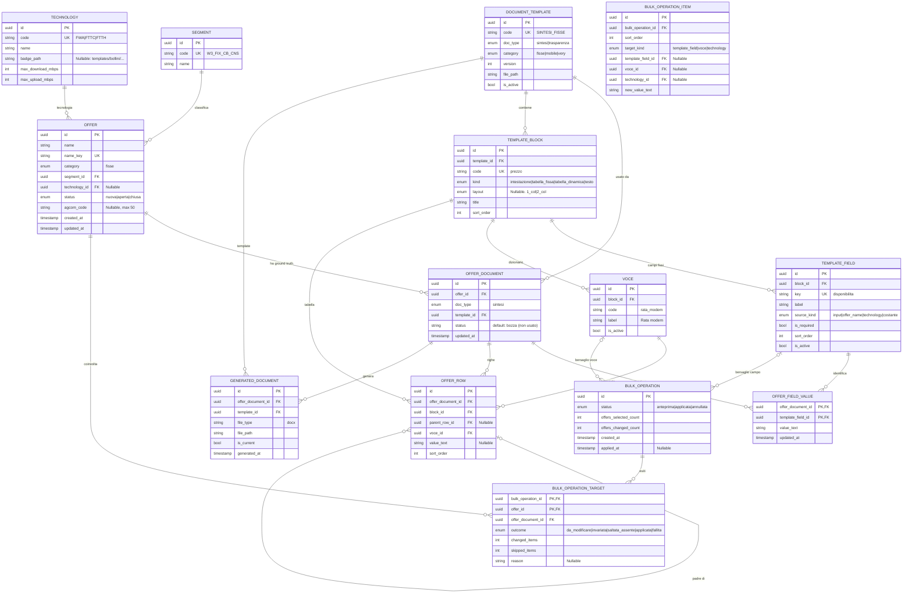

# Sintesi & Trasparenze — MVP Sintesi: documento di riferimento

**Versione:** 1.0 · **Data:** 10 ottobre 2026 · **Natura:** documento tecnico di
riferimento dell'**MVP implementato** (as-built).

**A chi è rivolto:** sviluppatori e colleghi che ricevono il pacchetto `mvp/`.
Rispetto ai documenti 01–04 (panoramica, funzionalità, modello dati, fuori
scope), questo documento raccoglie **decisioni, razionale, modello completo ed
esempio end-to-end** nello stile dei documenti di progettazione del progetto
(vedi `riferimenti/`).

**Fonte di verità:** il codice in `app/` e i test in `tests/` (78 test verdi).
Dove questo documento e i design in `riferimenti/` divergono, **vince questo
documento**: i design contengono parti ancora solo su carta (note, Trasparenza,
mappatura).

## 0. Come leggere — legenda

| Etichetta | Significato |
|---|---|
| **[IMPLEMENTATO]** | Esiste nel codice, coperto da test |
| **[IMPLEMENTATO PARZIALE]** | Esiste la parte essenziale; restano rifiniture |
| **[DECISO]** | Decisione dello sviluppatore/committente che ha guidato l'MVP |
| **[EREDITATO]** | Vincolo o requisito dei documenti di progetto |
| **[FUORI MVP]** | Non implementato, con motivo e piste (vedi approfondimenti in `04_FUORI_SCOPE_E_ROADMAP.md`) |
| **[APERTO]** | Non ancora deciso |

I riferimenti a file sono relativi a `mvp/` (es. `app/services/sintesi.py`).

---

## 1. Il progetto in una pagina

WINDTRE produce per ogni offerta due documenti regolamentari: la **Sintesi
Contrattuale** (Word, poi PDF) e la **Trasparenza Tariffaria** (Excel AGCOM). I
file vivono oggi sui PC del marketing; ogni modifica comune a più offerte è
rifatta a mano.

L'MVP è una web app per il marketing che copre **la Sintesi delle sole offerte
Fisse**:

1. **offerta** con nome univoco, segmento e tecnologia;
2. **compilazione** della Sintesi su un form generato dalle definizioni del
   template (campi fissi) e su tabelle a **righe variabili** con etichette prese
   da un **dizionario delle voci**;
3. **generazione del DOCX** dal template Word (`docxtpl`);
4. **modifiche massive** con anteprima, applicazione ed esito per offerta.

Numeri dell'as-built: **13 tabelle** nel database, **6 blocchi / 12 campi /
7 voci** nel seed del template Fisse, **78 test**, `ruff` e `mypy --strict`
puliti. Stack: Python 3.13, `uv`, FastAPI, SQLAlchemy 2.0, Pydantic v2, SQLite,
`docxtpl`, Jinja2.

Il percorso di lettura operativo (avvio, pagine) è in
`01_PANORAMICA_APPLICATIVO.md`; qui si racconta **il modello e il suo
razionale**.

---

## 2. Registro delle decisioni

Le decisioni sono numerate (`M`) e ognuna ha una **conseguenza diretta sul
modello o sull'esperienza**. Lo stato indica se è nell'MVP o no.

| # | Decisione | Conseguenza | Stato |
|---|---|---|---|
| **M1** | **Due ground truth indipendenti** per offerta: Sintesi e Trasparenza si compilano con form separati e possono divergere; il collegamento è futuro. | Nessun vincolo tra i due documenti; l'MVP implementa solo il documento Sintesi. | [DECISO] · [IMPLEMENTATO PARZIALE] (solo Sintesi) |
| **M2** | **Modifiche massive solo sulla Sintesi.** | La Trasparenza non avrà azioni massive; eventuali disallineamenti sono accettati. | [DECISO] · [IMPLEMENTATO] |
| **M3** | **Unità "offerta"**: una riga in `offers` con **nome univoco**; niente modello di punti prezzo o varianti. | L'offerta è anagrafica pura; i contenuti stanno nei documenti. | [DECISO] · [IMPLEMENTATO] |
| **M4** | **Tre categorie**: Fisse, Mobile, Very; un template per categoria. L'MVP copre **solo Fisse**. | `document_templates.category` esiste; il seed crea solo `SINTESI_FISSE`. | [DECISO] · [IMPLEMENTATO PARZIALE] |
| **M5** | **Sintesi = template Word con merge field**, riempito da `docxtpl`. | Il contratto tra DB e template sono chiavi stabili (`{{ campo.<key> }}`) e cicli per le tabelle. | [DECISO] · [IMPLEMENTATO] |
| **M6** | **Trasparenza = Excel a griglia fissa** (form separato, celle mappate). | Rimandata: richiede Vademecum e mappatura cella→campo. | [DECISO] · [FUORI MVP] |
| **M7** | Nelle **tabelle dinamiche** le etichette di padri/figli vengono da un **dizionario condiviso** (tendina + "Nuova voce"), con **nessuna voce obbligatoria**. | Ogni etichetta ha un'identità stabile: massive e (future) note possono riferirla. L'utente compone liberamente le righe. | [DECISO] · [IMPLEMENTATO] |
| **M8** | Il **layout** (`1_col`/`2_col`) è una proprietà del **blocco del template**, non una scelta dell'utente; il frontend lo rende in modo distinto. | `template_blocks.layout`; UI affiancata per 2 colonne, incolonnata per 1 colonna. | [DECISO] · [IMPLEMENTATO] |
| **M9** | La **creazione della Sintesi** avviene on the fly: tasto "Crea Sintesi" in elenco e **get-or-create all'apertura dell'editor**. | L'offerta nasce anche senza documento; l'editor non fallisce mai per documento assente. | [DECISO] · [IMPLEMENTATO] |
| **M10** | **Nuova offerta a form completo in una sola azione**: anagrafica + tutti i campi + tabelle, con un unico "Crea offerta". | `POST /api/offers` crea offerta, documento e valori nello stesso flusso; **validazione prima della creazione** (niente offerte orfane). | [DECISO] · [IMPLEMENTATO] |
| **M11** | I **campi derivati** (Nome Offerta, Velocità) si popolano da soli: live nel form nuova offerta, lato server nell'editor. | `source_kind` ≠ `input`; nessun valore salvato per i derivati. | [DECISO] · [IMPLEMENTATO] |
| **M12** | **Bootstrap automatico** all'avvio: schema + seed idempotente. | `uvicorn` da solo è sufficiente; `python -m app.seed` resta opzionale. | [DECISO] · [IMPLEMENTATO] |
| **M13** | Le **note** delle tabelle (statiche/dinamiche, con chip verso i valori) | Non implementate; il template di test è senza note. Il modello dati le accoglierà come tabella del catalogo. | [EREDITATO] · [FUORI MVP] |
| **M14** | **Storico minimo**: registro append-only di eventi e dettagli. | Rimosso per minimalità: le tabelle `change_events`/`change_items` (e la colonna `row_version`) erano scritte ma **mai lette**. Procedura di reintroduzione, con schema e punti di hook, in `04 §12`. | [RIMANDATO] · [RIMOSSO] |
| **M15** | **Ciclo di vita dell'offerta**: stati `NUOVA`/`APERTA`/`CHIUSA` e **codice AGCOM**, impostabili **liberamente** (in creazione e in editor); nessun vincolo automatico. Colonne su `offers` (non sul documento). | Tag colorati ovunque, chip AGCOM se presente; la coerenza stato↔codice è responsabilità dell'utente (requisiti non definitivi). | [DECISO] · [IMPLEMENTATO] |
| **M16** | **Tecnologia modificabile dall'editor**, salvata con "Applica Modifiche"; le velocità derivate si aggiornano. | `Offer.technology_id` aggiornabile; `_resolve_derived` le rilegge al volo. | [DECISO] · [IMPLEMENTATO] |
| **M17** | **Usabilità dell'editor**: **breadcrumb "← Offerte / nome"** in cima alle pagine di dettaglio; sezioni "Tabelle fisse" e "Tabelle dinamiche" speculari con divider e titoli più grandi; campi con etichetta a sinistra; **tabelle dinamiche** con rendering per layout (**2 colonne** affiancate con azioni a destra, **1 colonna** con voce sopra e valore+azioni sulla stessa riga), **barretta verticale che collega i figli al padre in entrambi i layout** (di colore contrastato, visibile anche in hover, termina prima del divider), **hover di riga simmetrico nei due layout** e **hover dei figli più corto** (righe compatti anche nei controlli e banda che parte dal bordo della barretta), spaziature da **variabili CSS condivise** e **divider in una riga separatore dedicata** tra i gruppi, **nessun header nelle tabelle dinamiche** (una tabella vuota mostra solo "Nessuna voce…"); layout come **hint secondario** in piccolo; barra sticky in fondo con "Applica Modifiche"/"Genera Sintesi (.docx)" (in creazione "Crea offerta"); **Genera bloccato finché ci sono modifiche non salvate**, con il motivo spiegato in barra e nel tooltip; nav evidenziata solo nella pagina giusta. | Il blocco della generazione è lato client; niente redirect forzati: si resta sulla pagina ai salvataggi e in creazione. | [DECISO] · [IMPLEMENTATO] |
| **M18** | **Feedback di compilazione**: errori **inline sul campo** (bordo rosso + messaggio e scroll sopra il campo); banner in cima solo per errori **senza campo** associato; indicazione "Modifiche non salvate" **arancione** nella barra; asterisco + legenda **solo per il Nome offerta** (i campi del template non sono imposti); chip **AGCOM nascosto se assente**. | Convenzioni di form best-practice; nessuna enforcement dei campi del template. | [DECISO] · [IMPLEMENTATO] |
| **M19** | **Uscita e conferme**: "**Ripristina**" e "**Applica Modifiche**" compaiono **solo con modifiche pendenti**; **Applica chiede conferma** con una modale e al termine **resta sulla pagina** con popup **verde** ("Modifiche applicate") o **rosso** in caso di errore; uscita/Ripristina con modifiche aperte tramite **modale dell'applicazione** (messaggi diversi per creazione e modifica); alla creazione si apre **l'editor della nuova offerta** con popup dal titolo verde "Offerta creata"; la card Dati offerta mostra la **data di ultima modifica in griglia** (con etichetta, separata dai tag di stato/AGCOM). | Niente dialoghi nativi del browser in nessun flusso dell'app. | [DECISO] · [IMPLEMENTATO] |
| **M20** | **Regola fissa — popup e bozza**: **mai popup nativi**; "Nuova voce" e tutte le conferme usano le modali dell'app; gli errori di duplicato restano **dentro la modale di creazione voce** (che non si chiude, per correggere subito il nome); le modifiche non salvate sono copiate in una **bozza locale** (`localStorage`): su reload/riapertura dell'URL una modale propone "Riprendi le modifiche"/"Scarta" (niente perdita di lavoro). Le **voci sono univoche per tabella senza distinzione di maiuscole/minuscole** ("MODEM" = "Modem"): duplicato → errore. | Regola di prodotto vincolante per tutta l'app. | [REGOLA] · [IMPLEMENTATO] |
| **M21** | **Palette bottoni uniforme**: **primario** arancione pieno (una sola azione primaria per vista); **neutro** grigio; **distruttivo** rosso pieno per le conferme nelle modali e **rosso outline/ghost** per le azioni distruttive discrete ("×" rimozione riga, "Ripristina/Scarta" toolbar e ripristino bozza). | Il distruttivo è sempre riconoscibile e il primario non viene confuso con azioni che perdono dati. | [DECISO] · [IMPLEMENTATO] |
| **M22** | **Eliminazione offerta** dalla lista: hard delete con conferma in **modale dell'app** (mai nativi); rimuove documenti, valori, righe, registrazioni dei file e **file DOCX dal disco**, più i target delle massive; **il nome torna disponibile**. | Azione irreversibile ben segnalata; niente soft delete nell'MVP. | [DECISO] · [IMPLEMENTATO] |
| **M23** | **Bollino della tecnologia nel DOCX**: ogni tecnologia ha `badge_path` (seed: FWA fibra-radio giallo, FTTC fibra-rame giallo, FTTH verde); in generazione il bollino è iniettato come **immagine** (`InlineImage`, dimensione fissa **0,53 × 0,53 cm**: la riga resta quella del template) **inline dopo il valore di "Servizi"**. Lo stesso bollino è mostrato **in UI** (colonna "Tecnologia" in lista, accanto alla select nell'editor) tramite `GET /technologies/{id}/badge`. | Tecnologia senza bollino → cella normale; il testo alternativo/accessibilità resta [APERTO]. | [DECISO] · [IMPLEMENTATO] |
| **M24** | **Duplicazione offerta** dalla lista: modale con **nuovo nome obbligatorio e unico** (case-insensitive, controllo client+server); la copia porta anagrafica e **tutta la Sintesi** (valori e righe padre/figlio) e **nasce `NUOVA`, senza codice AGCOM e senza file generati**. | Copia indipendente dalla sorgente; i file DOCX restano solo sull'originale. | [DECISO] · [IMPLEMENTATO] |
| **M25** | **Governo delle Sintesi generate**: generazione **idempotente** (se la corrente è più recente dell'ultima modifica → `200` "già aggiornata", con opzione `force` per rigenerare comunque) e card **"Sintesi generata"** con **corrente** (badge verde "Aggiornata" / arancione "Superata" + avviso) e **storico versioni** collassato; la barra ricorda quando la Sintesi è superata. | Niente duplicati inutili; l'utente vede sempre quale file è valido e cosa è cambiato dopo. | [DECISO] · [IMPLEMENTATO] |
| **M26** | **Massiva multi-campo**: pagina `/bulk` con **due box** (selezione **Offerte** e **Cosa modificare**), il secondo con gruppi **"Tabelle fisse"** (tecnologia, campi fissi, **velocità derivate popolate scegliendo la tecnologia**) e **"Tabelle dinamiche"** separati da un divider; **compila solo ciò che vuoi cambiare** (vuoto = non toccare); le voci si aggiornano **dove esistono** e vengono **saltate** dove mancano (nessuna creazione in v1); modello a **item** (`bulk_operation_items`) ed esiti per offerta con **riepilogo** (dettaglio per item nell'API, non in UI); **Applica chiede conferma**, mostra uno **spinner** se lento e una modale di esito **senza conteggi**, restando in pagina; ogni modifica dopo l'anteprima **la resetta**. | Sostituisce la massiva a bersaglio singolo con "crea se manca"/padre di contesto (rimossi). | [DECISO] · [IMPLEMENTATO] |

### 2.1 Le tre decisioni che spiegano tutto il resto

**M7 — l'identità vive nel dizionario, non nel documento.** È la risposta al
problema "come referenzio un campo che non ha schema?". Se ogni offerta potesse
scrivere etichette libere, "la stessa voce" in due offerte sarebbe
indimostrabile e le massive diventerebbero euristiche. Il dizionario registra
l'etichetta **una volta**: da lì in poi quella voce è la stessa ovunque.

**M1+M2 — libertà di divergere, ma niente massive sulla Trasparenza.** I due
documenti hanno cicli di vita diversi e l'utente può scrivere le stesse
informazioni in modi diversi (`24,0` in Sintesi, `24 mesi` in Trasparenza). È un
costo accettato in cambio di semplicità; il collegamento futuro sarà una
mappatura tra identità stabili.

**M8+M11 — tutto ciò che è ripetitivo si deriva o si rende per layout.** Il
layout è nel blocco (una volta); velocità e nome offerta si derivano (non si
salvano). Meno dati da inserire significa meno occasioni di errore e massive
più piccole.

---

## 3. Il problema centrale e la soluzione

### 3.1 Il problema

Una tabella della Sintesi (es. Prezzo, Costi) ha **righe variabili da offerta a
offerta**: in alcune c'è "Costo SIM", in altre no; le etichette possono essere
scritte diversamente; l'ordine cambia. Per una **modifica massiva** ("porta la
Rata modem a 2 euro su tutte le offerte Fisse CB") bisogna **riconoscere che la
riga è la stessa voce** in offerte diverse. Con le tabelle salvate come JSON
senza schema questo è impossibile: "voce assente" e "voce scritta diversamente"
sono indistinguibili e ogni confronto è una scommessa.

### 3.2 La soluzione: dizionario + righe relazionali

L'MVP adotta due scelte complementari:

1. **Il dizionario (`voci`)** registra ogni etichetta una volta per blocco
   dinamico. L'utente sceglie dalla tendina o crea con "Nuova voce" in una
   modale dell'app (API: `201` se nuova; se il nome esiste già, anche con
   maiuscole diverse, `422` con messaggio). La voce ha un `code` stabile (slug
   univoco nel blocco) e una `label` visibile.
2. **Le righe (`offer_rows`)** non sono JSON: ogni riga è un record con
   `parent_row_id` (nullo = padre), `voce_id`, `value_text` (facoltativo) e
   `sort_order`. L'assenza di riga significa **voce non presente**; `ND` è una
   stringa come le altre.

La proiezione per il documento è quindi: catalogo (blocchi, campi, voci) +
valori dell'offerta. Niente da tenere allineato a mano.

### 3.3 Cosa diventa possibile (e cosa no)

| Operazione | Come funziona |
|---|---|
| Massiva multi-campo | Si compilano solo i valori da cambiare (campi fissi e voci del dizionario), si scelgono le offerte: i campi vuoti non vengono toccati |
| Massiva su una voce | Un item voce: `UPDATE` delle righe esistenti con quel `voce_id` in ogni offerta; le voci assenti vengono saltate |
| Campo fisso vuoto | Il campo è sempre nel template: al primo valore scritto la riga `offer_field_values` viene creata |
| Esito certo per offerta | `da_modificare` / `invariata` (stringa identica) / `saltata_assente` (nessun item applicabile), con dettaglio per item |
| Note future | I chip punteranno alle voci; la propagazione sarà automatica perché la nota non copia il valore |

Limiti dichiarati: il confronto è per **stringa esatta** (`10 euro` ≠ `10 €`);
le etichette sono globali per blocco (una rinomina vale per tutti); i valori
liberi e i testi non sono referenziabili.

---

## 4. Modello concettuale

Le entità del dominio e le loro relazioni:

| Concetto | Descrizione | Dove vive |
|---|---|---|
| **Segmento** | Gruppo di marketing (qui: i 4 Fisse) | `segments` |
| **Tecnologia** | Rete con velocità massime; determina i derivati velocità | `technologies` |
| **Offerta** | Riga con **nome univoco** (`name_key`), categoria, segmento, tecnologia | `offers` |
| **Documento** | Un **ground truth** dell'offerta: oggi `SINTESI`, domani `TRASPARENZA` | `offer_documents` |
| **Template** | File Word/Excel con versione, per categoria | `document_templates` |
| **Blocco** | Unità del template: intestazione, tabella fissa, **tabella dinamica**, testo; porta il layout | `template_blocks` |
| **Campo fisso** | Slot dichiarato dal template con chiave stabile; alimenta un merge field | `template_fields` |
| **Voce** | Etichetta del dizionario delle tabelle dinamiche, con identità stabile | `voci` |
| **Valore fisso** | Testo inserito per un campo, per documento | `offer_field_values` |
| **Riga dinamica** | Padre o figlio: voce + valore facoltativo, in ordine | `offer_rows` |
| **Operazione massiva** | Valori da applicare (lista di campi/voci), selezione offerte, esiti per offerta | `bulk_operations` + `items` + targets |
| **Documento generato** | File immutabile prodotto da una generazione | `generated_documents` |

### 4.1 Padre, figlio, valore (chiarimento di terminologia)

- **Padre** = riga di primo livello (di norma in grassetto nel documento);
  può avere valore proprio e/o figli.
- **Figlio** = riga sotto un padre: è una **sottovoce** con etichetta e valore
  facoltativo. Un valore **non** è un figlio: il figlio è definito dalla
  posizione.
- **Valore** = attributo facoltativo di una riga (o di un campo fisso).

Nelle tabelle a **1 colonna** (Costi) le righe si stampano incolonnate
(etichetta sopra, valore sotto); nelle **2 colonne** (Prezzo) affiancate. Il
modello dei dati è identico. **Nell'editor le due tabelle si presentano in modo
uniforme**: il layout incide solo sul documento generato ed è mostrato come
hint secondario accanto al titolo.

### 4.2 Fissi, dinamici e derivati

| Tipo | Chi li definisce | Presenza | Esempio |
|---|---|---|---|
| **Campi fissi** | Il template (`template_fields`) | Sempre nel form; valore o vuoto | Disponibilità, Servizi, Durata |
| **Voci dinamiche** | Il dizionario (`voci`) | L'utente sceglie se e quali inserire | Costo SIM, Rata modem |
| **Derivati** | Il sistema | Mai inseriti: risolti da offerta/tecnologia | Nome Offerta, Velocità download/upload, Bollino |

---

## 5. Modello dati fisico

### 5.1 ER completo (attributi principali)



### 5.2 Dizionario delle tabelle

Tutte le tabelle seguono le stesse convenzioni: PK `uuid` generata
dall'applicazione, enum salvati come `VARCHAR` (`native_enum=False`),
timestamp timezone-aware con default UTC.

| Tabella | Ruolo | Note di integrità |
|---|---|---|
| `segments` | Segmenti di marketing | `code` univoco |
| `technologies` | Tecnologie con velocità e bollino | `code` univoco; `badge_path` può essere nullo |
| `document_templates` | Template per categoria e tipo | `code` univoco; `file_path` relativo al progetto |
| `template_blocks` | Blocchi del template | `code` univoco; `layout` valorizzato solo per le dinamiche |
| `template_fields` | Campi fissi | `key` univoca: contratto con i merge field |
| `voci` | Dizionario delle voci | univoci `(block_id, code)` e `(block_id, label)` |
| `offers` | Offerte | `name_key` univoco (nome normalizzato); `status`+`agcom_code` per il ciclo di vita |
| `offer_documents` | Ground truth | univoco `(offer_id, doc_type)` |
| `offer_field_values` | Valori fissi | PK composta `(documento, campo)`; riga assente = campo vuoto |
| `offer_rows` | Righe dinamiche | `parent_row_id` nullo = padre; due livelli al massimo (regola applicativa) |
| `bulk_operations` | Operazioni massive multi-campo | `status` guida il ciclo anteprima→applicata |
| `bulk_operation_items` | Valori da applicare | uno per campo/voce, con `sort_order` |
| `bulk_operation_targets` | Esiti per offerta | PK composta `(operazione, offerta)`; `changed_items`/`skipped_items` |
| `generated_documents` | File prodotti | `is_current` per tipo; file mai sovrascritti |

### 5.3 Enumerazioni

| Enum | Valori | Uso |
|---|---|---|
| `Category` | `fisse`, `mobile`, `very` | offerte e template |
| `OfferStatus` | `nuova`, `aperta`, `chiusa` | ciclo di vita offerta |
| `DocType` | `sintesi`, `trasparenza` | documenti |
| `BlockKind` | `intestazione`, `tabella_fissa`, `tabella_dinamica`, `testo` | blocchi |
| `Layout` | `1_col`, `2_col` | rendering tabelle |
| `SourceKind` | `input`, `offer_name`, `technology`, `costante` | campi fissi |
| `Outcome` | `da_modificare`, `invariata`, `saltata_assente`, `applicata`, `fallita` | esiti massiva |
| `BulkTargetKind` | `template_field`, `voce`, `technology` | tipo item |
| `BulkStatus` | `anteprima`, `applicata`, `annullata` | stato operazione |

### 5.4 Il seed iniziale

Il seed (in `app/services/seed.py`) è **idempotente** e viene applicato a ogni
avvio. Contiene:

**Segmenti** (4): `W3_FIX_GA_CNS`, `W3_FIX_CB_CNS`, `W3_FIX_GA_MB`,
`W3_FIX_CB_MB`.
**Tecnologie** (3): FWA Indoor (300/50, bollino fibra-radio giallo), FTTC
(200/20, fibra-rame giallo), FTTH (1000/100, fibra verde).

**Template `SINTESI_FISSE` v1** → `templates/word/sintesi_fisse_template.docx`.

| Blocco | kind | layout | Campi (`key`) |
|---|---|---|---|
| `intestazione` | intestazione | — | `nome_offerta` (derivato), `disponibilita` |
| `servizi` | tabella fissa | — | `servizi`, `traffico_internet`, `traffico_fonia`, `apparecchiature` |
| `velocita` | tabella fissa | — | `velocita_download`, `velocita_upload` (derivati) |
| `durata` | tabella fissa | — | `durata_minima`, `rinnovo`, `risoluzione_anticipata`, `sblocco_apparato` |
| `prezzo` | tabella dinamica | `2_col` | *(voci dal dizionario)* |
| `costi` | tabella dinamica | `1_col` | *(voci dal dizionario)* |

**Voci**: Prezzo → Costo mensile, Per i già clienti, Costo SIM, Rata modem;
Costi → Costo di attivazione, Modem, Costo di disattivazione.

---

## 6. Il template Word: il contratto

`templates/word/sintesi_fisse_template.docx` è costruito con `docxtpl` e
definisce il legame tra catalogo e documento:

| Elemento | Sintassi | Note |
|---|---|---|
| Campo fisso | `{{ campo.<key> }}` | es. `{{ campo.disponibilita }}` |
| Ciclo tabella 2 colonne | riga con `` … riga `` | la riga-ciclo contiene `{{r r.etichetta }}` e `{{ r.valore }}`; le righe dei soli tag vengono rimosse |
| Ciclo tabella 1 colonna | `` … `` | la riga-ciclo contiene `{{r r.testo }}` |
| Grassetto dei padri | `{{r <var> }}` con `RichText(..., bold=True)` | la `r` è obbligatoria per le variabili formattate |

**Regola d'oro del renderer:** il servizio di generazione **appiattisce**
l'albero padre→figli nell'ordine di stampa e decide per ogni riga il testo e lo
stile (padre grassetto, figlio normale). Per le tabelle a 1 colonna ogni riga
diventa una o due righe fisiche (etichetta, poi valore se presente); per le 2
colonne una riga fisica con due celle.

Conseguenze pratiche:

- aggiungere un campo fisso = una riga in `template_fields` + il merge field
  nel file Word;
- aggiungere una voce = "Nuova voce" nel form (o una riga nel seed): **nessuna
  modifica al database o al template**;
- aggiungere una tabella = nuovo blocco + ciclo nel template.

---

## 7. Esempio end-to-end

**Scenario.** Segmento Fisso CB Consumer. L'utente crea l'offerta
"SUPER Internet Casa 5G" (tecnologia FWA): nasce in stato **`NUOVA`**. Poi
compila tutta la Sintesi; genera il DOCX e applica una modifica massiva alla
voce "Rata modem".

### 7.1 Creazione (una sola azione, `POST /api/offers`)

Payload concettuale:

```json
{
  "name": "SUPER Internet Casa 5G",
  "segment_id": "<W3_FIX_CB_CNS>",
  "technology_id": "<FWA>",
  "fixed": {
    "disponibilita": "15-01-2025",
    "servizi": "Fisso, fonia e Internet in tecnologia FWA 5G",
    "traffico_internet": "Illimitato",
    "traffico_fonia": "Illimitato",
    "apparecchiature": "Modem e Antenna in vendita abbinata",
    "durata_minima": "24 mesi",
    "rinnovo": "Rinnovo automatico ogni mese",
    "risoluzione_anticipata": "In caso di recesso si applicano le condizioni contrattuali",
    "sblocco_apparato": "Non applicabile"
  },
  "rows": [
    {"block": "prezzo", "local_id": "p1", "voce_id": "<Costo mensile>", "value": ""},
    {"block": "prezzo", "local_id": "p2", "parent_local_id": "p1",
     "voce_id": "<Costo canone del servizio>", "value": "27,99 euro"},
    {"block": "costi", "local_id": "c1", "voce_id": "<Costo di attivazione>", "value": ""},
    {"block": "costi", "local_id": "c2", "voce_id": "<Modem>",
     "value": "5,99 euro al mese per 48 mesi"}
  ]
}
```

Il server **valida prima di creare** (campi/voci di un altro template, livelli
incoerenti, ecc. → errore, nessuna riga scritta), poi crea offerta, documento
Sintesi e valori, e risponde `201 {"id": ...}`; il form apre l'editor della
nuova offerta con un popup di conferma ("Offerta creata").

### 7.2 Compilazione "voci" e "Nuova voce"

Nell'editor l'utente può arricchire le tabelle:

1. su **Costi** preme "Nuova voce…", scrive `Già clienti`: l'app chiama
   `POST /api/voci`, la voce entra nel dizionario (codice `gia_clienti`) e
   diventa disponibile per **tutte** le offerte. Stessa cosa per
   `Nuovi clienti`.
2. aggiunge i due figli sotto il padre "Costo di attivazione" con valori `ND`
   e `5 euro`;
3. su **Prezzo** crea la voce `Rata antenna` e la aggiunge come figlio di
   "Costo mensile" con valore `9,99 euro`.

### 7.3 Salvataggio (`PUT /api/offers/{id}/sintesi`)

- i valori fissi vengono scritti in `offer_field_values` (9 righe);
- le righe dinamiche vengono sostituite integralmente in `offer_rows`
  (7 righe: 3 in Prezzo, 4 in Costi — vedi Appendice A);
- tecnologia, stato e codice AGCOM vengono salvati **come impostati**
  (nessun vincolo automatico; l'utente può anche mettere un codice senza
  cambiare lo stato);
- `updated_at` di offerta e documento vengono aggiornati.
- Al successo **si resta sull'offerta** con un popup verde ("Modifiche
  applicate"); in errore il popup è rosso. Il pulsante "Applica Modifiche"
  (editor) o "Crea offerta" (form nuovo) chiede conferma prima di salvare.

### 7.4 Generazione del DOCX

`POST /api/offers/{id}/generate` costruisce il contesto:

- `campo.nome_offerta` = `SUPER Internet Casa 5G` (derivato);
- `campo.velocita_download` = `300,00 Mbps in Download` (derivato da FWA);
- `prezzo.righe` = [padre "Costo mensile" (grassetto), figlio "Costo canone
  del servizio" | 27,99 euro, figlio "Rata antenna" | 9,99 euro];
- `costi.righe` = vista incolonnata: "Costo di attivazione", "Già clienti",
  "ND", "Nuovi clienti", "5 euro", "Modem", "5,99 euro al mese per 48 mesi".

Il file viene salvato in `data/generated/` (nome
`SUPER_Internet_Casa_5G_sintesi_<timestamp>.docx`) e registrato in
`generated_documents` (`is_current = true`). Le generazioni precedenti restano,
con `is_current = false`.

### 7.5 Modifica massiva multi-campo

Nella pagina `/bulk` l'utente compila **solo i valori da cambiare** (es. campo
fisso *Durata minima* = `24 mesi` e voce *Rata modem* = `2 euro`) e seleziona 4
offerte. L'anteprima mostra, per ogni offerta, l'esito aggregato e il
riepilogo (il dettaglio per item è calcolato e disponibile nell'API, ma non
mostrato in UI in questa versione):

| Offerta | Durata minima | Rata modem | Esito anteprima |
|---|---|---|---|
| A | vuota | `3 euro` | **da_modificare** (2 item: campo compilato + voce aggiornata) |
| B | `24 mesi` | `2 euro` | **invariata** (tutto già uguale) |
| C | vuota | assente | **da_modificare** (1 item: solo il campo; la voce viene saltata) |
| D | vuota | assente | **saltata_assente** (nessun item applicabile: la voce manca) |

Alla conferma, in una transazione: i valori dei campi fissi vengono
creati/aggiornati, le righe delle voci esistenti aggiornate (le voci assenti
restano invariate, nessuna riga creata), i timestamp delle offerte cambiate
aggiornati, operazione `APPLICATA`. I conteggi riportano offerte
modificate/inviariate/saltate, valori modificati e voci saltate.

### 7.6 Effetti

| Dove | Cosa si vede |
|---|---|
| `offer_rows` | Valori aggiornati/creati secondo l'esito |
| `bulk_operations` + items + targets | Conteggi, valori applicati e esito per offerta |
| `generated_documents` | I DOCX precedenti risultano superati (da rigenerare se si vuole il testo aggiornato) |

*(Lo storico delle modifiche non esiste nell'MVP: rimosso per minimalità, vedi
`04 §12`.)*

---

## 8. Pagine e API

| Metodo | Percorso | Tipo | Scopo |
|---|---|---|---|
| GET | `/` | pagina | Elenco offerte ("Apri" / "Crea Sintesi") |
| GET | `/offers/new` | pagina | Form completo nuova offerta |
| POST | `/offers` | form | Creazione legacy minimale (compatibilità) |
| POST | `/offers/{id}/sintesi` | pagina | "Crea Sintesi" on the fly → editor |
| GET | `/offers/{id}` | pagina | Editor Sintesi (get-or-create del documento) |
| POST | `/api/offers` | JSON | Creazione completa (201) |
| PUT | `/api/offers/{id}/sintesi` | JSON | Salvataggio Sintesi + tecnologia/stato/AGCOM |
| POST | `/api/offers/{id}/generate` | JSON | Generazione DOCX (201) |
| GET | `/documents/{id}/download` | file | Download DOCX |
| POST | `/api/voci` | JSON | Crea/recupera voce (201/200) |
| GET | `/bulk` | pagina | Modifica massiva |
| POST | `/api/bulk/preview` | JSON | Anteprima (persiste l'operazione) |
| POST | `/api/bulk/{id}/apply` | JSON | Applica la massiva |

Mappatura errori: `DomainNotFoundError` → 404, `DomainValidationError` → 422,
`GenerationError` → 500; il form legacy sul nome duplicato risponde 400 con
messaggio in pagina.

---

## 9. Storico: rimandato per minimalità

Nell'MVP **non esiste storico**: le tabelle `change_events`/`change_items` e la
colonna `row_version` sono state eliminate perché scritte a ogni operazione ma
**mai lette** da pagine o API. Restano due forme di tracciamento funzionanti:

- la **lista dei file generati** (`generated_documents`, file immutabili,
  `is_current` per tipo);
- gli **esiti per offerta delle massive** (`bulk_operation_targets`, con i
  conteggi per item e il motivo).

Lo scopo futuro del registro "chi ha fatto cosa" (timeline per offerta, base per
annullamento massive e conflitti) e la **procedura di reintroduzione** — schema
delle tabelle rimosse, punti di hook nei servizi, `If-Match` per i conflitti —
sono nel documento `04_FUORI_SCOPE_E_ROADMAP.md`, §12.

---

## 10. Copertura e limiti dell'MVP

Sintesi dei limiti (dettaglio e piste in `04_FUORI_SCOPE_E_ROADMAP.md`):

| Area | Stato |
|---|---|
| Trasparenza (form + Excel) | [FUORI MVP] |
| Note statiche/dinamiche con chip | [FUORI MVP] |
| PDF / PDF-UA / regole Adobe | [FUORI MVP] |
| Ciclo AGCOM: stati + codice | [IMPLEMENTATO PARZIALE] (transizioni automatiche; restano "4 file", blocco modifiche, PDF) |
| Autenticazione e permessi per segmento | [FUORI MVP] |
| Categorie Mobile, Very, Etnico | [FUORI MVP] |
| Massive: multi-campo (M26) | [IMPLEMENTATO] (aggiornamento di campi e voci esistenti) |
| Creazione/rimozione righe in massiva (ex "crea se manca"/padre di contesto) | [FUORI MVP] |
| Massive avanzate (annulla, conflitti, cluster) | [FUORI MVP] |
| Storico minimo (`change_events`/`change_items`, `row_version`) | [RIMANDATO] (rimosso per minimalità; procedura in `04 §12`) |
| Alias tra voci, valori ricorrenti, disattivazione da UI | [FUORI MVP] |
| ND → "Non applicabile" e regola "riga vuota non compare" | [FUORI MVP] (i valori vengono stampati così come scritti) |
| Migrazioni schema, Postgres/Spanner, GCS, CI/CD | [FUORI MVP] |

---

## 11. Punti aperti

| # | Punto | Nota |
|---|---|---|
| A1 | **Seed delle voci inventato** | Va sostituito con il censimento reale delle Sintesi Fisse |
| A2 | **Regole ND / riga senza valore** | Da implementare in generazione (oggi il valore vuoto stampa cella vuota, `ND` resta `ND`) |
| A3 | **Policy delle note** | Chip irrisolti: blocco della generazione o nota condizionata? |
| A4 | **Conflitti tra massiva e modifiche concorrenti** | `row_version` è stata rimossa con lo storico; da reintrodurre insieme al controllo (vedi `04 §12`) |
| A5 | **Etichette globali** | Una rinomina vale per tutte le offerte del blocco; `label_override` per offerta è un'estensione |
| A6 | **Unicità dei nomi** | Con l'eliminazione reale il nome torna disponibile; il soft delete resta [FUORI MVP] |
| A7 | **Duplicazione offerte** | Implementata (M24): copia anagrafica e Sintesi, la copia nasce `NUOVA` e senza codice AGCOM |
| A8 | **Test JS in browser** | Oggi solo smoke su DOM simulato |

---

## 12. Mappa decisione → implementazione

| Decisione | Dove vive nel codice/database |
|---|---|
| M1 due ground truth | `offer_documents.doc_type`; nel seed solo `sintesi` |
| M2 massive solo Sintesi | `bulk.py` filtra i documenti Sintesi; API solo su `/api/bulk` |
| M3 offerta = nome univoco | `offers.name_key`; `offer.py:normalize_name` |
| M4 categorie / solo Fisse | `document_templates.category`, seed |
| M5 template + merge field | `generation.py` (`DocxTemplate`, `build_context`) |
| M6 Trasparenza | *(non implementata)* |
| M7 dizionario + nessun obbligo | `voci`, `offer_rows`, `voce.py`, `sintesi.py` |
| M8 layout 1/2 colonne | `template_blocks.layout`, `static/editor.css`, `editor.js` |
| M9 creazione on the fly | `offer.py:create_sintesi_document`, `pages.py:offer_detail` |
| M10 form completo | `schemas.OfferCreateFull`, `sintesi.create_offer_with_sintesi`, `offer_new.html` |
| M11 derivati | `sintesi._resolve_derived`, `editor.js:refreshDerivedFields` |
| M12 bootstrap | `bootstrap.py`, `main.py:lifespan` |
| M13 note | *(non implementate)* |
| M14 storico | *(rimandato; rimozione e procedura di reintroduzione in `04 §12`)* |
| M15 stato e codice AGCOM | `offers.status`/`agcom_code`, `sintesi._apply_offer_metadata`, accepted in `OfferCreate`, tag in `offers_list.html`/`offer_detail.html`/`offer_new.html` |
| M16 tecnologia modificabile | `sintesi._validate_metadata`, select in `offer_detail.html`, `editor.js:refreshDerivedFields` |
| M17 usabilità editor | `offer_detail.html`/`offer_new.html`, `editor.css` (`.table-section`, `.save-bar`), `editor.js` (dirty tracking) |
| M18 feedback di compilazione | `base.html` (`[hidden]`, `.error-banner`, `.req`), `editor.js` (`showError`/`clearError`/`updateEmptyState`), `dependencies.asset_url` (cache-busting) |
| M19 uscita e conferme | `editor.js` (`buildConfirmModal`, `openInfo`, interceptor dei link, `#discard-btn`, flag `?created=1`), `editor.css` (`.modal-overlay`) |
| M20 popup/bozza/voci | `editor.js` (`openPrompt`, bozza `localStorage` + `maybeRestoreDraft`), `voce.create_voce` (unicità case-insensitive), `VoceAlreadyExistsError` |
| M21 palette bottoni | `base.html` (`.btn`, `.btn.secondary`, `.btn.danger`, `.btn.danger-ghost`), classi nei template e in `editor.js` |
| M22 eliminazione offerta | `offer.delete_offer` (cascata + file su disco), `DELETE /api/offers/{id}`, `offers_list.js` + `modal.js` (modale condiviso) |
| M23 bollino tecnologia | `Technology.badge_path` + seed, `generation.build_context`/`render_sintesi` (`InlineImage`), `templates/bollini/`, placeholder nel template Word |
| M24 duplicazione offerta | `offer.duplicate_offer` (copia Sintesi con remap padre/figlio), `POST /api/offers/{id}/duplicate`, `offers_list.js` (modale con nome) |
| M25 governo sintesi generate | `generation.render_sintesi` (skip + `force`, confronto `generated_at`/`updated_at`), `pages.py` (corrente/storico/superata), card in `offer_detail.html`, `editor.js` (`SINTESI_STALE`, modale "già aggiornata") |
| M26 massiva multi-campo | `bulk.py` (items + esiti per item), `BulkRequest`/`BulkItemIn`, `bulk.html` (form editor-like + anteprima dettagliata), `bulk_operation_items` |

---

## Appendice A — Stato del database dopo l'esempio (§7)

`offers` (1 riga): `SUPER Internet Casa 5G` · fisse · W3_FIX_CB_CNS · FWA ·
stato `NUOVA` · senza codice AGCOM.

`offer_documents` (1 riga): tipo `sintesi` · template `SINTESI_FISSE`.

`offer_field_values` (9 righe): `disponibilita`, `servizi`,
`traffico_internet`, `traffico_fonia`, `apparecchiature`, `durata_minima`,
`rinnovo`, `risoluzione_anticipata`, `sblocco_apparato`.
*(Niente righe per `nome_offerta`/`velocita_*`: sono derivati.)*

`offer_rows` (7 righe):

| blocco | voce | padre di | valore | sort |
|---|---|---|---|---|
| prezzo | Costo mensile | — | *(vuoto)* | 0 |
| prezzo | Costo canone del servizio | Costo mensile | `27,99 euro` | 1 |
| prezzo | Rata antenna | Costo mensile | `9,99 euro` | 2 |
| costi | Costo di attivazione | — | *(vuoto)* | 3 |
| costi | Già clienti | Costo di attivazione | `ND` | 4 |
| costi | Nuovi clienti | Costo di attivazione | `5 euro` | 5 |
| costi | Modem | — | `5,99 euro al mese per 48 mesi` | 6 |

Le voci "Già clienti" e "Nuovi clienti" (create con "Nuova voce") vivono in
`voci` con il blocco Costi e sono disponibili per tutte le offerte.

`generated_documents` (1 riga, `is_current = true`).

---

## Appendice B — Glossario

- **Ground truth**: l'insieme di dati che fa fede per un documento (Sintesi o
  Trasparenza), indipendente dall'altro.
- **Voce**: etichetta del dizionario di una tabella dinamica; ha identità
  stabile (`code`) e etichetta visibile (`label`).
- **Riga dinamica**: padre o figlio in `offer_rows`; assenza = voce non
  presente.
- **Derivato**: campo non salvato, risolto da offerta o tecnologia
  (Nome Offerta, Velocità).
- **Render context**: struttura costruita alla generazione e passata al
  template (`campo`, `prezzo.righe`, `costi.righe`).
- **Massiva**: operazione su un campo o una voce applicata a più offerte, con
  anteprima ed esito per offerta.
- **Stato offerta**: `NUOVA`/`APERTA`/`CHIUSA`; impostato **liberamente**
  dall'utente (default `NUOVA` alla creazione); il codice AGCOM è informativo e
  non lo modifica.
- **Bootstrap**: creazione di schema e definizioni all'avvio dell'app.
- **ND**: valore convenzionale "non applicabile"; nell'MVP è una stringa come
  le altre (la traduzione AGCOM è prevista in fase 2).
- **Bollino**: immagine associata alla tecnologia (FWA fibra-radio giallo,
  FTTC fibra-rame giallo, FTTH fibra verde), iniettata inline dopo il valore
  di "Servizi" nel DOCX generato.
